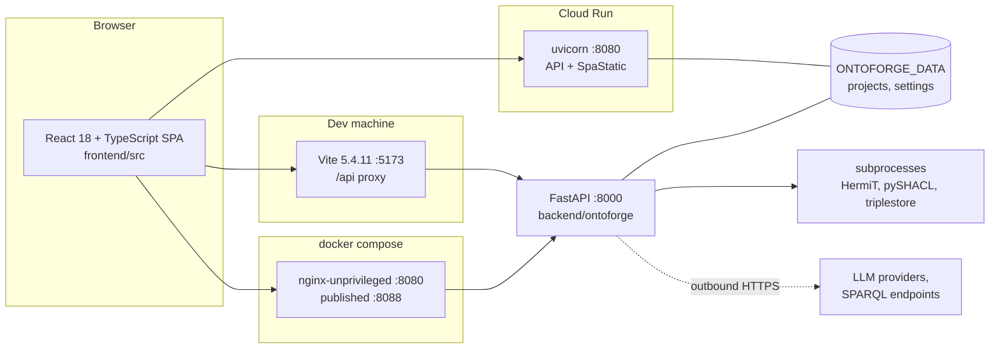

# 01. Overview and getting started in development {#vue-ensemble-demarrage}

The repository folders, how the pieces fit together, and the commands to run, test and rebuild OntoForge in development. Each subsystem is detailed in the following chapters. The architecture guide (`docs/guide/architecture.en.md`) describes the module catalogue; this manual describes the code. Back to the [index](README.en.md).

State verified on 23 November 2026, branch `lot/L51`.

## 1. What OntoForge does {#role}

In OntoForge you design an OWL 2 / SHACL ontology, check its W3C conformance, then transpose it into a property graph model (Curiosity first, Neo4j second). A human arbitrates whatever gets lost. Technically: a Python backend (FastAPI) that carries all the semantics, a React front end (TypeScript, Vite) that recomputes none of it, and generation code (C#, Cypher, GraphQL) produced as text.

## 2. Overview {#vue-d-ensemble}



Three ways to serve the front end: Vite in development, nginx in `docker compose`, uvicorn alone in production (chapter 02 §4.7, chapter 17).

## 3. Directory layout {#arborescence}

| Folder | Content |
|---|---|
| `backend/ontoforge/` | the Python application: `main.py` (assembly), `api/` (routers), `core/` (normative pydantic models), `io/`, `conformance/`, `shacl/`, `mapping/` (engine and rules), `targets/` (generators), `queries/`, `assistant/`, `localstore/`, `auth/`, `collab/`, `settings/`, `localize/`, `projects/`, `editing/`, `importers/`, `businessmap/`, `standards/` |
| `backend/tests/` | 75 `test_*.py` files, 1607 tests collected on 23/11 (chapter 18) |
| `backend/pyproject.toml`, `backend/constraints.txt`, `backend/Dockerfile` | dependencies (exact versions), development / `docker compose` image |
| `frontend/src/` | React application (chapter 15); `frontend/tests/`: Node tests of the safe Markdown renderer |
| `frontend/package.json`, `frontend/package-lock.json`, `frontend/vite.config.ts`, `frontend/nginx.conf`, `frontend/security-headers.conf`, `frontend/Dockerfile` | build, proxy, local server (chapter 17) |
| `samples/` | example ontologies `automaint` and `trap` (the transposition oracle) |
| `docs/` | `guide/` (user documentation, embedded in the app), `dev/` (this manual, never embedded), `ARCHITECTURE.md`, `CONTRACTS.md`, `RULES.md`, `PLAN.md`, `veille/` |
| `tools/recette/` | per-lot Playwright recipes (`*.mjs`) and `e2e_api.py` (chapter 18); `tools/docs/` guide screenshots; `tools/git/publish.sh`; `tools/demo`, `tools/video`, `tools/dotnet`, `tools/salle` |
| `deploy/cloudrun/` | production Dockerfile, Cloud Build, `env.yaml`, PowerShell script |
| `.github/` | `workflows/ci.yml`, `dependabot.yml` |
| `skills/`, `.claude/agents/`, `lots/`, `journal/` | organisation of the agent team: method, role sheets, lot contracts, reviews |
| `design/krakie/` | sources of the mascot poses |

`docker-compose.yml` and `.env.example` are at the root.

## 4. Main libraries {#librairies}

Exact versions read from `backend/pyproject.toml` and `frontend/package.json` (all pinned, decision D-L21-02: no version bump without approval).

| Area | Library | Version | Why |
|---|---|---|---|
| Backend | FastAPI / Starlette / uvicorn | 0.133.0 / 1.3.1 / 0.32.1 | HTTP API, in-house ASGI middlewares |
| Backend | pydantic | 2.10.3 | `core/*.py` contracts |
| Backend | rdflib / pySHACL / owlrl | 7.1.1 / 0.29.1 / 7.1.2 | RDF, SHACL, inference |
| Backend | pyoxigraph | 0.5.13 | local triplestore |
| Backend | owlready2 (`reasoner` extra) | 0.47 | HermiT |
| Backend | cryptography / argon2-cffi / bcrypt | 50.0.2 / 25.1.0 / 5.0.0 | key encryption, passwords |
| Front | React / react-dom | 18.3.1 | interface |
| Front | Vite / TypeScript | 5.4.11 / 5.6.3 | build and type checking |
| Front | @xyflow/react / @dagrejs/dagre | 12.8.4 / 1.1.5 | graph editor and layout |
| Front | cytoscape | 3.30.2 | target model diagram, results |
| Front | CodeMirror 6 (`@codemirror/*`) | see `frontend/package.json` | code and quick input |
| Front | marked | 18.1.1 | Markdown (guide, AI texts) |

Python: `requires-python >= 3.11`; the images and CI use 3.12; the venv on this machine is 3.13.18 (the suite is collected there). Node 22 (CI and images); 22.23.4 here.

## 5. Getting started in development {#demarrer}

### 5.1 With Docker {#demarrer-docker}

```bash
docker compose up --build        # http://localhost:8088
```

Three services: `init-perms` (gives the volumes back to user 10001), `backend` (:8000, not published), `frontend` (nginx, published on `127.0.0.1:${ONTOFORGE_PORT:-8088}`). Data lives in the volumes `ontoforge-data` (`/data`) and `ontoforge-keys` (`/keys`, master key). Variables go in `.env` (template `.env.example`). The Docker build cannot be run in the agents' environment (decision D-012): it is checked on Jerem's machine.

### 5.2 Without Docker (recommended for development) {#demarrer-local}

```bash
cd backend
python -m venv .venv && . .venv/bin/activate
pip install -c constraints.txt -e ".[dev,reasoner]"      # reasoner: only for HermiT (Java required, 21 tested; the code imposes no version)
ONTOFORGE_LLM_PROVIDER=mock ONTOFORGE_DATA=/tmp/of-data uvicorn ontoforge.main:app --reload --port 8000

cd ../frontend
npm ci
npm run dev                                              # http://localhost:5173, /api proxied to :8000
```

Verified on 23/11: uvicorn (port 8099) and `vite` (port 5199, `ONTOFORGE_API=http://127.0.0.1:8099`); `GET /api/health` answers identically on both sides, `GET /api/auth/session` goes through the proxy. `ONTOFORGE_API` changes the proxy target. The root README installs the same way, with `-c constraints.txt` (pinned versions, like the CI and the images; fixed in L52, DF-F09).

The `mock` provider makes the assistant deterministic, with no key. Without `ONTOFORGE_DATA`, the default data folder is `./data` (relative to the launch folder; the backend/data folder is git-ignored); the Docker image sets `/data`. Outside Docker, set it so as not to pollute the repository.

To test authentication locally: `ONTOFORGE_AUTH=password`, `ONTOFORGE_SECRET_KEY`, `ONTOFORGE_AUTH_USERS`, and `ONTOFORGE_COOKIE_SECURE=0` (otherwise the `Secure` cookie is not sent back over http). Passwords are hashed with `python -m ontoforge.auth hash --stdin --user <login>`. Details in chapter 12.

### 5.3 Tests and build {#tests-build}

```bash
cd backend && pytest -q                                  # about 1600 tests; ONTOFORGE_RATE_LIMIT=0 set by conftest.py
cd frontend && npm run build                             # tsc -b then vite build (23 s here)
cd frontend && npm test                                  # node --test tests/*.test.mjs (19 tests)
node tools/recette/e2e_ui.mjs                            # UI recipe (build the front end first)
```

There is no Makefile and no front-end linter configured: `tsc -b` (strict mode, `frontend/tsconfig.json`) is the only static check. See chapter 18 for how tests and recipes are organised.

### 5.4 Where to look when it does not work {#depannage}

| Symptom | Likely cause |
|---|---|
| The interface shows "Server unreachable" | backend not running, or the Vite proxy points elsewhere (`ONTOFORGE_API`) |
| 403 `csrf` / `bad_origin` locally with authentication | reaching the app through a host other than the page's (chapter 02 §4.1) |
| The session cookie is not sent | `Secure` without https: `ONTOFORGE_COOKIE_SECURE=0` |
| Bursts of 429 during a load test | rate limiter: `ONTOFORGE_RATE_LIMIT=0` |
| `POST /reason` answers 501 | image or venv without `owlready2` / Java (`reasoner` extra) |
| Blank page after a build | stale `dist/` or cache: rerun `npm run build`; in Docker, `docker compose build frontend` |

## 6. Team conventions {#conventions}

- Code in English, documentation and messages in French; the manual and the app's docs are bilingual.
- An unconfirmed external API is marked `À VÉRIFIER` in the code; in this manual, `À CONFIRMER`.
- The `backend/ontoforge/core/*.py` contracts only change through a traced decision (`journal/decisions.md`).
- Interface texts live in `frontend/src/i18n/fr.json` and `en.json` (chapter 15, §6); never rename an existing key.
- One lot = one `lot/Lxx` branch, one contract in `lots/`, cross reviews in `journal/<Lxx>/` (protocol: `docs/TEAM.md`).

## 7. Decisions {#decisions}

- D-002: FastAPI + React / TypeScript / Vite. **D-003**: Docker execution. **D-012**: Docker Hub unreachable from the build machine, hence criteria that can be run locally.
- D-L21-02: stable base, no version bump. **D-L21-03**: Neo4j and Curiosity validated by hand (no testcontainers, no C# compilation in CI).
- D-L51-01: this manual, bilingual, published on GitHub, not embedded in the app.

## 8. Pitfalls {#pieges}

- The `ref/` folder is not published (`tools/git/publish.sh`), nor is `journal/securite/`: do not cite them in the manual.
- `docs/guide/*.md` is **compiled into the front end** (`import.meta.glob`): editing the guide requires rebuilding the front end. `docs/dev/` is not embedded.
- The CI venv paths are hard-coded in the recipes (`/home/claude/venv/bin/python`, see chapter 18).
- Test data never goes into the repository: generic examples only.

## 9. How to add… {#comment-ajouter}

### … a backend module {#ajouter-module}

Create the package under `backend/ontoforge/`, plug it in through a router in `backend/ontoforge/api/__init__.py` (list `ROUTERS`), classify its routes in `backend/ontoforge/collab/routes.py` if they carry a project (chapter 02), write tests under `backend/tests/`, document it in the relevant chapter.

### … a screen {#ajouter-ecran}

Chapter 15 §13: component, entry in `frontend/src/shell/registry.tsx::SCREENS`, i18n keys, recipe.

### … an environment variable {#ajouter-variable}

Read it in the module that uses it (there is no central registry), document it in `.env.example` if useful locally, in `deploy/cloudrun/env.yaml` if non-secret in production, and in chapter 17.
