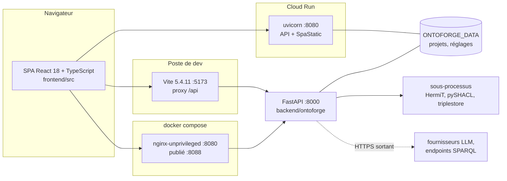

# 01. Vue d'ensemble et démarrage en développement {#vue-ensemble-demarrage}

Les dossiers du dépôt, la façon dont les pièces s'emboîtent et les commandes pour lancer, tester et reconstruire OntoForge en développement. Les sous-systèmes sont détaillés dans les chapitres suivants. Le guide d'architecture (`docs/guide/architecture.md`) décrit le catalogue des modules ; ce manuel décrit le code. Retour au [sommaire](README.md).

État vérifié le 23 novembre 2026, branche `lot/L51`.

## 1. Rôle d'OntoForge {#role}

Dans OntoForge, on conçoit une ontologie OWL 2 / SHACL, on contrôle sa conformité W3C, puis on la transpose en modèle property graph (Curiosity en priorité, Neo4j). L'humain arbitre ce qui se perd. Techniquement : un backend Python (FastAPI) qui porte toute la sémantique, un front React (TypeScript, Vite) qui n'en recalcule rien, et du code de génération (C#, Cypher, GraphQL) produit comme texte.

## 2. Vue d'ensemble {#vue-d-ensemble}



Trois façons de servir le front : Vite en développement, nginx dans `docker compose`, uvicorn seul en production (chapitre 02 §4.7, chapitre 17).

## 3. Arborescence {#arborescence}

| Dossier | Contenu |
|---|---|
| `backend/ontoforge/` | l'application Python : `main.py` (assemblage), `api/` (routeurs), `core/` (modèles pydantic normatifs), `io/`, `conformance/`, `shacl/`, `mapping/` (moteur et règles), `targets/` (générateurs), `queries/`, `assistant/`, `localstore/`, `auth/`, `collab/`, `settings/`, `localize/`, `projects/`, `editing/`, `importers/`, `businessmap/`, `standards/` |
| `backend/tests/` | 75 fichiers `test_*.py`, 1607 tests collectés au 23/11 (chapitre 18) |
| `backend/pyproject.toml`, `backend/constraints.txt`, `backend/Dockerfile` | dépendances (versions exactes), image de développement et de `docker compose` |
| `frontend/src/` | application React (chapitre 15) ; `frontend/tests/` : tests Node du rendu Markdown sûr |
| `frontend/package.json`, `frontend/package-lock.json`, `frontend/vite.config.ts`, `frontend/nginx.conf`, `frontend/security-headers.conf`, `frontend/Dockerfile` | build, proxy, serveur local (chapitre 17) |
| `samples/` | ontologies d'exemple `automaint` et `trap` (oracle de la transposition) |
| `docs/` | `guide/` (documentation utilisateur, embarquée dans l'appli), `dev/` (ce manuel, jamais embarqué), `ARCHITECTURE.md`, `CONTRACTS.md`, `RULES.md`, `PLAN.md`, `veille/` |
| `tools/recette/` | recettes Playwright par lot (`*.mjs`) et `e2e_api.py` (chapitre 18) ; `tools/docs/` captures du guide ; `tools/git/publish.sh` ; `tools/demo`, `tools/video`, `tools/dotnet`, `tools/salle` |
| `deploy/cloudrun/` | Dockerfile de production, Cloud Build, `env.yaml`, script PowerShell |
| `.github/` | `workflows/ci.yml`, `dependabot.yml` |
| `skills/`, `.claude/agents/`, `lots/`, `journal/` | organisation de l'équipe d'agents : méthode, fiches, contrats de lot, revues |
| `design/krakie/` | sources des poses de la mascotte |

`docker-compose.yml` et `.env.example` sont à la racine.

## 4. Librairies principales {#librairies}

Versions exactes lues dans `backend/pyproject.toml` et `frontend/package.json` (toutes épinglées, décision D-L21-02 : pas de montée de version sans accord).

| Zone | Librairie | Version | Pourquoi |
|---|---|---|---|
| Backend | FastAPI / Starlette / uvicorn | 0.133.0 / 1.3.1 / 0.32.1 | API HTTP, middlewares ASGI maison |
| Backend | pydantic | 2.10.3 | contrats `core/*.py` |
| Backend | rdflib / pySHACL / owlrl | 7.1.1 / 0.29.1 / 7.1.2 | RDF, SHACL, inférence |
| Backend | pyoxigraph | 0.5.13 | triplestore local |
| Backend | owlready2 (extra `reasoner`) | 0.47 | HermiT |
| Backend | cryptography / argon2-cffi / bcrypt | 50.0.2 / 25.1.0 / 5.0.0 | chiffrement des clés, mots de passe |
| Front | React / react-dom | 18.3.1 | interface |
| Front | Vite / TypeScript | 5.4.11 / 5.6.3 | build et vérification de types |
| Front | @xyflow/react / @dagrejs/dagre | 12.8.4 / 1.1.5 | éditeur de graphe et mise en page |
| Front | cytoscape | 3.30.2 | diagramme du modèle cible, résultats |
| Front | CodeMirror 6 (`@codemirror/*`) | voir `frontend/package.json` | code et saisie rapide |
| Front | marked | 18.1.1 | Markdown (guide, textes de l'IA) |

Python : `requires-python >= 3.11` ; les images et la CI utilisent 3.12 ; le venv de cette machine est en 3.13.18 (la suite s'y collecte). Node 22 (CI et images) ; 22.23.4 ici.

## 5. Démarrer en développement {#demarrer}

### 5.1 Avec Docker {#demarrer-docker}

```bash
docker compose up --build        # http://localhost:8088
```

Trois services : `init-perms` (remet les droits des volumes à l'utilisateur 10001), `backend` (:8000, non publié), `frontend` (nginx, publié sur `127.0.0.1:${ONTOFORGE_PORT:-8088}`). Données dans les volumes `ontoforge-data` (`/data`) et `ontoforge-keys` (`/keys`, clé maître). Variables dans `.env` (modèle `.env.example`). Le build Docker n'est pas exécutable dans l'environnement des agents (décision D-012) : il est vérifié chez Jerem.

### 5.2 Sans Docker (recommandé pour développer) {#demarrer-local}

```bash
cd backend
python -m venv .venv && . .venv/bin/activate
pip install -c constraints.txt -e ".[dev,reasoner]"      # reasoner : seulement pour HermiT (Java requis, 21 testé ; le code n'impose pas de version)
ONTOFORGE_LLM_PROVIDER=mock ONTOFORGE_DATA=/tmp/of-data uvicorn ontoforge.main:app --reload --port 8000

cd ../frontend
npm ci
npm run dev                                              # http://localhost:5173, proxy /api -> :8000
```

Vérifié le 23/11 : uvicorn (port 8099) et `vite` (port 5199, `ONTOFORGE_API=http://127.0.0.1:8099`) ; `GET /api/health` répond identiquement des deux côtés, `GET /api/auth/session` passe par le proxy. `ONTOFORGE_API` change la cible du proxy. Le README racine propose `pip install -e ".[dev]"` sans `-c constraints.txt` : préférer la forme ci-dessus (DF-F09).

Le fournisseur `mock` rend l'assistant déterministe, sans clé. Sans `ONTOFORGE_DATA`, le dossier de données par défaut est `./data` (relatif au dossier de lancement, le dossier backend/data est ignoré par git) ; l'image Docker fixe `/data`. Hors Docker, définissez-le pour ne pas polluer le dépôt.

Pour tester l'authentification en local : `ONTOFORGE_AUTH=password`, `ONTOFORGE_SECRET_KEY`, `ONTOFORGE_AUTH_USERS`, et `ONTOFORGE_COOKIE_SECURE=0` (sinon le cookie `Secure` n'est pas renvoyé en http). Les mots de passe se hachent par `python -m ontoforge.auth hash --stdin --user <login>`. Détail au chapitre 12.

### 5.3 Tests et build {#tests-build}

```bash
cd backend && pytest -q                                  # de l'ordre de 1600 tests ; ONTOFORGE_RATE_LIMIT=0 posé par conftest.py
cd frontend && npm run build                             # tsc -b puis vite build (23 s ici)
cd frontend && npm test                                  # node --test tests/*.test.mjs (4 tests)
node tools/recette/e2e_ui.mjs                            # recette UI (front construit avant)
```

Il n'y a ni Makefile, ni linter de front configuré : `tsc -b` (mode strict, `frontend/tsconfig.json`) est le seul contrôle statique. Chapitre 18 pour l'organisation des tests et des recettes.

### 5.4 Où regarder quand ça ne marche pas {#depannage}

| Symptôme | Cause probable |
|---|---|
| L'interface affiche « Serveur injoignable » | backend non lancé, ou proxy Vite pointant ailleurs (`ONTOFORGE_API`) |
| 403 `csrf` / `bad_origin` en local avec authentification | passage par un autre hôte que celui de la page (chapitre 02 §4.1) |
| Le cookie de session n'est pas envoyé | `Secure` sans https : `ONTOFORGE_COOKIE_SECURE=0` |
| 429 en rafale pendant un test de charge | limiteur : `ONTOFORGE_RATE_LIMIT=0` |
| `POST /reason` répond 501 | image ou venv sans `owlready2` / Java (extra `reasoner`) |
| Page blanche après un build | `dist/` périmé ou cache : relancer `npm run build` ; en Docker, `docker compose build frontend` |

## 6. Conventions de l'équipe {#conventions}

- Code en anglais, documentation et messages en français ; la doc du manuel et de l'appli est bilingue.
- Une API externe non confirmée est marquée `À VÉRIFIER` dans le code ; dans ce manuel, `À CONFIRMER`.
- Les contrats `backend/ontoforge/core/*.py` ne changent que par une décision tracée (`journal/decisions.md`).
- Les textes d'interface sont dans `frontend/src/i18n/fr.json` et `en.json` (chapitre 15, §6) ; ne jamais renommer une clé existante.
- Un lot = une branche `lot/Lxx`, un contrat dans `lots/`, des relectures croisées dans `journal/<Lxx>/` (protocole : `docs/TEAM.md`).

## 7. Décisions {#decisions}

- D-002 : FastAPI + React / TypeScript / Vite. **D-003** : exécution Docker. **D-012** : Docker Hub injoignable depuis la machine de build, d'où des critères exécutables localement.
- D-L21-02 : base stable, pas de montée de version. **D-L21-03** : Neo4j et Curiosity validés à la main (pas de testcontainers, pas de compilation C# en CI).
- D-L51-01 : ce manuel, bilingue, publié sur GitHub, non intégré à l'appli.

## 8. Pièges {#pieges}

- Le dossier `ref/` n'est pas publié (`tools/git/publish.sh`), ni `journal/securite/` : ne les citez pas dans le manuel.
- `docs/guide/*.md` est **compilé dans le front** (`import.meta.glob`) : modifier le guide demande de reconstruire le front. `docs/dev/` n'est pas embarqué.
- Les chemins du venv de la CI sont codés en dur dans les recettes (`/home/claude/venv/bin/python`, voir chapitre 18).
- Les données de test ne vont jamais dans le dépôt : exemples génériques seulement.

## 9. Comment ajouter… {#comment-ajouter}

### … un module backend {#ajouter-module}

Créer le paquet sous `backend/ontoforge/`, le brancher via un routeur dans `backend/ontoforge/api/__init__.py` (liste `ROUTERS`), classer ses routes dans `backend/ontoforge/collab/routes.py` si elles portent un projet (chapitre 02), écrire les tests sous `backend/tests/`, documenter dans le chapitre concerné.

### … un écran {#ajouter-ecran}

Chapitre 15 §13 : composant, entrée dans `frontend/src/shell/registry.tsx::SCREENS`, clés i18n, recette.

### … une variable d'environnement {#ajouter-variable}

La lire dans le module qui l'utilise (aucun registre central), la documenter dans `.env.example` si elle est utile en local, dans `deploy/cloudrun/env.yaml` si elle est non secrète en production, et au chapitre 17.
