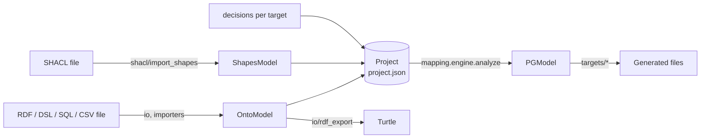

# 03. Internal model {#modele-interne}

Three objects carry the backend's data: the ontology (`OntoModel`), the SHACL shapes (`ShapesModel`) and the property graph model (`PGModel`). The `Project` envelope holds them together. The rest of the backend reads or produces these objects: whoever knows them can read any module.

Sources read: `backend/ontoforge/core/onto_model.py`, `backend/ontoforge/core/shapes_model.py`, `backend/ontoforge/core/pg_model.py`, `backend/ontoforge/core/project.py`, `backend/ontoforge/core/lang.py`, `backend/ontoforge/api/_common.py`, `docs/CONTRACTS.md` §3.

## Role {#role}

- `OntoModel`: an OWL 2 / RDFS ontology shaped for transposition. Frequent axioms have a dedicated field, arbitrary class expressions stay as a tree (`ClassExpr`), and anything the model cannot represent goes to `unmapped`, so nothing is lost silently.
- `ShapesModel`: structured SHACL Core; SHACL-SPARQL kept raw.
- `PGModel`: the analysis result for one target (`curiosity` or `neo4j`): node and edge types, validations, materializations, findings and decisions.
- `Project`: what is persisted on disk (ontology, shapes, decisions per target, UI state, history).

These files are **normative** (D-028): they change only through a decision recorded in `journal/decisions.md`. Every field added since v0.1 has a default value, which keeps old `project.json` files readable.

## Files {#fichiers}

| File | Content |
|---|---|
| `backend/ontoforge/core/onto_model.py` | `OntoModel` and its entities; namespace constants (`XSD`, `RDF`, `RDFS`, `OWL`); `local_name` function |
| `backend/ontoforge/core/shapes_model.py` | `ShapesModel`, `NodeShape`, `PropertyShape`, `Path`, `Constraints` |
| `backend/ontoforge/core/pg_model.py` | `PGModel`, `NodeType`, `EdgeType`, `PGProperty`, `Validation`, `Materialization`, `Finding`, `Option`, `DecisionNote` |
| `backend/ontoforge/core/project.py` | `Project`, `ProjectView`, `Perimeter`, `GenerationRecord` |
| `backend/ontoforge/core/lang.py` | `LABEL_LANG`: language of the labels read by the engine (context variable) |

## Flow {#flux}

The `PGModel` is **never stored**: it is recomputed on every analysis or generation call from the project and the decisions (see chapter [07](07-moteur-analyse.en.md)). Only the decisions (`Project.decisions`) and their trace (`Project.decision_notes`) are persisted.

## Libraries {#librairies}

| Library | Version (`backend/constraints.txt`) | Why |
|---|---|---|
| pydantic | 2.10.3 (pydantic-core 2.27.1) | validation and JSON serialization of the models; one schema for the API (OpenAPI) and for the disk |

`core/` has no RDF dependency: the models do not know rdflib, so they are tested and serialized without a graph.

## Key structures {#structures-cles}

### OntoModel {#ontomodel}

Class `backend/ontoforge/core/onto_model.py::OntoModel`. Each collection is a dictionary **absolute IRI → entity**:

| Field | Type | Note |
|---|---|---|
| `meta` | `OntologyMeta` | ontology IRI, `version_iri`, `imports`, `prefixes` |
| `classes` | `dict[str, OntClass]` | `sub_class_of` (named parents), `restrictions` (anonymous restriction superclasses, flattened), `super_expressions` (other anonymous superclasses), `equivalent_to`, `disjoint_with`, `disjoint_union_of`, `has_keys`, `one_of` |
| `object_properties` | `dict[str, ObjectProperty]` | `domain` / `range` (intersection when there are several axioms), `domain_union` / `range_union` (`owl:unionOf`), `domain_expr` / `range_expr` (complex domain), `inverse_of`, `chains`, `characteristics` |
| `datatype_properties` | `dict[str, DatatypeProperty]` | `range` = datatype IRIs, `range_expr` = `DataRange` (facets, `oneOf`), `functional` |
| `annotation_properties`, `datatypes`, `individuals` | | `DatatypeDef.definition` is a `DataRange`; `Individual.facts` is a list of `Fact` (with `negative` for `owl:NegativePropertyAssertion`) |
| `all_different` | `list[list[str]]` | `owl:AllDifferent` |
| `unmapped` | `list[UnmappedAxiom]` | triples read but not represented, as abbreviated N-Triples |

All entities inherit from `backend/ontoforge/core/onto_model.py::Entity`: `labels` and `comments` are `LangText` (`dict[str, str]`, key = language tag, `""` = no language), `annotations` holds `skos:*`, `dcterms:*` and free annotations, `deprecated` reflects `owl:deprecated`.

A restriction exists in two forms: `Restriction` (flattened view of a superclass `rdfs:subClassOf [owl:Restriction …]`, which most rules read) and `ClassExpr` (full tree, `op` among `named`, `and`, `or`, `not`, `oneOf` and the seven restriction kinds). When the filler of a restriction is not named, `Restriction.filler` is `None` and the tree is in `filler_expr`.

The read-only helpers `OntoModel.label`, `OntoModel.ancestors`, `OntoModel.children` and `OntoModel.descendants` are used everywhere. `ancestors` skips `owl:Thing` and tolerates cycles (`seen` list). `label` looks for the requested language first, then `en`, then no language, then any, and falls back to `local_name`.

### ShapesModel {#shapesmodel}

`backend/ontoforge/core/shapes_model.py::ShapesModel`: `shapes` (NodeShape by id), `property_shapes` (standalone referenced property shapes), `prefixes`, `warnings`. `Constraints` groups the constraints shared by both kinds of shapes; `sparql` keeps SHACL-SPARQL constraints as is (reported, never interpreted). Fields whose name is a Python reserved word have an alias: `class_` → `class`, `in_` → `in`, `and_`, `or_`, `not_`. Details in chapter [06](06-shacl.en.md).

### PGModel {#pgmodel}

`backend/ontoforge/core/pg_model.py::PGModel`:

| Field | Content |
|---|---|
| `target` | `curiosity` or `neo4j` (`Target`) |
| `node_types` | name → `NodeType` (`labels[0]` = main label, only one for Curiosity; `source` = merged OWL classes; `key`; `discriminator` for flattened inheritance; `icon` since D-L9-02) |
| `edge_types` | list of `EdgeType`; `from_` has the JSON alias `from`; `reverse` always set for Curiosity; `properties` always empty for Curiosity; `derived` for a materialized edge |
| `validations` | what becomes application-side checking (`ValidationKind`: cardinality, existence, disjointness…) |
| `materializations` | transitive closures, chains, super-properties, classification… (`MaterializationKind`) |
| `findings` | engine findings (`Finding`) |
| `decisions` | finding id → option id; `decision_notes`: who, when, why (D-L47-02) |

`PGType` lists the recognized property types: `String`, `Integer`, `Float`, `Decimal` (added by D-L13-01), `Boolean`, `Date`, `DateTime`, `LocalDateTime`, `Time`, `Duration`.

Conventions (D-L4-02, `docs/CONTRACTS.md` §3): the property carrying the original IRI of a node is found through `source = "urn:ontoforge:iri"`, not by its name (`uri` in Neo4j, `Uri` in Curiosity). A `NodeType` without a key uses this property as its fallback key. `Materialization.chain` holds `EdgeType` names, never IRIs.

### Finding {#finding}

`backend/ontoforge/core/pg_model.py::Finding` is the unit of arbitration:

- `id`: stable, `f"{rule}:{subject_iri}"`, suffixed with `:{property_iri}` for a restriction and with a short SHA-1 digest for an anonymous construct (D-035). It is the key of `decisions`: changing the shape of an id loses existing arbitrations.
- `severity`: `auto`, `review`, `lost` or `info` (D-L9-02: informative finding, excluded from counters). `PGModel.summary` counts `auto`, `review`, `lost`, `decided`, `pending`, ignoring `info`.
- `options`, `recommended` (advised option for the target), `chosen` (arbitrated option, `None` otherwise), `rationale`.
- `auto_reason`: why a finding was reclassified as `auto` (D-L47-01); `root`: hierarchy root, for arbitration by branch (L47).

### Project {#project}

`backend/ontoforge/core/project.py::Project`: `onto`, `shapes`, `decisions` (`{"curiosity": {...}, "neo4j": {...}}`), `view` (icons, positions and collapsed nodes of the graph editor, read by no generator), `perimeters`, `generations`, `target_versions` (L31), `business_maps` (L36a), `decision_notes`. Storage is described in chapter [13](13-projets-versions.en.md).

## Serialization {#serialisation}

Models are emitted as JSON **with aliases**: `backend/ontoforge/api/_common.py::dump` calls `model_dump(mode="json", by_alias=True)` and `backend/ontoforge/projects/store.py::save` writes `model_dump_json(by_alias=True, indent=2)`. The front therefore receives `from`, `in`, `class`, never `from_` or `in_`. Models with aliases declare `populate_by_name = True`: they can be built in Python with `from_=...` as well as `**{"from": ...}`.

## Label language {#langue-des-libelles}

The engine reads ontology labels (node type descriptions, "Class X (label)") in a language given by `backend/ontoforge/core/lang.py::label_lang`, which reads the context variable `LABEL_LANG` (default `fr`). `backend/ontoforge/api/analysis.py` sets it around the analysis call from the label language setting, then resets it. Outside the API (tests, scripts), the value stays `fr`.

## Decisions {#decisions}

- D-028: `core/*.py` and `docs/CONTRACTS.md` are normative.
- D-035: `Finding.id` format.
- D-L4-02: IRI conventions, fallback key, `chain`.
- D-L9-02: `NodeType.icon` and `info` severity.
- D-L13-01: `Decimal` type.
- D-L47-01, D-L47-02: `auto_reason`, `root`, `DecisionNote`.

## Pitfalls and limits {#pieges}

- Backward compatibility: every new field of `Project` or `OntoModel` needs a default value, otherwise existing projects no longer load (pydantic raises a validation error).
- Absolute IRIs: CURIE compaction is done by the export and the front, never in the model. A relative IRI in a model is a bug.
- Multiple domain: `ObjectProperty.domain` with two classes means their *intersection* (OWL semantics of two `rdfs:domain` axioms); the union is in `domain_union`.
- Two views of a restriction: changing `OntClass.restrictions` does not update `super_expressions`, and vice versa. The RDF export emits both lists; an editor must pick one.
- `OntoModel.children` is linear in the number of classes; `descendants` calls it at each level. On a very large ontology, prefer a reverse index built once (what the engine does in its context, chapter 07).
- The variable `LABEL_LANG` also exists in `backend/ontoforge/localize/__init__.py` but nobody reads it there (defect DF-B01): the one in `core/lang.py` is what counts.

## How to add a field {#comment-ajouter}

1. Open a decision in `journal/decisions.md` (normative contract).
2. Add the field with a default value (`Field(default_factory=...)` for a list or a dictionary).
3. If it must survive an RDF round trip, read it in `backend/ontoforge/io/rdf_import.py` and write it in `backend/ontoforge/io/rdf_export.py` (chapter [04](04-import-export-rdf.en.md)), then extend the round-trip test `backend/tests/test_io_import_export.py`.
4. If it changes the meaning of a version, add it to the SemVer diff in `backend/ontoforge/projects/releases.py` (chapter 13).
5. The matching TypeScript type on the front is maintained by hand (chapter [02](02-communication-front-back.en.md#serveur-modeles)); no test detects a drift between the two (`backend/tests/test_api_contract.py` only compares routes).
