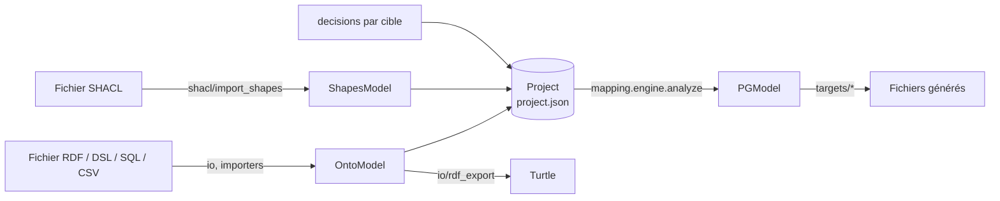

# 03. Modèle interne {#modele-interne}

Trois objets portent les données du backend : l'ontologie (`OntoModel`), les shapes SHACL (`ShapesModel`) et le modèle property graph (`PGModel`). L'enveloppe `Project` les réunit. Tout le reste du backend lit ou produit ces objets : qui les connaît sait lire n'importe quel module.

Sources lues : `backend/ontoforge/core/onto_model.py`, `backend/ontoforge/core/shapes_model.py`, `backend/ontoforge/core/pg_model.py`, `backend/ontoforge/core/project.py`, `backend/ontoforge/core/lang.py`, `backend/ontoforge/api/_common.py`, `docs/CONTRACTS.md` §3.

## Rôle {#role}

- `OntoModel` : représentation d'une ontologie OWL 2 / RDFS orientée transposition. Les axiomes fréquents ont un champ dédié, les expressions de classes arbitraires restent en arbre (`ClassExpr`), et tout ce que le modèle ne sait pas représenter part dans `unmapped`, sans perte silencieuse.
- `ShapesModel` : SHACL Core structuré, SHACL-SPARQL conservé brut.
- `PGModel` : résultat de l'analyse pour une cible (`curiosity` ou `neo4j`) : types de nœuds et d'arêtes, validations, matérialisations, constats et décisions.
- `Project` : ce qui est persisté sur disque (ontologie, shapes, décisions par cible, état d'interface, historique).

Ces fichiers sont **normatifs** (D-028) : ils ne changent que par une décision tracée dans `journal/decisions.md`. Les champs ajoutés depuis la v0.1 ont tous une valeur par défaut, ce qui garde les anciens `project.json` lisibles.

## Fichiers {#fichiers}

| Fichier | Contenu |
|---|---|
| `backend/ontoforge/core/onto_model.py` | `OntoModel` et ses entités ; constantes d'espaces de noms (`XSD`, `RDF`, `RDFS`, `OWL`) ; fonction `local_name` |
| `backend/ontoforge/core/shapes_model.py` | `ShapesModel`, `NodeShape`, `PropertyShape`, `Path`, `Constraints` |
| `backend/ontoforge/core/pg_model.py` | `PGModel`, `NodeType`, `EdgeType`, `PGProperty`, `Validation`, `Materialization`, `Finding`, `Option`, `DecisionNote` |
| `backend/ontoforge/core/project.py` | `Project`, `ProjectView`, `Perimeter`, `GenerationRecord` |
| `backend/ontoforge/core/lang.py` | `LABEL_LANG` : langue des libellés lus par le moteur (variable de contexte) |

## Flux {#flux}

Le `PGModel` n'est **jamais stocké** : il est recalculé à chaque appel d'analyse ou de génération à partir du projet et des décisions (voir le chapitre [07](07-moteur-analyse.md)). Seules les décisions (`Project.decisions`) et leur trace (`Project.decision_notes`) sont persistées.

## Librairies {#librairies}

| Librairie | Version (`backend/constraints.txt`) | Pourquoi |
|---|---|---|
| pydantic | 2.10.3 (pydantic-core 2.27.1) | validation et sérialisation JSON des modèles ; même schéma pour l'API (OpenAPI) et le disque |

`core/` n'a aucune dépendance RDF : les modèles ne connaissent pas rdflib, on les teste et on les sérialise donc sans graphe.

## Structures clés {#structures-cles}

### OntoModel {#ontomodel}

Classe `backend/ontoforge/core/onto_model.py::OntoModel`. Chaque collection est un dictionnaire **IRI absolue → entité** :

| Champ | Type | Remarque |
|---|---|---|
| `meta` | `OntologyMeta` | IRI de l'ontologie, `version_iri`, `imports`, `prefixes` |
| `classes` | `dict[str, OntClass]` | `sub_class_of` (parents nommés), `restrictions` (superclasses anonymes de type restriction, aplaties), `super_expressions` (autres superclasses anonymes), `equivalent_to`, `disjoint_with`, `disjoint_union_of`, `has_keys`, `one_of` |
| `object_properties` | `dict[str, ObjectProperty]` | `domain` / `range` (intersection si plusieurs axiomes), `domain_union` / `range_union` (`owl:unionOf`), `domain_expr` / `range_expr` (domaine complexe), `inverse_of`, `chains`, `characteristics` |
| `datatype_properties` | `dict[str, DatatypeProperty]` | `range` = IRI de datatypes, `range_expr` = `DataRange` (facettes, `oneOf`), `functional` |
| `annotation_properties`, `datatypes`, `individuals` | | `DatatypeDef.definition` est un `DataRange` ; `Individual.facts` est une liste de `Fact` (avec `negative` pour `owl:NegativePropertyAssertion`) |
| `all_different` | `list[list[str]]` | `owl:AllDifferent` |
| `unmapped` | `list[UnmappedAxiom]` | triplets lus mais non représentés, en N-Triples abrégés |

Toutes les entités héritent de `backend/ontoforge/core/onto_model.py::Entity` : `labels` et `comments` sont des `LangText` (`dict[str, str]`, clé = balise de langue, `""` = sans langue), `annotations` porte les `skos:*`, `dcterms:*` et annotations libres, `deprecated` reflète `owl:deprecated`.

Une restriction existe sous deux formes : `Restriction` (vue aplatie d'une superclasse `rdfs:subClassOf [owl:Restriction …]`, ce que lisent la plupart des règles) et `ClassExpr` (arbre complet, `op` parmi `named`, `and`, `or`, `not`, `oneOf` et les sept genres de restriction). Quand le *filler* d'une restriction n'est pas nommé, `Restriction.filler` vaut `None` et l'arbre est dans `filler_expr`.

Les aides en lecture seule `OntoModel.label`, `OntoModel.ancestors`, `OntoModel.children` et `OntoModel.descendants` sont utilisées partout. `ancestors` ignore `owl:Thing` et tolère les cycles (liste `seen`). `label` cherche d'abord la langue demandée, puis `en`, puis sans langue, puis la première venue, et retombe sur `local_name`.

### ShapesModel {#shapesmodel}

`backend/ontoforge/core/shapes_model.py::ShapesModel` : `shapes` (NodeShape par id), `property_shapes` (property shapes autonomes référencées), `prefixes`, `warnings`. `Constraints` regroupe les contraintes communes aux deux genres de shapes ; `sparql` garde les contraintes SHACL-SPARQL telles quelles (signalées, jamais interprétées). Les champs dont le nom est un mot réservé Python ont un alias : `class_` → `class`, `in_` → `in`, `and_`, `or_`, `not_`. Détails au chapitre [06](06-shacl.md).

### PGModel {#pgmodel}

`backend/ontoforge/core/pg_model.py::PGModel` :

| Champ | Contenu |
|---|---|
| `target` | `curiosity` ou `neo4j` (`Target`) |
| `node_types` | nom → `NodeType` (`labels[0]` = label principal, un seul pour Curiosity ; `source` = classes OWL fusionnées ; `key` ; `discriminator` pour l'héritage aplati ; `icon` depuis D-L9-02) |
| `edge_types` | liste d'`EdgeType` ; `from_` a l'alias JSON `from` ; `reverse` toujours renseigné pour Curiosity ; `properties` toujours vide pour Curiosity ; `derived` pour une arête matérialisée |
| `validations` | ce qui devient du contrôle applicatif (`ValidationKind` : cardinalité, existence, disjonction…) |
| `materializations` | fermetures transitives, chaînes, super-propriétés, classification… (`MaterializationKind`) |
| `findings` | constats du moteur (`Finding`) |
| `decisions` | id de constat → id d'option ; `decision_notes` : qui, quand, pourquoi (D-L47-02) |

`PGType` liste les types de propriété reconnus : `String`, `Integer`, `Float`, `Decimal` (ajouté par D-L13-01), `Boolean`, `Date`, `DateTime`, `LocalDateTime`, `Time`, `Duration`.

Conventions (D-L4-02, `docs/CONTRACTS.md` §3) : la propriété qui porte l'IRI d'origine d'un nœud est repérée par `source = "urn:ontoforge:iri"` et non par son nom (`uri` en Neo4j, `Uri` en Curiosity). Un `NodeType` sans clé utilise cette propriété comme clé de repli. `Materialization.chain` contient des noms d'`EdgeType`, jamais des IRI.

### Finding {#finding}

`backend/ontoforge/core/pg_model.py::Finding` est l'unité d'arbitrage :

- `id` : stable, `f"{rule}:{subject_iri}"`, suffixé par `:{property_iri}` pour une restriction et par une empreinte SHA-1 courte pour un construct anonyme (D-035). C'est la clé de `decisions` : changer la forme d'un id fait perdre les arbitrages existants.
- `severity` : `auto`, `review`, `lost` ou `info` (D-L9-02 : constat informatif, exclu des compteurs). `PGModel.summary` compte `auto`, `review`, `lost`, `decided`, `pending` en ignorant `info`.
- `options`, `recommended` (option conseillée pour la cible), `chosen` (option arbitrée, `None` sinon), `rationale`.
- `auto_reason` : motif d'un reclassement en `auto` (D-L47-01) ; `root` : racine de hiérarchie, pour l'arbitrage par branche (L47).

### Project {#project}

`backend/ontoforge/core/project.py::Project` : `onto`, `shapes`, `decisions` (`{"curiosity": {...}, "neo4j": {...}}`), `view` (icônes, positions et nœuds repliés de l'éditeur graphique, qu'aucun générateur ne lit), `perimeters`, `generations`, `target_versions` (L31), `business_maps` (L36a), `decision_notes`. Le stockage est décrit au chapitre [13](13-projets-versions.md).

## Sérialisation {#serialisation}

Les modèles sont émis en JSON **avec les alias** : `backend/ontoforge/api/_common.py::dump` appelle `model_dump(mode="json", by_alias=True)` et `backend/ontoforge/projects/store.py::save` écrit `model_dump_json(by_alias=True, indent=2)`. Le front reçoit donc `from`, `in`, `class`, jamais `from_` ou `in_`. Les modèles qui ont des alias déclarent `populate_by_name = True` : on peut les construire en Python avec `from_=...` comme avec `**{"from": ...}`.

## Langue des libellés {#langue-des-libelles}

Le moteur lit les libellés d'ontologie (descriptions des types de nœuds, « Classe X (libellé) ») dans une langue donnée par `backend/ontoforge/core/lang.py::label_lang`, qui lit la variable de contexte `LABEL_LANG` (défaut `fr`). `backend/ontoforge/api/analysis.py` la pose autour de l'appel d'analyse à partir du réglage de langue des libellés, puis la remet en place. Hors API (tests, scripts), la valeur reste `fr`.

## Décisions {#decisions}

- D-028 : `core/*.py` et `docs/CONTRACTS.md` sont normatifs.
- D-035 : format de `Finding.id`.
- D-L4-02 : conventions IRI, clé de repli, `chain`.
- D-L9-02 : `NodeType.icon` et sévérité `info`.
- D-L13-01 : type `Decimal`.
- D-L47-01, D-L47-02 : `auto_reason`, `root`, `DecisionNote`.

## Pièges et limites {#pieges}

- Rétrocompatibilité : tout nouveau champ de `Project` ou de `OntoModel` doit avoir une valeur par défaut, sinon les projets existants ne se chargent plus (pydantic lève une erreur de validation).
- IRI absolues : la compaction en CURIE est faite par l'export et le front, jamais dans le modèle. Une IRI relative dans un modèle est un bug.
- Domaine multiple : `ObjectProperty.domain` avec deux classes signifie leur *intersection* (sémantique OWL de deux axiomes `rdfs:domain`) ; l'union est dans `domain_union`.
- Deux vues d'une restriction : modifier `OntClass.restrictions` ne met pas à jour `super_expressions`, et inversement. L'export RDF émet les deux listes ; un éditeur doit choisir l'une ou l'autre.
- `OntoModel.children` est linéaire sur le nombre de classes ; `descendants` l'appelle à chaque niveau. Sur une très grande ontologie, préférer un index inverse construit une fois (ce que fait le moteur dans son contexte, chapitre 07).
- La langue des libellés lus par le moteur est la variable `LABEL_LANG` de `backend/ontoforge/core/lang.py`, et elle seule (le doublon de `localize/__init__.py` a été retiré en L52, DF-B01).

## Comment ajouter un champ {#comment-ajouter}

1. Ouvrir une décision dans `journal/decisions.md` (contrat normatif).
2. Ajouter le champ avec une valeur par défaut (`Field(default_factory=...)` pour une liste ou un dictionnaire).
3. S'il doit survivre à un aller-retour RDF, le lire dans `backend/ontoforge/io/rdf_import.py` et l'écrire dans `backend/ontoforge/io/rdf_export.py` (chapitre [04](04-import-export-rdf.md)), puis compléter le test d'aller-retour `backend/tests/test_io_import_export.py`.
4. S'il change la sémantique d'une version, l'ajouter au diff SemVer de `backend/ontoforge/projects/releases.py` (chapitre 13).
5. Le type TypeScript correspondant côté front est maintenu à la main (chapitre [02](02-communication-front-back.md#serveur-modeles)) ; aucun test ne détecte une dérive entre les deux (`backend/tests/test_api_contract.py` ne compare que les routes).
