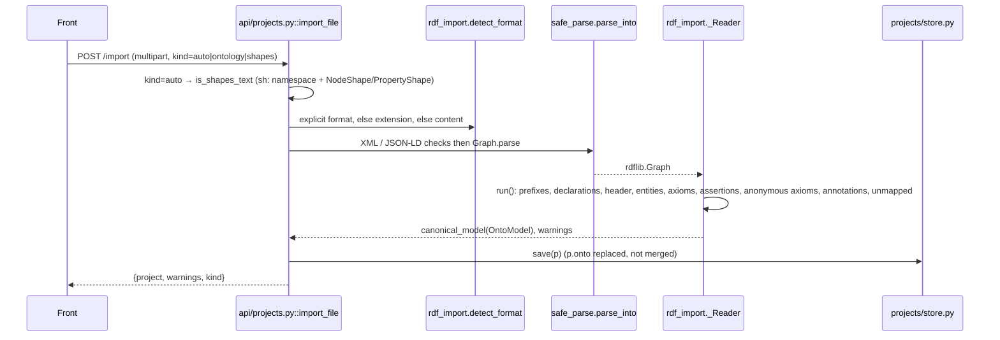

# 04. RDF import and export {#import-export-rdf}

How an RDF file becomes an `OntoModel`, how an `OntoModel` becomes RDF again, and which safeguards protect the reading. The quick-entry DSL is covered at the end, since it also produces an `OntoModel`.

Sources read: `backend/ontoforge/io/rdf_import.py`, `backend/ontoforge/io/rdf_export.py`, `backend/ontoforge/io/safe_parse.py`, `backend/ontoforge/io/dsl.py`, `backend/ontoforge/api/projects.py`, `backend/ontoforge/api/_common.py`, tests `backend/tests/test_io_import_export.py`, `backend/tests/test_sec_rdf.py`, `backend/tests/test_io_dsl.py`. Runs through the FastAPI test client (throwaway data folder).

## Role {#role}

- Import: apply the *OWL 2 Mapping to RDF Graphs* (2nd edition, §3) in reverse to fill the structured fields of `OntoModel`. Every unconsumed triple is kept in `OntoModel.unmapped` and reported with an `[unmapped_triple]` warning.
- Export: apply the mapping in the forward direction, re-emit `unmapped` triples as is, serialize.
- Round-trip guarantee: `graph_to_model(model_to_graph(m))` gives back `canonical_model(m)`, that is `m` up to the order of collections that are sets.

## Files {#fichiers}

| File | Responsibility |
|---|---|
| `backend/ontoforge/io/rdf_import.py` | `detect_format`, `parse_ontology`, `graph_to_model`, `canonical_model`, `parse_warning`; internal class `_Reader` |
| `backend/ontoforge/io/rdf_export.py` | `model_to_graph`, `serialize`, `FORMATS` table; internal class `_Writer` |
| `backend/ontoforge/io/safe_parse.py` | `parse_into` (defensive reading), `canonical_or_same`, caps `max_canon_triples` and `max_unmapped_triples`, exception `UnsafeRdfError` |
| `backend/ontoforge/io/dsl.py` | `parse_dsl`, `DSL_EXAMPLE`, `DSL_HELP` |
| `backend/ontoforge/api/projects.py` | routes `POST /api/projects/{pid}/import`, `POST /api/projects/{pid}/dsl`, `GET /api/projects/{pid}/export/ontology`, `ONTO_MEDIA` table |

## Import flow {#flux-import}

Details:

1. `backend/ontoforge/api/projects.py::import_file` reads the whole file, rejects an empty file (422), guesses the kind (`is_shapes_text`) then calls `_parse_onto` or `_parse_shapes`. The service module is resolved at call time by `backend/ontoforge/api/_common.py::service` (501 if missing); any reading exception becomes a 422 through `parse_error` (message cut at 800 characters). The import **replaces** the project ontology.
2. `backend/ontoforge/io/rdf_import.py::detect_format`: explicit format (alias table), then extension (`.owl` is deliberately missing from the table, since it is ambiguous), then content sniffing (`_sniff`). OWL/XML, functional syntax and Manchester are **detected and rejected** with a message advising to export as Turtle or RDF/XML from Protégé.
3. `backend/ontoforge/io/rdf_import.py::parse_ontology` creates an `rdflib.Graph(bind_namespaces="none")` (no prefixes added by rdflib), reads through `parse_into`, converts, and prepends `[format] : format détecté …, N triplets` to the warnings.
4. `_Reader.run` chains the passes in a fixed order: `collect_prefixes` (only prefixes actually used are kept, except rdf/rdfs/owl/xsd), `declarations` (typing of IRIs, inference for untyped `rdf:Property`, undeclared individuals, *punning* detection), `ontology_header`, `entities`, `axioms`, `individual_assertions`, `anonymous_axioms`, `annotations`, `collect_unmapped`. Each pass marks the triples it consumes (`_Reader.use`).
5. `collect_unmapped` groups the remaining triples by subject (blank nodes attached to their root, depth-first walk **without recursion**) and canonicalizes blank node labels if their number stays below the cap.

Warnings are strings `"[code] <subject> : message"`; `backend/ontoforge/io/rdf_import.py::parse_warning` splits them into `{code, subject, message}`. Codes found in the code: `format`, `no_ontology_header`, `rdfs_class`, `untyped_property`, `undeclared_property`, `undeclared_individual`, `punning`, `punning_illegal`, `unresolved_import`, `unmapped_triple`, `unmapped_not_canonical`, among others.

Run example (two-triple Turtle, `:A a owl:Class . :x :y :z .`): three warnings, `[format]`, `[no_ontology_header]` (deduced IRI `http://e.org`) and `[unmapped_triple] <http://e.org/#x>`; `unmapped` holds one `UnmappedAxiom` with the triple in N-Triples.

## Formats {#formats}

| Direction | Accepted formats | Where |
|---|---|---|
| Import | Turtle, N-Triples, N3, TriG, N-Quads, RDF/XML, JSON-LD | `_EXT`, `_FORMAT_ALIASES` in `backend/ontoforge/io/rdf_import.py` |
| Ontology export | `turtle`, `xml` ("pretty" RDF/XML), `json-ld` (compacted with the model prefixes), `nt`, `n3`, `trig` | `backend/ontoforge/io/rdf_export.py::FORMATS` |

`backend/ontoforge/io/rdf_export.py::serialize` has two particularities:

- RDF/XML: rdflib's `pretty-xml` output is parsed again and compared to the graph (`isomorphic`); if it is not faithful (known case: `rdf:type` pointing to a blank node), it falls back to plain `xml`.
- Turtle: a header comment `# OntoForge — export Turtle de <iri>` is added.

`n3` and `trig` are the rdflib serializers applied to the model graph (TriG: a single graph, the default graph); before L52, `ONTO_MEDIA` advertised them without `serialize` knowing them and the route answered 500 (DF-B02). The test `backend/tests/test_l52_corrections.py::test_b02_every_advertised_format_is_serializable` checks that every `ONTO_MEDIA` format is in `FORMATS`. The shapes export (`backend/ontoforge/shacl/export_shapes.py::serialize_shapes`) passes the format to rdflib and does not have this problem.

## Input safeguards {#garde-fous}

Every RDF file supplied by the user (ontology, shapes, data to validate) goes through `backend/ontoforge/io/safe_parse.py::parse_into`, never through `Graph.parse` directly; files loaded into the local triplestore go through the same `check_xml` and `check_jsonld` checks before Oxigraph (chapter [10](10-triplestore-local.en.md#chargement), L52):

| Check | Implementation | Cap / variable |
|---|---|---|
| RDF/XML and TriX: any `DOCTYPE` or entity declaration rejected | `check_xml`: `expat` parser that stops at the first tag | — |
| JSON-LD: remote context rejected (`@context` string, `@import`); nothing is downloaded while reading | `check_jsonld`, `_scan_context` | depth `MAX_JSON_DEPTH` = 200 |
| Blank node canonicalization bounded (quadratic cost) | `canonical_or_same` and `collect_unmapped` | `ONTOFORGE_MAX_CANON_TRIPLES` (default 1500, minimum 50) |
| Number of unrecognized triples | `collect_unmapped` raises `RdfImportError` | `ONTOFORGE_MAX_UNMAPPED_TRIPLES` (default 10000, minimum 100) |
| Request body size | `backend/ontoforge/security.py::max_body_bytes` | `ONTOFORGE_MAX_BODY_MB` (default 32) |

Above the canonicalization cap, unmapped triples are kept as is with the `[unmapped_not_canonical]` warning: their blank node labels are no longer stable from one import to the next. The tests for these checks are in `backend/tests/test_sec_rdf.py`. Chapter [16](16-securite.en.md) puts them back in the overall security picture.

## Libraries {#librairies}

| Library | Version | Why |
|---|---|---|
| rdflib | 7.1.1 | reading and writing every RDF format, `rdflib.compare.to_canonical_graph` and `isomorphic` |
| html5rdf | 1.2.1 | rdflib dependency (listed in `backend/constraints.txt`) |
| pyparsing | 3.3.3 | rdflib dependency |

rdflib is pinned at 7.1.1 by D-L21-02 (no upgrade without Jerem's decision).

## Structures and conventions {#structures}

- `_Reader.kinds`: IRI → set of kinds (`class`, `object`, `data`, `annotation`, `individual`, `datatype`, `ontology`). An IRI with several kinds triggers `punning` (allowed in OWL 2 DL) or `punning_illegal` (two property kinds, or class and datatype).
- `rdfs:Class` is handled as `owl:Class`, with a warning.
- `xsd:decimal` is normalized on reading (`_lex`: `0` becomes `0.0`), because Turtle serializers rewrite it that way: without it the round trip would not be stable.
- Anonymous superclasses are dispatched by `_Reader._subclass`: a restriction goes to `restrictions` (flattened view, `_to_restriction`), anything else to `super_expressions`. An `owl:equivalentClass` to an `owl:oneOf` fills `one_of`.
- `canonical_model` sorts and deduplicates set-like collections, but keeps the order of RDF lists (chains, keys, unions, `oneOf`).

## The quick-entry DSL {#dsl}

`backend/ontoforge/io/dsl.py::parse_dsl` reads a text line by line (one line = one axiom) and returns `(OntoModel, errors)`. The full help is the constant `DSL_HELP`. No route serves it and no front code reads it: the editor has its own examples in `frontend/src/screens/editor/QuickInput.tsx` and `frontend/src/screens/ontology-list/QuickPanel.tsx`, and its texts under the `ed.dsl.*` keys of `frontend/src/i18n/en.json`. `DSL_EXAMPLE` is checked by the tests.

- Each line is applied on a snapshot: on error, the state goes back to the snapshot (no partial effect). Beyond 1500 lines, the snapshot is no longer taken (cost of the deep copy) and a wrong line may leave a partial effect.
- `parse_dsl` never raises: errors are `{line, message}`.
- A property name used with several domains produces a **union** (`domain_union`), unlike plain RDF where several `rdfs:domain` mean intersection.
- The route `POST /api/projects/{pid}/dsl` merges with the existing ontology by default (`merge: true`) and translates error messages into the UI language.

## Decisions {#decisions}

- D-L21-02: no rdflib upgrade.
- L39-secu (SEC-04, SEC-06, SEC-07): input safeguards described above (details are in the lot reports, outside this manual).

## Pitfalls and limits {#pieges}

- OWL/XML, Manchester, functional syntax: not supported, rejected with a message. The user has to re-export from Protégé.
- `owl:imports` is not followed: the imported IRI is recorded in `meta.imports` with the `[unresolved_import]` warning, nothing is downloaded (offline work).
- Import = replacement: `import_file` overwrites `p.onto` (and `p.shapes` for shapes). Only the DSL merges (`merge: true`).
- Large files: beyond 1500 unmapped triples, blank nodes are no longer canonicalized, so the version diff may show changes that are not real.
- Round trip: what is not in `canonical_model` (order of set-like lists, unused prefixes, Turtle comments) is lost.

## How to add… {#comment-ajouter}

**…reading a new axiom.** Add the field to the model (chapter [03](03-modele-interne.en.md)), fill it in the matching `_Reader` pass (often `axioms` or `anonymous_axioms`) calling `self.use(...)` on every consumed triple, write it in `_Writer.run` of `backend/ontoforge/io/rdf_export.py`, then add a case to the round-trip test in `backend/tests/test_io_import_export.py`. A triple forgotten in `use` stays in `unmapped` and is emitted twice on export.

**…an export format.** Add it to `FORMATS` in `backend/ontoforge/io/rdf_export.py` **and** to `ONTO_MEDIA` in `backend/ontoforge/api/projects.py` (MIME type and extension); the test `test_b02_every_advertised_format_is_serializable` reports an omission.

**…an import format.** Add the extension to `_EXT` and the alias to `_FORMAT_ALIASES`; if the format is XML or JSON-LD, add it to `XML_FORMATS` or `JSONLD_FORMATS` in `backend/ontoforge/io/safe_parse.py` so it goes through the checks.
