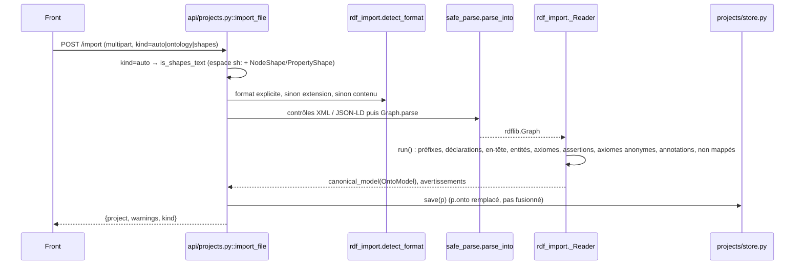

# 04. Import et export RDF {#import-export-rdf}

Comment un fichier RDF devient un `OntoModel`, comment un `OntoModel` redevient du RDF, et quels garde-fous protègent la lecture. Le DSL de saisie rapide est traité à la fin, car il produit aussi un `OntoModel`.

Sources lues : `backend/ontoforge/io/rdf_import.py`, `backend/ontoforge/io/rdf_export.py`, `backend/ontoforge/io/safe_parse.py`, `backend/ontoforge/io/dsl.py`, `backend/ontoforge/api/projects.py`, `backend/ontoforge/api/_common.py`, tests `backend/tests/test_io_import_export.py`, `backend/tests/test_sec_rdf.py`, `backend/tests/test_io_dsl.py`. Exécutions au client de test FastAPI (dossier de données jetable).

## Rôle {#role}

- Import : appliquer à l'envers le *OWL 2 Mapping to RDF Graphs* (2e édition, §3) pour remplir les champs structurés d'`OntoModel`. Tout triplet non consommé est gardé dans `OntoModel.unmapped` et signalé par un avertissement `[unmapped_triple]`.
- Export : appliquer le mapping dans le sens direct, réémettre les triplets `unmapped` tels quels, sérialiser.
- Garantie d'aller-retour : `graph_to_model(model_to_graph(m))` redonne `canonical_model(m)`, c'est-à-dire `m` à l'ordre près des collections qui sont des ensembles.

## Fichiers {#fichiers}

| Fichier | Responsabilité |
|---|---|
| `backend/ontoforge/io/rdf_import.py` | `detect_format`, `parse_ontology`, `graph_to_model`, `canonical_model`, `parse_warning` ; classe interne `_Reader` |
| `backend/ontoforge/io/rdf_export.py` | `model_to_graph`, `serialize`, table `FORMATS` ; classe interne `_Writer` |
| `backend/ontoforge/io/safe_parse.py` | `parse_into` (lecture défensive), `canonical_or_same`, plafonds `max_canon_triples` et `max_unmapped_triples`, exception `UnsafeRdfError` |
| `backend/ontoforge/io/dsl.py` | `parse_dsl`, `DSL_EXAMPLE`, `DSL_HELP` |
| `backend/ontoforge/api/projects.py` | routes `POST /api/projects/{pid}/import`, `POST /api/projects/{pid}/dsl`, `GET /api/projects/{pid}/export/ontology`, table `ONTO_MEDIA` |

## Flux d'import {#flux-import}

Détails :

1. `backend/ontoforge/api/projects.py::import_file` lit tout le fichier, refuse un fichier vide (422), devine le genre (`is_shapes_text`) puis appelle `_parse_onto` ou `_parse_shapes`. Le module de service est résolu à l'appel par `backend/ontoforge/api/_common.py::service` (501 si absent) ; toute exception de lecture devient un 422 via `parse_error` (message tronqué à 800 caractères). L'import **remplace** l'ontologie du projet.
2. `backend/ontoforge/io/rdf_import.py::detect_format` : format explicite (table d'alias), puis extension (`.owl` est volontairement absent de la table, car ambigu), puis reniflage du contenu (`_sniff`). OWL/XML, syntaxe fonctionnelle et Manchester sont **détectés et refusés** avec un message qui conseille d'exporter en Turtle ou RDF/XML depuis Protégé.
3. `backend/ontoforge/io/rdf_import.py::parse_ontology` crée un `rdflib.Graph(bind_namespaces="none")` (pas de préfixes ajoutés par rdflib), lit via `parse_into`, convertit, et préfixe la liste d'avertissements par `[format] : format détecté …, N triplets`.
4. `_Reader.run` enchaîne les passes dans un ordre fixe : `collect_prefixes` (seuls les préfixes réellement utilisés sont gardés, hors rdf/rdfs/owl/xsd), `declarations` (typage des IRI, inférence des `rdf:Property` non typées, individus non déclarés, détection du *punning*), `ontology_header`, `entities`, `axioms`, `individual_assertions`, `anonymous_axioms`, `annotations`, `collect_unmapped`. Chaque passe marque les triplets consommés (`_Reader.use`).
5. `collect_unmapped` regroupe les triplets restants par sujet (nœuds blancs rattachés à leur racine, parcours en profondeur **sans récursion**) et canonise les étiquettes de nœuds blancs si leur nombre reste sous le plafond.

Les avertissements sont des chaînes `"[code] <sujet> : message"` ; `backend/ontoforge/io/rdf_import.py::parse_warning` les découpe en `{code, subject, message}`. Codes rencontrés dans le code : `format`, `no_ontology_header`, `rdfs_class`, `untyped_property`, `undeclared_property`, `undeclared_individual`, `punning`, `punning_illegal`, `unresolved_import`, `unmapped_triple`, `unmapped_not_canonical`, entre autres.

Exemple exécuté (Turtle de deux triplets, `:A a owl:Class . :x :y :z .`) : trois avertissements, `[format]`, `[no_ontology_header]` (IRI déduite `http://e.org`) et `[unmapped_triple] <http://e.org/#x>` ; `unmapped` contient un `UnmappedAxiom` avec le triplet en N-Triples.

## Formats {#formats}

| Sens | Formats acceptés | Où |
|---|---|---|
| Import | Turtle, N-Triples, N3, TriG, N-Quads, RDF/XML, JSON-LD | `_EXT`, `_FORMAT_ALIASES` dans `backend/ontoforge/io/rdf_import.py` |
| Export ontologie | `turtle`, `xml` (RDF/XML « pretty »), `json-ld` (compacté avec les préfixes du modèle), `nt`, `n3`, `trig` | `backend/ontoforge/io/rdf_export.py::FORMATS` |

`backend/ontoforge/io/rdf_export.py::serialize` a deux particularités :

- RDF/XML : la forme `pretty-xml` de rdflib est relue et comparée au graphe (`isomorphic`) ; si elle n'est pas fidèle (cas connu : `rdf:type` vers un nœud blanc), on retombe sur la forme `xml` simple.
- Turtle : un commentaire d'en-tête `# OntoForge — export Turtle de <iri>` est ajouté.

`n3` et `trig` sont les sérialiseurs de rdflib appliqués au graphe du modèle (TriG : un seul graphe, le graphe par défaut) ; avant L52, `ONTO_MEDIA` les annonçait sans que `serialize` les connaisse et la route répondait 500 (DF-B02). Le test `backend/tests/test_l52_corrections.py::test_b02_every_advertised_format_is_serializable` vérifie que tout format de `ONTO_MEDIA` est dans `FORMATS`. L'export des shapes (`backend/ontoforge/shacl/export_shapes.py::serialize_shapes`) passe le format à rdflib et n'a pas ce problème.

## Garde-fous d'entrée {#garde-fous}

Tous les fichiers RDF fournis par l'utilisateur (ontologie, shapes, données à valider) passent par `backend/ontoforge/io/safe_parse.py::parse_into`, jamais par `Graph.parse` directement ; les fichiers chargés dans le triplestore local passent par les mêmes contrôles `check_xml` et `check_jsonld` avant Oxigraph (chapitre [10](10-triplestore-local.md#chargement), L52) :

| Contrôle | Implémentation | Plafond / variable |
|---|---|---|
| RDF/XML et TriX : tout `DOCTYPE` ou déclaration d'entité refusé | `check_xml` : analyseur `expat` qui s'arrête à la première balise | — |
| JSON-LD : contexte distant refusé (`@context` chaîne, `@import`) ; rien n'est téléchargé pendant la lecture | `check_jsonld`, `_scan_context` | profondeur `MAX_JSON_DEPTH` = 200 |
| Canonisation des nœuds blancs bornée (coût quadratique) | `canonical_or_same` et `collect_unmapped` | `ONTOFORGE_MAX_CANON_TRIPLES` (défaut 1500, minimum 50) |
| Nombre de triplets non reconnus | `collect_unmapped` lève `RdfImportError` | `ONTOFORGE_MAX_UNMAPPED_TRIPLES` (défaut 10000, minimum 100) |
| Taille du corps de requête | `backend/ontoforge/security.py::max_body_bytes` | `ONTOFORGE_MAX_BODY_MB` (défaut 32) |

Au-delà du plafond de canonisation, les triplets non mappés sont gardés tels quels avec l'avertissement `[unmapped_not_canonical]` : leurs étiquettes de nœuds blancs ne sont plus stables d'un import à l'autre. Les tests de ces contrôles sont dans `backend/tests/test_sec_rdf.py`. Le chapitre [16](16-securite.md) replace ces contrôles dans la sécurité d'ensemble.

## Librairies {#librairies}

| Librairie | Version | Pourquoi |
|---|---|---|
| rdflib | 7.1.1 | lecture et écriture de tous les formats RDF, `rdflib.compare.to_canonical_graph` et `isomorphic` |
| html5rdf | 1.2.1 | dépendance de rdflib (relevée dans `backend/constraints.txt`) |
| pyparsing | 3.3.3 | dépendance de rdflib |

rdflib est figé à 7.1.1 par D-L21-02 (pas de montée sans décision de Jerem).

## Structures et conventions {#structures}

- `_Reader.kinds` : IRI → ensemble de genres (`class`, `object`, `data`, `annotation`, `individual`, `datatype`, `ontology`). Une IRI qui a plusieurs genres déclenche `punning` (permis en OWL 2 DL) ou `punning_illegal` (deux genres de propriété, ou classe et datatype).
- `rdfs:Class` est traité comme `owl:Class`, avec avertissement.
- `xsd:decimal` est normalisé à la lecture (`_lex` : `0` devient `0.0`), car les sérialiseurs Turtle réécrivent ainsi : sans cela l'aller-retour ne serait pas stable.
- Les superclasses anonymes sont réparties par `_Reader._subclass` : une restriction va dans `restrictions` (vue aplatie, `_to_restriction`), le reste dans `super_expressions`. Un `owl:equivalentClass` vers un `owl:oneOf` remplit `one_of`.
- `canonical_model` trie et dédoublonne les collections ensemblistes, mais garde l'ordre des listes RDF (chaînes, clés, unions, `oneOf`).

## Le DSL de saisie rapide {#dsl}

`backend/ontoforge/io/dsl.py::parse_dsl` lit un texte ligne par ligne (une ligne = un axiome) et renvoie `(OntoModel, erreurs)`. L'aide complète est la constante `DSL_HELP`. Aucune route ne la sert et aucun code du front ne la lit : l'éditeur a ses propres exemples dans `frontend/src/screens/editor/QuickInput.tsx` et `frontend/src/screens/ontology-list/QuickPanel.tsx`, et ses textes sous les clés `ed.dsl.*` de `frontend/src/i18n/fr.json`. `DSL_EXAMPLE` est vérifié par les tests.

- Chaque ligne est appliquée sur un instantané : en cas d'erreur, l'état revient à l'instantané (aucun effet partiel). Au-delà de 1500 lignes, l'instantané n'est plus pris (coût de la copie profonde) et une ligne fausse peut laisser un effet partiel.
- `parse_dsl` ne lève jamais : les erreurs sont des `{line, message}`.
- Un même nom de propriété avec plusieurs domaines produit une **union** (`domain_union`), contrairement à RDF pur où plusieurs `rdfs:domain` veulent dire intersection.
- La route `POST /api/projects/{pid}/dsl` fusionne par défaut avec l'ontologie existante (`merge: true`) et traduit les messages d'erreur dans la langue de l'interface.

## Décisions {#decisions}

- D-L21-02 : pas de montée de version de rdflib.
- L39-secu (SEC-04, SEC-06, SEC-07) : garde-fous d'entrée décrits plus haut (le détail est dans les rapports de lot, hors de ce manuel).

## Pièges et limites {#pieges}

- OWL/XML, Manchester, syntaxe fonctionnelle : non pris en charge, refusés avec un message. L'utilisateur doit réexporter depuis Protégé.
- `owl:imports` n'est pas suivi : l'IRI importée est notée dans `meta.imports` avec l'avertissement `[unresolved_import]`, rien n'est téléchargé (travail hors ligne).
- Import = remplacement : `import_file` écrase `p.onto` (et `p.shapes` pour des shapes). Seul le DSL fusionne (`merge: true`).
- Grands fichiers : au-delà de 1500 triplets non mappés, les nœuds blancs ne sont plus canonisés, donc le diff de versions peut montrer des changements qui n'en sont pas.
- Aller-retour : ce qui n'est pas dans `canonical_model` (ordre des listes ensemblistes, préfixes inutilisés, commentaires Turtle) se perd.

## Comment ajouter… {#comment-ajouter}

**…la lecture d'un nouvel axiome.** Ajouter le champ au modèle (chapitre [03](03-modele-interne.md)), le remplir dans la passe de `_Reader` qui correspond (souvent `axioms` ou `anonymous_axioms`) en appelant `self.use(...)` sur chaque triplet consommé, l'écrire dans `_Writer.run` de `backend/ontoforge/io/rdf_export.py`, puis ajouter un cas au test d'aller-retour de `backend/tests/test_io_import_export.py`. Un triplet oublié dans `use` reste dans `unmapped` et sera réémis en double à l'export.

**…un format d'export.** L'ajouter à `FORMATS` dans `backend/ontoforge/io/rdf_export.py` **et** à `ONTO_MEDIA` dans `backend/ontoforge/api/projects.py` (type MIME et extension) ; le test `test_b02_every_advertised_format_is_serializable` signale un oubli.

**…un format d'import.** Ajouter l'extension à `_EXT` et l'alias à `_FORMAT_ALIASES` ; si le format est du XML ou du JSON-LD, l'ajouter à `XML_FORMATS` ou `JSONLD_FORMATS` de `backend/ontoforge/io/safe_parse.py` pour qu'il passe par les contrôles.
