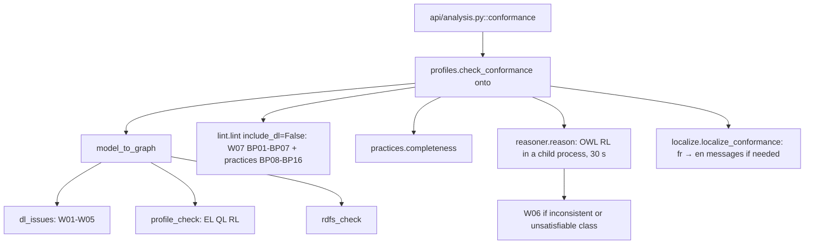

# 05. OWL 2 conformance: profiles, lint and HermiT {#conformite-owl-hermit}

The backend checks an ontology at three levels: **OWL 2 DL syntax and profiles** (EL, QL, RL, RDFS), **good practices** (lint) and **reasoning**. Reasoning comes in two very different variants: OWL RL through owlrl (bounded Python child process, on every conformance check) and OWL 2 DL through HermiT (Java subprocess, on demand). This chapter mostly details HermiT.

Sources read: `backend/ontoforge/conformance/profiles.py`, `backend/ontoforge/conformance/lint.py`, `backend/ontoforge/conformance/practices.py`, `backend/ontoforge/conformance/reasoner.py`, `backend/ontoforge/conformance/hermit.py`, `backend/ontoforge/conformance/report.py`, `backend/ontoforge/api/analysis.py`, `backend/ontoforge/assistant/reasoning.py`, `backend/Dockerfile`, `deploy/cloudrun/Dockerfile`, tests `backend/tests/test_conformance_profiles.py`, `backend/tests/test_reason_hermit.py`, `backend/tests/test_reason_hermit_w3c.py`. Runs of `run_hermit` in the test environment (OpenJDK 21.0.12, owlready2 0.47).

## Role {#role}

| Check | Input | Where | When |
|---|---|---|---|
| Structural OWL 2 DL (W01 to W05) | RDF graph | `backend/ontoforge/conformance/profiles.py::dl_issues` | `GET /conformance`, and before every HermiT run |
| EL, QL, RL, RDFS profiles | RDF graph | `profile_check`, `rdfs_check` | `GET /conformance` |
| Lint W07, BP01 to BP07 | `OntoModel` (+ graph for prefixes) | `backend/ontoforge/conformance/lint.py::lint` | `GET /conformance` |
| Good practices BP08 to BP16, completeness (L49) | `OntoModel` | `backend/ontoforge/conformance/practices.py::lint`, `completeness` | `GET /conformance` (called by `lint`) |
| OWL RL reasoning (W06) | RDF graph | `backend/ontoforge/conformance/reasoner.py::reason` | `GET /conformance` |
| OWL 2 DL reasoning, HermiT | RDF graph | `backend/ontoforge/conformance/hermit.py::run_hermit` | `POST /reason`, Krakie "reason" intent |

The checks work on the **RDF graph** rebuilt by `backend/ontoforge/io/rdf_export.py::model_to_graph`, not on the `OntoModel`: it is the only form that keeps everything the specification asks to check (declarations, punning, anonymous expressions, typed literals).

## Files {#fichiers}

| File | Responsibility |
|---|---|
| `backend/ontoforge/conformance/report.py` | `Issue` (`level`, `code`, `message`, `subject`, `spec_ref`), `ReasonerInfo`, `ConformanceReport`, `PROFILE_NAMES` |
| `backend/ontoforge/conformance/profiles.py` | `check_conformance` (entry point), `dl_issues`, `profile_check`, `rdfs_check`, datatype map `OWL2_DATATYPE_MAP` |
| `backend/ontoforge/conformance/lint.py` | `lint`: W07 (fr/en labels, `owl:versionIRI`, prefixes), BP01 to BP07 |
| `backend/ontoforge/conformance/practices.py` | BP08 to BP16 (definition, status, deprecation, SemVer version, header), cards and completeness score |
| `backend/ontoforge/conformance/reasoner.py` | `reason`: runs OWL RL in a child process (`childproc.run_limited`), `_SLOTS` places, timeout notes |
| `backend/ontoforge/conformance/_owlrl_core.py` | OWL RL computation (`closure`), `prp-key` bug workaround (`apply_prp_key`), unsatisfiable class heuristic `unsat`; imports only rdflib and owlrl |
| `backend/ontoforge/conformance/_owlrl_worker.py` | child process script: N-Triples on stdin, JSON on stdout |
| `backend/ontoforge/conformance/hermit.py` | HermiT: location, bounds, subprocess, output parsing, comparison, heuristic explanation, fr/en messages |
| `backend/ontoforge/assistant/reasoning.py` | Krakie "reason" intent (`matches`, `answer`) |

## Codes {#codes}

| Code | Level | Meaning |
|---|---|---|
| W01 | error (warning in an annotation) | datatype outside the OWL 2 map, or ill-typed literal |
| W02 | error | missing declaration, bare `rdf:Property` |
| W03 | error | non-simple property where OWL 2 DL requires a simple one (cardinality, functional, asymmetric…) |
| W04 | error | illegal punning |
| W05 | error | characteristic not allowed on a data property |
| W06 | error | unsatisfiable class or inconsistent ontology (according to OWL RL) |
| W07 | warning | fr/en labels, `owl:versionIRI`, non-standard prefixes |
| BP01 to BP16 | info or warning, never error | good practices (orphans, cycles, naming, definitions, status, versions…) |

The reference table (with the specification sections) is in `skills/w3c-ontology-conformance/SKILL.md`. An EL, QL or RL profile is reported true only if DL is true as well (`check_conformance`: `not pv[p] and rep.profiles["DL"]`).

## `GET /conformance` flow {#flux-conformance}



### OWL RL through owlrl {#owl-rl}

`backend/ontoforge/conformance/reasoner.py::reason` serializes the graph as N-Triples and hands it to `backend/ontoforge/conformance/_owlrl_worker.py` through `backend/ontoforge/childproc.py::run_limited` (chapter [16](16-securite.en.md)): timeout `timeout` (30 s by default), CPU = timeout + 2 s, memory `ONTOFORGE_OWLRL_MEMORY_MB` (2048 MB), reduced environment. On timeout the child is **killed**: `reason` records "time limit of N s exceeded" and returns `used = "none"`, `consistent = None`. Memory or CPU cap reached: note "memory or computation time limit reached", same result. `ONTOFORGE_OWLRL_SLOTS` (2, between 1 and 32, read at import) limits the number of simultaneous runs. On Cloud Run the container only has 2 GiB: 1 place and 256 MB (`deploy/cloudrun/env.yaml`; measured on 24/11: 96 MB is enough at 7,000 triples (10 s) and, at 22,000 triples, the timeout hits before any memory cap; worst-case sum: chapter [17](17-build-ci-deploiement.en.md#plafonds-somme)). Beyond the places, reasoning is not started and a note asks to run again; the conformance check answers normally. Before L52, owlrl ran in a `daemon` thread abandoned on timeout but never stopped (DF-B03). Child cost measured on automaint: about 0.25 s more per check (0.6 s instead of 0.35 s).

`backend/ontoforge/conformance/_owlrl_core.py::closure` (in the child) copies the graph, **removes the `owl:hasKey` axioms** then calls `owlrl.DeductiveClosure(owlrl.OWLRL_Semantics, axiomatic_triples=False, datatype_axioms=False).expand(work)`. The `prp-key` rule is applied separately by `apply_prp_key`, then the closure is recomputed. Reason: in owlrl 7.1.2, the `prp-key` loop skips the last property of the key, so with `owl:hasKey (p)` every individual of the type becomes `owl:sameAs`. Inconsistencies are read from owlrl's error triples (`ERRNS.error`), unsatisfiable classes from the `unsat` heuristic (ancestor `owl:Nothing`, two disjoint ancestors, or an ancestor and its complement; no reasoning on restrictions).

## HermiT in detail {#hermit}

### Why a subprocess and not owlready2 {#hermit-pourquoi}

HermiT 1.3.8 **ships inside the owlready2 package** (`owlready2/hermit/HermiT.jar`). OntoForge nevertheless does **not** use owlready2's Python API (`sync_reasoner_hermit`): it loads the whole ontology into an in-memory owlready2 world, inside the server process, and returns neither duration nor diagnosis. The module runs HermiT's command line directly in a **Java subprocess**, with the same classpath as owlready2. owlready2 therefore only serves to find the jar (and possibly the Java executable it has configured).

### Sequence {#hermit-sequence}

```mermaid
sequenceDiagram
  participant F as Front / Krakie
  participant A as api/analysis.py::reason
  participant H as hermit.run_hermit
  participant P as profiles.dl_issues
  participant J as java (subprocess)
  F->>A: POST /api/projects/{id}/reason {reasoner: "hermit", timeout?}
  A->>A: 422 if reasoner ≠ hermit; load_project
  A->>H: run_hermit(model_to_graph(onto), timeout, lang)
  H->>H: locate(): owlready2, HermiT.jar, java (else HermitUnavailable → 501)
  H->>H: configured_timeout, configured_memory
  H->>P: DL errors → "indicative result" warning
  H->>H: strip owl:imports (warning)
  H->>H: _SLOTS.acquire(non-blocking) (else HermitBusy → 503)
  H->>H: mkdtemp ontoforge-hermit-*; write onto.nt
  H->>J: java -Xmx<N>m -Djava.io.tmpdir=<tmp> -cp hermit:HermiT.jar org.semanticweb.HermiT.cli.CommandLine -c -O -D -I --ignoreUnsupportedDatatypes file://onto.nt
  J-->>H: stdout (inferred axioms), stderr, exit code
  H->>H: timeout? inconsistent? OutOfMemoryError? code ≠ 0?
  H->>H: parse_output then compare(graph, output)
  H->>H: finally: _SLOTS.release, rmtree(tmp)
  H-->>A: JSON dict
```

### Location and fallback when Java is missing {#hermit-localisation}

`backend/ontoforge/conformance/hermit.py::locate`:

1. `import owlready2`; on failure, `HermitUnavailable("owlready2")`.
2. The jar must exist at `<owlready2>/hermit/HermiT.jar`, otherwise `HermitUnavailable("owlready2")`.
3. Java executable: `ONTOFORGE_JAVA`, else `owlready2.JAVA_EXE`, else `java`, resolved by `shutil.which`. Not found: `HermitUnavailable("java")`.
4. Classpath: `<owlready2>/hermit` **then** the jar (`os.pathsep`). The folder holds classes patched by owlready2 that must come before the jar's.
5. Version: read from the jar's `META-INF/MANIFEST.MF` (`Implementation-Version`); default `1.3.8`. In the test environment, `availability()` returns `HermiT 1.3.8.1099 (owlready2 0.47)`.

The **fallback** is an explicit error, not a substitute reasoner: the route answers 501 with `unavailable_message`, which says what to install (a JRE or `pip install 'ontoforge[reasoner]'`, or the Docker image built with `WITH_REASONER=1`). The Conformance screen shows this message as is (`frontend/src/screens/Conformance.tsx`): it must stay clear and translated. The Krakie intent returns the same text as its reply, without raising. The conformance check does not depend on Java: W01 to W07 and OWL RL work without HermiT. `availability()` is used by the tests (`pytest.mark.skipif`). No route exposes it: the front learns that HermiT is missing from the 501 answer.

Verified: with `ONTOFORGE_JAVA=nojava`, `availability()` is `{'available': False, 'version': None, 'reason': 'java'}`.

### Bounds: memory, time, parallelism {#hermit-bornes}

| Variable | Default | Read by | Effect |
|---|---|---|---|
| `ONTOFORGE_HERMIT_MAX_MB` | 1024 (Cloud Run: 192) | `configured_memory`, minimum 128, invalid value → 1024 | Java heap `-Xmx<N>m`; `OutOfMemoryError` in stderr → `status: error`, message `memory` |
| `ONTOFORGE_HERMIT_TIMEOUT` | 30 s | `configured_timeout`, invalid value → 30 | timeout when the request gives none |
| `ONTOFORGE_HERMIT_MAX_TIMEOUT` | 300 s | `configured_timeout`, invalid value → 300 | cap on the requested timeout; floor 1 s |
| `ONTOFORGE_HERMIT_SLOTS` | 2 (Cloud Run: 1) | `_SLOTS`, read **at module import**, minimum 1, invalid value → 2 | number of simultaneous HermiT runs; beyond that, immediate 503 (no queue) |
| `ONTOFORGE_JAVA` | — | `locate` | path or name of the Java executable |

`-Xmx` bounds the Java **heap**, not the total process memory (metaspace, stacks, native code come on top): leave a margin above `ONTOFORGE_HERMIT_MAX_MB` × `ONTOFORGE_HERMIT_SLOTS` in the container memory (measured on 24/11: a nearly empty JVM, `-Xmx32m`, takes 130 MB; the Cloud Run calculation adds 150 MB on top of the heap, see chapter [17](17-build-ci-deploiement.en.md#plafonds-somme)). Measurements: a 128 MB heap is enough for the "trap" sample ontology and for automaint with its data (4,700 triples); Cloud Run sets 192 MB. The timeout is applied by `backend/ontoforge/conformance/hermit.py::_run_java`: the process starts with `start_new_session=True` (new process group). On expiry, `os.killpg(pid, SIGKILL)` kills Java and any children, then whatever output is left is read (5 s at most). The result is then `status: "timeout"`, `consistent: null`, no other result kept.

Measurements in the test environment: a small 6-class ontology answers in about 0.4 s; the sample `samples/trap/trap.ttl` in about 5.4 s, mostly JVM start-up. With `timeout=0.5`, the timeout is raised to 1 s (floor) and the answer comes in 1.0 s with `status: timeout`.

### What is sent to HermiT {#hermit-entree}

- The ontology is serialized as **N-Triples** in a temporary folder `ontoforge-hermit-*` (`tempfile.mkdtemp`), also passed as `java.io.tmpdir`. The folder is removed in the `finally`, even after a timeout (checked by `test_timeout_kills_and_cleans`).
- `owl:imports` triples are **removed** before writing: HermiT would otherwise fetch the IRI over the network from the server. A warning lists the first three removed IRIs.
- Command-line options: `-c` (classification), `-O` (object properties), `-D` (data properties), `-I` (individual realization), `--ignoreUnsupportedDatatypes` (an unknown datatype does not make it fail). Meaning checked in HermiT's help (`--help`, owlready2 0.47 jar): `-c` / `--classify`, `-O` / `--classifyOPs`, `-D` / `--classifyDPs`, `-I` / `--classifyIs` (instance classification).
- Outside OWL 2 DL: HermiT still runs, with the `not_dl` message ("indicative result") first in the warnings. If it rejects the ontology, the answer is `status: error` and the message points to the profile.

### Translating the results {#hermit-resultats}

Standard output holds one line per axiom of the **direct** hierarchy: `SubClassOf( <child> <parent> )`, `EquivalentClasses( <a> <b> … )` (a group containing `owl:Nothing` = unsatisfiable classes) and `Type( <individual> <class> )`. `backend/ontoforge/conformance/hermit.py::parse_output` reads them with the `_LINE` regular expression.

`backend/ontoforge/conformance/hermit.py::compare` subtracts the **declared** hierarchy (`_declared_edges`: `rdfs:subClassOf` and `owl:equivalentClass` between named classes, plus the named conjuncts of a definition `A ≡ B ⊓ R`):

| Response field | Computation |
|---|---|
| `unsatisfiable` | members of groups equivalent to `owl:Nothing` (OWL vocabulary excluded) |
| `hierarchy.new_subclass` | `SubClassOf` edges missing from the declared closure. HermiT writes only one representative per equivalence group: an edge counts as declared if a member of the child's group has a member of the parent's group as declared ancestor |
| `hierarchy.new_equivalent` | equivalence groups where at least one pair is not already mutually subclass |
| `reclassified` | individuals with an inferred type outside the closure of their declared types |
| `warnings` (`thing_equiv`) | class inferred equivalent to `owl:Thing` (often an over-broad axiom) |
| `hierarchy.counts` | number of declared edges, inferred edges, inferred types |

Run example: `A ⊥ B`, `C ⊑ A ⊓ B` (as two axioms), `D ≡ ∃p.A`, `E ⊑ ∃p.A` gives `consistent: true`, `unsatisfiable: [C]`, `new_subclass: [{sub: E, sup: D}]`.

**Inconsistent ontology.** HermiT reports inconsistency in its output (`InconsistentOntologyException` or `Inconsistent ontology`) but the command line provides **no justification**. OntoForge then calls `explain_inconsistency`, a syntactic heuristic that looks for **candidates**: an individual whose types (closed by the declared hierarchy and by the `rdfs:domain` / `rdfs:range` of assertions) contain two disjoint classes, an individual of an obviously unsatisfiable class, a pair that is both `owl:sameAs` and `owl:differentFrom`. The answer carries `explanation.justification = false` and `source = "heuristic"`, and the note advises Protégé ("Explain inconsistent ontology") for a minimal justification. Run example: an individual typed `A` and `B`, which are disjoint, gives an item `kind: disjoint`, "i est de type A et B, qui sont disjointes".

**Errors.** Non-zero exit code: `status: error`, `error` = first useful line of stderr (`JAVA_TOOL_OPTIONS` lines ignored, cut at 300 characters), followed by a pointer to the profile if the ontology is outside DL.

The full response shape is in `docs/CONTRACTS.md` §11. Messages are in French or English according to `localize.ui_lang()` (`MSG` table, `message` function).

### Krakie {#hermit-krakie}

`backend/ontoforge/assistant/reasoning.py::answer` recognizes reasoning requests (fr and en regular expressions, `matches` function), calls `run_hermit` **before** any LLM provider, and summarizes the result with a `navigate` action to the Conformance screen. It never raises: missing Java or a busy server give a plain answer.

### Installation {#hermit-installation}

- `backend/pyproject.toml`: extra `reasoner = ["owlready2==0.47"]`.
- `backend/Dockerfile` (the `docker compose` image): always installs `default-jre-headless` and `.[reasoner]`.
- `deploy/cloudrun/Dockerfile`: `WITH_REASONER` argument (1 by default); `WITH_REASONER=0` gives a slim image where `POST /reason` answers 501.
- Java version: OpenJDK 21.0.12.1 in the test environment; in the image, it is the `default-jre-headless` of the `python:3.12-slim` distribution (Debian 13), so `À CONFIRMER` on a built image. D-040 removed `openjdk-17-jre-headless`, which Debian 13 does not ship.

## Libraries {#librairies}

| Library | Version | Why |
|---|---|---|
| rdflib | 7.1.1 | RDF graph, N-Triples serialization for HermiT |
| owlrl | 7.1.2 | in-memory OWL RL closure (with the `prp-key` workaround) |
| owlready2 | 0.47 (`reasoner` extra) | ships `HermiT.jar` 1.3.8 and its patched classes; its Python API is not used |
| Java | OpenJDK 21 (test) | runs HermiT |

## Decisions {#decisions}

- D-018: HermiT is the first thing cut when time runs short; it stays optional.
- D-040: no `openjdk-17-jre-headless` in the image (not in Debian 13).
- L32 (`docs/CONTRACTS.md` §11): contract of `POST /reason`.
- L39-secu, SEC-21: the old loading through owlready2 from a local file, without stripping `owl:imports`, was removed (comment in `reason`).
- D-L49-01: vocabularies of good practices BP08 to BP16.

## Pitfalls and limits {#pieges}

- Two reasoners, two semantics. W06 comes from OWL RL (incomplete for OWL 2 DL); the HermiT card is a separate computation. A class can be unsatisfiable for HermiT without W06.
- Open world. Neither HermiT nor owlrl reports missing information; two different names may denote the same individual.
- owlrl is bounded in time and memory (child process killed on timeout), but a large ontology can still exceed 30 s: W06 is then missing and the timeout note says so.
- No HermiT queue: the third simultaneous request (with 2 slots) gets 503 right away.
- `ONTOFORGE_HERMIT_SLOTS` is read at import: changing it requires a restart. A non-numeric value (or `nan`, `inf`) of a HermiT variable is replaced by its default, with a warning in the `ontoforge.conformance.hermit` log (`_env_number`); before L52 it broke the module import or every `POST /reason` (DF-B04).
- JVM start-up: several seconds per call; HermiT is not meant to run on every keystroke.
- Heuristic explanation: `explanation.items` can be empty while the ontology is inconsistent (the note says so).

## How to add… {#comment-ajouter}

**…a conformance check.** Pick the level: DL profile error (a `_wNN` function called in `dl_issues`), good practice on the model (`lint` or `practices.lint`, info or warning only). Produce `Issue` objects with a `spec_ref` citing the standard's section, add the English translation of the message in `backend/ontoforge/localize/` if the text is composed, and a case in `samples/trap/trap-nondl.ttl` (one case per code, D-036) with its test.

**…another reasoner.** `ReasonRequest.reasoner` is there for that: add a branch in `backend/ontoforge/api/analysis.py::reason`, a module that returns the same response shape as `run_hermit` (the front and Krakie read it), and the same error contract (501 unavailable, 503 busy). Keep execution outside the server process if the reasoner may loop or exhaust memory.
