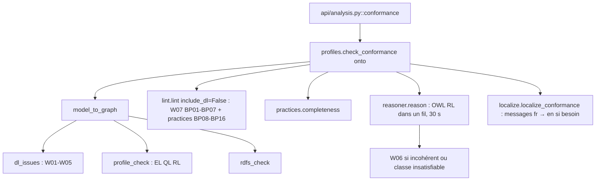

# 05. Conformité OWL 2 : profils, lint et HermiT {#conformite-owl-hermit}

Le backend vérifie une ontologie à trois niveaux : la **syntaxe OWL 2 DL et les profils** (EL, QL, RL, RDFS), les **bonnes pratiques** (lint) et le **raisonnement**. Le raisonnement existe en deux variantes très différentes : OWL RL par owlrl (en mémoire, à chaque contrôle de conformité) et OWL 2 DL par HermiT (sous-processus Java, à la demande). Ce chapitre détaille surtout HermiT.

Sources lues : `backend/ontoforge/conformance/profiles.py`, `backend/ontoforge/conformance/lint.py`, `backend/ontoforge/conformance/practices.py`, `backend/ontoforge/conformance/reasoner.py`, `backend/ontoforge/conformance/hermit.py`, `backend/ontoforge/conformance/report.py`, `backend/ontoforge/api/analysis.py`, `backend/ontoforge/assistant/reasoning.py`, `backend/Dockerfile`, `deploy/cloudrun/Dockerfile`, tests `backend/tests/test_conformance_profiles.py`, `backend/tests/test_reason_hermit.py`, `backend/tests/test_reason_hermit_w3c.py`. Exécutions de `run_hermit` dans l'environnement de test (OpenJDK 21.0.12, owlready2 0.47).

## Rôle {#role}

| Contrôle | Entrée | Où | Quand |
|---|---|---|---|
| OWL 2 DL structurel (W01 à W05) | graphe RDF | `backend/ontoforge/conformance/profiles.py::dl_issues` | `GET /conformance`, et avant chaque HermiT |
| Profils EL, QL, RL, RDFS | graphe RDF | `profile_check`, `rdfs_check` | `GET /conformance` |
| Lint W07, BP01 à BP07 | `OntoModel` (+ graphe pour les préfixes) | `backend/ontoforge/conformance/lint.py::lint` | `GET /conformance` |
| Bonnes pratiques BP08 à BP16, complétude (L49) | `OntoModel` | `backend/ontoforge/conformance/practices.py::lint`, `completeness` | `GET /conformance` (appelé par `lint`) |
| Raisonnement OWL RL (W06) | graphe RDF | `backend/ontoforge/conformance/reasoner.py::reason` | `GET /conformance` |
| Raisonnement OWL 2 DL HermiT | graphe RDF | `backend/ontoforge/conformance/hermit.py::run_hermit` | `POST /reason`, intention Krakie « raisonne » |

Les contrôles travaillent sur le **graphe RDF** reconstruit par `backend/ontoforge/io/rdf_export.py::model_to_graph`, et non sur l'`OntoModel` : c'est la seule forme qui garde tout ce que la spécification demande de vérifier (déclarations, punning, expressions anonymes, littéraux typés).

## Fichiers {#fichiers}

| Fichier | Responsabilité |
|---|---|
| `backend/ontoforge/conformance/report.py` | `Issue` (`level`, `code`, `message`, `subject`, `spec_ref`), `ReasonerInfo`, `ConformanceReport`, `PROFILE_NAMES` |
| `backend/ontoforge/conformance/profiles.py` | `check_conformance` (point d'entrée), `dl_issues`, `profile_check`, `rdfs_check`, carte des datatypes `OWL2_DATATYPE_MAP` |
| `backend/ontoforge/conformance/lint.py` | `lint` : W07 (libellés fr/en, `owl:versionIRI`, préfixes), BP01 à BP07 |
| `backend/ontoforge/conformance/practices.py` | BP08 à BP16 (définition, statut, dépréciation, version SemVer, en-tête), fiches et score de complétude |
| `backend/ontoforge/conformance/reasoner.py` | OWL RL par owlrl, contournement du bogue `prp-key`, heuristique des classes insatisfiables `_unsat` |
| `backend/ontoforge/conformance/hermit.py` | HermiT : localisation, bornes, sous-processus, lecture de la sortie, comparaison, explication heuristique, messages fr/en |
| `backend/ontoforge/assistant/reasoning.py` | intention Krakie « raisonne » (`matches`, `answer`) |

## Codes {#codes}

| Code | Niveau | Sens |
|---|---|---|
| W01 | erreur (avertissement en annotation) | datatype hors de la carte OWL 2, ou littéral mal typé |
| W02 | erreur | déclaration manquante, `rdf:Property` seul |
| W03 | erreur | propriété non simple là où OWL 2 DL exige une propriété simple (cardinalité, fonctionnelle, asymétrique…) |
| W04 | erreur | punning interdit |
| W05 | erreur | caractéristique interdite sur une propriété de données |
| W06 | erreur | classe insatisfiable ou ontologie incohérente (d'après OWL RL) |
| W07 | avertissement | libellés fr/en, `owl:versionIRI`, préfixes non standard |
| BP01 à BP16 | info ou avertissement, jamais erreur | bonnes pratiques (orphelines, cycles, nommage, définitions, statut, versions…) |

Le tableau de référence (avec les paragraphes des spécifications) est dans `skills/w3c-ontology-conformance/SKILL.md`. Un profil EL, QL ou RL n'est déclaré vrai que si DL l'est aussi (`check_conformance` : `not pv[p] and rep.profiles["DL"]`).

## Flux de `GET /conformance` {#flux-conformance}



### OWL RL par owlrl {#owl-rl}

`backend/ontoforge/conformance/reasoner.py::reason` exécute `_owlrl` dans un fil `daemon` et l'attend `timeout` secondes (30 par défaut). Au-delà, il note un dépassement et rend `used = "none"`, `consistent = None`. Le fil n'est pas interrompu pour autant : il continue jusqu'à sa fin (défaut DF-B03).

`_owlrl` copie le graphe, **retire les axiomes `owl:hasKey`** puis appelle `owlrl.DeductiveClosure(owlrl.OWLRL_Semantics, axiomatic_triples=False, datatype_axioms=False).expand(work)`. La règle `prp-key` est appliquée à part par `apply_prp_key`, puis la fermeture est recalculée. Raison : dans owlrl 7.1.2, la boucle de `prp-key` ignore la dernière propriété de la clé, si bien qu'avec `owl:hasKey (p)` tous les individus du type deviennent `owl:sameAs`. Les incohérences sont lues dans les triplets d'erreur d'owlrl (`ERRNS.error`), les classes insatisfiables par l'heuristique `_unsat` (ancêtre `owl:Nothing`, deux ancêtres disjoints, ou un ancêtre et son complément ; aucun raisonnement sur les restrictions).

## HermiT en détail {#hermit}

### Pourquoi un sous-processus et pas owlready2 {#hermit-pourquoi}

HermiT 1.3.8 est **fourni dans le paquet owlready2** (`owlready2/hermit/HermiT.jar`). OntoForge n'utilise pourtant **pas** l'API Python d'owlready2 (`sync_reasoner_hermit`) : elle charge toute l'ontologie dans un monde owlready2 en mémoire, dans le processus du serveur, et ne rend ni durée ni diagnostic. Le module lance directement la ligne de commande de HermiT dans un **sous-processus Java**, avec le même classpath qu'owlready2. owlready2 sert donc seulement à trouver le jar (et éventuellement l'exécutable Java qu'il a configuré).

### Séquence {#hermit-sequence}

```mermaid
sequenceDiagram
  participant F as Front / Krakie
  participant A as api/analysis.py::reason
  participant H as hermit.run_hermit
  participant P as profiles.dl_issues
  participant J as java (sous-processus)
  F->>A: POST /api/projects/{id}/reason {reasoner: "hermit", timeout?}
  A->>A: 422 si reasoner ≠ hermit ; load_project
  A->>H: run_hermit(model_to_graph(onto), timeout, lang)
  H->>H: locate() : owlready2, HermiT.jar, java (sinon HermitUnavailable → 501)
  H->>H: configured_timeout, configured_memory
  H->>P: erreurs DL → avertissement « résultat indicatif »
  H->>H: retire owl:imports (avertissement)
  H->>H: _SLOTS.acquire(non bloquant) (sinon HermitBusy → 503)
  H->>H: mkdtemp ontoforge-hermit-* ; écrit onto.nt
  H->>J: java -Xmx<N>m -Djava.io.tmpdir=<tmp> -cp hermit:HermiT.jar org.semanticweb.HermiT.cli.CommandLine -c -O -D -I --ignoreUnsupportedDatatypes file://onto.nt
  J-->>H: stdout (axiomes inférés), stderr, code
  H->>H: timeout ? incohérent ? OutOfMemoryError ? code ≠ 0 ?
  H->>H: parse_output puis compare(graphe, sortie)
  H->>H: finally : _SLOTS.release, rmtree(tmp)
  H-->>A: dict JSON
```

### Localisation et repli quand Java manque {#hermit-localisation}

`backend/ontoforge/conformance/hermit.py::locate` :

1. `import owlready2` ; en cas d'échec, `HermitUnavailable("owlready2")`.
2. Le jar doit exister dans `<owlready2>/hermit/HermiT.jar`, sinon `HermitUnavailable("owlready2")`.
3. Exécutable Java : `ONTOFORGE_JAVA`, sinon `owlready2.JAVA_EXE`, sinon `java`, résolu par `shutil.which`. Introuvable : `HermitUnavailable("java")`.
4. Classpath : `<owlready2>/hermit` **puis** le jar (`os.pathsep`). Le dossier contient des classes corrigées par owlready2 qui doivent passer avant celles du jar.
5. Version : lue dans `META-INF/MANIFEST.MF` du jar (`Implementation-Version`) ; défaut `1.3.8`. Dans l'environnement de test, `availability()` renvoie `HermiT 1.3.8.1099 (owlready2 0.47)`.

Le **repli** est une erreur explicite, pas un raisonneur de remplacement : la route répond 501 avec `unavailable_message`, qui dit quoi installer (JRE ou `pip install 'ontoforge[reasoner]'`, ou image Docker construite avec `WITH_REASONER=1`). L'écran Conformité affiche ce message tel quel (`frontend/src/screens/Conformance.tsx`) : il doit rester clair et traduit. L'intention Krakie renvoie le même texte comme réponse, sans lever. Le contrôle de conformité, lui, ne dépend pas de Java : W01 à W07 et OWL RL fonctionnent sans HermiT. `availability()` sert aux tests (`pytest.mark.skipif`). Aucune route ne l'expose : le front découvre l'absence de HermiT par la réponse 501.

Vérifié : avec `ONTOFORGE_JAVA=nojava`, `availability()` vaut `{'available': False, 'version': None, 'reason': 'java'}`.

### Bornes : mémoire, temps, parallélisme {#hermit-bornes}

| Variable | Défaut | Lecture | Effet |
|---|---|---|---|
| `ONTOFORGE_HERMIT_MAX_MB` | 1024 | `configured_memory`, minimum 128, valeur invalide → 1024 | `-Xmx<N>m` du tas Java ; `OutOfMemoryError` dans stderr → `status: error`, message `memory` |
| `ONTOFORGE_HERMIT_TIMEOUT` | 30 s | `configured_timeout` | délai si la requête n'en donne pas |
| `ONTOFORGE_HERMIT_MAX_TIMEOUT` | 300 s | `configured_timeout` | plafond du délai demandé ; plancher 1 s |
| `ONTOFORGE_HERMIT_SLOTS` | 2 | `_SLOTS`, lu **à l'import** du module | nombre de HermiT simultanés ; au-delà, 503 immédiat (pas de file d'attente) |
| `ONTOFORGE_JAVA` | — | `locate` | chemin ou nom de l'exécutable Java |

`-Xmx` borne le **tas** Java, pas la mémoire totale du processus (métaespace, piles, code natif s'y ajoutent) : prévoir une marge au-dessus de `ONTOFORGE_HERMIT_MAX_MB` × `ONTOFORGE_HERMIT_SLOTS` dans la mémoire du conteneur. Le délai est appliqué par `backend/ontoforge/conformance/hermit.py::_run_java` : le processus est lancé avec `start_new_session=True` (nouveau groupe de processus). À l'expiration, `os.killpg(pid, SIGKILL)` tue Java et ses éventuels enfants, puis on lit ce qui reste de la sortie (5 s maximum). Le résultat est alors `status: "timeout"`, `consistent: null`, aucun autre résultat retenu.

Mesures dans l'environnement de test : une petite ontologie de 6 classes répond en 0,4 s environ ; l'exemple `samples/trap/trap.ttl` en 5,4 s environ, dont l'essentiel est le démarrage de la JVM. Avec `timeout=0.5`, le délai est relevé à 1 s (plancher) et la réponse arrive en 1,0 s avec `status: timeout`.

### Ce qui est envoyé à HermiT {#hermit-entree}

- L'ontologie est sérialisée en **N-Triples** dans un dossier temporaire `ontoforge-hermit-*` (`tempfile.mkdtemp`), passé aussi comme `java.io.tmpdir`. Le dossier est supprimé dans le `finally`, même après un dépassement de délai (vérifié par `test_timeout_kills_and_cleans`).
- Les triplets `owl:imports` sont **retirés** avant l'écriture : HermiT irait sinon chercher l'IRI sur le réseau depuis le serveur. Un avertissement liste les trois premières IRI retirées.
- Options de la ligne de commande : `-c` (classification), `-O` (propriétés objet), `-D` (propriétés de données), `-I` (réalisation des individus), `--ignoreUnsupportedDatatypes` (un datatype inconnu ne fait pas échouer). Sens vérifié dans l'aide de HermiT (`--help`, jar d'owlready2 0.47) : `-c` / `--classify`, `-O` / `--classifyOPs`, `-D` / `--classifyDPs`, `-I` / `--classifyIs` (classification des instances).
- Hors OWL 2 DL : HermiT est quand même lancé, avec en tête des avertissements le message `not_dl` (« résultat indicatif »). S'il refuse l'ontologie, la réponse est `status: error` et le message renvoie au profil.

### Traduction des résultats {#hermit-resultats}

La sortie standard contient une ligne par axiome de la hiérarchie **directe** : `SubClassOf( <enfant> <parent> )`, `EquivalentClasses( <a> <b> … )` (un groupe contenant `owl:Nothing` = classes insatisfiables) et `Type( <individu> <classe> )`. `backend/ontoforge/conformance/hermit.py::parse_output` les lit avec l'expression `_LINE`.

`backend/ontoforge/conformance/hermit.py::compare` retranche la hiérarchie **déclarée** (`_declared_edges` : `rdfs:subClassOf` et `owl:equivalentClass` entre classes nommées, plus les conjoints nommés d'une définition `A ≡ B ⊓ R`) :

| Champ de la réponse | Calcul |
|---|---|
| `unsatisfiable` | membres des groupes équivalents à `owl:Nothing` (hors vocabulaire OWL) |
| `hierarchy.new_subclass` | arêtes `SubClassOf` absentes de la fermeture déclarée. HermiT n'écrit qu'un représentant par groupe d'équivalence : une arête est tenue pour déclarée si un membre du groupe de l'enfant a un membre du groupe du parent pour ancêtre déclaré |
| `hierarchy.new_equivalent` | groupes d'équivalence dont au moins une paire n'est pas déjà mutuellement sous-classe |
| `reclassified` | individus dont un type inféré n'est pas dans la fermeture de leurs types déclarés |
| `warnings` (`thing_equiv`) | classe inférée équivalente à `owl:Thing` (souvent un axiome trop large) |
| `hierarchy.counts` | nombre d'arêtes déclarées, d'arêtes inférées, de types inférés |

Exemple exécuté : `A ⊥ B`, `C ⊑ A ⊓ B` (en deux axiomes), `D ≡ ∃p.A`, `E ⊑ ∃p.A` donne `consistent: true`, `unsatisfiable: [C]`, `new_subclass: [{sub: E, sup: D}]`.

**Ontologie incohérente.** HermiT signale l'incohérence dans sa sortie (`InconsistentOntologyException` ou `Inconsistent ontology`) mais la ligne de commande ne fournit **aucune justification**. OntoForge appelle alors `explain_inconsistency`, une heuristique syntaxique qui cherche des **candidats** : individu dont les types (fermés par la hiérarchie déclarée et par `rdfs:domain` / `rdfs:range` des assertions) contiennent deux classes disjointes, individu d'une classe évidemment insatisfiable, paire à la fois `owl:sameAs` et `owl:differentFrom`. La réponse porte `explanation.justification = false` et `source = "heuristic"`, et la note conseille Protégé (« Explain inconsistent ontology ») pour une justification minimale. Exemple exécuté : un individu typé `A` et `B` disjointes donne un item `kind: disjoint`, « i est de type A et B, qui sont disjointes ».

**Erreurs.** Code de retour non nul : `status: error`, `error` = première ligne utile de stderr (les lignes `JAVA_TOOL_OPTIONS` sont ignorées, coupée à 300 caractères), suivie d'un renvoi au profil si l'ontologie sort de DL.

La forme complète de la réponse est dans `docs/CONTRACTS.md` §11. Les messages sont en français ou en anglais selon `localize.ui_lang()` (table `MSG`, fonction `message`).

### Krakie {#hermit-krakie}

`backend/ontoforge/assistant/reasoning.py::answer` reconnaît les demandes de raisonnement (expressions régulières fr et en, fonction `matches`), appelle `run_hermit` **avant** tout fournisseur LLM, et résume le résultat avec une action `navigate` vers l'écran Conformité. Il ne lève jamais : Java absent ou serveur occupé donnent une réponse en clair.

### Installation {#hermit-installation}

- `backend/pyproject.toml` : extra `reasoner = ["owlready2==0.47"]`.
- `backend/Dockerfile` (image de `docker compose`) : installe toujours `default-jre-headless` et `.[reasoner]`.
- `deploy/cloudrun/Dockerfile` : argument `WITH_REASONER` (1 par défaut) ; `WITH_REASONER=0` donne une image légère où `POST /reason` répond 501.
- Version de Java : OpenJDK 21.0.12.1 dans l'environnement de test ; dans l'image, c'est le `default-jre-headless` de la distribution de `python:3.12-slim` (Debian 13), donc `À CONFIRMER` sur une image construite. D-040 a retiré `openjdk-17-jre-headless`, absent de Debian 13.

## Librairies {#librairies}

| Librairie | Version | Pourquoi |
|---|---|---|
| rdflib | 7.1.1 | graphe RDF, sérialisation N-Triples pour HermiT |
| owlrl | 7.1.2 | fermeture OWL RL en mémoire (avec contournement `prp-key`) |
| owlready2 | 0.47 (extra `reasoner`) | fournit `HermiT.jar` 1.3.8 et ses classes corrigées ; son API Python n'est pas utilisée |
| Java | OpenJDK 21 (test) | exécution de HermiT |

## Décisions {#decisions}

- D-018 : HermiT est le premier élément coupé en cas de manque de temps ; il reste optionnel.
- D-040 : pas d'`openjdk-17-jre-headless` dans l'image (absent de Debian 13).
- L32 (`docs/CONTRACTS.md` §11) : contrat de `POST /reason`.
- L39-secu, SEC-21 : l'ancien chargement par owlready2 depuis un fichier local, sans retrait des `owl:imports`, a été supprimé (commentaire dans `reason`).
- D-L49-01 : vocabulaires des bonnes pratiques BP08 à BP16.

## Pièges et limites {#pieges}

- Deux raisonneurs, deux sémantiques. W06 vient d'OWL RL (incomplet pour OWL 2 DL) ; la carte HermiT est un autre calcul. Une classe peut être insatisfiable pour HermiT sans W06.
- Monde ouvert. Ni HermiT ni owlrl ne signalent une information absente ; deux noms différents peuvent désigner le même individu.
- Fil owlrl non interruptible (DF-B03) : sur une grosse ontologie, plusieurs `GET /conformance` successifs empilent des calculs.
- Pas de file d'attente HermiT : la troisième demande simultanée (avec 2 places) reçoit 503 tout de suite.
- `ONTOFORGE_HERMIT_SLOTS` est lu à l'import : le changer demande un redémarrage. Une valeur non numérique de cette variable ou des délais fait échouer le module ou la route (DF-B04).
- Démarrage de la JVM : plusieurs secondes par appel ; HermiT n'est pas fait pour être lancé à chaque frappe.
- Explication heuristique : `explanation.items` peut être vide alors que l'ontologie est incohérente (la note le dit).

## Comment ajouter… {#comment-ajouter}

**…un contrôle de conformité.** Choisir le niveau : erreur de profil DL (fonction `_wNN` appelée dans `dl_issues`), bonne pratique sur le modèle (`lint` ou `practices.lint`, niveau info ou avertissement seulement). Produire des `Issue` avec un `spec_ref` qui cite le paragraphe de la norme, ajouter la traduction anglaise du message dans `backend/ontoforge/localize/` si le texte est composé, et un cas dans `samples/trap/trap-nondl.ttl` (un cas par code, D-036) avec son test.

**…un autre raisonneur.** `ReasonRequest.reasoner` est prévu pour cela : ajouter une branche dans `backend/ontoforge/api/analysis.py::reason`, un module qui rend la même forme de réponse que `run_hermit` (le front et Krakie la lisent), et le même contrat d'erreurs (501 indisponible, 503 occupé). Garder l'exécution hors du processus du serveur si le raisonneur peut boucler ou épuiser la mémoire.
