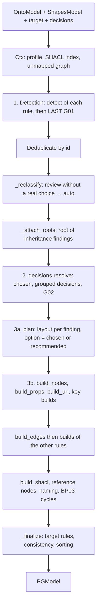

# 07. Analysis engine and rule catalog {#moteur-analyse}

The engine turns an `OntoModel` (and its shapes) into a `PGModel` for one target. It is the business core. It detects every OWL construct that raises a transposition question and turns it into a finding (`Finding`) classified `auto`, `review` or `lost`. It then applies the human decision or the recommendation, and builds node types, edges, validations and materializations.

Sources read: `backend/ontoforge/mapping/engine.py`, `backend/ontoforge/mapping/decisions.py`, `backend/ontoforge/mapping/notes.py`, `backend/ontoforge/mapping/profile_api.py`, `backend/ontoforge/mapping/profiles/curiosity.py`, `backend/ontoforge/mapping/profiles/neo4j.py`, `backend/ontoforge/mapping/rules/`, `backend/ontoforge/api/analysis.py`, `docs/RULES.md`, `samples/trap/expected-findings.yaml`, `backend/tests/test_mapping_oracle.py`. Run of `analyze` on `samples/trap/` (state of 23/11).

## Role {#role}

`backend/ontoforge/mapping/engine.py::analyze` has the signature `analyze(onto, shapes, target, decisions) -> PGModel`. It is **pure and deterministic**: same inputs, same output (everything is sorted), no disk access. The `PGModel` is never stored: the route recomputes it on every call (chapter [03](03-modele-interne.en.md#flux)).

## Files {#fichiers}

| File | Responsibility |
|---|---|
| `backend/ontoforge/mapping/engine.py` | `analyze`; reclassification `_reclassify`; roots `_attach_roots`; cycle findings `_cycle_notes`; finishing `_finalize` |
| `backend/ontoforge/mapping/rules/__init__.py` | `REGISTRY` (id → `RuleInfo`: `detect`, `plan`, `build`, metadata), `LAST`, `rules_table` |
| `backend/ontoforge/mapping/rules/catalog.py` | **normative catalog** `RULES` (title, severity, options, recommendation per target, rationale, compensation); tables `NO_CHOICE`, `SINGLE_OPTION_AUTO`, `HIERARCHY_RULES`; source of `docs/RULES.md` |
| `backend/ontoforge/mapping/rules/_base.py` | `Ctx` (analysis context, cached semantic views, build plan), factory `finding`, `make_id`, `add_validation`, `add_materialization`, unmapped-triples graph `build_unmapped_graph` |
| `backend/ontoforge/mapping/rules/classes.py`, `keys.py`, `data.py`, `objects.py`, `reification.py`, `annotations.py`, `individuals.py`, `naming.py`, `shacl.py` | one rule family per module: dictionaries `DETECT` (and `DETECT_LAST`), `APPLY_PLAN`, `APPLY_BUILD` |
| `backend/ontoforge/mapping/decisions.py` | `resolve` (decision replay, grouped decision `<rule>:*`, G02 finding for an unknown option), `clean` |
| `backend/ontoforge/mapping/notes.py` | decision trace (`DecisionNote`): `apply_changes`, `notes_for`, `clean_reason`, `MAX_REASON` = 280 |
| `backend/ontoforge/mapping/profile_api.py` | `Profile`: single adapter between the engine and target profiles, with internal fallbacks; `get_profile` |
| `backend/ontoforge/mapping/profiles/curiosity.py`, `backend/ontoforge/mapping/profiles/neo4j.py` | platform capabilities, naming (N01), datatype table, per-rule rationales |
| `backend/ontoforge/mapping/reverse_names.py` | `uniquify_reverses`: unique reverse edge names (Curiosity) |

## Flow {#flux}

In `analyze`:

1. Detection. Each `RuleInfo.detect(ctx)` returns a list of `Finding`, without changing the model (read caches only). Rules in `LAST` (G01) run last: they read what the others have "consumed" in the unmapped graph. Two findings with the same id are merged (union of `related`).
2. Reclassification (D-L47-01). A `review` finding whose recommended option for the target loses nothing, and whose alternative only drops the constraint, becomes `auto` with `auto_reason` (table `catalog.NO_CHOICE`: D09, D13, O09, O10 depending on the target). A `lost` finding is **never** reclassified (D-L14-02). Special Curiosity case: an O09 `exactly n` (n ≥ 1) requires the data, so it stays to be arbitrated (`_tightens_curiosity`).
3. Decisions. `backend/ontoforge/mapping/decisions.py::resolve` sets `chosen`: first grouped decisions `<rule>:*` (for the rule's findings without an individual decision), then individual decisions. An unknown option is ignored (the recommendation applies) and produces a G02 finding. A decision whose finding has disappeared is kept in `PGModel.decisions` and replayed if it comes back.
4. Two-step build. `plan(ctx, f, option)` lays things out (merge, flatten, rename…) in `ctx.plan`; then the builders `classes.build_nodes`, `data.build_props`, `keys.build_uri` create the types, key `build`s run, `objects.build_edges` creates the edges, and the other `build`s add properties, validations and materializations. The applied option is always `f.chosen or f.recommended`.
5. Finishing (`_finalize`). Neo4j: a subtype inherits its ancestor's key if it only has the default key. Curiosity: a single label, edge properties removed (with a note), `reverse` always set and made unique. Then: edges to a missing type removed, deduplication, sorting, fallback key `uri`, `decisions` cleaned.

## The rule catalog {#catalogue}

`backend/ontoforge/mapping/rules/catalog.py::RULES` is the **single source** (D-031); `docs/RULES.md` is its rendering and is not edited by hand. Each entry: `family`, `construct`, `detect` (text), `severity`, `title`, `options` (`{id: {label, impact, targets}}`), `reco` (`{curiosity, neo4j}`), `rationale`, `compensation`. Option ids are the normative vocabulary of `samples/trap/expected-findings.yaml`.

State of 23/11: 68 rules in the registry (66 transposition rules, plus S01 and S02 for SHACL). G02 is in the catalog but produced by `decisions.resolve`, and BP03 by `_cycle_notes`: neither has a detector in the registry. Split by module: objects 21, classes 13, data 13, annotations 6, individuals 5, keys 5, reification 2, SHACL 2, naming 1. The `assert` at the bottom of `backend/ontoforge/mapping/rules/__init__.py` guarantees that every rule of `catalog.TRANSPOSITION_RULES` is implemented: an omission prevents the engine from importing.

The factory `backend/ontoforge/mapping/rules/_base.py::finding` builds a complete `Finding` from the catalog: options filtered for the target, recommendation (can be overridden per finding with `reco`), rationale completed with the target profile's (`Profile.rationale`).

### Finding ids {#ids}

`make_id(rule, subject, suffix)` gives `<rule>:<subject IRI>[:<suffix>]` (D-035): suffix `:<property IRI>` for a restriction, `sha8` digest of a canonical form for an anonymous construct. These ids are the keys of `Project.decisions`: changing them loses arbitrations.

### Severities {#severites}

| Severity | Meaning | Counters |
|---|---|---|
| `auto` | trivial transposition, or reclassified (`auto_reason`) | counted |
| `review` | possible loss, to be arbitrated | counted, "pending" while undecided |
| `lost` | no native equivalent, certain loss without compensation | counted, never bulk-accepted by default |
| `info` | informative finding (perimeter P00 to P03, BP03 cycles) | excluded (D-L9-02) |

## Target profiles {#profils}

The engine does not know targets directly: it reads a `backend/ontoforge/mapping/profile_api.py::Profile` obtained from `get_profile(target)`, which normalizes the modules `profiles/curiosity.py` and `profiles/neo4j.py` (written by the target experts with slightly different signatures). `Profile` exposes `cap(name)` (capabilities: `multi_label`, `edge_properties`, `native_reverse_edges`…), N01 naming (`node`, `edge`, `prop`, `reverse`), `datatype(iri) -> (PGType, lossy, note)` and `rationale(rule)`. If a profile is missing or raises, `Profile._safe` switches to the internal fallbacks (`_FALLBACK_TYPES`, `_pascal`, `_camel`, `_upper_snake`) and adds a warning: the engine never depends on the state of another module.

## API side {#api}

`backend/ontoforge/api/analysis.py::run_analysis` wraps `analyze`:

- applies the requested perimeter (`editing/perimeter.py::scope`, which adds perimeter information findings);
- sets `LABEL_LANG` for the label language (chapter [03](03-modele-interne.en.md#langue-des-libelles));
- adds the decision trace (`notes_for`), the project's standard versions and each node type's icon;
- the response is translated into English if needed by `localize.localize_pg` (the engine writes French).

Routes: `POST /analyze`, `PUT /decisions/{target}` (old flat format `{id: option|null}` or L47 format `{decisions, reason?, reasons?, via?}`), `POST /decisions/{target}/accept-recommended` (`review` only, `lost` with `include_lost=true`, D-L14-02), `POST /decisions/{target}/branch` (arbitration by hierarchy root, L47: another account's decision is replaced only with `overwrite: true`). A decision is saved **after** a successful analysis: if the engine is missing, the route answers 501 before writing anything.

## The trap oracle {#oracle}

`samples/trap/trap.ttl` is a trap ontology (OWL 2 DL by construction, D-036) with at least one case per rule. `samples/trap/expected-findings.yaml` (owner: w3c) lists a **minimal** set of expected findings (rule, subject, severity, recommendation per target) and forbidden findings (`must_not`). `backend/tests/test_mapping_oracle.py` runs it for both targets. Extra findings are tolerated. An oracle gap is settled by a decision (example: D-L47-01 for `auto` reclassifications).

Run of 23/11 on `trap.ttl` + `trap-shapes.ttl`, without decisions:

| Target | auto | review | lost | node types | edge types | validations | materializations |
|---|---|---|---|---|---|---|---|
| curiosity | 196 | 81 | 21 | 25 | 49 | 71 | 10 |
| neo4j | 195 | 80 | 27 | 40 | 34 | 73 | 5 |

These numbers change with the engine: do not use them as test criteria.

## Libraries {#librairies}

| Library | Version | Why |
|---|---|---|
| pydantic | 2.10.3 | `Finding`, `PGModel` models |
| rdflib | 7.1.1 | unmapped-triples graph read again by the rules (`build_unmapped_graph`) |

The engine itself is plain Python.

## Decisions {#decisions}

- D-031, D-031bis: 66 rules, corrected severities (K02 and C05 as `review`).
- D-035: id format; D-L4-02: PGModel conventions.
- D-L9-02: `info` severity.
- D-L14-02: "accept recommendations" does not accept `lost` by default.
- D-L15-01: inheritance under a merged abstract class (C04 `merge_into_leaves`).
- D-L47-01 to D-L47-03: `auto` reclassification, decision trace, arbitration by branch.

## Pitfalls and limits {#pieges}

- Build order: a `build` that needs edges must live in a module other than `keys` (the `keys` builds run before `build_edges`). Putting a rule in the wrong module gives missing properties or validations, with no error.
- `Ctx.cache`: views (`parents`, `children`…) are computed once. A rule that changed `ctx.onto` during detection would make the caches wrong; detection must stay pure.
- Open world versus closed world: transposing an axiom into a validation is a strengthening; the report says so. Do not present a validation as equivalent to the axiom.
- Orphan decisions: a decision whose finding has disappeared stays in the project. This is intended (replay), but `Project.decisions` may hold ids without a finding.
- Language: the engine writes French; translation happens at the HTTP boundary (`localize`). A composed text without a translation fragment stays in French.

## How to add a rule {#comment-ajouter}

1. Add the entry to the catalog `backend/ontoforge/mapping/rules/catalog.py::RULES` (with the `r(...)` function); `TRANSPOSITION_RULES` is derived from it (everything except S01, S02, G02). Record a decision, since the catalog is normative (D-031).
2. Write `detect_xxx(ctx)` in the family's module, building findings with `finding(ctx, "XNN", subject, detail, suffix=...)`; add it to `DETECT`.
3. Write the application: `APPLY_PLAN` for a layout (merge, rename) before the build, `APPLY_BUILD` to add properties, validations (`add_validation`) or materializations (`add_materialization`) afterwards.
4. If the target profile has its own rationale, add it in `profiles/curiosity.py` or `profiles/neo4j.py`.
5. Add a case in `samples/trap/trap.ttl` and the expected entry in `expected-findings.yaml` (with the w3c agent, owner), then the English translation of title and detail in `backend/ontoforge/localize/catalog_en.py` or `phrases.py`.
6. Regenerate `docs/RULES.md` from the catalog (`rules_table` gives the serializable view). No rendering script is versioned (checked on 23/11: `rules_table` has no caller in the repository) and no test compares `docs/RULES.md` with the catalog: a drift is not detected automatically.
