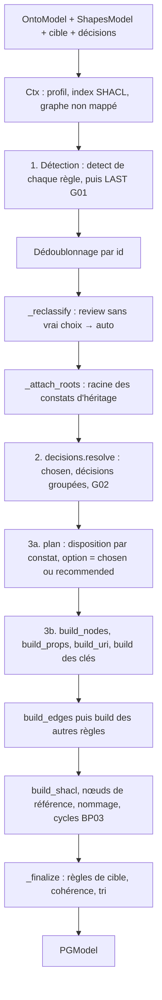

# 07. Moteur d'analyse et catalogue de règles {#moteur-analyse}

Le moteur transforme un `OntoModel` (et ses shapes) en `PGModel` pour une cible. C'est le cœur métier. Il détecte chaque construct OWL qui pose une question de transposition et en fait un constat (`Finding`) classé `auto`, `review` ou `lost`. Il applique ensuite la décision humaine ou la recommandation, puis construit les types de nœuds, les relations, les validations et les matérialisations.

Sources lues : `backend/ontoforge/mapping/engine.py`, `backend/ontoforge/mapping/decisions.py`, `backend/ontoforge/mapping/notes.py`, `backend/ontoforge/mapping/profile_api.py`, `backend/ontoforge/mapping/profiles/curiosity.py`, `backend/ontoforge/mapping/profiles/neo4j.py`, `backend/ontoforge/mapping/rules/`, `backend/ontoforge/api/analysis.py`, `docs/RULES.md`, `samples/trap/expected-findings.yaml`, `backend/tests/test_mapping_oracle.py`. Exécution de `analyze` sur `samples/trap/` (état du 23/11).

## Rôle {#role}

`backend/ontoforge/mapping/engine.py::analyze` a la signature `analyze(onto, shapes, target, decisions) -> PGModel`. Il est **pur et déterministe** : mêmes entrées, même sortie (tout est trié), aucun accès disque. Le `PGModel` n'est jamais stocké : la route le recalcule à chaque appel (chapitre [03](03-modele-interne.md#flux)).

## Fichiers {#fichiers}

| Fichier | Responsabilité |
|---|---|
| `backend/ontoforge/mapping/engine.py` | `analyze` ; reclassement `_reclassify` ; racines `_attach_roots` ; constats de cycle `_cycle_notes` ; finition `_finalize` |
| `backend/ontoforge/mapping/rules/__init__.py` | registre `REGISTRY` (id → `RuleInfo` : `detect`, `plan`, `build`, métadonnées), `LAST`, `rules_table` |
| `backend/ontoforge/mapping/rules/catalog.py` | **catalogue normatif** `RULES` (titre, sévérité, options, recommandation par cible, justification, compensation) ; tables `NO_CHOICE`, `SINGLE_OPTION_AUTO`, `HIERARCHY_RULES` ; source de `docs/RULES.md` |
| `backend/ontoforge/mapping/rules/_base.py` | `Ctx` (contexte d'analyse, vues sémantiques en cache, plan de construction), fabrique `finding`, `make_id`, `add_validation`, `add_materialization`, graphe des triplets non mappés `build_unmapped_graph` |
| `backend/ontoforge/mapping/rules/classes.py`, `keys.py`, `data.py`, `objects.py`, `reification.py`, `annotations.py`, `individuals.py`, `naming.py`, `shacl.py` | une famille de règles par module : dictionnaires `DETECT` (et `DETECT_LAST`), `APPLY_PLAN`, `APPLY_BUILD` |
| `backend/ontoforge/mapping/decisions.py` | `resolve` (rejeu des décisions, décision groupée `<règle>:*`, constat G02 si option inconnue), `clean` |
| `backend/ontoforge/mapping/notes.py` | trace des décisions (`DecisionNote`) : `apply_changes`, `notes_for`, `clean_reason`, `MAX_REASON` = 280 |
| `backend/ontoforge/mapping/profile_api.py` | `Profile` : adaptateur unique entre le moteur et les profils cibles, avec replis internes ; `get_profile` |
| `backend/ontoforge/mapping/profiles/curiosity.py`, `backend/ontoforge/mapping/profiles/neo4j.py` | capacités de la plateforme, nommage (N01), table des datatypes, justifications par règle |
| `backend/ontoforge/mapping/reverse_names.py` | `uniquify_reverses` : noms d'arêtes inverses uniques (Curiosity) |

## Flux {#flux}

Dans `analyze` :

1. Détection. Chaque `RuleInfo.detect(ctx)` renvoie une liste de `Finding`, sans modifier le modèle (seulement des caches de lecture). Les règles de `LAST` (G01) passent en dernier : elles lisent ce que les autres ont « consommé » dans le graphe non mappé. Deux constats de même id sont fusionnés (union de `related`).
2. Reclassement (D-L47-01). Un constat `review` dont l'option recommandée pour la cible ne perd rien, et dont l'alternative n'est qu'un abandon de la contrainte, passe en `auto` avec `auto_reason` (table `catalog.NO_CHOICE` : D09, D13, O09, O10 selon la cible). Un constat `lost` n'est **jamais** reclassé (D-L14-02). Cas particulier Curiosity : un O09 `exactly n` (n ≥ 1) exige la donnée, il reste à arbitrer (`_tightens_curiosity`).
3. Décisions. `backend/ontoforge/mapping/decisions.py::resolve` pose `chosen` : d'abord les décisions groupées `<règle>:*` (pour les constats de la règle sans décision individuelle), puis les décisions individuelles. Une option inconnue est ignorée (la recommandation s'applique) et produit un constat G02. Une décision dont le constat a disparu est gardée dans `PGModel.decisions` et rejouée s'il réapparaît.
4. Construction en deux temps. `plan(ctx, f, option)` dispose (fusionner, aplatir, renommer…) dans `ctx.plan` ; puis les constructeurs `classes.build_nodes`, `data.build_props`, `keys.build_uri` créent les types, les `build` des clés passent, `objects.build_edges` crée les arêtes, et les autres `build` ajoutent propriétés, validations et matérialisations. L'option appliquée est toujours `f.chosen or f.recommended`.
5. Finition (`_finalize`). Neo4j : un sous-type hérite de la clé de son ancêtre s'il n'a que la clé par défaut. Curiosity : un seul label, propriétés d'arête retirées (avec note), `reverse` toujours renseigné et rendu unique. Puis : arêtes vers un type inexistant retirées, dédoublonnage, tri, clé de repli `uri`, `decisions` nettoyées.

## Le catalogue de règles {#catalogue}

`backend/ontoforge/mapping/rules/catalog.py::RULES` est la **source unique** (D-031) ; `docs/RULES.md` en est le rendu et ne se modifie pas à la main. Chaque entrée : `family`, `construct`, `detect` (texte), `severity`, `title`, `options` (`{id: {label, impact, targets}}`), `reco` (`{curiosity, neo4j}`), `rationale`, `compensation`. Les identifiants d'options sont le vocabulaire normatif de `samples/trap/expected-findings.yaml`.

État du 23/11 : 68 règles au registre (66 de transposition, plus S01 et S02 pour SHACL). G02 est au catalogue mais produit par `decisions.resolve`, et BP03 par `_cycle_notes` : ni l'un ni l'autre n'a de détecteur au registre. Répartition par module : objets 21, classes 13, données 13, annotations 6, individus 5, clés 5, réification 2, SHACL 2, nommage 1. Le `assert` en bas de `backend/ontoforge/mapping/rules/__init__.py` garantit que toutes les règles de `catalog.TRANSPOSITION_RULES` sont implémentées : un oubli empêche l'import du moteur.

La fabrique `backend/ontoforge/mapping/rules/_base.py::finding` construit un `Finding` complet à partir du catalogue : options filtrées pour la cible, recommandation (surchargeable par constat avec `reco`), justification complétée par celle du profil cible (`Profile.rationale`).

### Identifiants de constats {#ids}

`make_id(rule, subject, suffix)` donne `<règle>:<IRI sujet>[:<suffixe>]` (D-035) : suffixe `:<IRI propriété>` pour une restriction, empreinte `sha8` d'une forme canonique pour un construct anonyme. Ces ids sont les clés de `Project.decisions` : les changer fait perdre les arbitrages.

### Sévérités {#severites}

| Sévérité | Sens | Compteurs |
|---|---|---|
| `auto` | transposition triviale, ou reclassée (`auto_reason`) | comptée |
| `review` | perte possible, à arbitrer | comptée, « pending » tant que non décidée |
| `lost` | pas d'équivalent natif, perte certaine sans compensation | comptée, jamais acceptée en masse par défaut |
| `info` | constat informatif (périmètre P00 à P03, cycles BP03) | exclue (D-L9-02) |

## Profils cibles {#profils}

Le moteur ne connaît pas les cibles directement : il lit un `backend/ontoforge/mapping/profile_api.py::Profile` obtenu par `get_profile(target)`, qui normalise les modules `profiles/curiosity.py` et `profiles/neo4j.py` (écrits par les experts cibles avec des signatures un peu différentes). `Profile` expose `cap(name)` (capacités : `multi_label`, `edge_properties`, `native_reverse_edges`…), le nommage N01 (`node`, `edge`, `prop`, `reverse`), `datatype(iri) -> (PGType, perte, note)` et `rationale(rule)`. Si un profil manque ou lève une exception, `Profile._safe` bascule sur les replis internes (`_FALLBACK_TYPES`, `_pascal`, `_camel`, `_upper_snake`) et ajoute un avertissement : le moteur ne dépend jamais de l'état d'un autre module.

## Côté API {#api}

`backend/ontoforge/api/analysis.py::run_analysis` encadre `analyze` :

- applique le périmètre demandé (`editing/perimeter.py::scope`, qui ajoute les constats d'information de périmètre) ;
- pose `LABEL_LANG` pour la langue des libellés (chapitre [03](03-modele-interne.md#langue-des-libelles)) ;
- ajoute la trace des décisions (`notes_for`), les versions de normes du projet et l'icône de chaque type de nœud ;
- la réponse est traduite en anglais si besoin par `localize.localize_pg` (le moteur écrit en français).

Routes : `POST /analyze`, `PUT /decisions/{target}` (ancien format plat `{id: option|null}` ou format L47 `{decisions, reason?, reasons?, via?}`), `POST /decisions/{target}/accept-recommended` (`review` seulement, `lost` avec `include_lost=true`, D-L14-02), `POST /decisions/{target}/branch` (arbitrage par racine de hiérarchie, L47 : une décision d'un autre compte n'est remplacée qu'avec `overwrite: true`). Une décision est enregistrée **après** une analyse réussie : si le moteur manque, la route répond 501 avant toute écriture.

## L'oracle trap {#oracle}

`samples/trap/trap.ttl` est une ontologie piège (OWL 2 DL par construction, D-036) qui contient au moins un cas par règle. `samples/trap/expected-findings.yaml` (propriétaire : w3c) liste un ensemble **minimal** de constats attendus (règle, sujet, sévérité, recommandation par cible) et des constats interdits (`must_not`). `backend/tests/test_mapping_oracle.py` l'exécute pour les deux cibles. Des constats supplémentaires sont tolérés. Un écart d'oracle se règle par décision (exemple : D-L47-01 pour les reclassements en `auto`).

Exécution du 23/11 sur `trap.ttl` + `trap-shapes.ttl`, sans décision :

| Cible | auto | review | lost | types de nœuds | types d'arêtes | validations | matérialisations |
|---|---|---|---|---|---|---|---|
| curiosity | 196 | 81 | 21 | 25 | 49 | 71 | 10 |
| neo4j | 195 | 80 | 27 | 40 | 34 | 73 | 5 |

Ces nombres évoluent avec le moteur : ne pas les utiliser comme critère de test.

## Librairies {#librairies}

| Librairie | Version | Pourquoi |
|---|---|---|
| pydantic | 2.10.3 | modèles `Finding`, `PGModel` |
| rdflib | 7.1.1 | graphe des triplets non mappés relu par les règles (`build_unmapped_graph`) |

Le moteur lui-même est du Python pur.

## Décisions {#decisions}

- D-031, D-031bis : 66 règles, sévérités corrigées (K02 et C05 en `review`).
- D-035 : format des ids ; D-L4-02 : conventions PGModel.
- D-L9-02 : sévérité `info`.
- D-L14-02 : « accepter les recommandations » n'accepte pas les `lost` par défaut.
- D-L15-01 : héritage sous une classe abstraite fusionnée (C04 `merge_into_leaves`).
- D-L47-01 à D-L47-03 : reclassement en `auto`, trace des décisions, arbitrage par branche.

## Pièges et limites {#pieges}

- Ordre de construction : un `build` qui a besoin des arêtes doit être dans un module autre que `keys` (les `build` de `keys` passent avant `build_edges`). Ajouter une règle dans le mauvais module donne des propriétés ou validations manquantes, sans erreur.
- `Ctx.cache` : les vues (`parents`, `children`…) sont calculées une fois. Une règle qui modifierait `ctx.onto` pendant la détection rendrait les caches faux ; la détection doit rester pure.
- Monde ouvert contre monde clos : transposer un axiome en validation est un renforcement ; le rapport le rappelle. Ne pas présenter une validation comme équivalente à l'axiome.
- Décisions orphelines : une décision dont le constat a disparu reste dans le projet. C'est voulu (rejeu), mais `Project.decisions` peut contenir des ids sans constat.
- Langue : le moteur écrit en français ; la traduction se fait à la frontière HTTP (`localize`). Un texte composé sans fragment de traduction reste en français.

## Comment ajouter une règle {#comment-ajouter}

1. Ajouter l'entrée au catalogue `backend/ontoforge/mapping/rules/catalog.py::RULES` (avec la fonction `r(...)`) ; `TRANSPOSITION_RULES` en est déduit (tout sauf S01, S02, G02). Décision tracée, car le catalogue est normatif (D-031).
2. Écrire `detect_xxx(ctx)` dans le module de la famille, en construisant les constats avec `finding(ctx, "XNN", sujet, détail, suffix=...)` ; l'ajouter à `DETECT`.
3. Écrire l'application : `APPLY_PLAN` pour une disposition (fusion, renommage) avant la construction, `APPLY_BUILD` pour ajouter propriétés, validations (`add_validation`) ou matérialisations (`add_materialization`) après.
4. Si le profil cible a une justification propre, l'ajouter dans `profiles/curiosity.py` ou `profiles/neo4j.py`.
5. Ajouter un cas dans `samples/trap/trap.ttl` et l'entrée attendue dans `expected-findings.yaml` (avec l'agent w3c, propriétaire), puis la traduction anglaise du titre et du détail dans `backend/ontoforge/localize/catalog_en.py` ou `phrases.py`.
6. Regénérer `docs/RULES.md` depuis le catalogue (`rules_table` en donne la vue sérialisable). Aucun script de rendu n'est versionné (vérifié le 23/11 : `rules_table` n'a aucun appelant dans le dépôt) et aucun test ne compare `docs/RULES.md` au catalogue : l'écart n'est pas détecté automatiquement.
