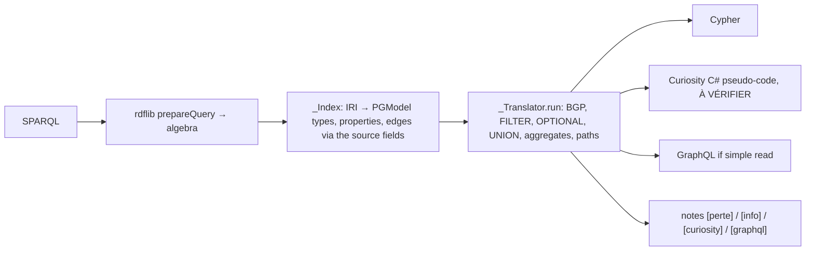

# 09. Queries: SPARQL translation, guided querying, endpoints {#requetes}

The `backend/ontoforge/queries/` package does three things: translate a SPARQL query written against the ontology into a query on the generated property graph (Cypher, Curiosity, GraphQL); build Sparnatural-style guided queries, including from a natural-language question; run a read-only query against a SPARQL endpoint or the local triplestore (chapter [10](10-triplestore-local.en.md)).

Sources read: `backend/ontoforge/queries/translate.py`, `backend/ontoforge/queries/builder.py`, `backend/ontoforge/queries/nl.py`, `backend/ontoforge/queries/endpoint.py`, `backend/ontoforge/queries/options.py`, `backend/ontoforge/queries/saved.py`, `backend/ontoforge/queries/competency.py`, `backend/ontoforge/api/queries.py`, `backend/ontoforge/api/analysis.py`, `docs/CONTRACTS.md` §6. Translations run on `samples/automaint/automaint.ttl`.

## Files {#fichiers}

| File | Responsibility |
|---|---|
| `backend/ontoforge/queries/translate.py` | `translate(sparql, pg, onto) -> TranslationResult`: SPARQL → Cypher, Curiosity pseudo-code, GraphQL, loss notes |
| `backend/ontoforge/queries/builder.py` | `GuidedQuery` (root, steps, filters, selection, ordering), `validate_guided`, `to_sparql`, `Suggester` (suggestions driven by the ontology and shapes), `build_all`, `guided_from_sparql` |
| `backend/ontoforge/queries/nl.py` | natural-language question → `GuidedQuery`: deterministic pre-analysis, optional LLM, strict validation (`sanitize`), deterministic fallback; entry point `interpret` |
| `backend/ontoforge/queries/sparql_lock.py` | single lock for rdflib's SPARQL parser (`parse_query`, `parse_update`, `prepare_query`, `translate_parsed`); every parser call in the server process goes through it (L53, DF-B17) |
| `backend/ontoforge/queries/endpoint.py` | execution on a SPARQL endpoint: `query_form` (updates rejected), `force_limit`, `run_select`, `ping`, `graph_preview` |
| `backend/ontoforge/queries/options.py` | possible values known without an endpoint (individuals, `owl:oneOf`, `sh:in`, DataOneOf, PGModel enum) |
| `backend/ontoforge/queries/saved.py` | saved queries (project's `queries.json`, atomic write under lock) |
| `backend/ontoforge/queries/competency.py` | 5 to 10 competency questions generated from the PGModel, translated with `translate` |
| `backend/ontoforge/api/queries.py` | routes `/api/projects/{pid}/query/*` and `/queries/saved*` |

## SPARQL → property graph translation {#traduction}



- Parsing: `rdflib.plugins.sparql.prepareQuery` (called through `queries/sparql_lock.py::prepare_query`, see the pitfalls) gives the SPARQL algebra; an unreadable query (or an update) gives `supported: false` and an `[erreur]` note, never an exception.
- IRI → PG mapping (`_Index`): through the PGModel `source` fields (`NodeType.source`, `PGProperty.source`, `EdgeType.source`), completed by the ontology (inverses, sub-properties, subclasses, transitivity). With Neo4j multi-labels, a parent class also matches the subtypes carrying its label.
- Translated subset (module docstring): BGP, FILTER (comparisons, regex, `CONTAINS`, `STRSTARTS`, `IN`, `BOUND`, `EXISTS`…), OPTIONAL, MINUS, UNION (Cypher), BIND, ORDER BY / LIMIT / OFFSET / DISTINCT, aggregates and GROUP BY / HAVING, paths `/ | ^ + * ?`, ASK.
- Caution rule: a class or property missing from the PG must never produce a wider pattern (superset). The translator then emits a pattern that returns nothing (`false`) and a `[perte]` note. A missing class whose subclasses are transposed is replaced by those subclasses (`[info]` note, equivalent to RDFS inference).
- Output: `TranslationResult` (`cypher`, `curiosity`, `graphql`, `notes`, `lossy`, `supported`, `variables`). Notes are prefixed `[perte]`, `[info]`, `[curiosity]`, `[graphql]`, `[erreur]`; `lossy` is true as soon as a `[perte]` note exists.

Run example (neo4j target): `SELECT ?v ?vin WHERE { ?v a am:Vehicle ; am:vin ?vin . FILTER(STRSTARTS(?vin, "VF")) } ORDER BY ?vin LIMIT 10` gives:

```cypher
MATCH (v:Vehicle)
WHERE v.vin STARTS WITH 'VF'
RETURN v.uri AS v, v.vin AS vin
ORDER BY vin
LIMIT 10
```

On the neo4j target, `am:Vehicle` is carried by three node types (`Vehicle`, `ElectricVehicle`, `CombustionVehicle`) that all have the `Vehicle` label (multi-labels): `backend/ontoforge/queries/translate.py::_Translator.node_pat` takes the union of the possible types, each one being "label" or "label and discriminator value", and simplifies it; here it reduces to the single label `:Vehicle`. Several labels give a `WHERE (v:A OR v:B)` condition. Before L52, this case gave `MATCH (v)` (every node, DF-B06). If a possible type had no label (the generator produces none today), the pattern would stay unfiltered with a `[perte]` note.

### EXISTS, NOT EXISTS and MINUS sub-patterns {#sous-motifs}

`backend/ontoforge/queries/translate.py::_Translator.sub_condition` translates the sub-pattern of `FILTER EXISTS`, `FILTER NOT EXISTS` (called by `exists_pattern`) and `MINUS` (called by `render_block`; `MINUS` is read as `NOT EXISTS`). While the sub-pattern is translated, `_sub_ctx` holds the nodes already bound outside:

- A type test `?v a C` on an outer node is not added to the type of `?v`: it becomes a condition, built by `type_predicate` with the same "label" or "label and discriminator" union as `node_pat`. On neo4j, where loading sets both the general label and the specific label (`targets/neo4j.py`), this gives `v:ElectricVehicle` or `NOT v:ElectricVehicle`. On curiosity (flattened type), it gives `(v:Vehicle AND coalesce(v.VehicleKind = 'ElectricVehicle', false))`: thanks to the `coalesce`, `NOT …` keeps the nodes that have no discriminator. A class missing from the PG gives `false`, with the `[perte]` note from `resolve_class`. A type test incompatible with the node's PG types (`_check_sub_types`, for example ElectricVehicle under CombustionVehicle: no common node type on neo4j, different discriminators on curiosity) keeps its predicate, but gets the same `[perte]` note as at top level (intersection that cannot be represented): `lossy = true`.
- If the sub-pattern adds nodes or relationships, the output is `[NOT] EXISTS { MATCH … WHERE … }` and the type predicates go into the `WHERE`.
- If the sub-pattern adds no node but carries conditions, it is anchored on an outer node: `NOT EXISTS { MATCH (v) WHERE v.vin IS NOT NULL AND … }`. Inside a sub-pattern, a property bound to a new variable is required (`IS NOT NULL`, or `size(…) > 0` for a list), because `NOT EXISTS { ?v am:vin ?x }` means "without a vin".
- If nothing translates, a `[perte]` note is added and the condition is `false`.
- Sub-pattern on an `OPTIONAL` variable that may be unbound (condition placed after the `OPTIONAL MATCH`, `_opt_keys`): `MINUS` keeps the row when the variable is unbound (disjoint domains, SPARQL 1.1 §18.5), hence `(v IS NULL OR NOT …)`. `EXISTS` / `NOT EXISTS` then evaluate the sub-pattern over the whole graph (§18.6): for a lone type test, `CASE WHEN v IS NULL THEN [NOT] EXISTS { MATCH (_any1) WHERE … } ELSE … END`. In other cases (relationship, property, `MINUS` that also touches another variable), a `[perte]` note is added.
- The sub-pattern does not leak (DF-B18): after rendering, `sub_condition` removes the nodes, properties, `BIND`s and blocks it created. An `OPTIONAL` inside the sub-pattern is ignored, which is exact for `EXISTS` / `NOT EXISTS` and for a `MINUS` whose `OPTIONAL` binds no variable of the main pattern; otherwise a `[perte]` note is added. A `BIND` on a main-pattern variable gives `[perte]`. A sub-pattern-only variable is out of scope (SPARQL 1.1 §18.2.1): no column with `SELECT *`; when named in the `SELECT`, it is `null`, with an `[info]` note.
- Under `NOT EXISTS` or `MINUS`, a sub-pattern made unsatisfiable by an element missing from the PG (class, property, new node with a missing type) gives `false` for the whole condition, with a `[perte]` note: a loss must never widen the result.
- A `MINUS` whose sub-pattern shares no variable with the main pattern removes nothing (SPARQL 1.1, §8.3.3): the condition is dropped, with an `[info]` note (`_Translator.pattern`, DF-B14).
- Curiosity pseudo-code: a lone type test becomes `.Where(n => …)` on the discriminator (`cs_type_check`). When the node type is enough to decide, the filter disappears (always true) or becomes `.Where(n => false)`. If the node has several possible types, or if the type test targets another node type that carries its label (multi-label subtype), a `[curiosity]` note is added and the output is marked partial. A filter on a node outside the traversal (`OPTIONAL` node) is not written: `[curiosity]` note and partial output. More generally, any `FILTER` not translated to the Query API marks the output partial. Any `EXISTS`, `NOT EXISTS` or `MINUS` not translated to C# (for example with a relationship) also marks the output partial ("Traduction partielle").
- Generic guard (`translate`, `_EMPTY_MATCH`): a Cypher containing a `MATCH` with no pattern, outside strings and backquoted identifiers (`_CY_STRINGS`), is never returned. The result is `cypher = null`, `supported = false` and a `[perte]` note.

Before L53 (DF-B12), these sub-patterns gave `WHERE [NOT] EXISTS { MATCH  }` (invalid Cypher) with no note. The type test also changed the type of the outer variable: the sub-pattern's class was lost, the C# filtered the wrong way round (`NOT EXISTS { ?v a am:ElectricVehicle }` gave an "= ElectricVehicle" filter) and false losses were reported.

The route `POST /api/projects/{pid}/queries/translate` (in `backend/ontoforge/api/analysis.py::translate`) recomputes the target's PGModel then calls `translate`.

## Guided querying {#guide}

`backend/ontoforge/queries/builder.py::GuidedQuery` describes a "sentence": `root {var, class_iri}`, `steps` (property, direction, target class, optional, negated), `filters` (text, equality, regex, language, numeric and date ranges, value list), `select`, `order`, `limit`. `to_sparql` produces SPARQL 1.1 with the ontology's prefixes; `build_all` adds Cypher, Curiosity and GraphQL **by reusing `translate`** (no second translator).

`Suggester` offers, for a class, the valid outgoing and incoming properties (domain and range, subclasses, sub-properties, unions), filterable data properties and target classes, refined by `sh:class` when a shape says so. The `GET /query/suggest` route adds, for each target class, the number of known individuals (`options.known_count`).

### Natural language {#nl}

`backend/ontoforge/queries/nl.py::interpret`: (1) deterministic pre-analysis of the question's words against labels, `skos:altLabel` and local names (simple stemming, small fr → en lexicon); (2) if a real LLM provider is configured (not `mock`), a compact schema summary (`schema_digest`) and the hints are sent, and a `GuidedQuery` JSON is expected back; (3) strict validation of the JSON against the ontology (`sanitize`: steps fixed or removed, discarded terms in `unmatched`); (4) otherwise a fully deterministic fallback (`deterministic`: best classes, shortest paths between named classes). The question is untrusted text: it is fenced by `backend/ontoforge/assistant/untrusted.py::fence` before going to the LLM (chapter [11](11-assistant-krakie.en.md)). Without a usable provider, the route uses the fallback without error.

## Running on an endpoint {#endpoints}

`backend/ontoforge/api/queries.py::_executor` picks the executor: local triplestore (`endpoint: {kind: "local"}`), temporary endpoint entered inline (`InlineEndpoint`, never saved nor logged) or an endpoint saved in the settings (`endpoint_id`, else the active endpoint; none → 409).

Safeguards in `backend/ontoforge/queries/endpoint.py`:

| Safeguard | Implementation |
|---|---|
| Read-only | `query_form` parses the query with rdflib's SPARQL parser; if it only parses as an update → 403, unreadable → 422. No network call in these cases |
| `LIMIT` | `force_limit` caps the top-level `LIMIT` to `limit + 1` (or adds it); `_scan` and `_top_level` skip comments, strings, IRIs and subqueries. `HARD_LIMIT` = 5000. The extra row is used to detect truncation |
| Timeout | the endpoint's `timeout_s` (1 to 300 s, 30 by default); exceeded → 504 |
| Outgoing calls | `make_client` = `netguard.client`: private addresses rejected and address checked after resolution when protection is on (chapter [16](16-securite.en.md)) |
| Secrets | `basic` or `bearer` authentication built by `_auth`; the secret is encrypted in the settings and appears in no message |
| Error messages | with protection on, neither the start of a host's response nor a saved endpoint's address in the error (D-L41-01) |

`graph_preview` builds a `{nodes, edges}` preview (300 nodes at most) from the result columns and the guided query's steps.

## Libraries {#librairies}

| Library | Version | Why |
|---|---|---|
| rdflib | 7.1.1 | SPARQL 1.1 parser and algebra (`prepareQuery`, `parseQuery`, `parseUpdate`) |
| httpx | 0.28.1 | HTTP client to endpoints (wrapped by `netguard`) |
| pydantic | 2.10.3 | `GuidedQuery`, `TranslationResult`, `QueryResult` |

## Decisions {#decisions}

- D-018: Curiosity translation is the second feature cut when time runs short; it stays `À VÉRIFIER` pseudo-code.
- D-L15-01: Sparnatural-style guided querying (CONTRACTS §6).
- D-L41-01: outgoing address protection as soon as authentication is on; error messages without host details.

## Pitfalls and limits {#pieges}

- No reasoning on the endpoint side: `?x a C` does not return instances of subclasses; guided querying offers `subclasses: true`. Sub-properties are not expanded in the executed query.
- Variable predicate (`?s ?p ?o`): no property graph equivalent (relationship types are schema); triple ignored with a `[perte]` note.
- Edge properties (de-reified R01): a property carried by a relationship is not rewritten automatically; `[perte]` note.
- Curiosity: the output is Query API pseudo-code; the reference documentation is in `CURIOSITY_DOC`. Nothing is run against Curiosity.
- `MINUS` is translated as `NOT EXISTS` when both patterns share a variable. If a shared variable is bound on one side only by an `OPTIONAL`, the equivalence is not checked.
- A `FILTER` that mentions a variable bound only by an `OPTIONAL` is placed after the `OPTIONAL MATCH`, in `WITH * WHERE …` (`render_one`, DF-B15); before L53, it went into the first `WHERE`, where the variable does not exist yet (invalid Cypher).
- Curiosity: an `EXISTS` or `MINUS` sub-pattern that contains a relationship is not translated in the C# pseudo-code (`[curiosity]` note, output marked partial); only a lone type test on a node is ([sub-patterns](#sous-motifs)).
- On neo4j, a relationship to a subtype (`?o am:concerns ?v . ?v a am:ElectricVehicle`) gives a false `[perte]` "Relation incompatible" note (DF-B16, open): relationship resolution ignores the labels carried by subtypes.
- The column order of a `SELECT *` is not deterministic from one run to the next (iteration order of a set of variables); it existed before L53 and no test depends on it. To be fixed if a client reads columns by position.
- rdflib's SPARQL parser (pyparsing) is not reentrant (DF-B17, fixed in L53): two simultaneous parses failed at random (422 "invalid SPARQL: Param.postParse2() missing…" on a valid query). Every call to `parseQuery`, `parseUpdate`, `prepareQuery` or `translateQuery` therefore goes through `queries/sparql_lock.py` (reentrant lock, held for the duration of one parse, never during execution or a network call). A new direct parser call breaks `test_b17_no_sparql_parser_call_outside_the_lock`, which reads every file of `backend/ontoforge` (`__init__.py` and `conformance/_owlrl_core.py` included; only the four child-process scripts are excluded, by name) and also refuses `prepareUpdate`, `translateUpdate`, renamed imports, `from rdflib.plugins.sparql` outside the three files that import only the algebra, and `.query(` / `Graph.update(` outside Oxigraph. Not covered by the guard: third-party libraries that call the parser themselves. pySHACL runs in the server for the meta-validation in `editing/files.py`; zero parser calls measured for those inputs (user shapes are data, the meta-shape has no SPARQL constraint, `advanced=False`), checked by `test_b17_pyshacl_in_the_server_does_not_reach_the_sparql_parser`, which counts parses at the grammar entry points (`Query.parseString`, `UpdateUnit.parseString`, shared by every copy of `parseQuery`) and whose positive witness `test_b17_counter_sees_graph_query_calls` proves the counter sees a `Graph.query`. If that changes (advanced mode, a SPARQL constraint in the meta-shape), wrap the call in `sparql_lock.LOCK`. Measured cost: 4.8 ms per parse of a simple query (5.2 ms before, a meaningless difference); 5 simultaneous threads: median 24 ms, each waits for the others, as under the interpreter's global lock (the total time for 500 parses is the same).

## How to add… {#comment-ajouter}

**…a SPARQL construct to the translator.** Find the algebra node in `_Translator.run` (or the matching block method), produce the Cypher clause, and call `self.lost(...)` for anything not equivalent: an unhandled construct must give a note, never a wider result. Add a case in `backend/tests/test_translate.py`.

**…a guided filter kind.** Extend `QFilter.kind` in `builder.py`, render it in `to_sparql`, validate it in `validate_guided`, and accept it in `nl.sanitize` (`_bad_filter`) if the LLM may propose it. The front has its own filter list (chapter [15](15-front.en.md)).

**…an endpoint kind.** Add a body model in `api/queries.py`, a branch in `_executor` returning `(id, function(sparql, limit) -> QueryResult)`, and keep the same safeguards (read-only, `LIMIT`, timeout, `netguard`).
