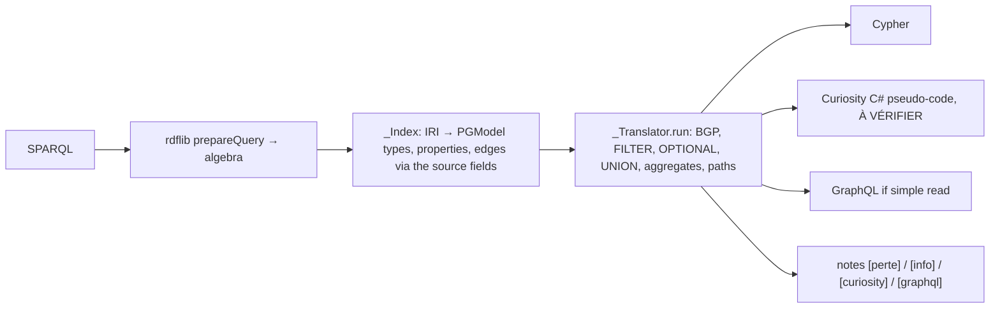

# 09. Queries: SPARQL translation, guided querying, endpoints {#requetes}

The `backend/ontoforge/queries/` package does three things: translate a SPARQL query written against the ontology into a query on the generated property graph (Cypher, Curiosity, GraphQL); build Sparnatural-style guided queries, including from a natural-language question; run a read-only query against a SPARQL endpoint or the local triplestore (chapter [10](10-triplestore-local.en.md)).

Sources read: `backend/ontoforge/queries/translate.py`, `backend/ontoforge/queries/builder.py`, `backend/ontoforge/queries/nl.py`, `backend/ontoforge/queries/endpoint.py`, `backend/ontoforge/queries/options.py`, `backend/ontoforge/queries/saved.py`, `backend/ontoforge/queries/competency.py`, `backend/ontoforge/api/queries.py`, `backend/ontoforge/api/analysis.py`, `docs/CONTRACTS.md` §6. Translations run on `samples/automaint/automaint.ttl`.

## Files {#fichiers}

| File | Responsibility |
|---|---|
| `backend/ontoforge/queries/translate.py` | `translate(sparql, pg, onto) -> TranslationResult`: SPARQL → Cypher, Curiosity pseudo-code, GraphQL, loss notes |
| `backend/ontoforge/queries/builder.py` | `GuidedQuery` (root, steps, filters, selection, ordering), `validate_guided`, `to_sparql`, `Suggester` (suggestions driven by the ontology and shapes), `build_all`, `guided_from_sparql` |
| `backend/ontoforge/queries/nl.py` | natural-language question → `GuidedQuery`: deterministic pre-analysis, optional LLM, strict validation (`sanitize`), deterministic fallback; entry point `interpret` |
| `backend/ontoforge/queries/endpoint.py` | execution on a SPARQL endpoint: `query_form` (updates rejected), `force_limit`, `run_select`, `ping`, `graph_preview` |
| `backend/ontoforge/queries/options.py` | possible values known without an endpoint (individuals, `owl:oneOf`, `sh:in`, DataOneOf, PGModel enum) |
| `backend/ontoforge/queries/saved.py` | saved queries (project's `queries.json`, atomic write under lock) |
| `backend/ontoforge/queries/competency.py` | 5 to 10 competency questions generated from the PGModel, translated with `translate` |
| `backend/ontoforge/api/queries.py` | routes `/api/projects/{pid}/query/*` and `/queries/saved*` |

## SPARQL → property graph translation {#traduction}



- Parsing: `rdflib.plugins.sparql.prepareQuery` gives the SPARQL algebra; an unreadable query (or an update) gives `supported: false` and an `[erreur]` note, never an exception.
- IRI → PG mapping (`_Index`): through the PGModel `source` fields (`NodeType.source`, `PGProperty.source`, `EdgeType.source`), completed by the ontology (inverses, sub-properties, subclasses, transitivity). With Neo4j multi-labels, a parent class also matches the subtypes carrying its label.
- Translated subset (module docstring): BGP, FILTER (comparisons, regex, `CONTAINS`, `STRSTARTS`, `IN`, `BOUND`, `EXISTS`…), OPTIONAL, MINUS, UNION (Cypher), BIND, ORDER BY / LIMIT / OFFSET / DISTINCT, aggregates and GROUP BY / HAVING, paths `/ | ^ + * ?`, ASK.
- Caution rule: a class or property missing from the PG must never produce a wider pattern (superset). The translator then emits a pattern that returns nothing (`false`) and a `[perte]` note. A missing class whose subclasses are transposed is replaced by those subclasses (`[info]` note, equivalent to RDFS inference).
- Output: `TranslationResult` (`cypher`, `curiosity`, `graphql`, `notes`, `lossy`, `supported`, `variables`). Notes are prefixed `[perte]`, `[info]`, `[curiosity]`, `[graphql]`, `[erreur]`; `lossy` is true as soon as a `[perte]` note exists.

Run example (neo4j target): `SELECT ?v ?vin WHERE { ?v a am:Vehicle ; am:vin ?vin . FILTER(STRSTARTS(?vin, "VF")) } ORDER BY ?vin LIMIT 10` gives:

```cypher
MATCH (v)
WHERE v.vin STARTS WITH 'VF'
RETURN v.uri AS v, v.vin AS vin
ORDER BY vin
LIMIT 10
```

The `:Vehicle` label is missing: this is defect DF-B06 (a class carried by several node types that share a single label). With `?v a am:Garage`, the pattern is correctly `MATCH (v:Garage)`.

The route `POST /api/projects/{pid}/queries/translate` (in `backend/ontoforge/api/analysis.py::translate`) recomputes the target's PGModel then calls `translate`.

## Guided querying {#guide}

`backend/ontoforge/queries/builder.py::GuidedQuery` describes a "sentence": `root {var, class_iri}`, `steps` (property, direction, target class, optional, negated), `filters` (text, equality, regex, language, numeric and date ranges, value list), `select`, `order`, `limit`. `to_sparql` produces SPARQL 1.1 with the ontology's prefixes; `build_all` adds Cypher, Curiosity and GraphQL **by reusing `translate`** (no second translator).

`Suggester` offers, for a class, the valid outgoing and incoming properties (domain and range, subclasses, sub-properties, unions), filterable data properties and target classes, refined by `sh:class` when a shape says so. The `GET /query/suggest` route adds, for each target class, the number of known individuals (`options.known_count`).

### Natural language {#nl}

`backend/ontoforge/queries/nl.py::interpret`: (1) deterministic pre-analysis of the question's words against labels, `skos:altLabel` and local names (simple stemming, small fr → en lexicon); (2) if a real LLM provider is configured (not `mock`), a compact schema summary (`schema_digest`) and the hints are sent, and a `GuidedQuery` JSON is expected back; (3) strict validation of the JSON against the ontology (`sanitize`: steps fixed or removed, discarded terms in `unmatched`); (4) otherwise a fully deterministic fallback (`deterministic`: best classes, shortest paths between named classes). The question is untrusted text: it is fenced by `backend/ontoforge/assistant/untrusted.py::fence` before going to the LLM (chapter [11](11-assistant-krakie.en.md)). Without a usable provider, the route uses the fallback without error.

## Running on an endpoint {#endpoints}

`backend/ontoforge/api/queries.py::_executor` picks the executor: local triplestore (`endpoint: {kind: "local"}`), temporary endpoint entered inline (`InlineEndpoint`, never saved nor logged) or an endpoint saved in the settings (`endpoint_id`, else the active endpoint; none → 409).

Safeguards in `backend/ontoforge/queries/endpoint.py`:

| Safeguard | Implementation |
|---|---|
| Read-only | `query_form` parses the query with rdflib's SPARQL parser; if it only parses as an update → 403, unreadable → 422. No network call in these cases |
| `LIMIT` | `force_limit` caps the top-level `LIMIT` to `limit + 1` (or adds it); `_scan` and `_top_level` skip comments, strings, IRIs and subqueries. `HARD_LIMIT` = 5000. The extra row is used to detect truncation |
| Timeout | the endpoint's `timeout_s` (1 to 300 s, 30 by default); exceeded → 504 |
| Outgoing calls | `make_client` = `netguard.client`: private addresses rejected and address checked after resolution when protection is on (chapter [16](16-securite.en.md)) |
| Secrets | `basic` or `bearer` authentication built by `_auth`; the secret is encrypted in the settings and appears in no message |
| Error messages | with protection on, neither the start of a host's response nor a saved endpoint's address in the error (D-L41-01) |

`graph_preview` builds a `{nodes, edges}` preview (300 nodes at most) from the result columns and the guided query's steps.

## Libraries {#librairies}

| Library | Version | Why |
|---|---|---|
| rdflib | 7.1.1 | SPARQL 1.1 parser and algebra (`prepareQuery`, `parseQuery`, `parseUpdate`) |
| httpx | 0.28.1 | HTTP client to endpoints (wrapped by `netguard`) |
| pydantic | 2.10.3 | `GuidedQuery`, `TranslationResult`, `QueryResult` |

## Decisions {#decisions}

- D-018: Curiosity translation is the second feature cut when time runs short; it stays `À VÉRIFIER` pseudo-code.
- D-L15-01: Sparnatural-style guided querying (CONTRACTS §6).
- D-L41-01: outgoing address protection as soon as authentication is on; error messages without host details.

## Pitfalls and limits {#pieges}

- No reasoning on the endpoint side: `?x a C` does not return instances of subclasses; guided querying offers `subclasses: true`. Sub-properties are not expanded in the executed query.
- Variable predicate (`?s ?p ?o`): no property graph equivalent (relationship types are schema); triple ignored with a `[perte]` note.
- Edge properties (de-reified R01): a property carried by a relationship is not rewritten automatically; `[perte]` note.
- Curiosity: the output is Query API pseudo-code; the reference documentation is in `CURIOSITY_DOC`. Nothing is run against Curiosity.
- DF-B06: a class carried by several node types sharing a label can lose its label in Cypher.

## How to add… {#comment-ajouter}

**…a SPARQL construct to the translator.** Find the algebra node in `_Translator.run` (or the matching block method), produce the Cypher clause, and call `self.lost(...)` for anything not equivalent: an unhandled construct must give a note, never a wider result. Add a case in `backend/tests/test_translate.py`.

**…a guided filter kind.** Extend `QFilter.kind` in `builder.py`, render it in `to_sparql`, validate it in `validate_guided`, and accept it in `nl.sanitize` (`_bad_filter`) if the LLM may propose it. The front has its own filter list (chapter [15](15-front.en.md)).

**…an endpoint kind.** Add a body model in `api/queries.py`, a branch in `_executor` returning `(id, function(sparql, limit) -> QueryResult)`, and keep the same safeguards (read-only, `LIMIT`, timeout, `netguard`).
