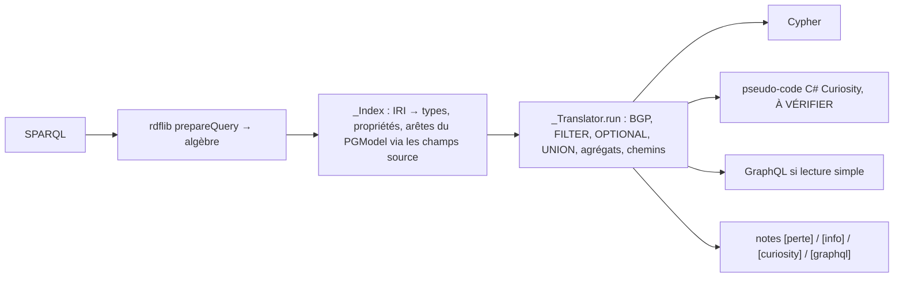

# 09. Requêtes : traduction SPARQL, requêtage guidé, endpoints {#requetes}

Le paquet `backend/ontoforge/queries/` fait trois choses : traduire une requête SPARQL écrite sur l'ontologie en requête sur le property graph généré (Cypher, Curiosity, GraphQL) ; construire des requêtes guidées façon Sparnatural, y compris depuis une question en langage naturel ; exécuter une requête en lecture seule sur un endpoint SPARQL ou sur le triplestore local (chapitre [10](10-triplestore-local.md)).

Sources lues : `backend/ontoforge/queries/translate.py`, `backend/ontoforge/queries/builder.py`, `backend/ontoforge/queries/nl.py`, `backend/ontoforge/queries/endpoint.py`, `backend/ontoforge/queries/options.py`, `backend/ontoforge/queries/saved.py`, `backend/ontoforge/queries/competency.py`, `backend/ontoforge/api/queries.py`, `backend/ontoforge/api/analysis.py`, `docs/CONTRACTS.md` §6. Traductions exécutées sur `samples/automaint/automaint.ttl`.

## Fichiers {#fichiers}

| Fichier | Responsabilité |
|---|---|
| `backend/ontoforge/queries/translate.py` | `translate(sparql, pg, onto) -> TranslationResult` : SPARQL → Cypher, pseudo-code Curiosity, GraphQL, notes de perte |
| `backend/ontoforge/queries/builder.py` | `GuidedQuery` (racine, étapes, filtres, sélection, tri), `validate_guided`, `to_sparql`, `Suggester` (suggestions pilotées par l'ontologie et les shapes), `build_all`, `guided_from_sparql` |
| `backend/ontoforge/queries/nl.py` | question en langage naturel → `GuidedQuery` : pré-analyse déterministe, LLM facultatif, validation stricte (`sanitize`), repli déterministe ; point d'entrée `interpret` |
| `backend/ontoforge/queries/endpoint.py` | exécution sur un endpoint SPARQL : `query_form` (refus des mises à jour), `force_limit`, `run_select`, `ping`, `graph_preview` |
| `backend/ontoforge/queries/options.py` | valeurs possibles connues sans endpoint (individus, `owl:oneOf`, `sh:in`, DataOneOf, enum du PGModel) |
| `backend/ontoforge/queries/saved.py` | requêtes sauvegardées (`queries.json` du projet, écriture atomique sous verrou) |
| `backend/ontoforge/queries/competency.py` | 5 à 10 questions de compétence générées depuis le PGModel, traduites par `translate` |
| `backend/ontoforge/api/queries.py` | routes `/api/projects/{pid}/query/*` et `/queries/saved*` |

## Traduction SPARQL → property graph {#traduction}



- Analyse : `rdflib.plugins.sparql.prepareQuery` donne l'algèbre SPARQL ; une requête illisible (ou une mise à jour) donne `supported: false` et une note `[erreur]`, jamais une exception.
- Correspondance IRI → PG (`_Index`) : par les champs `source` du `PGModel` (`NodeType.source`, `PGProperty.source`, `EdgeType.source`), complétés par l'ontologie (inverses, sous-propriétés, sous-classes, transitivité). Avec les multi-labels Neo4j, une classe parente correspond aussi aux sous-types qui portent son label.
- Sous-ensemble traduit (docstring du module) : BGP, FILTER (comparaisons, regex, `CONTAINS`, `STRSTARTS`, `IN`, `BOUND`, `EXISTS`…), OPTIONAL, MINUS, UNION (Cypher), BIND, ORDER BY / LIMIT / OFFSET / DISTINCT, agrégats et GROUP BY / HAVING, chemins `/ | ^ + * ?`, ASK.
- Règle de prudence : une classe ou une propriété absente du PG ne doit jamais produire un motif plus large (sur-ensemble). Le traducteur émet alors un motif qui ne renvoie rien (`false`) et une note `[perte]`. Une classe absente mais dont des sous-classes sont transposées est remplacée par ces sous-classes (note `[info]`, équivaut à une inférence RDFS).
- Sortie : `TranslationResult` (`cypher`, `curiosity`, `graphql`, `notes`, `lossy`, `supported`, `variables`). Les notes sont préfixées `[perte]`, `[info]`, `[curiosity]`, `[graphql]`, `[erreur]` ; `lossy` est vrai dès qu'une note `[perte]` existe.

Exemple exécuté (cible neo4j) : `SELECT ?v ?vin WHERE { ?v a am:Vehicle ; am:vin ?vin . FILTER(STRSTARTS(?vin, "VF")) } ORDER BY ?vin LIMIT 10` donne :

```cypher
MATCH (v:Vehicle)
WHERE v.vin STARTS WITH 'VF'
RETURN v.uri AS v, v.vin AS vin
ORDER BY vin
LIMIT 10
```

Sur la cible neo4j, `am:Vehicle` est portée par trois types de nœuds (`Vehicle`, `ElectricVehicle`, `CombustionVehicle`) qui ont tous le label `Vehicle` (multi-labels) : `backend/ontoforge/queries/translate.py::_Translator.node_pat` fait l'union des types possibles, chacun valant « label » ou « label et valeur du discriminant », et la simplifie ; ici elle se réduit au seul label `:Vehicle`. Plusieurs labels donnent une condition `WHERE (v:A OR v:B)`. Avant L52, ce cas donnait `MATCH (v)` (tous les nœuds, DF-B06). Si un type possible n'avait pas de label (le générateur n'en produit pas aujourd'hui), le motif resterait non filtré avec une note `[perte]`.

La route `POST /api/projects/{pid}/queries/translate` (dans `backend/ontoforge/api/analysis.py::translate`) recalcule le PGModel de la cible puis appelle `translate`.

## Requêtage guidé {#guide}

`backend/ontoforge/queries/builder.py::GuidedQuery` décrit une « phrase » : `root {var, class_iri}`, `steps` (propriété, sens, classe cible, optionnelle, niée), `filters` (texte, égalité, regex, langue, plages numériques et de dates, liste de valeurs), `select`, `order`, `limit`. `to_sparql` produit du SPARQL 1.1 avec les préfixes de l'ontologie ; `build_all` y ajoute Cypher, Curiosity et GraphQL **en réutilisant `translate`** (pas de second traducteur).

`Suggester` propose, pour une classe, les propriétés sortantes et entrantes valides (domaine et portée, sous-classes, sous-propriétés, unions), les propriétés de données filtrables et les classes cibles, affinées par `sh:class` quand une shape le précise. La route `GET /query/suggest` y ajoute, pour chaque classe cible, le nombre d'individus connus (`options.known_count`).

### Langage naturel {#nl}

`backend/ontoforge/queries/nl.py::interpret` : (1) pré-analyse déterministe des mots de la question contre les libellés, `skos:altLabel` et noms locaux (racinisation simple, petit lexique fr → en) ; (2) si un fournisseur LLM réel est configuré (pas `mock`), envoi d'un résumé compact du schéma (`schema_digest`) et des indices, réponse attendue en JSON `GuidedQuery` ; (3) validation stricte du JSON contre l'ontologie (`sanitize` : étapes corrigées ou retirées, termes écartés dans `unmatched`) ; (4) sinon repli entièrement déterministe (`deterministic` : meilleures classes, plus courts chemins entre classes citées). La question est un texte non fiable : elle est encadrée par `backend/ontoforge/assistant/untrusted.py::fence` avant d'aller au LLM (chapitre [11](11-assistant-krakie.md)). Sans fournisseur exploitable, la route utilise le repli sans erreur.

## Exécution sur un endpoint {#endpoints}

`backend/ontoforge/api/queries.py::_executor` choisit l'exécutant : triplestore local (`endpoint: {kind: "local"}`), endpoint temporaire saisi en ligne (`InlineEndpoint`, jamais enregistré ni journalisé) ou endpoint enregistré dans les paramètres (`endpoint_id`, sinon l'endpoint actif ; aucun → 409).

Garde-fous de `backend/ontoforge/queries/endpoint.py` :

| Garde-fou | Implémentation |
|---|---|
| Lecture seule | `query_form` analyse la requête avec le parseur SPARQL de rdflib ; si elle ne se lit qu'en mise à jour → 403, illisible → 422. Aucun appel réseau dans ces cas |
| `LIMIT` | `force_limit` plafonne le `LIMIT` de niveau supérieur à `limit + 1` (ou l'ajoute) ; `_scan` et `_top_level` ignorent commentaires, chaînes, IRI et sous-requêtes. `HARD_LIMIT` = 5000. La ligne de plus sert à détecter la troncature |
| Délai | `timeout_s` de l'endpoint (1 à 300 s, 30 par défaut) ; dépassement → 504 |
| Appels sortants | `make_client` = `netguard.client` : adresses privées refusées et adresse vérifiée après résolution quand la protection est active (chapitre [16](16-securite.md)) |
| Secrets | authentification `basic` ou `bearer` construite par `_auth` ; le secret est chiffré dans les paramètres et n'apparaît dans aucun message |
| Messages d'erreur | avec la protection active, ni le début de la réponse d'un hôte ni l'adresse d'un endpoint enregistré dans l'erreur (D-L41-01) |

`graph_preview` construit un aperçu `{nodes, edges}` (300 nœuds au plus) à partir des colonnes de résultat et des étapes de la requête guidée.

## Librairies {#librairies}

| Librairie | Version | Pourquoi |
|---|---|---|
| rdflib | 7.1.1 | parseur et algèbre SPARQL 1.1 (`prepareQuery`, `parseQuery`, `parseUpdate`) |
| httpx | 0.28.1 | client HTTP vers les endpoints (enveloppé par `netguard`) |
| pydantic | 2.10.3 | `GuidedQuery`, `TranslationResult`, `QueryResult` |

## Décisions {#decisions}

- D-018 : la traduction Curiosity est la deuxième fonction coupée en cas de manque de temps ; elle reste du pseudo-code `À VÉRIFIER`.
- D-L15-01 : requêtage guidé façon Sparnatural (CONTRACTS §6).
- D-L41-01 : protection des adresses sortantes dès que l'authentification est active ; messages d'erreur sans détail d'hôte.

## Pièges et limites {#pieges}

- Pas de raisonnement côté endpoint : `?x a C` ne ramène pas les instances des sous-classes ; le requêtage guidé propose `subclasses: true`. Les sous-propriétés ne sont pas développées dans la requête exécutée.
- Prédicat variable (`?s ?p ?o`) : pas d'équivalent en property graph (les types de relation sont du schéma) ; triplet ignoré avec une note `[perte]`.
- Propriétés d'arête (R01 dé-réifié) : une propriété portée par une relation n'est pas réécrite automatiquement ; note `[perte]`.
- Curiosity : la sortie est du pseudo-code de la Query API ; la documentation de référence est dans `CURIOSITY_DOC`. Rien n'est exécuté contre Curiosity.
- Sous-motif réduit à un typage (défaut DF-B12, ouvert) : `FILTER EXISTS`, `FILTER NOT EXISTS` ou `MINUS` dont le sous-motif ne contient que le typage d'une variable déjà imprimée donnent `WHERE [NOT] EXISTS { MATCH  }` (`_Translator.exists_pattern`), sur les deux cibles, sans note `[perte]`. Le Cypher est invalide, et pour `NOT EXISTS` et `MINUS` la classe du sous-motif est perdue.

## Comment ajouter… {#comment-ajouter}

**…un construct SPARQL au traducteur.** Repérer le nœud d'algèbre dans `_Translator.run` (ou la méthode de bloc correspondante), produire la clause Cypher, et appeler `self.lost(...)` pour tout ce qui n'est pas équivalent : un construct non géré doit donner une note, jamais un résultat plus large. Ajouter un cas dans `backend/tests/test_translate.py`.

**…un genre de filtre guidé.** Étendre `QFilter.kind` dans `builder.py`, le rendre dans `to_sparql`, le valider dans `validate_guided`, et l'accepter dans `nl.sanitize` (`_bad_filter`) si le LLM peut le proposer. Le front a sa propre liste de filtres (chapitre [15](15-front.md)).

**…un genre d'endpoint.** Ajouter un modèle de corps dans `api/queries.py`, une branche dans `_executor` qui renvoie `(id, fonction(sparql, limite) -> QueryResult)`, et garder les mêmes garde-fous (lecture seule, `LIMIT`, délai, `netguard`).
