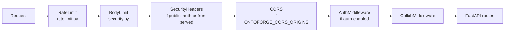

# 12. Accounts, sharing, administration, presence, activity log {#comptes-partage-admin}

Authentication (optional), accounts, project isolation by owner and roles, optimistic concurrency (`If-Match`, 409, 428), presence, the activity log, account administration and global settings. The browser side (cookie, CSRF token, headers sent) is in chapter [02](02-communication-front-back.en.md).

Sources read: `backend/ontoforge/main.py`, `backend/ontoforge/hardening.py`, `backend/ontoforge/auth/config.py`, `backend/ontoforge/auth/session.py`, `backend/ontoforge/auth/passwords.py`, `backend/ontoforge/auth/accounts.py`, `backend/ontoforge/auth/limiter.py`, `backend/ontoforge/auth/middleware.py`, `backend/ontoforge/collab/access.py`, `backend/ontoforge/collab/middleware.py`, `backend/ontoforge/collab/routes.py`, `backend/ontoforge/api/auth.py`, `backend/ontoforge/api/admin.py`, `backend/ontoforge/api/sharing.py`, `backend/ontoforge/settings/crypto.py`, `backend/ontoforge/settings/store.py`, `docs/CONTRACTS.md` §16 and §17, tests `backend/tests/test_auth.py`, `backend/tests/test_collab.py`, `backend/tests/test_l42_admin.py`, `backend/tests/test_l43_password.py`.

## Two modes {#modes}

| Mode | Activation | Identity | Isolation |
|---|---|---|---|
| Local (default) | `ONTOFORGE_AUTH` missing or other than `password` | implicit `local`, administrator, owner of everything | none; `If-Match` optional |
| Authenticated | `ONTOFORGE_AUTH=password` | session account | named projects, roles, CSRF, `If-Match` required on a shared project |

`backend/ontoforge/auth/config.py::load_config` reads the configuration; a dangerous configuration (key too short, no account…) raises `AuthConfigError` and **the server refuses to start** rather than open up by mistake.

## Middleware chain {#middlewares}

In `backend/ontoforge/main.py::create_app`, the last middleware added is the outermost. Order of a request, from the outside to the application:

`SecurityHeaders`, CORS and `AuthMiddleware` are conditional; `RateLimit`, `BodyLimit` and `CollabMiddleware` are always there. The built front is mounted under `/` (`security.SpaStatic`) when `ONTOFORGE_STATIC_DIR` is set.

## Authentication {#authentification}

- Configuration accounts: `ONTOFORGE_AUTH_USERS` and `ONTOFORGE_AUTH_USERS_FILE` (`user:hash`, merged); administrators `ONTOFORGE_AUTH_ADMINS`, else the first declared account.
- Interface accounts (L42): created by an administrator in `$ONTOFORGE_DATA/accounts.json` (or `ONTOFORGE_ACCOUNTS_FILE`), file mode 600, atomic write. `backend/ontoforge/auth/accounts.py::AccountDirectory` merges both sources; a configuration login wins.
- Passwords: `backend/ontoforge/auth/passwords.py` hashes with argon2id (argon2-cffi) and accepts bcrypt on reading; maximum length 256; an unknown login is checked against a throwaway hash (`dummy_hash`) so that timing reveals nothing.
- Mask (D-L43-01): changing the password of a configuration account writes a hash into `accounts.json` that **masks** the configuration's; the administrator can "revert to the configuration password".
- Session: `backend/ontoforge/auth/session.py` issues a signed cookie with no server state, `v1.<payload>.<HMAC-SHA256>`; the payload holds the user, the dates, a session id, the **CSRF token** and `gen`. Cookie name: `__Host-ontoforge_session` (Secure) or `ontoforge_session` if `ONTOFORGE_COOKIE_SECURE=0`; `HttpOnly`, `SameSite=Lax`. Lifetime `ONTOFORGE_SESSION_HOURS` (8 h). The signing key is derived from `ONTOFORGE_SECRET_KEY`.
- Revocation: logout records the session id in an **in-memory** list. Each account carries a random `gen`, renewed on each password change, reset or deactivation: `AuthMiddleware` reads the account again on every request (`session_ok`) and cuts a session whose `gen` no longer matches.
- Login attempts: `backend/ontoforge/auth/limiter.py`, per IP address: two free failures, then a block of 2 s, 4 s, 8 s… up to 15 minutes; during the block, the password is not even checked. In-memory state.

`backend/ontoforge/auth/middleware.py::AuthMiddleware`: every `/api/*` route requires a session, except `/api/health` and `/api/auth/*` (401 `auth_required`). An account with a temporary password gets 403 `password_change_required`. Modifying methods, **and** generation `GET`s (`csrf_required`: `/generate/{target}` and its zip, D-L42-01), require the `X-CSRF-Token` header equal to the session token (403 `csrf`) and an `Origin`, if present, equal to the host (403 `bad_origin`). The account language is set for the request (`localize.REQUEST_LANG`).

## Project isolation {#cloisonnement}

`backend/ontoforge/collab/middleware.py::CollabMiddleware`, for each `/api` request:

1. Identity: the session account, or `local`.
2. `/api/settings` writes and `/api/admin/*`: administrators only (403 `admin_only`).
3. Route carrying `{pid}`: its level is read from the table `backend/ontoforge/collab/routes.py::ROUTES` (`read`, `write`, `owner`). A route with `{pid}` missing from the table is **rejected** (403 `unclassified`): isolation fails closed. `backend/tests/test_collab.py::test_every_route_is_classified` walks every route of the application.
4. `access.require`: inaccessible or unknown project → 404 (not 403, to reveal nothing); a reader writing → 403 `read_only`; a non-owner on an owner action → 403 `owner_only`.
5. Writes to the same project are **serialized** by one asyncio lock per project.
6. After a successful response: version (`rev`) +1 if `project.json` changed (`access.signature`), activity log entry, `ETag: "<rev>"` header.

Routes whose project id is in the JSON body (assistant) are in `BODY_PROJECT_ROUTES`; their handler calls `access.enforce` or `load_project`. On the handler side, `backend/ontoforge/api/_common.py::load_project` repeats the access check before loading.

Sharing state lives in `<project>/collab.json` and the log in `<project>/activity.jsonl`, **outside the `Project` model**: a client sending back a full project through `PUT` can neither take ownership nor change its sharing. An unreadable `collab.json` locks the project read-only (403 `collab_corrupt`).

Roles (D-L40-01, D-L42-01): the owner shares (with an existing account, role `editor` or `reader`), changes a role, removes access, transfers ownership. The editor writes and generates, does not share nor delete. The reader views, validates, exports the ontology and shapes, reads the justification file, but does not generate. An administrator sees every project with the owner's rights; their writes are traced "as administrator" (`as_admin`), not their reads.

## Optimistic concurrency {#concurrence}

`backend/ontoforge/collab/access.py::check_precondition`, called for every write:

| `If-Match` | Project | Result |
|---|---|---|
| missing | not shared, or local mode | accepted (existing scripts and test runs) |
| missing | shared, authenticated mode | **428** `precondition_required`, with `current_rev` |
| `*` or equal to `rev` | — | accepted |
| other value | — | **409** `conflict`, with `current_rev`, `last_actor`, `last_at`; nothing is saved |

The front then reloads the project and offers to reapply ("reload and reapply", D-L40-01); for the browser side (version sent, write queue, replay), see chapter [02](02-communication-front-back.en.md#if-match).

## Presence and activity {#presence}

`POST /api/projects/{pid}/presence` (`backend/ontoforge/collab/access.py::beat`) records an in-memory heartbeat and returns who is present. A presence expires after `PRESENCE_TTL` = 60 s (the front beats every 20 s, chapter [02](02-communication-front-back.en.md#presence)). `GET /activity` reads the last lines of `activity.jsonl` (500 at most, `ACTIVITY_MAX`). Routes in `backend/ontoforge/api/sharing.py`.

## Account administration {#administration}

`backend/ontoforge/api/admin.py` (`/api/admin`, administrators): list, create (temporary password shown once), reset, revert to the configuration password, disable, enable, promote, delete (with mandatory transfer of projects to an active account: projects are never deleted), administration log. Configuration accounts cannot be disabled, deleted or have their role changed from the interface. The last active administrator is protected (`_last_admin_guard`).

The `admin-audit.jsonl` log (600) keeps who did what to which account, never a password, hash or token. It rotates by archiving (`AUDIT_MAX` = 1000 lines, `ONTOFORGE_AUDIT_ARCHIVES` archives, 10 by default). If the trace cannot be written, the action fails (500 `audit_write_failed`) and the store is restored.

Routes for the logged-in account (`backend/ontoforge/api/auth.py`): `GET /api/auth/session`, `POST /login`, `POST /logout`, `POST /password` (limiter `pwd:<login>` 5 per minute, 409 `password_changed_meanwhile` on a race), `PUT /preferences` (account language).

## Global settings {#parametres}

`$ONTOFORGE_DATA/settings.json` (`backend/ontoforge/settings/store.py`): LLM providers, SPARQL endpoints, languages, default versions. Atomic write; secrets encrypted with Fernet (`backend/ontoforge/settings/crypto.py`), prefix `enc:v1:`, key derived by HKDF-SHA256 from `ONTOFORGE_SECRET_KEY`, else from a key generated at first start in `ONTOFORGE_SECRET_FILE` or `$ONTOFORGE_DATA/.secret` (600). Keys are **never returned** by the API (`has_key`, D-L8-01). Rotation: `python -m ontoforge.settings rotate`. Writing is reserved to administrators.

## Libraries {#librairies}

| Library | Version | Why |
|---|---|---|
| argon2-cffi | 25.1.0 (argon2-cffi-bindings 26.1.0) | argon2id hashing |
| bcrypt | 5.0.0 | reading existing bcrypt hashes |
| cryptography | 50.0.2 | Fernet, HKDF |
| starlette | 1.3.1 | ASGI middlewares, route matching (`Match.FULL`) |
| fastapi | 0.133.0 | routes, `HTTPException` |

## Decisions {#decisions}

- D-L8-01: keys encrypted, never returned.
- D-L40-01: named projects, sharing, 404 rather than 403, `If-Match` and 428 on shared projects, presence, activity.
- D-L41-01: outgoing address control as soon as authentication is on (chapter [16](16-securite.en.md)).
- D-L42-01, D-L42-02: per-account language, no generation by readers, account administration, administrator on every project.
- D-L43-01: password change for every account, mask.

## Pitfalls and limits {#pieges}

- In-memory state: session revocation, login limiter, rate limiter and presence are lost on restart and not shared between instances. The application assumes **a single instance** (Cloud Run `max-instances=1`, chapter [17](17-build-ci-deploiement.en.md)).
- Per-process write lock: the per-project asyncio lock only serializes inside one process; several uvicorn workers would break serialization.
- New route with `{pid}`: without an entry in `ROUTES`, it answers 403 `unclassified`, in authenticated and local mode alike.
- `GET` that writes: generation stays a `GET` but requires the CSRF token; a non-browser client must send it.

## How to add… {#comment-ajouter}

**…a project route.** Declare the route in the router, then add it to `backend/ontoforge/collab/routes.py::ROUTES` with its level (`read`, `write`, `owner`) and the log action (empty string for a read). If it writes while being a `GET`, add it to `_WRITE_GET` in `auth/middleware.py`. If the project id is in the body, add it to `BODY_PROJECT_ROUTES` and call `access.enforce` in the handler. If it is costly, add it to `RULES` in `ratelimit.py`.

**…a role.** Add the role to `ROLES` and its rule in `access.role_for` and `require`, then in sharing (`share`) and in the front. This is a contract change (CONTRACTS §16, recorded decision).
