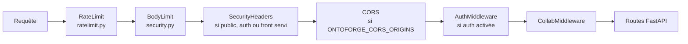

# 12. Comptes, partage, administration, présence, journal d'activité {#comptes-partage-admin}

Authentification (facultative), comptes, le cloisonnement des projets par propriétaire et rôles, la concurrence optimiste (`If-Match`, 409, 428), la présence, le journal d'activité, l'administration des comptes et les paramètres globaux. Le côté navigateur (cookie, jeton CSRF, en-têtes envoyés) est au chapitre [02](02-communication-front-back.md).

Sources lues : `backend/ontoforge/main.py`, `backend/ontoforge/hardening.py`, `backend/ontoforge/auth/config.py`, `backend/ontoforge/auth/session.py`, `backend/ontoforge/auth/passwords.py`, `backend/ontoforge/auth/accounts.py`, `backend/ontoforge/auth/limiter.py`, `backend/ontoforge/auth/middleware.py`, `backend/ontoforge/collab/access.py`, `backend/ontoforge/collab/middleware.py`, `backend/ontoforge/collab/routes.py`, `backend/ontoforge/api/auth.py`, `backend/ontoforge/api/admin.py`, `backend/ontoforge/api/sharing.py`, `backend/ontoforge/settings/crypto.py`, `backend/ontoforge/settings/store.py`, `docs/CONTRACTS.md` §16 et §17, tests `backend/tests/test_auth.py`, `backend/tests/test_collab.py`, `backend/tests/test_l42_admin.py`, `backend/tests/test_l43_password.py`.

## Deux modes {#modes}

| Mode | Activation | Identité | Cloisonnement |
|---|---|---|---|
| Local (défaut) | `ONTOFORGE_AUTH` absent ou autre que `password` | implicite `local`, administrateur, propriétaire de tout | aucun ; `If-Match` facultatif |
| Authentifié | `ONTOFORGE_AUTH=password` | compte de la session | projets nominatifs, rôles, CSRF, `If-Match` obligatoire sur un projet partagé |

`backend/ontoforge/auth/config.py::load_config` lit la configuration ; une configuration dangereuse (clé trop courte, aucun compte…) lève `AuthConfigError` et **le serveur refuse de démarrer** plutôt que de s'ouvrir par erreur.

## Chaîne des middlewares {#middlewares}

Dans `backend/ontoforge/main.py::create_app`, le dernier middleware ajouté est le plus extérieur. Ordre d'une requête, de l'extérieur vers l'application :

`SecurityHeaders`, CORS et `AuthMiddleware` sont conditionnels ; `RateLimit`, `BodyLimit` et `CollabMiddleware` sont toujours là. Le front compilé est monté sous `/` (`security.SpaStatic`) quand `ONTOFORGE_STATIC_DIR` est défini.

## Authentification {#authentification}

- Comptes de la configuration : `ONTOFORGE_AUTH_USERS` et `ONTOFORGE_AUTH_USERS_FILE` (`utilisateur:hachage`, fusionnés) ; administrateurs `ONTOFORGE_AUTH_ADMINS`, sinon le premier compte déclaré.
- Comptes de l'interface (L42) : créés par un administrateur dans `$ONTOFORGE_DATA/accounts.json` (ou `ONTOFORGE_ACCOUNTS_FILE`), fichier en 600, écriture atomique. `backend/ontoforge/auth/accounts.py::AccountDirectory` fusionne les deux sources ; un identifiant de la configuration l'emporte.
- Mots de passe : `backend/ontoforge/auth/passwords.py` hache en argon2id (argon2-cffi) et accepte bcrypt en lecture ; longueur maximale 256 ; un identifiant inconnu est vérifié contre un hachage jetable (`dummy_hash`) pour que la durée ne révèle rien.
- Masque (D-L43-01) : changer le mot de passe d'un compte de la configuration écrit un hachage dans `accounts.json` qui **masque** celui de la configuration ; l'administrateur peut « revenir au mot de passe de la configuration ».
- Session : `backend/ontoforge/auth/session.py` émet un cookie signé sans état serveur, `v1.<charge utile>.<HMAC-SHA256>` ; la charge porte l'utilisateur, les dates, un identifiant de session, le **jeton CSRF** et `gen`. Nom du cookie : `__Host-ontoforge_session` (Secure) ou `ontoforge_session` si `ONTOFORGE_COOKIE_SECURE=0` ; `HttpOnly`, `SameSite=Lax`. Durée `ONTOFORGE_SESSION_HOURS` (8 h). La clé de signature est dérivée de `ONTOFORGE_SECRET_KEY`.
- Révocation : la déconnexion inscrit l'identifiant de session dans une liste **en mémoire**. Chaque compte porte un `gen` tiré au hasard, renouvelé à chaque changement de mot de passe, réinitialisation ou désactivation : `AuthMiddleware` relit le compte à chaque requête (`session_ok`) et coupe une session dont le `gen` ne correspond plus.
- Tentatives de connexion : `backend/ontoforge/auth/limiter.py`, par adresse IP : deux échecs libres, puis blocage de 2 s, 4 s, 8 s… jusqu'à 15 minutes ; pendant le blocage, le mot de passe n'est pas vérifié. État en mémoire.

`backend/ontoforge/auth/middleware.py::AuthMiddleware` : toute route `/api/*` exige une session, sauf `/api/health` et `/api/auth/*` (401 `auth_required`). Un compte au mot de passe provisoire reçoit 403 `password_change_required`. Les méthodes qui modifient, **et** les `GET` de génération (`csrf_required` : `/generate/{target}` et son zip, D-L42-01), exigent l'en-tête `X-CSRF-Token` égal au jeton de la session (403 `csrf`) et un `Origin`, s'il est présent, égal à l'hôte (403 `bad_origin`). La langue du compte est posée pour la requête (`localize.REQUEST_LANG`).

## Cloisonnement des projets {#cloisonnement}

`backend/ontoforge/collab/middleware.py::CollabMiddleware`, pour chaque requête `/api` :

1. Identité : compte de la session, ou `local`.
2. `/api/settings` en écriture et `/api/admin/*` : administrateurs seulement (403 `admin_only`).
3. Route portant `{pid}` : son niveau est lu dans la table `backend/ontoforge/collab/routes.py::ROUTES` (`read`, `write`, `owner`). Une route avec `{pid}` absente de la table est **refusée** (403 `unclassified`) : le cloisonnement échoue fermé. `backend/tests/test_collab.py::test_every_route_is_classified` parcourt toutes les routes de l'application.
4. `access.require` : projet inaccessible ou inconnu → 404 (pas 403, pour ne rien révéler) ; lecteur qui écrit → 403 `read_only` ; non-propriétaire sur une action de propriétaire → 403 `owner_only`.
5. Écritures d'un même projet **sérialisées** par un verrou asyncio par projet.
6. Après une réponse réussie : version (`rev`) +1 si `project.json` a changé (`access.signature`), entrée au journal d'activité, en-tête `ETag: "<rev>"`.

Les routes dont l'identifiant de projet est dans le corps JSON (assistant) sont dans `BODY_PROJECT_ROUTES` ; leur handler appelle `access.enforce` ou `load_project`. Côté handler, `backend/ontoforge/api/_common.py::load_project` refait le contrôle d'accès avant de charger.

L'état de partage vit dans `<projet>/collab.json` et le journal dans `<projet>/activity.jsonl`, **hors du modèle `Project`** : un client qui renvoie un projet complet par `PUT` ne peut ni s'attribuer le projet ni changer ses partages. Un `collab.json` illisible verrouille le projet en lecture seule (403 `collab_corrupt`).

Rôles (D-L40-01, D-L42-01) : le propriétaire partage (avec un compte existant, rôle `editor` ou `reader`), change un rôle, retire un accès, transfère la propriété. L'éditeur écrit et génère, ne partage ni ne supprime. Le lecteur consulte, valide, exporte l'ontologie et les shapes, lit le dossier de justification, mais ne génère pas. Un administrateur voit tous les projets avec les droits du propriétaire ; ses écritures sont tracées « en tant qu'administrateur » (`as_admin`), pas ses lectures.

## Concurrence optimiste {#concurrence}

`backend/ontoforge/collab/access.py::check_precondition`, appelée pour toute écriture :

| `If-Match` | Projet | Résultat |
|---|---|---|
| absent | non partagé, ou mode local | accepté (scripts et recettes existants) |
| absent | partagé, mode authentifié | **428** `precondition_required`, avec `current_rev` |
| `*` ou égal à `rev` | — | accepté |
| autre valeur | — | **409** `conflict`, avec `current_rev`, `last_actor`, `last_at` ; rien n'est enregistré |

Le front relit alors le projet et propose de réappliquer (« recharger et réappliquer », D-L40-01) ; côté navigateur (envoi de la version, file d'écritures, rejeu), voir le chapitre [02](02-communication-front-back.md#if-match).

## Présence et activité {#presence}

`POST /api/projects/{pid}/presence` (`backend/ontoforge/collab/access.py::beat`) enregistre un battement en mémoire et renvoie les présents. Une présence expire après `PRESENCE_TTL` = 60 s (le front bat toutes les 20 s, chapitre [02](02-communication-front-back.md#presence)). `GET /activity` lit les dernières lignes de `activity.jsonl` (500 au plus, `ACTIVITY_MAX`). Routes dans `backend/ontoforge/api/sharing.py`.

## Administration des comptes {#administration}

`backend/ontoforge/api/admin.py` (`/api/admin`, administrateurs) : lister, créer (mot de passe provisoire affiché une fois), réinitialiser, revenir au mot de passe de la configuration, désactiver, réactiver, promouvoir, supprimer (avec transfert obligatoire des projets à un compte actif : jamais de suppression de projets), journal d'administration. Les comptes de la configuration ne peuvent être ni désactivés, ni supprimés, ni changés de rôle depuis l'interface. Le dernier administrateur actif est protégé (`_last_admin_guard`).

Le journal `admin-audit.jsonl` (600) garde qui a fait quoi sur quel compte, jamais un mot de passe, un hachage ou un jeton. Il tourne par archivage (`AUDIT_MAX` = 1000 lignes, `ONTOFORGE_AUDIT_ARCHIVES` archives, 10 par défaut). Si la trace ne peut pas être écrite, l'action échoue (500 `audit_write_failed`) et le magasin est rétabli.

Routes du compte connecté (`backend/ontoforge/api/auth.py`) : `GET /api/auth/session`, `POST /login`, `POST /logout`, `POST /password` (limiteur `pwd:<login>` 5 par minute, 409 `password_changed_meanwhile` en cas de course), `PUT /preferences` (langue du compte).

## Paramètres globaux {#parametres}

`$ONTOFORGE_DATA/settings.json` (`backend/ontoforge/settings/store.py`) : fournisseurs LLM, endpoints SPARQL, langues, versions par défaut. Écriture atomique ; secrets chiffrés par Fernet (`backend/ontoforge/settings/crypto.py`), préfixe `enc:v1:`, clé dérivée par HKDF-SHA256 de `ONTOFORGE_SECRET_KEY`, sinon d'une clé générée au premier démarrage dans `ONTOFORGE_SECRET_FILE` ou `$ONTOFORGE_DATA/.secret` (600). Les clés ne sont **jamais renvoyées** par l'API (`has_key`, D-L8-01). Rotation : `python -m ontoforge.settings rotate`. Écriture réservée aux administrateurs.

## Librairies {#librairies}

| Librairie | Version | Pourquoi |
|---|---|---|
| argon2-cffi | 25.1.0 (argon2-cffi-bindings 26.1.0) | hachage argon2id |
| bcrypt | 5.0.0 | lecture des hachages bcrypt existants |
| cryptography | 50.0.2 | Fernet, HKDF |
| starlette | 1.3.1 | middlewares ASGI, correspondance de routes (`Match.FULL`) |
| fastapi | 0.133.0 | routes, `HTTPException` |

## Décisions {#decisions}

- D-L8-01 : clés chiffrées, jamais renvoyées.
- D-L40-01 : projets nominatifs, partage, 404 plutôt que 403, `If-Match` et 428 sur projet partagé, présence, activité.
- D-L41-01 : contrôle des adresses sortantes dès que l'authentification est active (chapitre [16](16-securite.md)).
- D-L42-01, D-L42-02 : langue par compte, pas de génération par le lecteur, administration des comptes, administrateur sur tous les projets.
- D-L43-01 : changement de mot de passe pour tous les comptes, masque.

## Pièges et limites {#pieges}

- État en mémoire : révocation des sessions, limiteur de connexion, limiteur de débit et présence sont perdus au redémarrage et ne se partagent pas entre instances. L'application suppose **une seule instance** (Cloud Run `max-instances=1`, chapitre [17](17-build-ci-deploiement.md)).
- Verrou d'écriture par processus : le verrou asyncio par projet ne sérialise que dans un processus ; plusieurs travailleurs uvicorn casseraient la sérialisation.
- Route nouvelle avec `{pid}` : sans entrée dans `ROUTES`, elle répond 403 `unclassified` en mode authentifié comme en mode local.
- `GET` qui écrit : la génération reste un `GET` mais exige le jeton CSRF ; un client non navigateur doit l'envoyer.

## Comment ajouter… {#comment-ajouter}

**…une route de projet.** Déclarer la route dans le routeur, puis l'ajouter à `backend/ontoforge/collab/routes.py::ROUTES` avec son niveau (`read`, `write`, `owner`) et l'action du journal (chaîne vide pour une lecture). Si elle écrit alors qu'elle est un `GET`, l'ajouter à `_WRITE_GET` de `auth/middleware.py`. Si l'identifiant de projet est dans le corps, l'ajouter à `BODY_PROJECT_ROUTES` et appeler `access.enforce` dans le handler. Si elle est coûteuse, l'ajouter à `RULES` de `ratelimit.py`.

**…un rôle.** Ajouter le rôle à `ROLES` et sa règle dans `access.role_for` et `require`, puis dans le partage (`share`) et le front. C'est un changement de contrat (CONTRACTS §16, décision tracée).
