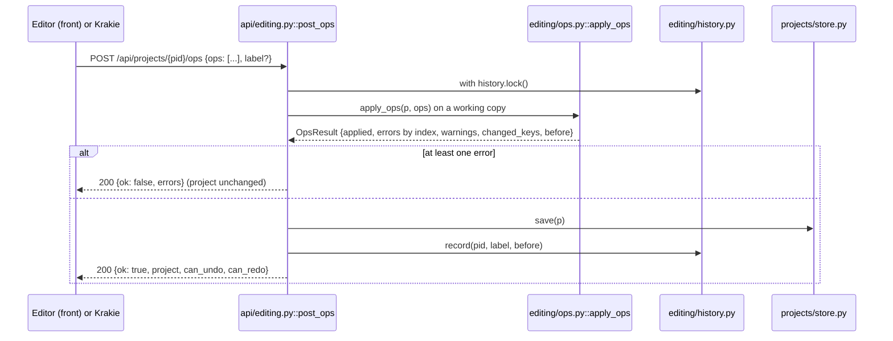

# 13. Projects: storage, editing, undo / redo, SemVer versions {#projets-versions}

How a project is laid out on disk, how the editor changes it through atomic operations, how undo and redo work, the file editor, perimeters, and published ontology versions (SemVer).

Sources read: `backend/ontoforge/projects/store.py`, `backend/ontoforge/projects/generations.py`, `backend/ontoforge/projects/releases.py`, `backend/ontoforge/fsutil.py`, `backend/ontoforge/editing/ops.py`, `backend/ontoforge/editing/history.py`, `backend/ontoforge/editing/files.py`, `backend/ontoforge/editing/perimeter.py`, `backend/ontoforge/api/projects.py`, `backend/ontoforge/api/editing.py`, `backend/ontoforge/api/files.py`, `backend/ontoforge/api/releases.py`, `backend/ontoforge/api/versions.py`, `docs/CONTRACTS.md` §5, §7, §8, §19.

## Layout on disk {#disposition}

`$ONTOFORGE_DATA` (default `./data` in development, `/data` in the Docker image) holds `projects/<id>/`:

| File | Written by | Role |
|---|---|---|
| `project.json` | `backend/ontoforge/projects/store.py::save` | **source of truth**: the serialized `Project` with its aliases (chapter [03](03-modele-interne.en.md#project)) |
| `decisions.json` | `save` | readable copy of `Project.decisions` (editable in the file editor) |
| `onto.ttl`, `shapes.ttl` | `save` (`_export_side_files`) | Turtle exports rewritten on every save; an export failure is logged, the save succeeds |
| `collab.json`, `activity.jsonl` | `collab/access.py` | sharing, `rev` version, activity log (chapter [12](12-comptes-partage-admin.en.md#cloisonnement)) |
| `ops-history.json` | `editing/history.py` | undo / redo stacks |
| `generations.json` | `projects/generations.py` | generation history (chapter [08](08-generateurs.en.md#flux)) |
| `queries.json` | `queries/saved.py` | saved queries |
| `releases.json`, `releases-undone.json` | `projects/releases.py` | published versions and undone versions |
| `triplestore/` | `localstore/store.py` | local triplestore (chapter [10](10-triplestore-local.en.md)) |
| `data.ttl` | `api/projects.py::create_project` | data of a sample loaded at creation |

Only `project.json` holds the model; everything else is a **side file**, so that a full project `PUT` can rewrite neither sharing nor history, and a read route never writes `project.json` (L41).

Project id: `slugify(name)` + 6 random hexadecimal characters (`new_id`); every id is validated by `ID_RE` (`^[a-z0-9][a-z0-9-]{0,80}$`) before building a path, which prevents escaping the projects folder. An unreadable `project.json` is logged and skipped by `list_projects`, without breaking the list.

## Writes {#ecritures}

`backend/ontoforge/fsutil.py::atomic_write` is the single write point: temporary file in the same folder, `flush`, `fsync` (best effort), `os.replace`; if the rename is refused (some mounts), direct write. It is designed to work on a Cloud Storage FUSE mount too, where there are no file locks and no links. Write serialization therefore relies on **thread locks** (one process, one instance) and, for routes, on `CollabMiddleware`'s per-project lock.

## Editing through operations {#operations}

- `backend/ontoforge/editing/ops.py::apply_ops` applies a list (`MAX_OPS` = 500) **all or nothing** on a copy: on the first failure, nothing changes. The answer is 200 even on error (`ok: false`, errors by index), so the front reads the body without an exception (D-L9-01).
- Each operation kind is an `_op_<name>` function registered in `HANDLERS` (add class, rename, delete, subclass, properties, domain and range, restriction, characteristic, inverse, disjointness, key, icon, position, collapse, deprecation, annotations, `owl:versionIRI`…). Integrity checks (`integrity_errors`, non-simple properties, subclass cycles through `editing/cycles.py`, literals through `check_literal`) run in the same pass.
- `snapshot` and `restore` only copy the tracked fields (`onto`, `view`, `perimeters`, `shapes`, `decisions`).
- Krakie uses the same `apply_ops` for its dry run (chapter [11](11-assistant-krakie.en.md#flux)).

### Undo / redo {#annuler-retablir}

`backend/ontoforge/editing/history.py`: each entry keeps the **before** state of the changed fields only; `undo` and `redo` stacks bounded to `LIMIT` = 200, in `ops-history.json`. `undo` and `redo` swap the current state and the stored state (`_swap`); empty stack → 409. Saves outside the editor (`PUT /onto`, import…) are not logged: undo then restores the entry's fields, which may overwrite a change made another way. `history.lock()` is a single (reentrant) lock shared by all projects.

A published version is tied to its history entry: undoing the publication operation moves the version to `releases-undone.json`, redoing puts it back (`releases.on_history`).

## File editor {#editeur-fichiers}

`backend/ontoforge/editing/files.py` (routes `/api/projects/{pid}/files*`, `backend/ontoforge/api/files.py`) serves `onto.ttl`, `shapes.ttl` and `decisions.json` as **canonical** text (graph relabeled by `canonical_or_same` before serialization, so that two reads give the same text and digest), plus generated files read-only (`generated/<name>`). `POST /files/validate` returns positioned diagnostics (syntax, conformance, SHACL meta-validation: chapter [06](06-shacl.en.md#meta-validation)), `POST /files/diff` the graph diff, `PUT /files/{path}` applies. Accepted consequence: comments and formatting of the typed text are normalized on apply.

## Perimeters {#perimetres}

`backend/ontoforge/editing/perimeter.py`: a `Perimeter` is a subset of classes (and of properties, or all those whose domain and range are inside), with or without descendants. `scope(p, perimeter_id)` returns the restricted ontology and shapes plus `info` findings (P00 to P03); `None`, `all` or `none` = full ontology, unknown id → 404. Analysis, generation and graph accept `?perimeter=`. `Project.active_perimeter` is UI state, with no effect on analysis.

## Published versions (SemVer) {#releases}

`backend/ontoforge/projects/releases.py` (L49, D-L49-02): each publication records an entry in `releases.json` (30 at most, `MAX_RELEASES`) with an ontology snapshot, to compute the next diff.

- `diff(old, new)` compares two `OntoModel`s collection by collection; `level_of` gives the proposed level, the strongest of the changes: **major** (entity removed, defining axiom changed, imports, `unmapped`), **minor** (entity added, labels, definitions, comments, deprecation, individuals), **patch** (other annotations, header). No change → patch.
- `preview` proposes the next version (`bump`) and the note; `check_version` rejects a version that is not SemVer or goes backwards.
- `POST /releases` goes through **editing operations** (`set_annotations` for `owl:versionInfo`, `dcterms:modified`, `owl:priorVersion`; `set_version_iri`): publishing is logged and undoable. `owl:versionIRI` = ontology IRI + `/<version>` (`version_iri_for`, D-L49-01).

The "versions" of `GET/PUT /projects/{pid}/versions` are something else: the project's standard and target versions (`Project.target_versions`, L31, chapter [08](08-generateurs.en.md#versions)).

## Decisions {#decisions}

- D-028: storage `$ONTOFORGE_DATA/projects/<id>/` (replaces D-019).
- D-L9-01: `/ops` answers 200 with `ok=false`; undo through snapshots of the changed fields only.
- D-L49-01, D-L49-02, D-L49-03: version vocabulary, SemVer diff rules, an addition proposes a minor version.
- L41: no read route writes `project.json`.

## Pitfalls and limits {#pieges}

- Single instance: thread locks, no file lock; two processes writing the same project may overwrite each other.
- Undo after an import: the import is not logged; undoing an earlier operation restores the ontology from before that operation, import included.
- Large `project.json`: rewritten entirely on every save, with `onto.ttl` and `shapes.ttl`. The cost grows with the ontology (and `unmapped`, capped: chapter [04](04-import-export-rdf.en.md#garde-fous)).
- Canonical text: the file editor keeps neither comments nor order; do not use it as storage for annotated source.

## How to add… {#comment-ajouter}

**…an editing operation.** Write `_op_<name>(w, op)` in `backend/ontoforge/editing/ops.py` (raise `OpError` with a French message; work on `w`, the copy), register it in `HANDLERS`, add the changed field to `TRACKED` if it is not there, the English translation of the messages in `backend/ontoforge/localize/phrases.py`, and a test in `backend/tests/test_editing_ops.py`. The front has its own operation catalog (chapter [15](15-front.en.md)).

**…a side file.** Write it through `fsutil.atomic_write` under a module lock, next to `project.json` (`store.project_dir(pid) / NAME`), never inside the `Project` model if a client must not be able to rewrite it through `PUT`. Check that project deletion takes it away (it removes the whole folder).
