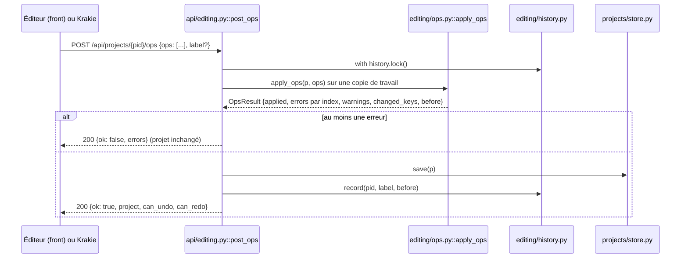

# 13. Projets : stockage, édition, annuler / rétablir, versions SemVer {#projets-versions}

Comment un projet est rangé sur disque, comment l'éditeur le modifie par opérations atomiques, comment fonctionnent annuler et rétablir, l'éditeur de fichiers, les périmètres, et les versions publiées de l'ontologie (SemVer).

Sources lues : `backend/ontoforge/projects/store.py`, `backend/ontoforge/projects/generations.py`, `backend/ontoforge/projects/releases.py`, `backend/ontoforge/fsutil.py`, `backend/ontoforge/editing/ops.py`, `backend/ontoforge/editing/history.py`, `backend/ontoforge/editing/files.py`, `backend/ontoforge/editing/perimeter.py`, `backend/ontoforge/api/projects.py`, `backend/ontoforge/api/editing.py`, `backend/ontoforge/api/files.py`, `backend/ontoforge/api/releases.py`, `backend/ontoforge/api/versions.py`, `docs/CONTRACTS.md` §5, §7, §8, §19.

## Disposition sur disque {#disposition}

`$ONTOFORGE_DATA` (défaut `./data` en développement, `/data` dans l'image Docker) contient `projects/<id>/` :

| Fichier | Écrit par | Rôle |
|---|---|---|
| `project.json` | `backend/ontoforge/projects/store.py::save` | **source de vérité** : le `Project` sérialisé avec ses alias (chapitre [03](03-modele-interne.md#project)) |
| `decisions.json` | `save` | copie lisible de `Project.decisions` (éditable dans l'éditeur de fichiers) |
| `onto.ttl`, `shapes.ttl` | `save` (`_export_side_files`) | exports Turtle réécrits à chaque sauvegarde ; un échec d'export est journalisé, la sauvegarde réussit |
| `collab.json`, `activity.jsonl` | `collab/access.py` | partage, version `rev`, journal d'activité (chapitre [12](12-comptes-partage-admin.md#cloisonnement)) |
| `ops-history.json` | `editing/history.py` | piles annuler / rétablir |
| `generations.json` | `projects/generations.py` | historique des générations (chapitre [08](08-generateurs.md#flux)) |
| `queries.json` | `queries/saved.py` | requêtes sauvegardées |
| `releases.json`, `releases-undone.json` | `projects/releases.py` | versions publiées et versions annulées |
| `triplestore/` | `localstore/store.py` | triplestore local (chapitre [10](10-triplestore-local.md)) |
| `data.ttl` | `api/projects.py::create_project` | données d'un exemple chargé à la création |

Seul `project.json` porte le modèle ; tout le reste est **annexe**, pour qu'un `PUT` de projet complet ne puisse ni réécrire les partages ni l'historique, et qu'une route de lecture n'écrive jamais `project.json` (L41).

Identifiant de projet : `slugify(nom)` + 6 caractères hexadécimaux aléatoires (`new_id`) ; tout identifiant est validé par `ID_RE` (`^[a-z0-9][a-z0-9-]{0,80}$`) avant de construire un chemin, ce qui empêche de sortir du dossier des projets. Un `project.json` illisible est signalé au journal et ignoré par `list_projects`, sans casser la liste.

## Écritures {#ecritures}

`backend/ontoforge/fsutil.py::atomic_write` est l'unique point d'écriture : fichier temporaire dans le même dossier, `flush`, `fsync` (au mieux), `os.replace` ; si le renommage est refusé (certains montages), écriture directe. Il est conçu pour fonctionner aussi sur un montage Cloud Storage FUSE, où il n'y a ni verrou de fichier ni lien. La sérialisation des écritures repose donc sur des **verrous de threads** (un seul processus, une seule instance) et, pour les routes, sur le verrou par projet de `CollabMiddleware`.

## Édition par opérations {#operations}

- `backend/ontoforge/editing/ops.py::apply_ops` applique une liste (`MAX_OPS` = 500) **tout ou rien** sur une copie : au moindre échec, rien n'est modifié. La réponse est 200 même en cas d'erreur (`ok: false`, erreurs par index), pour que le front lise le corps sans exception (D-L9-01).
- Chaque genre d'opération est une fonction `_op_<nom>` enregistrée dans `HANDLERS` (ajout de classe, renommage, suppression, sous-classe, propriétés, domaine et portée, restriction, caractéristique, inverse, disjonction, clé, icône, position, repli, dépréciation, annotations, `owl:versionIRI`…). Les contrôles d'intégrité (`integrity_errors`, propriétés non simples, cycles de sous-classes par `editing/cycles.py`, littéraux par `check_literal`) s'exécutent dans la même passe.
- `snapshot` et `restore` ne copient que les champs suivis (`onto`, `view`, `perimeters`, `shapes`, `decisions`).
- Krakie utilise le même `apply_ops` pour son essai à blanc (chapitre [11](11-assistant-krakie.md#flux)).

### Annuler / rétablir {#annuler-retablir}

`backend/ontoforge/editing/history.py` : chaque entrée garde l'état **avant** des seuls champs modifiés ; piles `undo` et `redo` bornées à `LIMIT` = 200, dans `ops-history.json`. `undo` et `redo` échangent l'état courant et l'état stocké (`_swap`) ; pile vide → 409. Les sauvegardes hors éditeur (`PUT /onto`, import…) ne sont pas journalisées : annuler restaure alors les champs de l'entrée, ce qui peut écraser une modification faite autrement. `history.lock()` est un verrou unique (réentrant) partagé par tous les projets.

Une version publiée est liée à son entrée d'historique : annuler l'opération de publication déplace la version dans `releases-undone.json`, rétablir la remet (`releases.on_history`).

## Éditeur de fichiers {#editeur-fichiers}

`backend/ontoforge/editing/files.py` (routes `/api/projects/{pid}/files*`, `backend/ontoforge/api/files.py`) sert `onto.ttl`, `shapes.ttl` et `decisions.json` en texte **canonique** (graphe réétiqueté par `canonical_or_same` avant sérialisation, pour que deux lectures donnent le même texte et la même empreinte), ainsi que les fichiers générés en lecture seule (`generated/<nom>`). `POST /files/validate` renvoie des diagnostics positionnés (syntaxe, conformité, méta-validation SHACL : chapitre [06](06-shacl.md#meta-validation)), `POST /files/diff` le diff de graphes, `PUT /files/{path}` applique. Conséquence assumée : commentaires et mise en forme du texte saisi sont normalisés à l'application.

## Périmètres {#perimetres}

`backend/ontoforge/editing/perimeter.py` : un `Perimeter` est un sous-ensemble de classes (et de propriétés, ou toutes celles dont domaine et portée sont dedans), avec ou sans descendants. `scope(p, perimeter_id)` renvoie l'ontologie et les shapes restreintes plus des constats `info` (P00 à P03) ; `None`, `all` ou `none` = ontologie complète, id inconnu → 404. Analyse, génération et graphe acceptent `?perimeter=`. `Project.active_perimeter` est un état d'interface, sans effet sur l'analyse.

## Versions publiées (SemVer) {#releases}

`backend/ontoforge/projects/releases.py` (L49, D-L49-02) : chaque publication enregistre une entrée dans `releases.json` (30 au plus, `MAX_RELEASES`) avec un instantané de l'ontologie, pour calculer le diff suivant.

- `diff(old, new)` compare deux `OntoModel` collection par collection ; `level_of` donne le niveau proposé, le plus fort des changements : **majeur** (entité retirée, axiome de définition changé, imports, `unmapped`), **mineur** (entité ajoutée, libellés, définitions, commentaires, dépréciation, individus), **correctif** (autres annotations, en-tête). Aucun changement → correctif.
- `preview` propose la version suivante (`bump`) et la note ; `check_version` refuse une version qui n'est pas SemVer ou qui recule.
- `POST /releases` passe par des **opérations d'édition** (`set_annotations` pour `owl:versionInfo`, `dcterms:modified`, `owl:priorVersion` ; `set_version_iri`) : la publication est journalisée et annulable. `owl:versionIRI` = IRI de l'ontologie + `/<version>` (`version_iri_for`, D-L49-01).

Les « versions » de `GET/PUT /projects/{pid}/versions` sont autre chose : les versions de normes et de cibles du projet (`Project.target_versions`, L31, chapitre [08](08-generateurs.md#versions)).

## Décisions {#decisions}

- D-028 : stockage `$ONTOFORGE_DATA/projects/<id>/` (remplace D-019).
- D-L9-01 : `/ops` répond 200 avec `ok=false` ; annuler par instantanés des seuls champs modifiés.
- D-L49-01, D-L49-02, D-L49-03 : vocabulaire de version, règles du diff SemVer, un ajout propose une version mineure.
- L41 : aucune route de lecture n'écrit `project.json`.

## Pièges et limites {#pieges}

- Une seule instance : verrous de threads, pas de verrou de fichier ; deux processus qui écrivent le même projet peuvent s'écraser.
- Annuler après un import : l'import n'est pas journalisé ; annuler une opération antérieure restaure l'ontologie d'avant cette opération, import compris.
- `project.json` volumineux : réécrit en entier à chaque sauvegarde, avec `onto.ttl` et `shapes.ttl`. Le coût croît avec l'ontologie (et `unmapped`, plafonné : chapitre [04](04-import-export-rdf.md#garde-fous)).
- Texte canonique : l'éditeur de fichiers ne garde ni commentaires ni ordre ; ne pas s'en servir comme stockage de source annotée.

## Comment ajouter… {#comment-ajouter}

**…une opération d'édition.** Écrire `_op_<nom>(w, op)` dans `backend/ontoforge/editing/ops.py` (lever `OpError` avec un message en français ; travailler sur `w`, la copie), l'enregistrer dans `HANDLERS`, ajouter le champ modifié à `TRACKED` s'il n'y est pas, la traduction anglaise des messages dans `backend/ontoforge/localize/phrases.py`, et un test dans `backend/tests/test_editing_ops.py`. Le front a son propre catalogue d'opérations (chapitre [15](15-front.md)).

**…un fichier annexe.** L'écrire par `fsutil.atomic_write` sous un verrou de module, à côté de `project.json` (`store.project_dir(pid) / NOM`), jamais dans le modèle `Project` si un client ne doit pas pouvoir le réécrire par `PUT`. Vérifier que la suppression du projet l'emporte (elle supprime le dossier entier).
