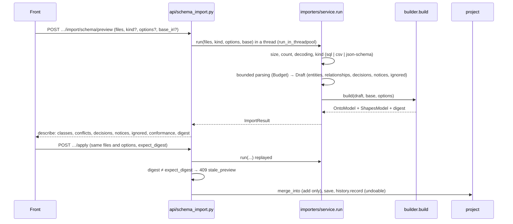

# 14. SQL DDL, CSV and JSON Schema imports {#imports-schemas}

OntoForge can bootstrap an ontology (and its shapes) from a database schema, CSV files or JSON Schemas, **without AI**: the computation is deterministic, the preview is mandatory, and applying replays the same computation (D-L48-01).

Sources read: `backend/ontoforge/importers/` (`service.py`, `ir.py`, `builder.py`, `limits.py`, `messages.py`, `sql_lexer.py`, `sql_ddl.py`, `sql_types.py`, `sql_check.py`, `sql_to_entities.py`, `csv_import.py`, `json_schema.py`), `backend/ontoforge/api/schema_import.py`, `docs/CONTRACTS.md` §18, test `backend/tests/test_l48_import.py`. Run of `service.run` on a small DDL.

## Files {#fichiers}

| File | Responsibility |
|---|---|
| `backend/ontoforge/importers/service.py` | orchestration: `run` (pure), `sniff_kind`, `clean_options`, `check_base`, `merge_into`, `describe`, `conformance` |
| `backend/ontoforge/importers/ir.py` | shared intermediate representation: `Draft`, `Entity`, `Prop`, `Rel`, `Decision`, `Notice` |
| `backend/ontoforge/importers/sql_lexer.py`, `sql_ddl.py`, `sql_types.py`, `sql_check.py`, `sql_to_entities.py` | SQL: lexer, `CREATE TABLE` / `ALTER TABLE … ADD` / indexes / `COMMENT ON` / `CREATE TYPE … AS ENUM`, types, `CHECK` subset, tables → entities |
| `backend/ontoforge/importers/csv_import.py` | CSV: bounded RFC 4180 reader, one class per file, types inferred from a sample |
| `backend/ontoforge/importers/json_schema.py` | JSON Schema: objects → classes, local `$ref` → relationships, `enum` / `const`, `allOf` of references → subclasses |
| `backend/ontoforge/importers/builder.py` | `build`: `Draft` → `OntoModel` + `ShapesModel` + `digest` |
| `backend/ontoforge/importers/limits.py` | bounds, `Budget`, `ImportRefused` |
| `backend/ontoforge/importers/messages.py` | readable fr / en messages from the stable codes |
| `backend/ontoforge/api/schema_import.py` | routes `POST /api/import/schema/preview` (no project), `POST /api/projects/{pid}/import/schema/preview`, `POST /api/projects/{pid}/import/schema/apply` |

## Flow {#flux}

- Pure: `run` reads only its arguments; two identical calls give the same `digest` (truncated SHA-256 of the serialized ontology and shapes, `builder.py`). Applying requires `expect_digest` (422 `missing_digest`) and refuses if the result changed since the preview (409 `stale_preview`).
- Add only: `merge_into` only adds new entities; an existing IRI is never changed (conflicts are listed in the preview).
- Undoable: applying records a history entry (`Import <kind> : <files>`); `POST /ops/undo` reverts it (chapter [13](13-projets-versions.en.md#annuler-retablir)).
- Rights: the out-of-project preview is open to any logged-in account; preview and apply on a project require the write right.

Run example: two tables `garage (id PK, name)` and `vehicle (vin PK, garage_id → garage, km CHECK (km >= 0))` give the classes `Garage`, `Vehicle`, the object property `hasGarage` and the data properties `id`, `name`, `vin`, `km`.

## Translation rules {#regles}

Choices of D-L48-01:

- Naming: short camelCase property if unique across the whole import, else prefixed with the class (independent of file order). Association table: object property named after the table.
- Decisions left to the human (`Decision`): association table (relationship or reified class), foreign key used as primary key (relationship or subclass), `xxx_id` columns of a CSV. Default: the simplest reading (relationship).
- Keys: primary key and `UNIQUE` on non-null columns → `owl:hasKey`; nullable `UNIQUE` → notice only. CSV: key assumed on an identifier-like column (`assumed_key` notice).
- Types: `date`, `time`, `duration`, `gYear` are not in the OWL 2 map: degraded (`dateTime`, `string`, `integer`) with a notice. Precise integers kept (`short`, `int`, `long`, unsigned).
- Required from the CSV sample: option, off by default (a sample does not prove a constraint).
- `xsd:string` enumerations: plain literals (otherwise `sh:in` compares badly under pySHACL).
- Losses reported, never silent: indexes, triggers, views, routines, grants, `CHECK` outside the recognized subset (`sql_check.py`: `IN`, `OR` of equalities, `= ANY (ARRAY[…])`, bounds, `BETWEEN`, `LENGTH(col) <= n`, `col <> ''`, `IS NOT NULL`), untranslated JSON Schema keywords (`additionalProperties`, `patternProperties`, `if/then/else`…) go to `Draft.ignored` or to notices.
- Output: OWL 2 DL (OWL 2 map datatypes, `owl:hasKey` on declared properties, cardinalities on simple properties, no property both object and data) and valid SHACL Core (shapes from `generate_shapes`, chapter [06](06-shacl.en.md#generation), enriched with the facets found: lengths, bounds, patterns). The preview shows the conformance result (`service.conformance`).

## Bounds {#bornes}

Every input is considered hostile: each parsing loop calls `Budget.tick`; an overflow raises `ImportRefused` with a stable code and an HTTP status (413 too big, 422 unreadable, 408 too long).

| Bound | Value | Source |
|---|---|---|
| file size | 2 MB (`ONTOFORGE_IMPORT_MAX_MB`, 1 to 20) | `max_bytes` |
| total per request | 10 MB (`MAX_TOTAL_MB`) | `limits.py` |
| files per request | 50 (`MAX_FILES`) | |
| parsing time | 8 s (`ONTOFORGE_IMPORT_MAX_SECONDS`, 1 to 60) | `time_limit` |
| tables or classes | 400; columns per table 1024, 20,000 in total | |
| depth (SQL parentheses, JSON nesting) | 32 | `MAX_DEPTH` |
| SQL tokens | 600,000 | `MAX_TOKENS` |
| JSON nodes | 300,000 | `MAX_JSON_NODES` |
| CSV rows read | 2,000 (the rest is not read); 10,000 characters per field | `MAX_CSV_ROWS`, `MAX_CSV_FIELD` |
| enumeration values | 500 | `MAX_ENUM` |

No JSON Schema `$ref` is followed, neither over the network nor on disk: an external reference becomes a "to be completed" class, unless the target file is part of the uploaded files. SQL is never executed and no database module is loaded.

## Libraries {#librairies}

No dependency: SQL, CSV and JSON Schema parsers are handwritten (the standard library's `json` module reads JSON). The result goes through the pydantic 2.10.3 models and `shacl/owl_to_shacl.py`.

## Decisions {#decisions}

- D-L48-01: deterministic import, mandatory preview, naming, decisions left to the human, keys, types, enumerations, rights.
- D-L46-01: launch of lot L48.

## Pitfalls and limits {#pieges}

- Exact replay: the front must send to apply **the same files and the same options** as for the preview, otherwise 409; this is what `frontend/src/api.ts::api.schemaApply` does (files, options, base and `expect_digest` built by `schemaForm`), see chapter [02](02-communication-front-back.en.md#ajouter-appel).
- Dialects: PostgreSQL, MySQL / MariaDB, SQL Server and a generic SQL (`detect_dialect`); syntax specific to another engine goes to `ignored`.
- CSV sample: types inferred from 2,000 rows may be wrong for the rest of the file.
- No merge with existing content: a class already present is not completed by the import; rename first or import into an empty project.

## How to add… {#comment-ajouter}

**…a source format** (example: XSD). Write a module that fills a `Draft` (entities, properties, relationships, notices, ignored) calling `Budget.tick` in every loop and raising `ImportRefused` on overflow; add it to `KINDS` and `sniff_kind` in `service.py` and to the branch in `run`; add the messages of its codes in `messages.py` (fr and en); determinism (same `digest`) and bound tests in `backend/tests/test_l48_import.py`. The `builder` does not change.

**…a `CHECK` form.** Add it to the subset in `sql_check.py` (top-level conjunction, one column) and translate it into a facet in `builder._facets`; an unrecognized form must stay in `unhandled`.
