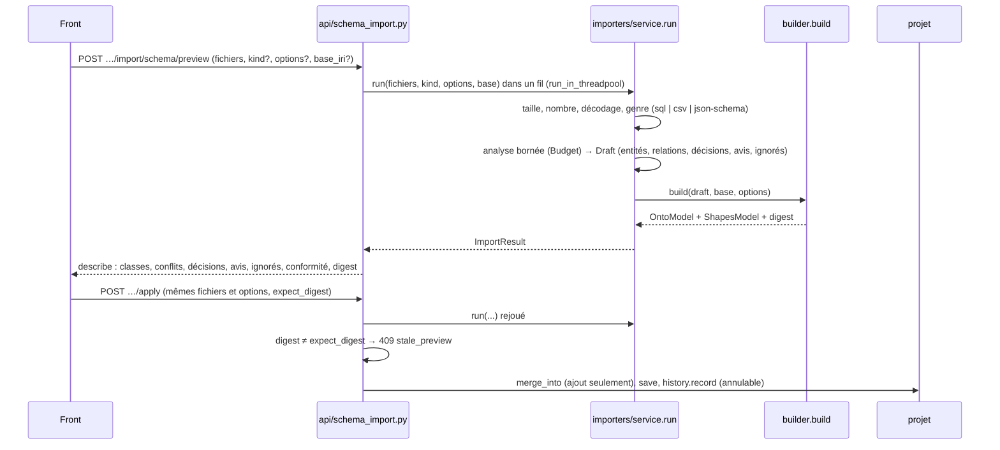

# 14. Imports SQL DDL, CSV et JSON Schema {#imports-schemas}

OntoForge sait amorcer une ontologie (et ses shapes) depuis un schéma de base de données, des fichiers CSV ou des JSON Schema, **sans IA** : le calcul est déterministe, l'aperçu est obligatoire, et l'application rejoue le même calcul (D-L48-01).

Sources lues : `backend/ontoforge/importers/` (`service.py`, `ir.py`, `builder.py`, `limits.py`, `messages.py`, `sql_lexer.py`, `sql_ddl.py`, `sql_types.py`, `sql_check.py`, `sql_to_entities.py`, `csv_import.py`, `json_schema.py`), `backend/ontoforge/api/schema_import.py`, `docs/CONTRACTS.md` §18, test `backend/tests/test_l48_import.py`. Exécution de `service.run` sur un petit DDL.

## Fichiers {#fichiers}

| Fichier | Responsabilité |
|---|---|
| `backend/ontoforge/importers/service.py` | orchestration : `run` (pur), `sniff_kind`, `clean_options`, `check_base`, `merge_into`, `describe`, `conformance` |
| `backend/ontoforge/importers/ir.py` | représentation intermédiaire commune : `Draft`, `Entity`, `Prop`, `Rel`, `Decision`, `Notice` |
| `backend/ontoforge/importers/sql_lexer.py`, `sql_ddl.py`, `sql_types.py`, `sql_check.py`, `sql_to_entities.py` | SQL : analyseur lexical, `CREATE TABLE` / `ALTER TABLE … ADD` / index / `COMMENT ON` / `CREATE TYPE … AS ENUM`, types, sous-ensemble des `CHECK`, passage tables → entités |
| `backend/ontoforge/importers/csv_import.py` | CSV : lecteur RFC 4180 borné, une classe par fichier, types déduits d'un échantillon |
| `backend/ontoforge/importers/json_schema.py` | JSON Schema : objets → classes, `$ref` locaux → relations, `enum` / `const`, `allOf` de références → sous-classes |
| `backend/ontoforge/importers/builder.py` | `build` : `Draft` → `OntoModel` + `ShapesModel` + empreinte `digest` |
| `backend/ontoforge/importers/limits.py` | bornes, `Budget`, `ImportRefused` |
| `backend/ontoforge/importers/messages.py` | messages lisibles fr / en à partir des codes stables |
| `backend/ontoforge/api/schema_import.py` | routes `POST /api/import/schema/preview` (sans projet), `POST /api/projects/{pid}/import/schema/preview`, `POST /api/projects/{pid}/import/schema/apply` |

## Flux {#flux}

- Pur : `run` ne lit que ses arguments ; deux appels identiques donnent le même `digest` (SHA-256 tronqué de l'ontologie et des shapes sérialisées, `builder.py`). L'application exige `expect_digest` (422 `missing_digest`) et refuse si le résultat a changé depuis l'aperçu (409 `stale_preview`).
- Ajout seulement : `merge_into` n'ajoute que des entités nouvelles ; une IRI existante n'est jamais modifiée (les conflits sont listés dans l'aperçu).
- Annulable : l'application enregistre une entrée d'historique (`Import <genre> : <fichiers>`) ; `POST /ops/undo` la défait (chapitre [13](13-projets-versions.md#annuler-retablir)).
- Droits : l'aperçu hors projet est ouvert à tout compte connecté ; l'aperçu et l'application sur un projet demandent le droit d'écriture.

Exemple exécuté : deux tables `garage (id PK, name)` et `vehicle (vin PK, garage_id → garage, km CHECK (km >= 0))` donnent les classes `Garage`, `Vehicle`, la propriété objet `hasGarage` et les propriétés de données `id`, `name`, `vin`, `km`.

## Règles de traduction {#regles}

Choix de D-L48-01 :

- Nommage : propriété courte en camelCase si elle est unique dans tout l'import, sinon préfixée par la classe (indépendant de l'ordre des fichiers). Table d'association : propriété objet nommée d'après la table.
- Décisions laissées à l'humain (`Decision`) : table d'association (relation ou classe réifiée), clé étrangère servant de clé primaire (relation ou sous-classe), colonnes `xxx_id` d'un CSV. Défaut : la lecture la plus simple (relation).
- Clés : clé primaire et `UNIQUE` sur colonnes non nulles → `owl:hasKey` ; `UNIQUE` nullable → avis seulement. CSV : clé supposée sur une colonne de type identifiant (avis `assumed_key`).
- Types : `date`, `time`, `duration`, `gYear` ne sont pas dans la carte OWL 2 : dégradés (`dateTime`, `string`, `integer`) avec avis. Entiers précis conservés (`short`, `int`, `long`, non signés).
- Obligatoire d'après l'échantillon CSV : option désactivée par défaut (un échantillon ne prouve pas une contrainte).
- Énumérations `xsd:string` : littéraux simples (sinon `sh:in` compare mal sous pySHACL).
- Pertes rapportées, jamais silencieuses : index, déclencheurs, vues, routines, droits, `CHECK` hors du sous-ensemble reconnu (`sql_check.py` : `IN`, `OR` d'égalités, `= ANY (ARRAY[…])`, bornes, `BETWEEN`, `LENGTH(col) <= n`, `col <> ''`, `IS NOT NULL`), mots-clés JSON Schema non traduits (`additionalProperties`, `patternProperties`, `if/then/else`…) vont dans `Draft.ignored` ou dans les avis.
- Sortie : OWL 2 DL (datatypes de la carte OWL 2, `owl:hasKey` sur des propriétés déclarées, cardinalités sur des propriétés simples, aucune propriété à la fois d'objet et de données) et SHACL Core valide (shapes de `generate_shapes`, chapitre [06](06-shacl.md#generation), enrichies des facettes relevées : longueurs, bornes, motifs). L'aperçu rend le résultat de la conformité (`service.conformance`).

## Bornes {#bornes}

Toute entrée est considérée hostile : chaque boucle d'analyse appelle `Budget.tick` ; un dépassement lève `ImportRefused` avec un code stable et un statut HTTP (413 trop gros, 422 illisible, 408 trop long).

| Borne | Valeur | Source |
|---|---|---|
| taille d'un fichier | 2 Mo (`ONTOFORGE_IMPORT_MAX_MB`, 1 à 20) | `max_bytes` |
| total par requête | 10 Mo (`MAX_TOTAL_MB`) | `limits.py` |
| fichiers par requête | 50 (`MAX_FILES`) | |
| durée d'analyse | 8 s (`ONTOFORGE_IMPORT_MAX_SECONDS`, 1 à 60) | `time_limit` |
| tables ou classes | 400 ; colonnes par table 1024, en tout 20 000 | |
| profondeur (parenthèses SQL, imbrication JSON) | 32 | `MAX_DEPTH` |
| unités lexicales SQL | 600 000 | `MAX_TOKENS` |
| nœuds JSON | 300 000 | `MAX_JSON_NODES` |
| lignes CSV lues | 2 000 (le reste n'est pas lu) ; 10 000 caractères par champ | `MAX_CSV_ROWS`, `MAX_CSV_FIELD` |
| valeurs d'une énumération | 500 | `MAX_ENUM` |

Aucun `$ref` JSON Schema n'est suivi, ni sur le réseau ni sur le disque : une référence externe devient une classe « à compléter », sauf si le fichier visé fait partie des fichiers déposés. Le SQL n'est jamais exécuté et aucun module de base de données n'est chargé.

## Librairies {#librairies}

Aucune dépendance : analyseurs SQL, CSV et JSON Schema écrits à la main (module `json` de la bibliothèque standard pour lire le JSON). Le résultat passe par les modèles pydantic 2.10.3 et par `shacl/owl_to_shacl.py`.

## Décisions {#decisions}

- D-L48-01 : import déterministe, aperçu obligatoire, nommage, décisions laissées à l'humain, clés, types, énumérations, droits.
- D-L46-01 : lancement du lot L48.

## Pièges et limites {#pieges}

- Rejeu exact : le front doit renvoyer à l'application **les mêmes fichiers et les mêmes options** que pour l'aperçu, sinon 409 ; c'est ce que fait `frontend/src/api.ts::api.schemaApply` (fichiers, options, base et `expect_digest` construits par `schemaForm`), voir le chapitre [02](02-communication-front-back.md#ajouter-appel).
- Dialectes : PostgreSQL, MySQL / MariaDB, SQL Server et un SQL générique (`detect_dialect`) ; une syntaxe propre à un autre moteur part dans `ignored`.
- Échantillon CSV : les types déduits de 2 000 lignes peuvent être faux pour la suite du fichier.
- Pas de fusion avec l'existant : une classe déjà présente n'est pas complétée par l'import ; renommer d'abord ou importer dans un projet vide.

## Comment ajouter… {#comment-ajouter}

**…un format source** (exemple : XSD). Écrire un module qui remplit un `Draft` (entités, propriétés, relations, avis, ignorés) en appelant `Budget.tick` dans chaque boucle et en levant `ImportRefused` sur dépassement ; l'ajouter à `KINDS` et à `sniff_kind` dans `service.py` et à la branche de `run` ; ajouter les messages de ses codes dans `messages.py` (fr et en) ; des tests de déterminisme (même `digest`) et de bornes dans `backend/tests/test_l48_import.py`. Le `builder` ne change pas.

**…une forme de `CHECK`.** L'ajouter au sous-ensemble de `sql_check.py` (conjonction de premier niveau, une colonne) et la traduire en facette dans `builder._facets` ; une forme non reconnue doit rester dans `unhandled`.
