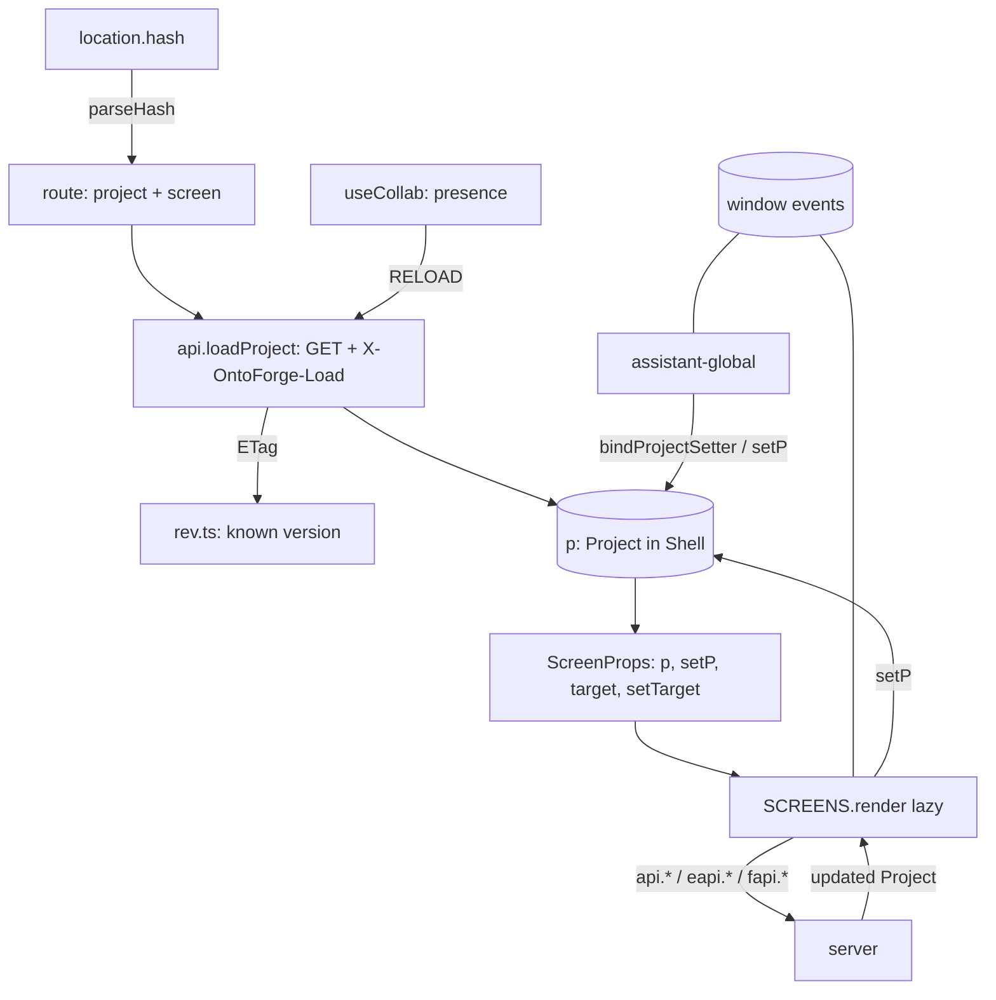

# 15. Front end: shell, state, design system, i18n, editors, phone {#front}

How the React application is built: the shell that carries navigation, how state flows, the component kit and its style tokens, internationalisation, the graph editor, the code editors, and the phone version. Communication with the server is in [chapter 02](02-communication-front-back.en.md); the build in [chapter 17](17-build-ci-deploiement.en.md); tests in [chapter 18](18-tests.en.md). Back to the [index](README.en.md).

State verified on 23 November 2026. The front end is about 9,500 lines of TypeScript under `frontend/src/` (excluding JSON and CSS).

## 1. Role {#role}

The front end is a single-page application (SPA) that **displays** what the server computes and sends intentions (operations, decisions). It recomputes no OWL / SHACL / transposition semantics. It has no router, no state library and no CSS framework: routing through `location.hash`, local React state plus a few small stores, hand-written CSS.

## 2. Files and responsibilities {#fichiers}

| Path | Responsibility |
|---|---|
| `frontend/src/main.tsx` | entry point: style sheets, `initMobileClass()`, rendering of `App` |
| `frontend/src/App.tsx::App` | provider stack: `I18nProvider` > `AuthGate` > `ToastHost` > `Shell` + `GameLauncher` |
| `frontend/src/shell/Shell.tsx::Shell` | navigation (sidebar, header, phone tab bar), route, project loading, target, active perimeter, collaboration |
| `frontend/src/shell/registry.tsx::SCREENS` | **screen registry**: URL key, i18n label, icon, step, lazy render |
| `frontend/src/shell/types.ts::ScreenProps` | common screen contract: `{p, setP, target, setTarget}` |
| `frontend/src/shell/sidePref.ts` | sidebar preference, `useMedia`, `useMobile`, `is-mobile` class |
| `frontend/src/shell/theme.ts::useTheme` | light / dark / system theme |
| `frontend/src/kit/index.tsx` | base components (Icon, Button, Field, Segmented, Tabs, Panel, Fold, Card…) |
| `frontend/src/kit/BottomSheet.tsx::BottomSheet` | phone bottom sheet |
| `frontend/src/design/tokens.css` | "Abysse" design system: light / dark variables |
| `frontend/src/i18n/index.tsx` | dictionaries, `useI18n`, `tr`, `extendDicts`; `fr.json`, `en.json` (2201 keys each) |
| `frontend/src/ui.tsx` | `useLoad`, `ErrorView`, toasts, `download`, `copy`, lazy CodeMirror wrapper |
| `frontend/src/screens/**` | one folder per screen (see §3) |
| `frontend/src/assistant-global/` | Krakie panel (conversation, actions, context), aquarium |
| `frontend/src/lib/` | `proposal.ts` (proposal store), `docs.ts` (embedded guide), `safeMarkdown.ts`, `assistantContext.ts`, `reasonerFlags.ts`, `codeHighlight.ts` |
| `frontend/src/collab/` | sharing, presence, read-only, conflicts (chapter 02) |
| `frontend/src/auth/` | login, account menu, password change |
| `frontend/src/tour/` | guided tour (21 steps) |
| `frontend/src/game/` | hidden mini-game, loaded on demand |
| `frontend/src/krakie/Krakie.tsx::Krakie` | animated mascot (frame-by-frame SVG, `public/krakie/anim/`) |
| `frontend/src/mobile/Fiche.tsx::FicheSheet` | class or property sheet on phone |

## 3. Screens {#ecrans}

`SCREENS` registry (sidebar order):

| URL key | Component | Step | Notes |
|---|---|---|---|
| `tableau` | `frontend/src/screens/Dashboard.tsx` | none | next action suggested by Krakie |
| `ontologie` | `frontend/src/screens/editor/Editor.tsx` | design | graph editor (@xyflow/react) |
| `ontologie-liste` | `frontend/src/screens/ontology-list/index.tsx` | design | list view |
| `carte-metier` | `frontend/src/screens/bmap/BusinessMap.tsx` | design | zones, roles, frames; read-only on phone |
| `shapes` | `frontend/src/screens/shacl/index.tsx` | design | Shapes tab |
| `fichiers` | `frontend/src/screens/files/index.tsx` | design | file editor (CodeMirror) |
| `conformite`, `shacl` | `Conformance.tsx`, `screens/shacl/` | check | conformance and good practices; SHACL validation |
| `analyse`, `modele` | `Analysis.tsx`, `Model.tsx` | transpose | arbitration; Cytoscape diagram; badge of findings to arbitrate |
| `exports`, `versions`, `requetes` | `Exports.tsx`, `screens/versions/`, `screens/queries/` | generate | |
| `assistant` | `frontend/src/screens/assistant/index.tsx` | none | full screen |
| `plus` | `frontend/src/screens/More.tsx` | phone only | "More" menu |
| `documentation` | `frontend/src/screens/documentation/Documentation.tsx` | none | embedded `docs/guide/*.md` |

Outside the registry (hash routes): `#/` (Projects), `#/parametres` (Settings), `#/administration` (accounts), `#/aide` (guide outside a project), `#/projet/<id>/<key>`. Parsing is `parseHash` in `frontend/src/shell/Shell.tsx`.

Each screen is loaded by `lazy(() => import(...))`: eighteen lazy calls in the code, one chunk per screen (visible in the `npm run build` output). The entry bundle weighs 642 kB (198 kB gzipped) on 23/11; Vite's 500 kB warning threshold is exceeded (see chapter 17).

## 4. Flow: from URL to screen {#flux}

Rules to know:

1. The whole project lives in `Shell` (`useState<Project>`) and goes down into screens through `ScreenProps`. A successful write returns the updated project (`Project` or `OpResult.project`); the screen calls `setP`. There is no optimistic update: the interface follows the server response.
2. Project change: `Shell` reloads (`api.loadProject`), which **sets the known version** (chapter 02 §4.2). After a conflict or a "reload", the `reloadKey` changes and remounts the screen (`Suspense key`).
3. The **to-arbitrate badge** comes from an `api.analyze` that `Shell` launches whenever the project, target or screen changes (`frontend/src/screens/analysis/pending.ts::pendingCount`).
4. `setTarget` sends `api.putProject` with the new target; a 409 / 428 has its own dialog, no extra toast.
5. `useLoad` (`frontend/src/ui.tsx`) loads asynchronous data with cancellation (`live`), `reload` and an `ApiError`; use it for simple reads.

## 5. State and data {#etat}

No Redux, no global data context. Four levels:

| Level | Where | Examples |
|---|---|---|
| Component state | `useState` / `useReducer` in the screen | selection, tabs, forms |
| React contexts | `I18nProvider` (language), `AuthGate` (`useAuth`), `ToastHost` (`useToast`) | |
| Module stores (`useSyncExternalStore`) | `frontend/src/lib/proposal.ts` (assistant proposal, persisted in `localStorage`), `frontend/src/assistant-global/store.ts` (conversations, panel state), `frontend/src/lib/reasonerFlags.ts` (unsatisfiable classes), `frontend/src/shell/sidePref.ts` | shared between screens that do not call each other |
| `window` events | `CustomEvent` | see below |

**`window` events** (name, emitter → receiver):
`ontoforge:auth-required` (AuthGate → AuthGate), `ontoforge:must-change`, `ontoforge:conflict` (patched fetch → `ConflictDialog`), `ontoforge:readonly`, `ontoforge:reload-project` (Banners → Shell), `of:perimeter` / `of:perimeters` (editor ↔ Shell), `ontoforge:endpoint-changed` (Settings → Shell), `ontoforge:assistant-open` / `ontoforge:assistant-context` (screens → Krakie panel), `ontoforge:open-query` (assistant → Queries), `ontoforge:settings-goto`, `ontoforge:tour-menu`, `ontoforge:game`, `of:delete` (inspector → editor), `of:side-settled`. Emitted with no receiver: `ontoforge:authed`, `ontoforge:project` (DF-F04).

**Assistant context**: each screen declares what it shows (`frontend/src/lib/assistantContext.ts::useAssistantContext`); `frontend/src/assistant-global/context.ts::effectiveContext` matches it to the route (`ROUTE_SCREEN`) before sending. Nothing is sent to the server that the user cannot see (`forSend`, modes `full`, `screen`, `none`).

**Browser storage** (always in a `try/catch`, in-memory fallback): `ontoforge.lang`, `of-theme`, `ontoforge.side`, `ontoforge.fold.v1`, `ontoforge.ed.mode|legend|show`, `ontoforge.proposal`, `ontoforge.assistant.<project>` (last 80 messages), `ontoforge.assistant.ui`, `ontoforge.tour.done`, `ontoforge.bmap.source`, `ontoforge.mobile.onto`, `ontoforge.pending-query.<…>`, `ontoforge.game.*`. No secret and no token: the CSRF token stays in memory (chapter 02).

## 6. Internationalisation {#i18n}

- Flat dictionaries: `frontend/src/i18n/fr.json` and `en.json`, key `zone.name` (`nav.ontologie`, `dash.stat.classes`). 2201 keys on both sides on 23/11, same `{name}` placeholders (checked by script; no test guards it, DF-F08).
- `useI18n()` gives `t(key, params)` in a component; `tr(key, params)` is for code outside components (`api.ts`, stores). Fallback: requested language, then French, then the key itself.
- The language comes from `GET /api/auth/session` (account) or from `GET /api/settings` (`language.ui`) when the instance has no accounts (`I18nProvider`); before login, from `localStorage` or the browser. The server translates its own messages itself (chapter 02 §4.5).
- Chunks loaded on demand add their strings through `extendDicts` (the mini-game: `frontend/src/game/strings.ts`).
- Write without breaking (skill `i18n-ecriture-sure`): read before writing, add the key in both languages at once, never rename or change the meaning of an existing key (recipes and help reference it), same `{placeholders}` on both sides, no multi-line `sed` on JSON.
- "(s)" plurals: known debt (skill `i18n-ecriture-sure`). Labels coming from the ontology come from the model (`labelOf` in `frontend/src/api.ts`), not from the dictionaries.

## 7. Design system {#design-system}

- Tokens: `frontend/src/design/tokens.css` defines the palette ("Abysse": ink, lagoon, amber, foam, alert), surfaces, severities (`--auto`, `--review`, `--lost`, `--info`), IBM Plex typography (`@fontsource` packages, self-hosted: the CSP forbids third-party fonts), radii, spacing, phone variables (`--tap`, `--tabbar-h`…). The dark theme uses `:root[data-theme="dark"]` set by `useTheme`; with no preference, system mode follows `prefers-color-scheme`.
- No hard-coded colour in screens: variables only (exception: the business-map palette, `frontend/src/screens/bmap/palette.ts`).
- Kit (`frontend/src/kit/index.tsx`): screens import `Button`, `IconButton`, `Field`, `Segmented`, `Tabs`, `Panel`, `Fold`, `Card`, `EmptyState`, `Icon`… from `../kit`. Icons are Font Awesome Free (`fontawesome-free` 7.3.1, `solid` set), referenced by name: `<Icon name="gauge-high" />`.
- Style sheets: `frontend/src/styles.css` (base), `frontend/src/shell/kit.css`, `shell.css`, `mobile.css`, `frontend/src/kit/sheet.css`, plus one `.css` per screen imported by its component. No CSS-in-JS and no preprocessor.
- Accessibility: components with `aria-*` (`Segmented`: `aria-pressed`, `Tabs`: `role=tab`), `data-testid` for the recipes (do not rename lightly), `prefers-reduced-motion` honoured (Krakie, transitions).
- Safe Markdown: any text coming from an LLM or a file goes through `frontend/src/lib/safeMarkdown.ts::renderSafeMarkdown` (raw HTML escaped, links limited to http(s) and mailto, images removed); tested by `frontend/tests/safe_markdown.test.mjs`. The embedded guide uses its own renderer (`frontend/src/lib/docs.ts`).

## 8. Editors {#editeurs}

### 8.1 Graph editor (`frontend/src/screens/editor/`) {#editeur-graphe}

- Library: `@xyflow/react` 12.8.4 (canvas, custom nodes and edges, handles, mini-map); automatic layout by `@dagrejs/dagre` 1.1.5 (`frontend/src/screens/editor/layout.ts::autoLayout`, which folds ranks that are too wide).
- Layout of the code: `Editor.tsx` (state, gestures, calls), `parts.tsx` (`ClassNode` node, `OfEdge` edge), `vowl.tsx` (VOWL mode: circles), `view.ts::buildView` (**pure function**: server graph + mode + filters → drawn nodes and edges), `prefs.ts` (remembered preferences), `Inspector.tsx`, `Tree.tsx`, `QuickInput.tsx` (DSL quick input), `Legend.tsx`, `ShowMenu.tsx`, `exporter.ts` (SVG / PNG), `types.ts::eapi`.
- Flow: `eapi.graph` (`GET /graph?lang=&perimeter=`) supplies nodes and edges; gestures (create, link, rename, delete, move) produce **operations** `Op` sent by `eapi.ops` (`POST /ops`, all or nothing, `ok=false` with per-index errors rather than an exception); the response carries the updated project (`setP`) and the undo / redo state. Moved positions are grouped then sent as a move operation after a delay (`moveTimer`).
- Assistant proposals: "ghost" classes and edges drawn from `useProposal()`, accepted by `acceptItem` (`POST /ops`).
- Unsatisfiable classes (HermiT): coloured from `useReasonerFlags`.
- Gotchas: a node is identified by its IRI; positions only go to the server for moves, not at every render; `ReactFlow` needs a container of defined size (otherwise nothing shows); preference state lives in the browser, not in the project.

### 8.2 CodeMirror 6 {#codemirror}

Two uses, two configurations:

- `frontend/src/CodeEditor.tsx::CodeEditor`: simple editor (quick input, SPARQL, code previews) with highlighting through legacy modes (`@codemirror/legacy-modes`: Cypher, SPARQL, Turtle, JavaScript, YAML; JSON through `@codemirror/lang-json`), per-line diagnostics. Loaded on demand by `frontend/src/ui.tsx::CodeEditor` (a `lazy` wrapper).
- File editor (`frontend/src/screens/files/`): `cm.ts::buildExtensions` (folding, search, multi-cursor, model-driven autocompletion, theme, in-house GraphQL, Turtle folding), `CodeHost.tsx::CodeHost` (**one `EditorView`, one `EditorState` per tab**, so each tab keeps its undo history), `fapi.ts::fapi`, `DiffView.tsx` (`@codemirror/merge`), `index.tsx::Files` (tabs, validation, diff preview before applying, `etag` conflict). The server is the authority: `validate` → `diff` → `apply` (`PUT` with `base_etag`); a 409 with `current_etag` opens the file-specific conflict window, distinct from the project-version dialog (the latter is driven by the `conflict` code, see chapter 02).
- The `@codemirror/*` package versions are pinned in `frontend/package.json`; the group is updated together (`.github/dependabot.yml`, group `codemirror`).

### 8.3 Other visualisations {#visualisations}

Cytoscape 3.30.2: target model diagram (`frontend/src/screens/Model.tsx`, `cose` layout) and results graph (`frontend/src/screens/queries/Results.tsx`). Business map: in-house rendering (`frontend/src/screens/bmap/render.ts`, `geometry.ts`); the layout is computed by the server.

## 9. Phone version {#telephone}

Decisions D-L44-01 (tab navigation, limited editing) and D-L44-02 (tablets use the desktop layout).

- Detection: `frontend/src/shell/sidePref.ts::MOBILE_Q` (`max-width: 700px`, or landscape under 500 px high). `useMobile()` drives rendering; `initMobileClass()` puts the `is-mobile` class on `<html>` for style sheets; `kb-open` hides the tab bar while the virtual keyboard is open. A tablet in portrait (768 px) keeps the wide layout with touch targets (`useCoarse`).
- Navigation: `MobileHeader.tsx` (title, target, perimeter), `MobileTabBar.tsx` (tabs), the `plus` screen (`More.tsx`), navigation drawer, `ContextSheet.tsx` (target and perimeter).
- Bottom sheet: `frontend/src/kit/BottomSheet.tsx::BottomSheet`: three heights (`peek`, `half`, `full`), handle usable by finger and keyboard, focus trap, `inert` background, virtual keyboard tracking (`visualViewport`).
- Partly read-only screens: `desktop` field of the registry: `'read'` (heavy editing reserved to desktop; `useReadOnlyGuard` disables buttons and `DesktopHint` explains why), `'full'` (the whole screen is more comfortable on desktop).
- Sheet: `frontend/src/mobile/Fiche.tsx::FicheSheet`: add a subclass or a property, rename; goes through `/ops` like the desktop editor.
- Gestures: long press (`kit/useLongPress.ts`), touch graph (`screens/editor/MobileGraphBar.tsx`).
- Foldable panels: `Fold` (`kit/index.tsx`), state in `ontoforge.fold.v1`.
- Tests: recipes `tools/recette/mobile_*.mjs` with emulated devices (chapter 18).

## 10. Libraries {#librairies}

| Library | Version | Use | Why |
|---|---|---|---|
| react, react-dom | 18.3.1 | interface | decision D-L21-02 (no React 19) |
| vite, @vitejs/plugin-react | 5.4.11, 4.3.4 | build, dev server | |
| typescript | 5.6.3 | types (`strict`) | |
| @xyflow/react | 12.8.4 | graph editor | React nodes, handles, mini-map |
| @dagrejs/dagre | 1.1.5 | hierarchical layout | |
| cytoscape (+ @types) | 3.30.2 (+ 3.21.8) | model diagram, results | force layouts (`cose`) |
| @codemirror/* | state 6.7.6, view 6.43.14, commands 6.11.1, language 6.13.1, search 6.7.2, autocomplete 6.20.4, lint 6.9.7, merge 6.12.3, lang-json 6.0.2, legacy-modes 6.5.5 | code editors | |
| @lezer/highlight | 1.2.5 | highlight styles | |
| marked | 18.1.1 | guide and AI texts | Markdown rendering |
| @fortawesome/fontawesome-free | 7.3.1 | icons | self-hosted (CSP) |
| @fontsource/ibm-plex-sans, -mono | 5.3.0 | fonts | self-hosted (CSP) |

## 11. Decisions {#decisions}

- D-002 (React + TypeScript + Vite), **D-L21-02** (React 18, Vite 5 frozen).
- D-L44-01 / D-L44-02 (phone, tablets).
- D-L40-01 / D-L42-01 (collaboration, per-account language, read-only): see chapter 02 and chapter 12.
- Jerem: the guide is embedded in the app (L28), the developer manual is not (D-L51-01).

## 12. Pitfalls {#pieges}

- A screen must **not** call `fetch` directly for a write without going through a client: the global `fetch` adds CSRF and version, but errors and language are handled in the clients (chapter 02 §8).
- `Shell` reloads the project (`api.loadProject`) only when the identifier changes: a screen that modifies the project **must** call `setP` with the response.
- `lazy` + `Suspense key={def.key + ':' + reloadKey}`: changing the key unmounts the screen and loses its local state.
- `data-testid` attributes and `.cm-*`, `.react-flow__*` classes are used by recipes and the guided tour (`data-tour`): renaming them breaks `tools/recette/*` and `frontend/src/tour/steps.ts`.
- `localStorage` may be unavailable (private browsing): always `try/catch`.
- The build does not check for missing i18n keys: a missing key is displayed as is (fallback to the key).
- Any component that reads `window` / `document` when its module loads must stay compatible with the Node tests (only `safeMarkdown.ts` is imported there).

## 13. How to add… {#comment-ajouter}

### … a screen {#ajouter-ecran}

1. Create `frontend/src/screens/<name>/index.tsx` exporting a component that receives `ScreenProps`.
2. Add the lazy import and the entry in `frontend/src/shell/registry.tsx::SCREENS`: `key` (URL segment), `labelKey`, `icon`, `step`, optionally `editing`, `fullBleed`, `desktop`, `badge`.
3. Add the keys `nav.<name>` and the screen's own **in both `fr.json` and `en.json`**.
4. If the assistant must see the screen: `useAssistantContext(...)` in the component and a line in `frontend/src/assistant-global/context.ts::ROUTE_SCREEN`.
5. If the screen is part of the tour: a step in `frontend/src/tour/steps.ts`.
6. Test: a recipe (chapter 18); add the screen to `tools/recette/e2e_ui.mjs`.

### … an i18n key {#ajouter-cle}

Read both files, add the key to both (same `{placeholders}`), keep the order and indentation, check `git diff --stat`, then `npm run build` and the `tools/recette/english_scan.mjs` recipe for English.

### … an API call from a screen {#ajouter-appel}

Add the method to the area's client and its type (chapter 02 §9); in the screen, `useLoad(() => api.x(id), [id])` for a read, or `await api.y(...)` followed by `setP` for a write; show errors with `ErrorView` or `toast(e.message)`.

### … a kit component {#ajouter-composant}

Add it to `frontend/src/kit/index.tsx` using CSS variables from `tokens.css` (no hard-coded colour), an accessible label, and its rule in `frontend/src/shell/kit.css`.
