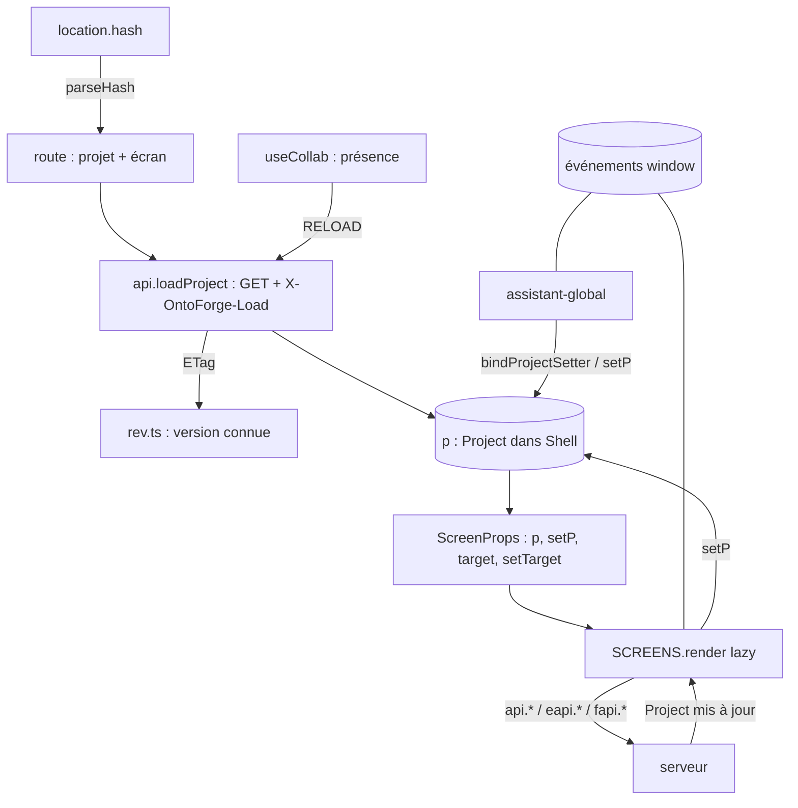

# 15. Front : shell, état, design system, i18n, éditeurs, téléphone {#front}

Construction de l'application React : le shell qui porte la navigation, la circulation de l'état, le kit de composants et ses jetons de style, l'internationalisation, l'éditeur de graphe, les éditeurs de code, la version téléphone. La communication avec le serveur est au [chapitre 02](02-communication-front-back.md) ; le build au [chapitre 17](17-build-ci-deploiement.md) ; les tests au [chapitre 18](18-tests.md). Retour au [sommaire](README.md).

État vérifié le 23 novembre 2026. Le front compte environ 9 500 lignes de TypeScript sous `frontend/src/` (hors JSON et CSS).

## 1. Rôle {#role}

Le front est une application monopage (SPA) qui **affiche** ce que calcule le serveur et envoie des intentions (opérations, décisions). Il ne recalcule aucune sémantique OWL / SHACL / transposition. Il n'a ni routeur, ni bibliothèque d'état, ni framework CSS : routage par `location.hash`, état local React plus quelques petits stores, CSS maison.

## 2. Fichiers et responsabilités {#fichiers}

| Chemin | Responsabilité |
|---|---|
| `frontend/src/main.tsx` | point d'entrée : feuilles de style, `initMobileClass()`, rendu de `App` |
| `frontend/src/App.tsx::App` | empilement des fournisseurs : `I18nProvider` > `AuthGate` > `ToastHost` > `Shell` + `GameLauncher` |
| `frontend/src/shell/Shell.tsx::Shell` | navigation (barre latérale, en-tête, barre d'onglets du téléphone), route, chargement du projet, cible, périmètre actif, collaboration |
| `frontend/src/shell/registry.tsx::SCREENS` | **registre des écrans** : clé d'URL, libellé i18n, icône, étape, rendu paresseux |
| `frontend/src/shell/types.ts::ScreenProps` | contrat commun des écrans : `{p, setP, target, setTarget}` |
| `frontend/src/shell/sidePref.ts` | préférence du bandeau latéral, `useMedia`, `useMobile`, classe `is-mobile` |
| `frontend/src/shell/theme.ts::useTheme` | thème clair / sombre / système |
| `frontend/src/kit/index.tsx` | composants de base (Icon, Button, Field, Segmented, Tabs, Panel, Fold, Card…) |
| `frontend/src/kit/BottomSheet.tsx::BottomSheet` | feuille du bas du téléphone |
| `frontend/src/design/tokens.css` | design system « Abysse » : variables clair / sombre |
| `frontend/src/i18n/index.tsx` | dictionnaires, `useI18n`, `tr`, `extendDicts` ; `fr.json`, `en.json` (2201 clés chacun) |
| `frontend/src/ui.tsx` | `useLoad`, `ErrorView`, toasts, `download`, `copy`, enveloppe paresseuse de CodeMirror |
| `frontend/src/screens/**` | un dossier par écran (voir §3) |
| `frontend/src/assistant-global/` | panneau Krakie (conversation, actions, contexte), aquarium |
| `frontend/src/lib/` | `proposal.ts` (store de proposition), `docs.ts` (guide embarqué), `safeMarkdown.ts`, `assistantContext.ts`, `reasonerFlags.ts`, `codeHighlight.ts` |
| `frontend/src/collab/` | partage, présence, lecture seule, conflits (chapitre 02) |
| `frontend/src/auth/` | connexion, menu de compte, changement de mot de passe |
| `frontend/src/tour/` | visite guidée (21 étapes) |
| `frontend/src/game/` | mini-jeu caché, chargé à la demande |
| `frontend/src/krakie/Krakie.tsx::Krakie` | mascotte animée (SVG par images, `public/krakie/anim/`) |
| `frontend/src/mobile/Fiche.tsx::FicheSheet` | fiche d'une classe ou propriété sur téléphone |

## 3. Écrans {#ecrans}

Registre `SCREENS` (ordre de la barre latérale) :

| Clé d'URL | Composant | Étape | Notes |
|---|---|---|---|
| `tableau` | `frontend/src/screens/Dashboard.tsx` | hors étape | prochaine action proposée par Krakie |
| `ontologie` | `frontend/src/screens/editor/Editor.tsx` | concevoir | éditeur de graphe (@xyflow/react) |
| `ontologie-liste` | `frontend/src/screens/ontology-list/index.tsx` | concevoir | vue liste |
| `carte-metier` | `frontend/src/screens/bmap/BusinessMap.tsx` | concevoir | zones, rôles, cadres ; lecture seule sur téléphone |
| `shapes` | `frontend/src/screens/shacl/index.tsx` | concevoir | onglet Shapes |
| `fichiers` | `frontend/src/screens/files/index.tsx` | concevoir | éditeur de fichiers (CodeMirror) |
| `conformite`, `shacl` | `Conformance.tsx`, `screens/shacl/` | vérifier | conformité et bonnes pratiques ; validation SHACL |
| `analyse`, `modele` | `Analysis.tsx`, `Model.tsx` | transposer | arbitrage ; diagramme Cytoscape ; pastille de constats à arbitrer |
| `exports`, `versions`, `requetes` | `Exports.tsx`, `screens/versions/`, `screens/queries/` | générer | |
| `assistant` | `frontend/src/screens/assistant/index.tsx` | hors étape | plein écran |
| `plus` | `frontend/src/screens/More.tsx` | mobile seulement | menu « Plus » |
| `documentation` | `frontend/src/screens/documentation/Documentation.tsx` | hors étape | `docs/guide/*.md` embarqué |

Hors registre (routes du hash) : `#/` (Projets), `#/parametres` (Paramètres), `#/administration` (comptes), `#/aide` (guide hors projet), `#/projet/<id>/<clé>`. L'analyse est `parseHash` dans `frontend/src/shell/Shell.tsx`.

Chaque écran est chargé par `lazy(() => import(...))` : dix-huit imports paresseux dans le code, un chunk par écran (visible dans la sortie de `npm run build`). Le bundle d'entrée pèse 642 kB (198 kB compressés) le 23/11 ; le seuil d'alerte de 500 kB de Vite est dépassé (voir chapitre 17).

## 4. Flux : de l'URL à l'écran {#flux}

Règles à connaître :

1. Le projet entier vit dans `Shell` (`useState<Project>`) et descend dans les écrans par `ScreenProps`. Une écriture réussie renvoie le projet à jour (`Project` ou `OpResult.project`) ; l'écran appelle `setP`. Il n'y a pas de mise à jour optimiste : l'interface suit la réponse du serveur.
2. Changement de projet : `Shell` recharge (`api.loadProject`), ce qui **fixe la version connue** (chapitre 02 §4.2). Après un conflit ou un « recharger », la clé `reloadKey` change et remonte l'écran (`Suspense key`).
3. Le **constat à arbitrer** (pastille) vient d'un `api.analyze` lancé par `Shell` à chaque changement de projet, de cible ou d'écran (`frontend/src/screens/analysis/pending.ts::pendingCount`).
4. `setTarget` envoie `api.putProject` avec la nouvelle cible ; un 409 / 428 a son dialogue, pas de toast en plus.
5. `useLoad` (`frontend/src/ui.tsx`) charge une donnée asynchrone avec annulation (`live`), `reload` et erreur `ApiError` ; à utiliser pour les lectures simples.

## 5. État et données {#etat}

Pas de Redux ni de contexte global de données. Quatre niveaux :

| Niveau | Où | Exemples |
|---|---|---|
| État de composant | `useState` / `useReducer` dans l'écran | sélection, onglets, formulaires |
| Contextes React | `I18nProvider` (langue), `AuthGate` (`useAuth`), `ToastHost` (`useToast`) | |
| Stores de module (`useSyncExternalStore`) | `frontend/src/lib/proposal.ts` (proposition de l'assistant, persistée dans `localStorage`), `frontend/src/assistant-global/store.ts` (conversations, état du panneau), `frontend/src/lib/reasonerFlags.ts` (classes insatisfiables), `frontend/src/shell/sidePref.ts` | partagés entre écrans qui ne s'appellent pas |
| Événements `window` | `CustomEvent` | voir ci-dessous |

**Événements `window`** (nom, émetteur → récepteur) :
`ontoforge:auth-required` (AuthGate → AuthGate), `ontoforge:must-change`, `ontoforge:conflict` (fetch corrigé → `ConflictDialog`), `ontoforge:readonly`, `ontoforge:reload-project` (Banners → Shell), `of:perimeter` / `of:perimeters` (éditeur ↔ Shell), `ontoforge:endpoint-changed` (Paramètres → Shell), `ontoforge:assistant-open` / `ontoforge:assistant-context` (écrans → panneau Krakie), `ontoforge:open-query` (assistant → Requêtes), `ontoforge:settings-goto`, `ontoforge:tour-menu`, `ontoforge:game`, `of:delete` (inspecteur → éditeur), `of:side-settled`. Émis sans récepteur : `ontoforge:authed`, `ontoforge:project` (DF-F04).

**Contexte de l'assistant** : chaque écran déclare ce qu'il montre (`frontend/src/lib/assistantContext.ts::useAssistantContext`) ; `frontend/src/assistant-global/context.ts::effectiveContext` le rapproche de la route (`ROUTE_SCREEN`) avant l'envoi. Rien n'est envoyé au serveur que l'utilisateur ne voie (`forSend`, modes `full`, `screen`, `none`).

**Stockage navigateur** (toujours dans un `try/catch`, repli en mémoire) : `ontoforge.lang`, `of-theme`, `ontoforge.side`, `ontoforge.fold.v1`, `ontoforge.ed.mode|legend|show`, `ontoforge.proposal`, `ontoforge.assistant.<projet>` (80 derniers messages), `ontoforge.assistant.ui`, `ontoforge.tour.done`, `ontoforge.bmap.source`, `ontoforge.mobile.onto`, `ontoforge.pending-query.<…>`, `ontoforge.game.*`. Aucun secret ni jeton : le jeton CSRF reste en mémoire (chapitre 02).

## 6. Internationalisation {#i18n}

- Dictionnaires **plats** : `frontend/src/i18n/fr.json` et `en.json`, clé `zone.nom` (`nav.ontologie`, `dash.stat.classes`). 2201 clés des deux côtés au 23/11, mêmes espaces réservés `{nom}` (vérifié par script ; aucun test ne le garde, DF-F08).
- `useI18n()` donne `t(clé, params)` dans un composant ; `tr(clé, params)` sert hors composant (`api.ts`, stores). Repli : langue demandée, puis français, puis la clé elle-même.
- La langue vient de `GET /api/auth/session` (compte) ou de `GET /api/settings` (`language.ui`) quand l'instance n'a pas de comptes (`I18nProvider`) ; avant la connexion, du `localStorage` ou du navigateur. Le serveur traduit lui-même ses messages (chapitre 02 §4.5).
- Des chunks chargés à la demande ajoutent leurs chaînes par `extendDicts` (le mini-jeu : `frontend/src/game/strings.ts`).
- Écrire sans casser (skill `i18n-ecriture-sure`) : lire avant d'écrire, ajouter la clé dans les deux langues en même temps, ne jamais renommer ni changer le sens d'une clé existante (les recettes et l'aide la référencent), mêmes `{espaces}` des deux côtés, pas de `sed` multiligne sur du JSON.
- Pluriels « (s) » : dette connue (skill `i18n-ecriture-sure`). Les libellés issus de l'ontologie viennent du modèle (`labelOf` dans `frontend/src/api.ts`), pas des dictionnaires.

## 7. Design system {#design-system}

- Jetons : `frontend/src/design/tokens.css` définit palette (« Abysse » : encre, lagon, ambre, écume, alerte), surfaces, sévérités (`--auto`, `--review`, `--lost`, `--info`), typographie IBM Plex (paquets `@fontsource`, auto-hébergés : la CSP interdit les polices tierces), rayons, espacements, variables du téléphone (`--tap`, `--tabbar-h`…). Le thème sombre passe par `:root[data-theme="dark"]` posé par `useTheme` ; sans préférence, le mode système suit `prefers-color-scheme`.
- Aucune couleur en dur dans les écrans : seulement des variables (exceptions : palette de la carte métier, `frontend/src/screens/bmap/palette.ts`).
- Kit (`frontend/src/kit/index.tsx`) : les écrans importent `Button`, `IconButton`, `Field`, `Segmented`, `Tabs`, `Panel`, `Fold`, `Card`, `EmptyState`, `Icon`… depuis `../kit`. Les icônes sont Font Awesome gratuit (`fontawesome-free` 7.3.1, jeu `solid`), appelées par nom : `<Icon name="gauge-high" />`.
- Feuilles de style : `frontend/src/styles.css` (base), `frontend/src/shell/kit.css`, `shell.css`, `mobile.css`, `frontend/src/kit/sheet.css`, plus un `.css` par écran importé par son composant. Pas de CSS-in-JS ni de préprocesseur.
- Accessibilité : composants avec `aria-*` (`Segmented` : `aria-pressed`, `Tabs` : `role=tab`), `data-testid` pour les recettes (ne pas les renommer à la légère), `prefers-reduced-motion` respecté (Krakie, transitions).
- Markdown sûr : tout texte venu d'un LLM ou d'un fichier passe par `frontend/src/lib/safeMarkdown.ts::renderSafeMarkdown` (HTML brut échappé, liens limités à http(s) et mailto, images supprimées) ; testé par `frontend/tests/safe_markdown.test.mjs`. Le guide embarqué utilise son propre rendu (`frontend/src/lib/docs.ts`).

## 8. Éditeurs {#editeurs}

### 8.1 Éditeur de graphe (`frontend/src/screens/editor/`) {#editeur-graphe}

- Bibliothèque : `@xyflow/react` 12.8.4 (canevas, nœuds et arêtes personnalisés, poignées, mini-carte) ; mise en page automatique par `@dagrejs/dagre` 1.1.5 (`frontend/src/screens/editor/layout.ts::autoLayout`, qui replie les rangs trop larges).
- Découpage : `Editor.tsx` (état, gestes, appels), `parts.tsx` (nœud `ClassNode`, arête `OfEdge`), `vowl.tsx` (mode VOWL : cercles), `view.ts::buildView` (**fonction pure** : graphe du serveur + mode + filtres → nœuds et arêtes dessinés), `prefs.ts` (préférences mémorisées), `Inspector.tsx`, `Tree.tsx`, `QuickInput.tsx` (saisie rapide DSL), `Legend.tsx`, `ShowMenu.tsx`, `exporter.ts` (SVG / PNG), `types.ts::eapi`.
- Flux : `eapi.graph` (`GET /graph?lang=&perimeter=`) fournit les nœuds et arêtes ; les gestes (créer, relier, renommer, supprimer, déplacer) produisent des **opérations** `Op` envoyées par `eapi.ops` (`POST /ops`, tout ou rien, `ok=false` avec erreurs par index au lieu d'une exception) ; la réponse porte le projet à jour (`setP`) et l'état annuler / rétablir. Les positions déplacées sont groupées puis envoyées comme une opération de déplacement avec un délai (`moveTimer`).
- Propositions de l'assistant : classes et arêtes « fantômes » dessinées d'après `useProposal()`, acceptées par `acceptItem` (`POST /ops`).
- Classes insatisfiables (HermiT) : coloriées d'après `useReasonerFlags`.
- Écueils : un nœud est identifié par l'IRI ; les positions ne vont au serveur que pour les déplacements, pas à chaque rendu ; `ReactFlow` demande un conteneur de taille définie (sinon rien ne s'affiche) ; l'état des préférences est dans le navigateur, pas dans le projet.

### 8.2 CodeMirror 6 {#codemirror}

Deux usages, deux configurations :

- `frontend/src/CodeEditor.tsx::CodeEditor` : éditeur simple (saisie rapide, SPARQL, aperçus de code) avec coloration par modes hérités (`@codemirror/legacy-modes` : Cypher, SPARQL, Turtle, JavaScript, YAML ; JSON via `@codemirror/lang-json`), diagnostics par ligne. Chargé à la demande par `frontend/src/ui.tsx::CodeEditor` (enveloppe `lazy`).
- Éditeur de fichiers (`frontend/src/screens/files/`) : `cm.ts::buildExtensions` (repli, recherche, multi-curseur, autocomplétion à partir du modèle, thème, GraphQL maison, repli Turtle), `CodeHost.tsx::CodeHost` (**un seul `EditorView`, un `EditorState` par onglet**, donc l'annulation de chaque onglet est conservée), `fapi.ts::fapi`, `DiffView.tsx` (`@codemirror/merge`), `index.tsx::Files` (onglets, validation, aperçu des différences avant application, conflit d'`etag`). Le serveur est l'autorité : `validate` → `diff` → `apply` (`PUT` avec `base_etag`) ; un 409 avec `current_etag` ouvre la fenêtre de conflit propre aux fichiers, distincte du dialogue de version de projet (le second est piloté par le code `conflict`, voir chapitre 02).
- Les versions des paquets `@codemirror/*` sont épinglées dans `frontend/package.json` ; le groupe est mis à jour ensemble (`.github/dependabot.yml`, groupe `codemirror`).

### 8.3 Autres visualisations {#visualisations}

Cytoscape 3.30.2 : diagramme du modèle cible (`frontend/src/screens/Model.tsx`, disposition `cose`) et graphe de résultats (`frontend/src/screens/queries/Results.tsx`). Carte métier : rendu maison (`frontend/src/screens/bmap/render.ts`, `geometry.ts`) ; la mise en page est calculée par le serveur.

## 9. Version téléphone {#telephone}

Décisions D-L44-01 (navigation par onglets, modification limitée) et D-L44-02 (tablettes en version ordinateur).

- Détection : `frontend/src/shell/sidePref.ts::MOBILE_Q` (`max-width: 700px`, ou paysage de moins de 500 px de haut). `useMobile()` pilote le rendu ; `initMobileClass()` pose la classe `is-mobile` sur `<html>` pour les feuilles de style ; `kb-open` masque la barre d'onglets quand le clavier virtuel est ouvert. Une tablette en portrait (768 px) garde la mise en page large avec des cibles tactiles (`useCoarse`).
- Navigation : `MobileHeader.tsx` (titre, cible, périmètre), `MobileTabBar.tsx` (onglets), écran `plus` (`More.tsx`), tiroir de navigation, `ContextSheet.tsx` (cible et périmètre).
- Feuille du bas : `frontend/src/kit/BottomSheet.tsx::BottomSheet` : trois hauteurs (`peek`, `half`, `full`), poignée au doigt et au clavier, piège de focus, `inert` sur le fond, suivi du clavier virtuel (`visualViewport`).
- Écrans partiellement en lecture : champ `desktop` du registre : `'read'` (édition lourde réservée à l'ordinateur ; `useReadOnlyGuard` désactive les boutons et `DesktopHint` l'explique), `'full'` (écran entier plus à l'aise sur ordinateur).
- Fiche : `frontend/src/mobile/Fiche.tsx::FicheSheet` : ajouter une sous-classe ou une propriété, renommer ; passe par `/ops` comme l'éditeur de bureau.
- Gestes : appui long (`kit/useLongPress.ts`), graphe au doigt (`screens/editor/MobileGraphBar.tsx`).
- Panneaux repliables : `Fold` (`kit/index.tsx`), état dans `ontoforge.fold.v1`.
- Tests : recettes `tools/recette/mobile_*.mjs` avec appareils émulés (chapitre 18).

## 10. Librairies {#librairies}

| Librairie | Version | Usage | Pourquoi |
|---|---|---|---|
| react, react-dom | 18.3.1 | interface | décision D-L21-02 (pas de React 19) |
| vite, @vitejs/plugin-react | 5.4.11, 4.3.4 | build, serveur de dev | |
| typescript | 5.6.3 | types (`strict`) | |
| @xyflow/react | 12.8.4 | éditeur de graphe | nœuds React, poignées, mini-carte |
| @dagrejs/dagre | 1.1.5 | disposition hiérarchique | |
| cytoscape (+ @types) | 3.30.2 (+ 3.21.8) | diagramme du modèle, résultats | dispositions force (`cose`) |
| @codemirror/* | état 6.7.6, vue 6.43.14, commands 6.11.1, language 6.13.1, search 6.7.2, autocomplete 6.20.4, lint 6.9.7, merge 6.12.3, lang-json 6.0.2, legacy-modes 6.5.5 | éditeurs de code | |
| @lezer/highlight | 1.2.5 | styles de coloration | |
| marked | 18.1.1 | guide et textes de l'IA | rendu Markdown |
| @fortawesome/fontawesome-free | 7.3.1 | icônes | auto-hébergées (CSP) |
| @fontsource/ibm-plex-sans, -mono | 5.3.0 | polices | auto-hébergées (CSP) |

## 11. Décisions {#decisions}

- D-002 (React + TypeScript + Vite), **D-L21-02** (React 18, Vite 5 figés).
- D-L44-01 / D-L44-02 (téléphone, tablettes).
- D-L40-01 / D-L42-01 (collaboration, langue par compte, lecture seule) : voir chapitre 02 et chapitre 12.
- Jerem : le guide est embarqué dans l'appli (L28), le manuel du développeur ne l'est pas (D-L51-01).

## 12. Pièges {#pieges}

- Un écran ne doit **pas** appeler `fetch` directement pour une écriture sans passer par un client : c'est le `fetch` global qui ajoute CSRF et version, mais l'erreur et la langue se gèrent dans les clients (chapitre 02 §8).
- `Shell` relit le projet (`api.loadProject`) seulement quand l'identifiant change : un écran qui modifie le projet **doit** appeler `setP` avec la réponse.
- `lazy` + `Suspense key={def.key + ':' + reloadKey}` : changer la clé démonte l'écran et perd son état local.
- Les `data-testid` et classes `.cm-*`, `.react-flow__*` sont utilisés par les recettes et la visite guidée (`data-tour`) : les renommer casse `tools/recette/*` et `frontend/src/tour/steps.ts`.
- `localStorage` peut être indisponible (navigation privée) : toujours `try/catch`.
- Le build ne vérifie pas les clés i18n manquantes : une clé absente s'affiche telle quelle (repli sur la clé).
- Tout composant qui lit `window` / `document` au chargement du module doit rester compatible avec les tests Node (seul `safeMarkdown.ts` y est importé).

## 13. Comment ajouter… {#comment-ajouter}

### … un écran {#ajouter-ecran}

1. Créer `frontend/src/screens/<nom>/index.tsx` exportant un composant qui reçoit `ScreenProps`.
2. Ajouter l'import paresseux et l'entrée dans `frontend/src/shell/registry.tsx::SCREENS` : `key` (segment d'URL), `labelKey`, `icon`, `step`, éventuellement `editing`, `fullBleed`, `desktop`, `badge`.
3. Ajouter les clés `nav.<nom>` et celles de l'écran **dans `fr.json` et `en.json`**.
4. Si l'assistant doit voir l'écran : `useAssistantContext(...)` dans le composant et une ligne dans `frontend/src/assistant-global/context.ts::ROUTE_SCREEN`.
5. Si l'écran est dans la visite : une étape dans `frontend/src/tour/steps.ts`.
6. Test : une recette (chapitre 18) ; ajouter l'écran à `tools/recette/e2e_ui.mjs`.

### … une clé i18n {#ajouter-cle}

Lire les deux fichiers, ajouter la clé dans les deux (mêmes `{espaces}`), conserver l'ordre et l'indentation, vérifier `git diff --stat`, puis `npm run build` et la recette `tools/recette/english_scan.mjs` pour l'anglais.

### … un appel d'API depuis un écran {#ajouter-appel}

Ajouter la méthode au client de la zone et son type (chapitre 02 §9) ; dans l'écran, `useLoad(() => api.x(id), [id])` pour une lecture, ou `await api.y(...)` suivi de `setP` pour une écriture ; afficher les erreurs avec `ErrorView` ou `toast(e.message)`.

### … un composant du kit {#ajouter-composant}

L'ajouter dans `frontend/src/kit/index.tsx` avec des variables CSS de `tokens.css` (aucune couleur en dur), un libellé accessible, et sa règle dans `frontend/src/shell/kit.css`.
