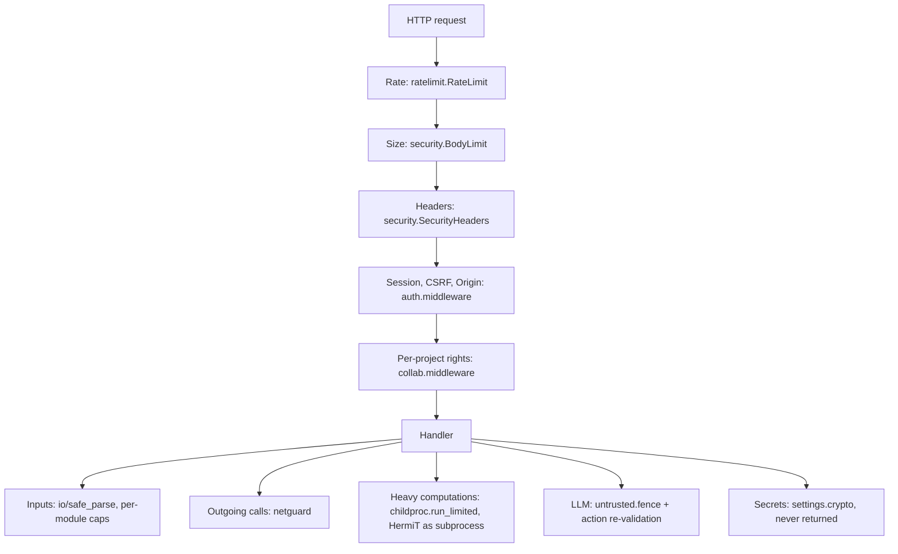

# 16. Cross-cutting security {#securite}

The security mechanisms that span several subsystems: where they are coded, what they guarantee, how to avoid bypassing them when adding code. Only the defensive design is described here. Attack scenarios and audit results stay in the secu agent's reports, outside this manual.

Sources read: `backend/ontoforge/main.py`, `backend/ontoforge/security.py`, `backend/ontoforge/hardening.py`, `backend/ontoforge/netguard.py`, `backend/ontoforge/childproc.py`, `backend/ontoforge/ratelimit.py`, `backend/ontoforge/io/safe_parse.py`, `backend/ontoforge/auth/`, `backend/ontoforge/collab/`, `backend/ontoforge/settings/crypto.py`, `backend/ontoforge/assistant/untrusted.py`, `backend/ontoforge/targets/justification.py`, `backend/Dockerfile`, `docs/CONTRACTS.md` §15, tests `backend/tests/test_security.py`, `backend/tests/test_netguard.py`, `backend/tests/test_sec_rdf.py`, `backend/tests/test_sec_network.py`, `backend/tests/test_sec_ratelimit.py`, `backend/tests/test_sec_assistant.py`, `backend/tests/test_sec_settings.py`, `backend/tests/test_sec_front.py`.

## Overview {#vue}

## Mechanisms {#mecanismes}

| Area | Mechanism | Where | Chapter |
|---|---|---|---|
| Access | password authentication (argon2id), signed `HttpOnly` / `Secure` / `SameSite=Lax` cookie, revocation through `gen` | `backend/ontoforge/auth/` | [12](12-comptes-partage-admin.en.md#authentification) |
| Cross-site requests | `X-CSRF-Token` bound to the session and `Origin` check on every write (and on `GET`s that write) | `backend/ontoforge/auth/middleware.py::csrf_required` | [12](12-comptes-partage-admin.en.md#authentification), [02](02-communication-front-back.en.md) |
| Isolation | exhaustive table of project routes, fail closed (`unclassified`), 404 for an inaccessible project, sharing state outside the model | `backend/ontoforge/collab/routes.py::ROUTES`, `backend/ontoforge/collab/access.py::require` | [12](12-comptes-partage-admin.en.md#cloisonnement) |
| Rate | 60 s sliding windows per IP and per session: global 900, assistant 20, heavy 120, reasoner 10 per minute; 429 with `Retry-After`; login attempts with progressive delay | `backend/ontoforge/ratelimit.py`, `backend/ontoforge/auth/limiter.py` | [12](12-comptes-partage-admin.en.md#authentification) |
| Size | body limited to `ONTOFORGE_MAX_BODY_MB` (32 MB), through `Content-Length` then by counting received bytes | `backend/ontoforge/security.py::BodyLimit` | — |
| Headers | strict CSP (`default-src 'self'`, no external resource, `frame-ancestors 'none'`), `nosniff`, `X-Frame-Options: DENY`, `Referrer-Policy`, `Permissions-Policy`, HSTS behind HTTPS, `Cache-Control: no-store` on `/api/*` | `backend/ontoforge/security.py::SecurityHeaders`, `CSP`; second copy served by nginx locally: `frontend/security-headers.conf` (both compared by `backend/tests/test_sec_network.py`, to be changed together: chapter [17](17-build-ci-deploiement.en.md#pieges)) | [15](15-front.en.md) |
| Produced documents | HTML justification file under CSP `default-src 'none'` (`STRICT_CSP`, the only own policy kept by `SecurityHeaders`, by exact equality), escaped texts | `backend/ontoforge/targets/justification.py` | [08](08-generateurs.en.md#justification) |
| RDF files | any `DOCTYPE` rejected in RDF/XML and TriX, remote JSON-LD contexts rejected, canonicalization and unrecognized triples capped | `backend/ontoforge/io/safe_parse.py::parse_into` | [04](04-import-export-rdf.en.md#garde-fous) |
| Other inputs | SQL / CSV / JSON Schema importers bounded (`Budget`), assistant document bounded, triplestore capped | `backend/ontoforge/importers/limits.py`, `backend/ontoforge/assistant/document.py`, `backend/ontoforge/localstore/store.py::limits` | [14](14-imports-schemas.en.md#bornes), [11](11-assistant-krakie.en.md#document), [10](10-triplestore-local.en.md#plafonds) |
| Outgoing calls | address control (http and https schemes, internal names and non-routable addresses rejected, single resolution and connection on the checked address, redirects re-checked, optional allowlist) | `backend/ontoforge/netguard.py` | below |
| Heavy computations | capped child processes (memory, CPU, no file writes, minimal environment, separate session); HermiT as a Java subprocess killed on timeout | `backend/ontoforge/childproc.py::run_limited`, `backend/ontoforge/conformance/hermit.py::_run_java` | [06](06-shacl.en.md#flux-validation), [10](10-triplestore-local.en.md#flux-requete), [05](05-conformite-owl-hermit.en.md#hermit-bornes) |
| SPARQL | read-only (updates rejected by the parser), forced `LIMIT`, timeout, `SERVICE` rejected locally | `backend/ontoforge/queries/endpoint.py`, `backend/ontoforge/localstore/runner.py::guard` | [09](09-requetes.en.md#endpoints) |
| LLM | imported content fenced as untrusted data, priority system rule, no action applied without a click, each action re-validated on the server | `backend/ontoforge/assistant/untrusted.py`, `backend/ontoforge/assistant/agent.py::build_actions` | [11](11-assistant-krakie.en.md#non-fiables) |
| Secrets | API keys and endpoint secrets encrypted (Fernet, key derived by HKDF), never returned by the API, masked in provider error messages; administration log without password or token | `backend/ontoforge/settings/crypto.py`, `backend/ontoforge/assistant/providers/base.py::_detail`, `backend/ontoforge/auth/accounts.py` | [12](12-comptes-partage-admin.en.md#parametres) |
| Start-up | dangerous authentication configuration = refusal to start; warnings if the instance listens beyond loopback without authentication, if `.env` is readable by others, if public mode has no outgoing allowlist; `/docs` and `/openapi.json` closed in public mode | `backend/ontoforge/auth/config.py::load_config`, `backend/ontoforge/hardening.py::startup_checks`, `backend/ontoforge/main.py::create_app` | — |
| Container | unprivileged user (uid 10001), `/data` and `/keys` owned by it, exact dependency versions (`constraints.txt`) | `backend/Dockerfile`, `backend/constraints.txt` | [17](17-build-ci-deploiement.en.md) |

## Outgoing calls: netguard {#netguard}

`backend/ontoforge/netguard.py` wraps httpx for SPARQL endpoints and LLM providers.

- When: on as soon as the instance is shared, `ONTOFORGE_PUBLIC=1` **or** `ONTOFORGE_AUTH=password` (`enabled`, D-L41-01). In local use without authentication, calls go through as is (Ollama on the machine, endpoint on the company network).
- How: `check_url` (scheme, credentials in the URL), `check_host` (internal names, non-standard numeric notations), `resolve_checked` (the name is resolved **once**, every address is checked by `ip_allowed`), then the TCP connection is made to the checked address (`_GuardedBackend`), TLS still being verified against the original name. `request` follows at most `MAX_REDIRECTS` (3) redirects, each re-checked.
- Intended exceptions: `ONTOFORGE_EGRESS_ALLOW_INTERNAL` exempts named internal hosts or addresses (with authentication); `ONTOFORGE_EGRESS_ALLOW` restricts destinations to a list. Some addresses stay rejected in every case (`_always_refused`).
- Messages: a refusal on an endpoint or provider saved by an administrator gives a generic message, without host or resolved address (L41); only a temporary endpoint typed by the caller gets the precise reason.

Entry point to use: `netguard.client(timeout)` (client with `post`) or `netguard.post(url, ...)`. A direct `httpx` call in a new module would bypass the whole control.

## Child processes {#processus-fils}

L41 rule: any computation whose cost depends on user input (shape regular expression, SPARQL query, reasoning) runs outside the server process, with a timeout enforced by killing the child. `backend/ontoforge/childproc.py::run_limited` starts `python -I` with a launcher that sets `RLIMIT_AS`, `RLIMIT_CPU`, `RLIMIT_FSIZE` then runs the script. Reduced environment (`minimal_env`), `cwd="/"`, separate session, no `preexec_fn`. The number of simultaneous children is bounded by non-blocking semaphores, and saturation gives a 503. HermiT follows the same rule through its own launcher (process group killed on timeout). Two departures from this rule are recorded in the lot's defect log (DF-B03 for owlrl in a thread, DF-B07 for local triplestore inference).

## Decisions {#decisions}

- D-L8-01: secrets encrypted, never returned.
- D-L21-02: no version upgrade without Jerem's decision, security updates included (proposed, then arbitrated).
- D-L40-01, D-L42-01: isolation, roles, CSRF on `GET`s that write.
- D-L41-01: outgoing address control as soon as authentication is on; messages without host details.
- L39-secu, L41: input safeguards, child processes, rate limiter, headers (CONTRACTS §15).

## Pitfalls and limits {#pieges}

- In-memory state (limiters, revocation, presence): valid for **one** instance; to be reviewed before any horizontal scaling.
- Local mode: without authentication, no access or egress protection; the start-up warning says so if listening is not local.
- New code: protections live in precise entry points (`parse_into`, `netguard`, `run_limited`, `ROUTES`, `fence`). A module that bypasses them inherits nothing: secu review is mandatory for any lot touching inputs, files, outgoing calls, secrets, authentication or the LLM (matrix in `docs/TEAM.md`).

## How to add… {#comment-ajouter}

**…a route.** Classify it in `ROUTES` (chapter [12](12-comptes-partage-admin.en.md#comment-ajouter)), add it to the limiter's `RULES` if costly, read RDF files through `parse_into`, bound every loop over an input.

**…an outgoing call.** Go through `netguard.client` or `netguard.post`, with a timeout; never return the body of a remote response in an error message when `netguard.enabled()` is true.

**…a costly computation.** A standalone script started by `childproc.run_limited`, JSON input and output, a slot semaphore and a "busy" error as 503 (model: `backend/ontoforge/shacl/validate.py`).

**…text sent to the LLM.** Any content that does not come from the person typing goes through `fence`; every system prompt through `guard`.
