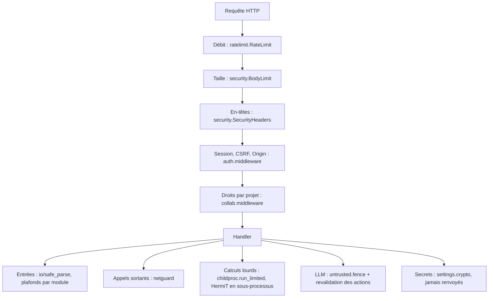

# 16. Sécurité transverse {#securite}

Les mécanismes de sécurité qui traversent plusieurs sous-systèmes : où ils sont codés, ce qu'ils garantissent, comment éviter de les contourner en ajoutant du code. Seule la conception défensive est décrite ici. Les scénarios d'attaque et les résultats d'audit restent dans les rapports de l'agent secu, hors de ce manuel.

Sources lues : `backend/ontoforge/main.py`, `backend/ontoforge/security.py`, `backend/ontoforge/hardening.py`, `backend/ontoforge/netguard.py`, `backend/ontoforge/childproc.py`, `backend/ontoforge/ratelimit.py`, `backend/ontoforge/io/safe_parse.py`, `backend/ontoforge/auth/`, `backend/ontoforge/collab/`, `backend/ontoforge/settings/crypto.py`, `backend/ontoforge/assistant/untrusted.py`, `backend/ontoforge/targets/justification.py`, `backend/Dockerfile`, `docs/CONTRACTS.md` §15, tests `backend/tests/test_security.py`, `backend/tests/test_netguard.py`, `backend/tests/test_sec_rdf.py`, `backend/tests/test_sec_network.py`, `backend/tests/test_sec_ratelimit.py`, `backend/tests/test_sec_assistant.py`, `backend/tests/test_sec_settings.py`, `backend/tests/test_sec_front.py`.

## Vue d'ensemble {#vue}

## Mécanismes {#mecanismes}

| Domaine | Mécanisme | Où | Chapitre |
|---|---|---|---|
| Accès | authentification par mot de passe (argon2id), cookie signé `HttpOnly` / `Secure` / `SameSite=Lax`, révocation par `gen` | `backend/ontoforge/auth/` | [12](12-comptes-partage-admin.md#authentification) |
| Requêtes intersites | jeton `X-CSRF-Token` lié à la session et contrôle de `Origin` sur toute écriture (et sur les `GET` qui écrivent) | `backend/ontoforge/auth/middleware.py::csrf_required` | [12](12-comptes-partage-admin.md#authentification), [02](02-communication-front-back.md) |
| Cloisonnement | table exhaustive des routes à projet, échec fermé (`unclassified`), 404 pour un projet inaccessible, état de partage hors du modèle | `backend/ontoforge/collab/routes.py::ROUTES`, `backend/ontoforge/collab/access.py::require` | [12](12-comptes-partage-admin.md#cloisonnement) |
| Débit | fenêtres glissantes de 60 s par IP et par session : global 900, assistant 20, lourd 120, raisonneur 10 par minute ; 429 avec `Retry-After` ; tentatives de connexion à délai progressif | `backend/ontoforge/ratelimit.py`, `backend/ontoforge/auth/limiter.py` | [12](12-comptes-partage-admin.md#authentification) |
| Taille | corps limité à `ONTOFORGE_MAX_BODY_MB` (32 Mo), par `Content-Length` puis par comptage des octets reçus | `backend/ontoforge/security.py::BodyLimit` | — |
| En-têtes | CSP stricte (`default-src 'self'`, aucune ressource externe, `frame-ancestors 'none'`), `nosniff`, `X-Frame-Options: DENY`, `Referrer-Policy`, `Permissions-Policy`, HSTS derrière HTTPS, `Cache-Control: no-store` sur `/api/*` | `backend/ontoforge/security.py::SecurityHeaders`, `CSP` ; seconde copie servie par nginx en local : `frontend/security-headers.conf` (les deux sont comparées par `backend/tests/test_sec_network.py`, à modifier ensemble : chapitre [17](17-build-ci-deploiement.md#pieges)) | [15](15-front.md) |
| Documents produits | dossier de justification HTML sous CSP `default-src 'none'` (`STRICT_CSP`, seule politique propre conservée par `SecurityHeaders`, à égalité exacte), textes échappés | `backend/ontoforge/targets/justification.py` | [08](08-generateurs.md#justification) |
| Fichiers RDF | refus de tout `DOCTYPE` en RDF/XML et TriX, refus des contextes JSON-LD distants, canonisation et triplets non reconnus plafonnés | `backend/ontoforge/io/safe_parse.py::parse_into` | [04](04-import-export-rdf.md#garde-fous) |
| Autres entrées | importeurs SQL / CSV / JSON Schema bornés (`Budget`), document de l'assistant borné, triplestore plafonné | `backend/ontoforge/importers/limits.py`, `backend/ontoforge/assistant/document.py`, `backend/ontoforge/localstore/store.py::limits` | [14](14-imports-schemas.md#bornes), [11](11-assistant-krakie.md#document), [10](10-triplestore-local.md#plafonds) |
| Appels sortants | contrôle des adresses (schémas http et https, noms internes et adresses non routables refusés, résolution unique et connexion sur l'adresse contrôlée, redirections recontrôlées, liste blanche facultative) | `backend/ontoforge/netguard.py` | ci-dessous |
| Calculs lourds | processus fils plafonnés (mémoire, CPU, aucune écriture de fichier, environnement minimal, session séparée) ; HermiT en sous-processus Java tué au délai | `backend/ontoforge/childproc.py::run_limited`, `backend/ontoforge/conformance/hermit.py::_run_java` | [06](06-shacl.md#flux-validation), [10](10-triplestore-local.md#flux-requete), [05](05-conformite-owl-hermit.md#hermit-bornes) |
| SPARQL | lecture seule (mise à jour refusée par le parseur), `LIMIT` forcé, délai, `SERVICE` refusé en local | `backend/ontoforge/queries/endpoint.py`, `backend/ontoforge/localstore/runner.py::guard` | [09](09-requetes.md#endpoints) |
| LLM | contenus importés encadrés comme données non fiables, règle système prioritaire, aucune action appliquée sans clic, chaque action revalidée côté serveur | `backend/ontoforge/assistant/untrusted.py`, `backend/ontoforge/assistant/agent.py::build_actions` | [11](11-assistant-krakie.md#non-fiables) |
| Secrets | clés d'API et secrets d'endpoint chiffrés (Fernet, clé dérivée par HKDF), jamais renvoyés par l'API, masqués dans les messages d'erreur des fournisseurs ; journal d'administration sans mot de passe ni jeton | `backend/ontoforge/settings/crypto.py`, `backend/ontoforge/assistant/providers/base.py::_detail`, `backend/ontoforge/auth/accounts.py` | [12](12-comptes-partage-admin.md#parametres) |
| Démarrage | configuration d'authentification dangereuse = refus de démarrer ; avertissements si l'instance écoute hors de la boucle locale sans authentification, si `.env` est lisible par d'autres, si le mode public n'a pas de liste blanche sortante ; `/docs` et `/openapi.json` fermés en mode public | `backend/ontoforge/auth/config.py::load_config`, `backend/ontoforge/hardening.py::startup_checks`, `backend/ontoforge/main.py::create_app` | — |
| Conteneur | utilisateur sans privilèges (uid 10001), `/data` et `/keys` à lui, versions exactes des dépendances (`constraints.txt`) | `backend/Dockerfile`, `backend/constraints.txt` | [17](17-build-ci-deploiement.md) |

## Appels sortants : netguard {#netguard}

`backend/ontoforge/netguard.py` enveloppe httpx pour les endpoints SPARQL et les fournisseurs LLM.

- Quand : actif dès que l'instance est partagée, `ONTOFORGE_PUBLIC=1` **ou** `ONTOFORGE_AUTH=password` (`enabled`, D-L41-01). En usage local sans authentification, les appels passent tels quels (Ollama sur la machine, endpoint du réseau de l'entreprise).
- Comment : `check_url` (schéma, identifiants dans l'URL), `check_host` (noms internes, écritures numériques non standard), `resolve_checked` (le nom est résolu **une fois**, toutes les adresses sont contrôlées par `ip_allowed`), puis la connexion TCP se fait sur l'adresse contrôlée (`_GuardedBackend`), le TLS restant vérifié sur le nom d'origine. `request` suit au plus `MAX_REDIRECTS` (3) redirections, chacune recontrôlée.
- Exceptions voulues : `ONTOFORGE_EGRESS_ALLOW_INTERNAL` exempte des noms ou adresses internes nommés (avec l'authentification) ; `ONTOFORGE_EGRESS_ALLOW` restreint les destinations à une liste. Certaines adresses restent refusées dans tous les cas (`_always_refused`).
- Messages : un refus sur un endpoint ou un fournisseur enregistré par un administrateur donne un message générique, sans hôte ni adresse résolue (L41) ; seul un endpoint temporaire saisi par l'appelant reçoit le motif précis.

Point d'entrée à utiliser : `netguard.client(timeout)` (client avec `post`) ou `netguard.post(url, ...)`. Un appel `httpx` direct dans un nouveau module contournerait tout le contrôle.

## Processus fils {#processus-fils}

Règle de L41 : tout calcul dont le coût dépend d'une entrée de l'utilisateur (expression régulière de shape, requête SPARQL, raisonnement) s'exécute hors du processus du serveur, avec un délai tenu par la mort du fils. `backend/ontoforge/childproc.py::run_limited` lance `python -I` avec un lanceur qui pose `RLIMIT_AS`, `RLIMIT_CPU`, `RLIMIT_FSIZE` puis exécute le script. Environnement réduit (`minimal_env`), `cwd="/"`, session séparée, pas de `preexec_fn`. Le nombre de fils simultanés est borné par des sémaphores non bloquants, et la saturation donne un 503. HermiT suit la même règle par son propre lanceur (groupe de processus tué au délai). Deux écarts à cette règle sont notés au journal des défauts du lot (DF-B03 pour owlrl en fil, DF-B07 pour l'inférence du triplestore local).

## Décisions {#decisions}

- D-L8-01 : secrets chiffrés, jamais renvoyés.
- D-L21-02 : pas de montée de version sans décision de Jerem, mises à jour de sécurité comprises (proposées, puis arbitrées).
- D-L40-01, D-L42-01 : cloisonnement, rôles, CSRF sur les `GET` qui écrivent.
- D-L41-01 : contrôle des adresses sortantes dès que l'authentification est active ; messages sans détail d'hôte.
- L39-secu, L41 : garde-fous d'entrée, processus fils, limiteur de débit, en-têtes (CONTRACTS §15).

## Pièges et limites {#pieges}

- État en mémoire (limiteurs, révocation, présence) : valable pour **une** instance ; à revoir avant toute mise à l'échelle horizontale.
- Mode local : sans authentification, aucune protection d'accès ni de sortie ; l'avertissement de démarrage le rappelle si l'écoute n'est pas locale.
- Nouveau code : les protections sont dans des points d'entrée précis (`parse_into`, `netguard`, `run_limited`, `ROUTES`, `fence`). Un module qui les contourne n'hérite de rien : la relecture secu est obligatoire pour tout lot qui touche aux entrées, aux fichiers, aux appels sortants, aux secrets, à l'authentification ou au LLM (matrice de `docs/TEAM.md`).

## Comment ajouter… {#comment-ajouter}

**…une route.** La classer dans `ROUTES` (chapitre [12](12-comptes-partage-admin.md#comment-ajouter)), l'ajouter à `RULES` du limiteur si elle est coûteuse, lire les fichiers RDF par `parse_into`, borner toute boucle sur une entrée.

**…un appel sortant.** Passer par `netguard.client` ou `netguard.post`, avec un délai ; ne jamais renvoyer le corps d'une réponse distante dans un message d'erreur quand `netguard.enabled()` est vrai.

**…un calcul coûteux.** Un script autonome lancé par `childproc.run_limited`, entrée et sortie JSON, un sémaphore de créneaux et une erreur « occupé » en 503 (modèle : `backend/ontoforge/shacl/validate.py`).

**…un texte envoyé au LLM.** Tout contenu qui ne vient pas de la personne qui écrit passe par `fence` ; toute invite système par `guard`.
