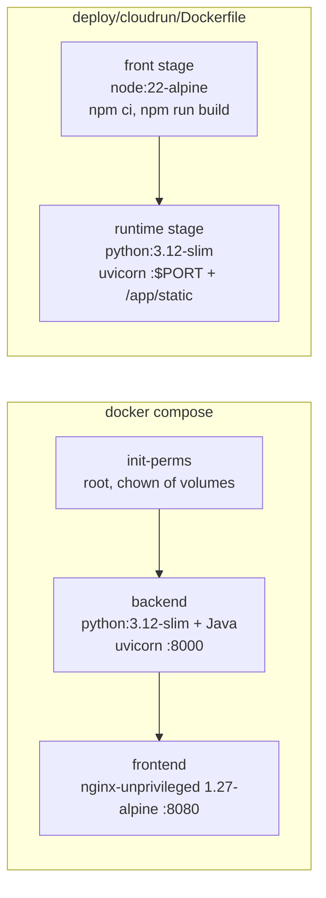
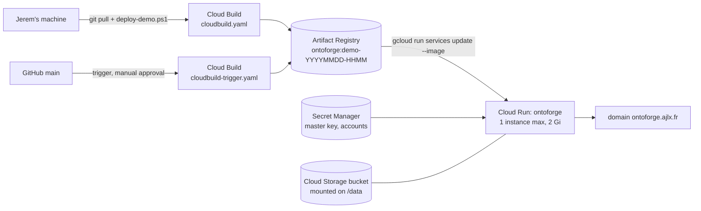

# 17. Build, CI, Docker, Cloud Run, GitHub publication {#build-ci-deploiement}

How the code becomes an image, how continuous integration checks it, how the demo is deployed on Google Cloud Run and how the working repository is published to GitHub. The operator's step-by-step deployment commands are in `deploy/cloudrun/README.md` (not to be copied here): this chapter only explains the mechanics. Back to the [index](README.en.md).

State verified on 23 November 2026. No Docker build was run for this chapter (decision D-012: Docker is not available on the agents' machine); what concerns images was read from the files.

## 1. Role {#role}

Three paths produce OntoForge: (1) `docker compose` for local use (two containers), (2) the single image of `deploy/cloudrun/Dockerfile` for Cloud Run, (3) the front-end build in development (`npm run build`). GitHub CI checks the backend, the front end and the dependencies; Playwright recipes run on demand. No secret is in the repository.

## 2. Files and responsibilities {#fichiers}

| File | Responsibility |
|---|---|
| `frontend/package.json`, `frontend/package-lock.json` | front-end dependencies (exact versions), scripts `dev`, `build`, `preview`, `test` |
| `frontend/vite.config.ts` | React plugin, `/api` proxy in dev, `server.fs.allow: ['..']` to read `docs/guide` |
| `frontend/tsconfig.json` | strict TypeScript, `noEmit` (only Vite emits) |
| `frontend/Dockerfile` | front-end build (Node 22) then unprivileged nginx |
| `frontend/nginx.conf`, `frontend/security-headers.conf` | local server, `/api` proxy, security headers |
| `backend/Dockerfile` | backend image for `docker compose` (Python 3.12-slim + Java) |
| `backend/pyproject.toml`, `backend/constraints.txt` | dependencies and exact constraints |
| `docker-compose.yml` | three services (`init-perms`, `backend`, `frontend`), two volumes |
| `deploy/cloudrun/Dockerfile` | single production image (API + compiled front end) |
| `deploy/cloudrun/cloudbuild.yaml` | manual build by Cloud Build |
| `deploy/cloudrun/cloudbuild-trigger.yaml`, `trigger-main.yaml` | automatic deployment on a push to `main` (trigger) |
| `deploy/cloudrun/env.yaml` | non-secret service variables |
| `deploy/cloudrun/deploy-demo.ps1`, `deploy-demo.bat` | one-command update from Windows |
| `.github/workflows/ci.yml` | continuous integration |
| `.github/dependabot.yml` | dependency watch |
| `.dockerignore`, `.gcloudignore` | what stays out of the build context |
| `tools/git/publish.sh` | publication of the working repository to the GitHub clone |

## 3. Front-end build {#build-front}

- `npm run build` = `tsc -b && vite build`: type checking **blocks** the build (there is no linter otherwise). Measured on 23/11: about 23 s, entry module 642 kB (198 kB gzip), one chunk per screen and per guide page.
- `npm ci` (never `npm install`) in the images: the `package-lock.json` lock is authoritative, and the build fails if it diverges from `package.json` (SEC-14).
- Embedded documentation: `frontend/src/lib/docs.ts` imports `docs/guide/*.md` and `backend/ontoforge/assistant/help_map.json` by relative path **outside `frontend/`** (`import.meta.glob`). Hence the Docker build context is the repository root, and the Dockerfiles do `COPY docs/guide /docs/guide` and `COPY backend/ontoforge/assistant/help_map.json …` before `npm run build`. `.dockerignore` only lets `docs/guide` through: the `docs/dev` manual enters neither the image nor the app.
- CSP: `script-src 'self'`, no third-party resource (self-hosted fonts and icons, compiled guide, no CDN). A component that added an external script or font would be blocked (chapter 16).

## 4. Docker images {#docker}

- Local: `docker-compose.yml` builds two images from the root (`backend/Dockerfile`, `frontend/Dockerfile`). The backend never runs as root; `init-perms` fixes the rights of volumes created by an earlier version. The port is published on `127.0.0.1` only by default (`ONTOFORGE_BIND`).
- Production: a single container. Why not nginx + uvicorn in one container: Cloud Run runs only one main process, a supervisor would make the image heavier and mix the logs. The front end is an SPA served to few visitors, uvicorn with GZip is enough, and authentication, security headers and SPA fallback live in the same place as the API (`backend/ontoforge/security.py::SpaStatic`).
- Reasoner: build argument `WITH_REASONER` (1 by default): installs `default-jre-headless` and the `reasoner` extra; at 0, the image is lighter and `POST /reason` answers 501.
- Reproducibility: `pip install -c constraints.txt` (exact versions, transitive ones included; consistency tested by `backend/tests/test_sec_network.py`), `npm ci`, base images by tag. The `sha256` digests of the base images are `À VÉRIFIER` (never determined for lack of network access, see the Dockerfile comment).
- User: unprivileged uid 10001; the `/data` volume (a mounted bucket in production) must belong to it.
- Both images start as the `ontoforge` user and read their configuration from the environment: `ONTOFORGE_DATA`, `ONTOFORGE_SAMPLES`, `ONTOFORGE_STATIC_DIR` (production), `ONTOFORGE_PUBLIC`, `ONTOFORGE_AUTH`, `ONTOFORGE_SECRET_FILE`, `ONTOFORGE_LLM_PROVIDER`… The production CMD **refuses to start** without `ONTOFORGE_EGRESS_ALLOW` (hosts reachable by outbound calls).

## 5. Continuous integration {#ci}

`.github/workflows/ci.yml` (decision D-L21-03: limited scope; no Neo4j and no C# compilation in CI). Triggers: push to `main`, pull request, manual dispatch (option `recettes`). Permissions `contents: read`. Actions are **pinned by commit SHA** (version in a comment); Dependabot proposes the new SHAs.

| Job | Content | Blocking |
|---|---|---|
| `backend` | Python 3.12, `pip install -c backend/constraints.txt -e "backend[dev]"`, `pytest -q` with `ONTOFORGE_LLM_PROVIDER=mock` | yes |
| `audit-dependances` | `pip-audit` on `backend/constraints.txt` (production: blocking); on the dev extra: informative | production: yes |
| `frontend` | Node 22, `npm ci`, `npm run build` | yes |
| `recettes` | manual: build, Playwright and Chromium installation, `tools/recette/e2e_ui.mjs`, `tools/recette/e2e_api.py`; screenshots as an artifact | manual |

Good to know: every backend install in `ci.yml` goes through `-c backend/constraints.txt` (the `backend` job, the `audit-dependances` job for the dev extra and the `recettes` job; before L53 the last two installed without constraints, so with versions that neither the images nor the tests had seen); resolution is checked with `pip install --dry-run -c backend/constraints.txt -e "backend[dev]"` in a throwaway Python 3.12 environment. The `recettes` job creates a link `/home/claude/venv/bin/python` to the CI interpreter because the scripts hard-code it (chapter 18); Playwright is installed there at version 1.63.0, the agents' one (`npm install --no-save playwright@1.63.0`, DF-F07 fixed in L52): raising it is a decision to trace, together with the local version. The `frontend` job runs `npm test` after the build (fr/en parity, API clients, Markdown renderer; DF-F08). The documentation tests (`backend/tests/test_dev_docs.py`, `test_docs_bilingual.py`) run with `pytest`.

Dependabot (`.github/dependabot.yml`): reports every Monday 6:00 (pip, npm), monthly (docker, actions); groups `semantique` (rdflib, pyshacl, owlrl, pyoxigraph, owlready2), `web`, `tests`, `codemirror`, `graphes`; **no major bump**, no merge without Jerem's approval (D-L21-02).

## 6. Deployment on Cloud Run {#cloud-run}

- First install: steps 0 to 6 of `deploy/cloudrun/README.md` (services, image repository, bucket, service account, secrets, `gcloud run deploy`, domain). Service settings: one instance maximum, 1 CPU, 2 Gi, port 8080, 300 s timeout; secrets (`ONTOFORGE_SECRET_KEY`, `ONTOFORGE_AUTH_USERS`) mounted from Secret Manager; non-secret variables from `deploy/cloudrun/env.yaml` (administrator, outbound hosts; caps and places set for 2 Gi, whose worst-case sum fits in 2048 MB: see the calculation below and chapter [16](16-securite.en.md)); Cloud Storage volume on `/data` with `uid=10001,gid=10001`.
- Update: since L53, `deploy-demo.ps1` and the trigger apply `env.yaml`, `--memory 2Gi`, `--max-instances 1` and the secrets (same options as `gcloud run deploy`, README §7 and §8), because the worst-case sum depends on them; a volume change still needs the full `gcloud run deploy`. The test `test_b13_deploy_scripts_apply_env_yaml_and_the_2_gib_settings` checks that these options are present in both files. Check after deployment: `gcloud run services describe` (README §7).
- Automatic deployment (README §8): a Cloud Build trigger on a push to `main` runs build / push / update (`cloudbuild-trigger.yaml`) with a minimal-role service account and **manual approval required**. `SHORT_SHA` only exists with a trigger: this file is not for `gcloud builds submit`.
- State: the instance keeps nothing on its disk; projects and settings are in the bucket; the local triplestore lives in `/tmp/ontoforge-triplestore` (variable `ONTOFORGE_LOCAL_STORE_DIR`, set in `deploy/cloudrun/Dockerfile`, read by `backend/ontoforge/localstore/store.py::local_dir`; lost when the instance stops).
- Costs and shutdown: section "Coûts et arrêt" of the deployment README.
- The commands of README section 8 were not executed by the agent team (the README says so); the rest of the deployment is operated by Jerem from Windows (`À CONFIRMER`: no execution log in the repository). The cloud project identifiers are in the operator's scripts, not in this manual.

### Caps and worst-case sum {#plafonds-somme}

2048 MB container, one instance. Each cap bounds ONE child; the calculation takes all places at the same time (server + places × cap per family). Measurements of 24/11, on the repository samples ("trap", automaint and its data repeated for large volumes), peak resident memory and smallest address-space cap that succeeds:

| Family (variables) | Places × cap | Worst case (MB) | Measurement |
|---|---|---|---|
| Server at rest | — | 175 | measured 121 to 146 MB (application loaded, one project), 175 kept |
| SHACL (`ONTOFORGE_SHACL_SLOTS`, `ONTOFORGE_SHACL_MEMORY_MB`) | 1 × 320 | 320 | "trap": 64 MB is enough, 38 MB resident (`both` inference included); 42,000 data triples: 192 MB is enough (128 MB fails), 124 MB resident |
| OWL RL (`ONTOFORGE_OWLRL_SLOTS`, `ONTOFORGE_OWLRL_MEMORY_MB`) | 1 × 256 | 256 | 7,000 triples (10 s): 96 MB is enough, 52 MB resident; at 22,000 triples the 30 s timeout hits before any memory cap (104 MB resident) |
| HermiT (`ONTOFORGE_HERMIT_SLOTS`, `ONTOFORGE_HERMIT_MAX_MB`) | 1 × (192 + 150) | 342 | "trap": 128 MB heap is enough (172 MB resident); automaint with 4,700 triples: 128 MB heap is enough (225 MB resident); nearly empty JVM (`-Xmx32m`): 130 MB resident, hence 150 MB of JVM counted outside the heap |
| Local triplestore, query and inference children (`ONTOFORGE_LOCAL_STORE_SLOTS`, `ONTOFORGE_LOCAL_STORE_MEMORY_MB`) | 1 × 640 | 640 | opening a 50,000-triple database: 10 runs out of 10 at 608 and 640 MB, 8 out of 10 at 512 MB; 640 MB for 1,000,000 triples (312 MB on disk), 32 MB resident; `both` inference at 31,000 source triples: 576 MB is enough, 92 MB resident; 640 MB leaves about 30 MB above the last failure |
| Local triplestore, loading a file in the **server** (`ONTOFORGE_LOCAL_STORE_LOAD_SLOTS`, `ONTOFORGE_LOCAL_STORE_MAX_TRIPLES`, `ONTOFORGE_LOCAL_STORE_MAX_UPLOAD_MB`) | 1 × ((50,000 + 20,000) triples × 1.7 MB / 1,000 + 5 MB) | 124 | parsing and writing happen in the server process: +101 MB for 50,000 triples, +164 MB for 100,000, +249 MB for 200,000 (resident peak above the idle server); 20,000 triples = one parsing block beyond the cap; 5 MB = the file read into memory |
| Local triplestore, in-memory disk (`ONTOFORGE_LOCAL_STORE_TOTAL_MB`) | — | 64 | about 470 bytes per triple on disk (union included), compaction peak up to 1.24 times the final size |
| Request body (`ONTOFORGE_MAX_BODY_MB`) | 1 × 12 | 12 | an upload is received whole before a place is taken; 12 MB covers the largest allowed upload (10 MB document); further simultaneous uploads come out of the margin |
| **Total** | | **1933** | 115 MB margin |

The test `test_b13_cloudrun_env_sum_at_worst_fits_in_2_gib` reads `env.yaml` back, redoes this calculation (server, children, loading in the server, disk, request body) and fails above 2048 MB; it also checks that the purge is on. The cap (address space) is higher than the memory used: the sum of the measured resident peaks is about 0.7 GiB. Before L53 (DF-B13), the `env.yaml` values already allowed 3 × 1024 MB at worst with the local triplestore alone on three projects, not counting loading or disk.

**In-memory disk** (D-L53-02, Jerem: total cap AND purge). A Cloud Run instance's file system is in memory (Cloud Run documentation, container runtime contract): the local triplestore, in `/tmp/ontoforge-triplestore`, counts in the 2 GiB. `backend/ontoforge/localstore/store.py`: `ONTOFORGE_LOCAL_STORE_TOTAL_MB` (64 on Cloud Run; 0 = no cap) refuses a load (413) when `(folder size + 500 bytes × file triples) × 1.25` exceeds the cap (`check_disk_budget`; 1.25 = RocksDB compaction margin); `ONTOFORGE_LOCAL_STORE_IDLE_MIN` (30 on Cloud Run; 0 = never) deletes inactive databases (`purge_idle`, called by `ensure` and `load_data`, under the project lock's `try_write`: a database in use is left alone; no background task). The purge loses the loaded data files (the ontology and individuals come back on demand); `stats` returns `purged` with a translated message, which the triplestore panel shows until a file is reloaded. Both apply only when `ONTOFORGE_LOCAL_STORE_DIR` is set (ephemeral folder). Loads have their own places (`ONTOFORGE_LOCAL_STORE_LOAD_SLOTS`, 4 by default, 1 on Cloud Run): `load_slot`, taken by the `POST /store/load` route before the file is read, 503 with `Retry-After: 5` when full.

## 7. GitHub publication {#publication}

The working repository (`/home/claude/OntoForge`, with its lots, journals and screenshots) is **not** the GitHub one. `tools/git/publish.sh "message" [--push]`:

1. exports the **committed** state of `HEAD` (`git archive`), never the working tree;
2. removes `ref/`, `journal/securite/`, `journal/L18/video/` and `*.whl`;
3. searches for secrets (families of API keys, PEM blocks, password hashes, `.env` files, API keys in `settings.json`); the exact patterns and exceptions stay in the script; a hit **cancels** the publication;
4. synchronises into the publication clone (`/home/claude/ontoforge-pub` by default, variables `ONTOFORGE_SRC`, `ONTOFORGE_PUB`, `PUBLISH_BRANCH`) then commits with the attribution lines;
5. pushes only if `--push` is given.

The team protocol wants only the `git` agent to push, after green tests, review verdicts and documentation (`docs/TEAM.md`, sheet `.claude/agents/git-release.md`). The `docs/dev/` manual is therefore published with the rest: it must never contain a secret or audit detail (`test_dev_docs.py` checks this).

## 8. Decisions {#decisions}

- D-003: Docker; **D-012**: no Docker in the agents' build environment.
- D-L21-02: stable base (React 18, Vite 5, no bump). **D-L21-03**: CI limited to backend tests, front-end build and manual recipes.
- L39-secu (SEC-11, SEC-12, SEC-14, SEC-16): unprivileged execution, identical security headers in nginx and in the server (compared by `backend/tests/test_sec_network.py`), strict `npm ci` and exact Python constraints, mandatory egress list in public mode.
- L46 (D-L46-01): fastapi and starlette bump recorded in `backend/constraints.txt`.

## 9. Pitfalls {#pieges}

- Changing `docs/guide/` **without rebuilding** the front end: the app embeds the old version.
- Adding a file outside `frontend/` imported by the front end: also add it to the Docker context (`COPY`) in **both** Dockerfiles; otherwise the Docker build breaks while the local build passes.
- `nginx.conf` sets no compression (`À CONFIRMER`: image default) whereas production compresses (Starlette GZip): the weight of the entry (642 kB) is mostly felt in local Docker.
- Security headers exist in **two copies** (`frontend/security-headers.conf` and `backend/ontoforge/security.py::CSP`): change them together; the test compares them.
- nginx `include`: `add_header` is not inherited by a `location` that declares one, hence `include …/ontoforge-security-headers.conf` in **every** block.
- Before L53, `services update --image` did not pick up `env.yaml`; the update scripts now apply it (guard test). Any other deployment path must do the same.
- CI uses Python 3.12, the agents' venv 3.13: any behaviour difference is `À CONFIRMER`.
- `/api`: nginx hides the backend's security headers (`proxy_hide_header`) so as not to double them, then sets its own.

## 10. How to add… {#comment-ajouter}

### … a front-end dependency {#ajouter-dependance-front}

Add the **exact** version to `frontend/package.json` (no `^`), regenerate `frontend/package-lock.json` with `npm install --package-lock-only`, check `npm ci && npm run build`, and note the reason in chapter 15. If it loads external resources, check the CSP.

### … a backend dependency {#ajouter-dependance-back}

Exact version in `backend/pyproject.toml` **and** in `backend/constraints.txt` (with its transitive ones); `pip-audit` must report nothing; mention the decision if it is a bump (D-L21-02).

### … a CI job {#ajouter-job-ci}

In `.github/workflows/ci.yml`, with actions pinned by SHA (copy the existing style); if a secret is needed, **do not** add it without approval (none is used today).

### … a production environment variable {#ajouter-variable-prod}

Non-secret: `deploy/cloudrun/env.yaml` then a full deployment. Secret: Secret Manager then `--set-secrets` (README §3 and §5). Document it in `.env.example` for local use.

### … a deployment configuration file {#ajouter-fichier-deploiement}

No secret, no project identifier: resource names and Cloud Build substitutions (`_REGION`, `_REPO`, `_SERVICE`), like `cloudbuild-trigger.yaml`.
