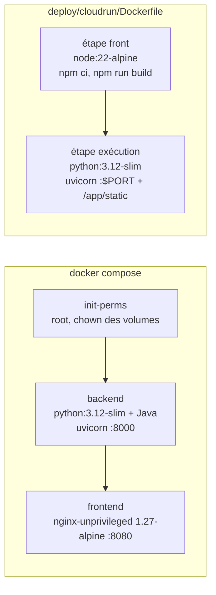
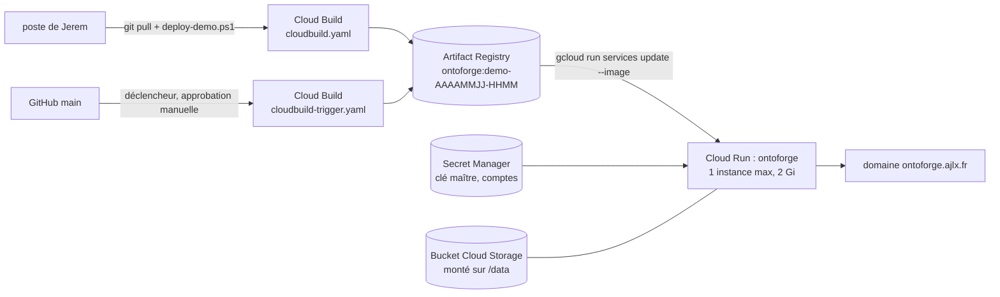

# 17. Build, CI, Docker, Cloud Run, publication GitHub {#build-ci-deploiement}

Comment le code devient une image, comment l'intégration continue le contrôle, comment la démonstration est déployée sur Google Cloud Run et comment le dépôt de travail est publié sur GitHub. Les commandes de déploiement pas à pas pour l'opérateur sont dans `deploy/cloudrun/README.md` (à ne pas recopier) : ce chapitre n'explique que la mécanique. Retour au [sommaire](README.md).

État vérifié le 23 novembre 2026. Aucune construction Docker n'a été exécutée pour ce chapitre (décision D-012 : Docker n'est pas disponible sur la machine des agents) ; ce qui concerne les images est lu dans les fichiers.

## 1. Rôle {#role}

Trois chemins produisent OntoForge : (1) `docker compose` pour l'usage local (deux conteneurs), (2) l'image unique de `deploy/cloudrun/Dockerfile` pour Cloud Run, (3) le build du front en développement (`npm run build`). La CI GitHub vérifie le backend, le front et les dépendances ; les recettes Playwright se lancent à la demande. Aucun secret n'est dans le dépôt.

## 2. Fichiers et responsabilités {#fichiers}

| Fichier | Responsabilité |
|---|---|
| `frontend/package.json`, `frontend/package-lock.json` | dépendances du front (versions exactes), scripts `dev`, `build`, `preview`, `test` |
| `frontend/vite.config.ts` | plugin React, proxy `/api` en dev, `server.fs.allow: ['..']` pour lire `docs/guide` |
| `frontend/tsconfig.json` | TypeScript strict, `noEmit` (le build n'émet que par Vite) |
| `frontend/Dockerfile` | build du front (Node 22) puis nginx sans privilèges |
| `frontend/nginx.conf`, `frontend/security-headers.conf` | serveur local, proxy `/api`, en-têtes de sécurité |
| `backend/Dockerfile` | image du backend pour `docker compose` (Python 3.12-slim + Java) |
| `backend/pyproject.toml`, `backend/constraints.txt` | dépendances et contraintes exactes |
| `docker-compose.yml` | trois services (`init-perms`, `backend`, `frontend`), deux volumes |
| `deploy/cloudrun/Dockerfile` | image unique de production (API + front compilé) |
| `deploy/cloudrun/cloudbuild.yaml` | construction manuelle par Cloud Build |
| `deploy/cloudrun/cloudbuild-trigger.yaml`, `trigger-main.yaml` | déploiement automatique sur push de `main` (déclencheur) |
| `deploy/cloudrun/env.yaml` | variables non secrètes du service |
| `deploy/cloudrun/deploy-demo.ps1`, `deploy-demo.bat` | mise à jour en une commande depuis Windows |
| `.github/workflows/ci.yml` | intégration continue |
| `.github/dependabot.yml` | veille des dépendances |
| `.dockerignore`, `.gcloudignore` | ce qui n'entre pas dans le contexte de build |
| `tools/git/publish.sh` | publication du dépôt de travail vers le clone GitHub |

## 3. Build du front {#build-front}

- `npm run build` = `tsc -b && vite build` : le contrôle de types **bloque** le build (aucun linter par ailleurs). Mesuré le 23/11 : environ 23 s, module d'entrée 642 kB (198 kB gzip), un chunk par écran et par page du guide.
- `npm ci` (jamais `npm install`) dans les images : le verrou `package-lock.json` fait foi, la construction échoue s'il diverge de `package.json` (SEC-14).
- Documentation embarquée : `frontend/src/lib/docs.ts` importe `docs/guide/*.md` et `backend/ontoforge/assistant/help_map.json` par chemin relatif **hors de `frontend/`** (`import.meta.glob`). D'où : le contexte de build Docker est la racine du dépôt, et les Dockerfiles font `COPY docs/guide /docs/guide` et `COPY backend/ontoforge/assistant/help_map.json …` avant `npm run build`. `.dockerignore` ne laisse passer que `docs/guide` : le manuel `docs/dev` n'entre ni dans l'image ni dans l'appli.
- CSP : `script-src 'self'`, aucune ressource tierce (polices et icônes auto-hébergées, guide compilé, aucun CDN). Un composant qui ajouterait un script ou une police externe serait bloqué (chapitre 16).

## 4. Images Docker {#docker}

- Local : `docker-compose.yml` construit deux images à partir de la racine (`backend/Dockerfile`, `frontend/Dockerfile`). Le backend ne tourne jamais en root ; `init-perms` corrige les droits des volumes créés par une version précédente. Le port n'est publié que sur `127.0.0.1` par défaut (`ONTOFORGE_BIND`).
- Production : un seul conteneur. Pourquoi pas nginx + uvicorn dans le même conteneur : Cloud Run n'exécute qu'un processus principal, un superviseur alourdirait l'image et mêlerait les journaux. Le front est une SPA servie à peu de visiteurs, uvicorn avec GZip suffit, et authentification, en-têtes de sécurité et repli SPA vivent au même endroit que l'API (`backend/ontoforge/security.py::SpaStatic`).
- Raisonneur : argument de build `WITH_REASONER` (1 par défaut) : installe `default-jre-headless` et l'extra `reasoner` ; à 0, l'image est plus légère et `POST /reason` répond 501.
- Reproductibilité : `pip install -c constraints.txt` (versions exactes, transitives comprises ; cohérence testée par `backend/tests/test_sec_network.py`), `npm ci`, images de base par étiquette. Les empreintes (digest `sha256`) des images de base sont `À VÉRIFIER` (jamais déterminées faute de réseau, voir le commentaire du Dockerfile).
- Utilisateur : uid 10001 sans privilèges ; le volume `/data` (bucket monté en production) doit lui appartenir.
- Les deux images démarrent sur l'utilisateur `ontoforge` et lisent leur configuration dans l'environnement : `ONTOFORGE_DATA`, `ONTOFORGE_SAMPLES`, `ONTOFORGE_STATIC_DIR` (production), `ONTOFORGE_PUBLIC`, `ONTOFORGE_AUTH`, `ONTOFORGE_SECRET_FILE`, `ONTOFORGE_LLM_PROVIDER`… Le CMD de production **refuse de démarrer** sans `ONTOFORGE_EGRESS_ALLOW` (hôtes joignables par les appels sortants).

## 5. Intégration continue {#ci}

`.github/workflows/ci.yml` (décision D-L21-03 : périmètre limité ; pas de Neo4j ni de compilation C# en CI). Déclencheurs : push sur `main`, pull request, déclenchement manuel (option `recettes`). Permissions `contents: read`. Les actions sont **épinglées par SHA de commit** (version en commentaire) ; Dependabot propose les nouveaux SHA.

| Job | Contenu | Bloquant |
|---|---|---|
| `backend` | Python 3.12, `pip install -c backend/constraints.txt -e "backend[dev]"`, `pytest -q` avec `ONTOFORGE_LLM_PROVIDER=mock` | oui |
| `audit-dependances` | `pip-audit` sur `backend/constraints.txt` (production : bloquant) ; sur l'extra dev : informatif | production oui |
| `frontend` | Node 22, `npm ci`, `npm run build` | oui |
| `recettes` | manuel : build, installation de Playwright et de Chromium, `tools/recette/e2e_ui.mjs`, `tools/recette/e2e_api.py` ; captures en artefact | manuel |

À savoir : toutes les installations du backend de `ci.yml` passent par `-c backend/constraints.txt` (jobs `backend`, `audit-dependances` pour l'extra dev et `recettes` ; avant L53 les deux derniers installaient sans contraintes, donc des versions que ni les images ni les tests n'avaient vues) ; la résolution se vérifie avec `pip install --dry-run -c backend/constraints.txt -e "backend[dev]"` dans un environnement jetable en Python 3.12. Le job `recettes` crée un lien `/home/claude/venv/bin/python` vers l'interpréteur de la CI parce que les scripts le codent en dur (chapitre 18) ; Playwright y est installé à la version 1.63.0, celle des agents (`npm install --no-save playwright@1.63.0`, DF-F07 corrigé en L52) : la monter est une décision à tracer, avec la version locale. Le job `frontend` lance `npm test` après le build (parité fr/en, clients API, rendu Markdown ; DF-F08). Les tests de documentation (`backend/tests/test_dev_docs.py`, `test_docs_bilingual.py`) tournent avec `pytest`.

Dependabot (`.github/dependabot.yml`) : signale chaque lundi 6 h (pip, npm), chaque mois (docker, actions) ; groupes `semantique` (rdflib, pyshacl, owlrl, pyoxigraph, owlready2), `web`, `tests`, `codemirror`, `graphes` ; **aucune montée majeure**, aucune fusion sans l'accord de Jerem (D-L21-02).

## 6. Déploiement sur Cloud Run {#cloud-run}

- Première installation : étapes 0 à 6 de `deploy/cloudrun/README.md` (services, dépôt d'images, bucket, compte de service, secrets, `gcloud run deploy`, domaine). Réglages du service : une instance maximum, 1 CPU, 2 Gi, port 8080, délai 300 s ; secrets (`ONTOFORGE_SECRET_KEY`, `ONTOFORGE_AUTH_USERS`) montés depuis Secret Manager ; variables non secrètes de `deploy/cloudrun/env.yaml` (administrateur, hôtes sortants ; plafonds et places réglés pour 2 Gi, dont la somme au pire tient dans 2048 Mo : voir le calcul ci-dessous et le chapitre [16](16-securite.md)) ; volume Cloud Storage sur `/data` avec `uid=10001,gid=10001`.
- Mise à jour : depuis L53, `deploy-demo.ps1` et le déclencheur appliquent `env.yaml`, `--memory 2Gi`, `--max-instances 1` et les secrets (mêmes options que `gcloud run deploy`, README §7 et §8), parce que la somme au pire en dépend ; un changement de volume demande toujours le `gcloud run deploy` complet. Le test `test_b13_deploy_scripts_apply_env_yaml_and_the_2_gib_settings` vérifie la présence de ces options dans les deux fichiers. Contrôle après déploiement : `gcloud run services describe` (README §7).
- Déploiement automatique (README §8) : un déclencheur Cloud Build sur push de `main` exécute construire / envoyer / mettre à jour (`cloudbuild-trigger.yaml`) avec un compte de service aux rôles minimaux et **approbation manuelle requise**. `SHORT_SHA` n'existe qu'avec un déclencheur : ce fichier ne sert pas à `gcloud builds submit`.
- État : l'instance ne garde rien sur son disque ; projets et réglages sont dans le bucket ; le triplestore local vit dans `/tmp/ontoforge-triplestore` (variable `ONTOFORGE_LOCAL_STORE_DIR`, posée dans `deploy/cloudrun/Dockerfile`, lue par `backend/ontoforge/localstore/store.py::local_dir` ; perdu à l'arrêt de l'instance).
- Coûts et arrêt : section « Coûts et arrêt » du README de déploiement.
- Les commandes de la section 8 du README n'ont pas été exécutées par l'équipe des agents (c'est écrit dans le README) ; le reste du déploiement est opéré par Jerem depuis Windows (`À CONFIRMER` : aucun journal d'exécution dans le dépôt). Les identifiants du projet cloud sont dans les scripts de l'opérateur, pas dans ce manuel.

### Plafonds et somme au pire {#plafonds-somme}

Conteneur de 2048 Mo, une instance. Chaque plafond borne UN fils ; le calcul prend toutes les places en même temps (serveur + places × plafond par famille). Mesures du 24/11, sur les jeux du dépôt (« trap », automaint et ses données répétées pour les gros volumes), pic de mémoire résidente et plus petit plafond d'espace d'adressage qui réussit :

| Famille (variables) | Places × plafond | Au pire (Mo) | Mesure |
|---|---|---|---|
| Serveur au repos | — | 175 | mesuré 121 à 146 Mo (application chargée, un projet), 175 retenus |
| SHACL (`ONTOFORGE_SHACL_SLOTS`, `ONTOFORGE_SHACL_MEMORY_MB`) | 1 × 320 | 320 | « trap » : 64 Mo suffisent, 38 Mo résidents (inférence `both` comprise) ; 42 000 triplets de données : 192 Mo suffisent (128 Mo échouent), 124 Mo résidents |
| OWL RL (`ONTOFORGE_OWLRL_SLOTS`, `ONTOFORGE_OWLRL_MEMORY_MB`) | 1 × 256 | 256 | 7 000 triplets (10 s) : 96 Mo suffisent, 52 Mo résidents ; à 22 000 triplets le délai de 30 s tombe avant tout plafond mémoire (104 Mo résidents) |
| HermiT (`ONTOFORGE_HERMIT_SLOTS`, `ONTOFORGE_HERMIT_MAX_MB`) | 1 × (192 + 150) | 342 | « trap » : tas de 128 Mo suffisant (172 Mo résidents) ; automaint avec 4 700 triplets : tas de 128 Mo suffisant (225 Mo résidents) ; JVM presque vide (`-Xmx32m`) : 130 Mo résidents, d'où 150 Mo de JVM comptés hors tas |
| Triplestore local, fils de requête et d'inférence (`ONTOFORGE_LOCAL_STORE_SLOTS`, `ONTOFORGE_LOCAL_STORE_MEMORY_MB`) | 1 × 640 | 640 | ouvrir la base de 50 000 triplets : 10 essais sur 10 à 608 et 640 Mo, 8 sur 10 à 512 Mo ; 640 Mo pour 1 000 000 triplets (312 Mo sur disque), 32 Mo résidents ; inférence `both` à 31 000 triplets sources : 576 Mo suffisent, 92 Mo résidents ; 640 Mo laissent environ 30 Mo au-dessus du dernier échec |
| Triplestore local, chargement d'un fichier dans le **serveur** (`ONTOFORGE_LOCAL_STORE_LOAD_SLOTS`, `ONTOFORGE_LOCAL_STORE_MAX_TRIPLES`, `ONTOFORGE_LOCAL_STORE_MAX_UPLOAD_MB`) | 1 × ((50 000 + 20 000) triplets × 1,7 Mo / 1 000 + 5 Mo) | 124 | analyse et écriture dans le processus du serveur : +101 Mo pour 50 000 triplets, +164 Mo pour 100 000, +249 Mo pour 200 000 (pic résident au-dessus du serveur au repos) ; 20 000 triplets = un bloc d'analyse au-delà du plafond ; 5 Mo = le fichier lu en mémoire |
| Triplestore local, disque en mémoire (`ONTOFORGE_LOCAL_STORE_TOTAL_MB`) | — | 64 | environ 470 octets par triplet sur disque (union comprise), pic de compaction jusqu'à 1,24 fois la taille finale |
| Corps de requête (`ONTOFORGE_MAX_BODY_MB`) | 1 × 12 | 12 | un envoi est reçu en entier avant la prise d'une place ; 12 Mo couvrent le plus gros envoi permis (document 10 Mo) ; les envois simultanés suivants sont pris sur la marge |
| **Total** | | **1933** | marge de 115 Mo |

Le test `test_b13_cloudrun_env_sum_at_worst_fits_in_2_gib` relit `env.yaml`, refait ce calcul (serveur, fils, chargement dans le serveur, disque, corps de requête) et échoue au-delà de 2048 Mo ; il vérifie aussi que la purge est active. Le plafond (espace d'adressage) est supérieur à la mémoire occupée : la somme des pics résidents mesurés est d'environ 0,7 Gio. Avant L53 (DF-B13), les valeurs de `env.yaml` donnaient, avec le seul triplestore local lancé sur trois projets, déjà 3 × 1024 Mo au pire, sans compter le chargement ni le disque.

**Disque en mémoire** (D-L53-02, Jerem : plafond total ET purge). Le système de fichiers d'une instance Cloud Run est en mémoire (documentation Cloud Run, contrat d'exécution du conteneur) : le triplestore local, dans `/tmp/ontoforge-triplestore`, compte dans les 2 Gio. `backend/ontoforge/localstore/store.py` : `ONTOFORGE_LOCAL_STORE_TOTAL_MB` (64 sur Cloud Run ; 0 = sans plafond) refuse un chargement (413) quand `(taille du dossier + 500 octets × triplets du fichier) × 1,25` dépasse le plafond (`check_disk_budget` ; 1,25 = marge de compaction de RocksDB) ; `ONTOFORGE_LOCAL_STORE_IDLE_MIN` (30 sur Cloud Run ; 0 = jamais) supprime les bases inactives (`purge_idle`, appelée par `ensure` et `load_data`, sous `try_write` du verrou du projet : une base en usage est laissée ; pas de tâche de fond). La purge fait perdre les fichiers de données chargés (l'ontologie et les individus reviennent à la demande) ; `stats` renvoie `purged` avec un message traduit, que le panneau du triplestore affiche jusqu'au rechargement d'un fichier. Les deux ne s'appliquent que si `ONTOFORGE_LOCAL_STORE_DIR` est posé (dossier éphémère). Les chargements ont leurs places (`ONTOFORGE_LOCAL_STORE_LOAD_SLOTS`, 4 par défaut, 1 sur Cloud Run) : `load_slot`, prise par la route `POST /store/load` avant la lecture du fichier, 503 avec `Retry-After: 5` si pleine.

## 7. Publication GitHub {#publication}

Le dépôt de travail (`/home/claude/OntoForge`, avec ses lots, journaux et captures) n'est **pas** celui de GitHub. `tools/git/publish.sh "message" [--push]` :

1. exporte l'état **commité** de `HEAD` (`git archive`), jamais l'arbre de travail ;
2. retire `ref/`, `journal/securite/`, `journal/L18/video/` et les `*.whl` ;
3. cherche des secrets (familles de clés d'API, blocs PEM, hachés de mots de passe, fichiers `.env`, clés d'API dans les `settings.json`) ; les motifs exacts et les exceptions restent dans le script ; une trouvaille **annule** la publication ;
4. synchronise dans le clone de publication (`/home/claude/ontoforge-pub` par défaut, variables `ONTOFORGE_SRC`, `ONTOFORGE_PUB`, `PUBLISH_BRANCH`) puis committe avec les lignes d'attribution ;
5. ne pousse que si `--push` est donné.

Le protocole d'équipe veut que seul l'agent `git` pousse, après tests verts, verdicts de relecture et doc (`docs/TEAM.md`, fiche `.claude/agents/git-release.md`). Le manuel `docs/dev/` est donc publié avec le reste : il ne doit jamais contenir de secret ni de détail d'audit (`test_dev_docs.py` le contrôle).

## 8. Décisions {#decisions}

- D-003 : Docker ; **D-012** : pas de Docker dans l'environnement de build des agents.
- D-L21-02 : base stable (React 18, Vite 5, pas de montée). **D-L21-03** : CI limitée aux tests backend, au build du front et aux recettes manuelles.
- L39-secu (SEC-11, SEC-12, SEC-14, SEC-16) : exécution sans privilèges, en-têtes de sécurité identiques côté nginx et côté serveur (comparés par `backend/tests/test_sec_network.py`), `npm ci` strict et contraintes Python exactes, egress obligatoire en mode public.
- L46 (D-L46-01) : montée de fastapi et starlette consignée dans `backend/constraints.txt`.

## 9. Pièges {#pieges}

- Modifier `docs/guide/` **sans reconstruire** le front : l'appli embarque l'ancienne version.
- Ajouter un fichier hors de `frontend/` importé par le front : l'ajouter aussi au contexte Docker (`COPY`) dans **les deux** Dockerfiles ; sinon le build Docker casse alors que le build local passe.
- `nginx.conf` ne configure pas de compression (`À CONFIRMER` : défaut de l'image) alors que la production compresse (GZip de Starlette) : le poids de l'entrée (642 kB) se sent surtout en local Docker.
- Les en-têtes de sécurité existent en **deux copies** (`frontend/security-headers.conf` et `backend/ontoforge/security.py::CSP`) : les modifier ensemble ; le test les compare.
- `include` de nginx : `add_header` n'est pas hérité d'un `location` qui en déclare un, d'où `include …/ontoforge-security-headers.conf` dans **chaque** bloc.
- Avant L53, `services update --image` ne reprenait pas `env.yaml` ; les scripts de mise à jour l'appliquent maintenant (test de garde). Un autre chemin de déploiement doit faire de même.
- La CI utilise Python 3.12, le venv des agents 3.13 : un écart de comportement éventuel est `À CONFIRMER`.
- `/api` : nginx masque les en-têtes de sécurité du backend (`proxy_hide_header`) pour ne pas les doubler, puis pose les siens.

## 10. Comment ajouter… {#comment-ajouter}

### … une dépendance du front {#ajouter-dependance-front}

Ajouter la version **exacte** dans `frontend/package.json` (pas de `^`), régénérer `frontend/package-lock.json` avec `npm install --package-lock-only`, vérifier `npm ci && npm run build`, et noter la raison au chapitre 15. Si elle charge des ressources externes, vérifier la CSP.

### … une dépendance du backend {#ajouter-dependance-back}

Version exacte dans `backend/pyproject.toml` **et** dans `backend/constraints.txt` (avec ses transitives) ; `pip-audit` ne doit rien signaler ; mentionner la décision si c'est une montée (D-L21-02).

### … un job de CI {#ajouter-job-ci}

Dans `.github/workflows/ci.yml`, avec des actions épinglées par SHA (copier le style existant) ; si un secret est nécessaire, **ne pas** l'ajouter sans accord (aucun n'est utilisé aujourd'hui).

### … une variable d'environnement de production {#ajouter-variable-prod}

Non secrète : `deploy/cloudrun/env.yaml` puis déploiement complet. Secrète : Secret Manager puis `--set-secrets` (README §3 et §5). Documentez-la dans `.env.example` pour le local.

### … un fichier de configuration du déploiement {#ajouter-fichier-deploiement}

Aucun secret, aucun identifiant de projet : des noms de ressources et des substitutions Cloud Build (`_REGION`, `_REPO`, `_SERVICE`), comme `cloudbuild-trigger.yaml`.
