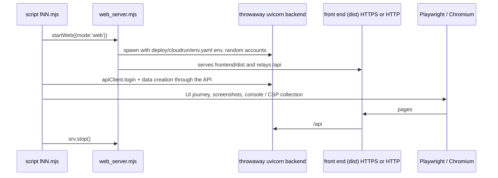

# 18. Tests: pytest, organisation, oracle, Playwright recipes, screenshots {#tests}

How OntoForge is tested: backend tests (pytest), the transposition oracle, front-end Node tests, the per-lot Playwright recipes that prove an end-to-end journey, and the documentation screenshot tools. Back to the [index](README.en.md). Generic method: skill `recette-playwright-par-lot`.

State verified on 23 November 2026: in the order of 1600 tests collected by `pytest --collect-only` (Python 3.13.18 venv; the number moves with every chapter or parametrised test added); `node --test`: 19 tests pass.

## 1. Role {#role}

Three levels:

1. Unit and API (pytest, `backend/tests/`): pure functions, engine, generators, routes through `TestClient`, security, documentation. This is the CI gate.
2. Oracle: a set of trap ontologies with the list of expected findings; it protects the semantics of the transposition.
3. Recipes (Playwright, `tools/recette/`): one script per lot that starts a throwaway backend and the built front end, runs a journey, checks what unit tests cannot see (CSP, cookies, gestures, rendering, multi-account) and takes screenshots. They do not run in CI by default.

## 2. Files {#fichiers}

| Path | Role |
|---|---|
| `backend/tests/conftest.py` | adds `backend/` to `sys.path`, turns the rate limiter off (`ONTOFORGE_RATE_LIMIT=0`), isolates `ONTOFORGE_DATA` in a session temp folder (only if the variable is not already set: `os.environ.setdefault`), `samples_dir` fixture |
| `backend/tests/fixtures/` | test data (`io/`, `shacl/`, `queries/`, `reasoner/`, `l48/`, frozen `pg_*.json` profiles) |
| `samples/trap/expected-findings.yaml` | **oracle**: expected findings (rule, subject, severity, recommended option per target) and `must_not` |
| `backend/tests/test_mapping_oracle.py` | replays the oracle on `samples/trap/trap.ttl` for Curiosity and Neo4j |
| `frontend/tests/safe_markdown.test.mjs` | Node tests of the safe Markdown renderer (`npm test`) |
| `frontend/tests/i18n_parity.test.mjs` | parity of `fr.json` and `en.json`: keys, `{x}` placeholders, non-empty values (DF-F08) |
| `frontend/tests/http_detail.test.mjs` | reading of `detail` (string, list, fallback, code) in `lib/httpDetail.ts` |
| `frontend/tests/api_clients.test.mjs` | code guards: API clients with no `fetch` nor `detail`, no hard-coded network message, `ontoforge:*` events with a receiver, no dead getter, existing `ORDER` pages |
| `backend/tests/test_front_guards.py` | runs these three Node files from `pytest` (skipped without Node 22.18 or later) |
| `tools/recette/*.mjs` | per-lot Playwright recipes; `web_server.mjs`: server that reproduces production |
| `tools/recette/e2e_api.py` | complete recipe through the API (throwaway backend + small SPARQL server) |
| `tools/recette/english_scan.mjs` | looks for visible French in the English interface |
| `tools/docs/captures.mjs` | generates the guide screenshots (`docs/guide/img/<fr|en>/`) |
| `backend/tests/test_dev_docs.py`, `test_docs_bilingual.py`, `test_help_map.py` | documentation consistency |

## 3. Backend tests {#pytest}

```bash
cd backend && pytest -q                                        # everything (about 1600 tests)
cd backend && pytest -q tests/test_mapping_oracle.py           # one file
cd backend && pytest -q -k "oracle and neo4j"                  # a selection
cd backend && PYTHONPATH=$PWD pytest -q tests/test_dev_docs.py tests/test_docs_bilingual.py   # documentation
```

(`pytest` is taken from the venv; `pyproject.toml` sets `testpaths = ["tests"]`.)

**Organisation by file-name prefix** (77 files):

| Prefix | Subject |
|---|---|
| `test_api_*`, `test_settings_*`, `test_assistant_*` | routes and API contract (`test_api_contract.py::test_all_contract_routes_exist`), settings, assistant (`mock` provider) |
| `test_io_*`, `test_conformance_*`, `test_reason_*`, `test_shacl_*` | RDF import / export, OWL 2 profiles, HermiT, SHACL |
| `test_mapping_*`, `test_target_*`, `test_profile_*`, `test_graphql`, `test_report`, `test_translate`, `test_query_*` | engine, generators, per-target profiles, query translation |
| `test_store`, `test_versions`, `test_local_store*`, `test_files_editor*`, `test_editing_*`, `test_business_map` | projects, versions, local triplestore, file editor, editing operations |
| `test_auth`, `test_collab`, `test_l42_*`, `test_l43_*` | accounts, sharing, project versions, administration |
| `test_sec_*`, `test_security`, `test_netguard`, `test_l41_*` | security (CSRF, origin, limiter, SSRF, headers, hostile RDF) |
| `test_l47_*`, `test_l48_*`, `test_l49_*`, `test_l52_*` | lot-specific tests (justification, SQL / CSV import, good practices, regression tests for defects DF-B01 to DF-B11 and DF-F03) |
| `test_english`, `test_generation_lang` | English version of server messages |
| `test_docs_bilingual`, `test_help_map`, `test_dev_docs` | documentation |

**Conventions**

- API tests: `TestClient(create_app())` or `TestClient(app)` with `monkeypatch.setenv("ONTOFORGE_DATA", str(tmp_path))` and `ONTOFORGE_LLM_PROVIDER=mock`; never any network, never any key (decision D-021). See `backend/tests/test_english.py` or `backend/tests/test_security.py::build` to build an application with specific variables.
- Security tests rebuild the application (`create_app`) with the case's variables (authentication, public, CORS); the rate limiter is explicitly turned back on in `test_sec_ratelimit.py`.
- Tests that need Node or Java are **skipped** if the tool is missing (`pytest.mark.skipif`): a "green" run can hide skipped tests, read the pytest summary.
- Large engine tests use module fixtures (`scope="module"`) to analyse only once.
- No company data: generic examples (`samples/`).

## 4. The transposition oracle {#oracle}

`samples/trap/trap.ttl` is a "trap" ontology that exercises the catalogue rules (`docs/RULES.md`). `samples/trap/expected-findings.yaml` lists, per rule and subject, the expected severity (`auto`, `review`, `lost`) and the **recommended** option for each target; `must_not` lists forbidden findings. The contract is **minimal**: the engine must produce at least these findings; others are tolerated except those in `must_not`.

`test_mapping_oracle.py` is parametrised by target and by entry (`test_expected`), and checks presence, severity, recommended option, that the options exist and that a justification is given (`rationale`). Adding a rule or changing a recommendation = updating the oracle **in the same lot**, with a traced decision. The oracle is read by the engine (chapter 07), the generators (chapter 08) and the profiles.

## 5. Front-end Node tests {#tests-front}

`cd frontend && npm test` = `node --test tests/*.test.mjs`. Four files: the safe Markdown renderer (`javascript:` links, images, raw HTML), i18n parity, the reading of `detail` and the API-client guards (the code tests read the sources, no browser). The files are `.ts` imported as-is by Node 22: the tested modules use only erasable syntax and import nothing from the interface (`httpDetail.ts` is split from `http.ts` for that reason). The Markdown renderer is also run by `backend/tests/test_sec_front.py::test_sec08_markdown_links_neutralised` if Node and `frontend/node_modules/marked` exist. **There are no component tests** (no Testing Library, no Vitest): screens are covered by recipes. Static checking is `tsc -b` inside `npm run build`.

## 6. Playwright recipes {#recettes}

Principles (skill `recette-playwright-par-lot`):

1. One script per lot (`tools/recette/l<NN>_subject.mjs`), standalone: starts a throwaway backend (simulated provider, temporary `ONTOFORGE_DATA`) and a front-end server, runs the journey, writes `OK` / `KO` per check, exits non-zero at the first failure.
2. The **front end is built beforehand** (`cd frontend && npm run build`); the recipe does not rebuild it.
3. No real secret: accounts and passwords drawn at random at run time, fake keys assembled on the fly.
4. Unique ports per script (by default 89xx for the backend, 49xx / 50xx for the front end), overridable: `BACKEND_PORT=9150 FRONT_PORT=5150 node tools/recette/mobile_l50.mjs`. Two scripts with the same port interfere without a clear error: list the ports in use before writing (`grep -rhoE "[89][0-9]{3}" tools/recette | sort -u`).
5. Wait for a state, never a duration (`waitFor`), clean up processes in `finally`, 40 s start-up wait loop (slow first start).
6. Console and CSP: collect console errors and `securitypolicyviolation` events, count them as failures.



**Two environments.** `tools/recette/web_server.mjs` reproduces production: `startWeb({ mode: 'web' })` starts uvicorn serving the API and the front end, with authentication, public mode, a `Secure` (`__Host-`) cookie, variables read from `deploy/cloudrun/env.yaml`, an HTTPS front with a self-signed certificate (`openssl`) that adds `X-Forwarded-*` without the server trusting them, and an adjustable latency (`WEB_LATENCY_MS`). `mode: 'local'` reproduces `docker compose` (no authentication, a server that imitates `nginx.conf`). The Playwright context must then have `ignoreHTTPSErrors: true`. A "simple" recipe (for example `tools/recette/e2e_ui.mjs`) starts `uvicorn` and `vite preview` without authentication and reroutes `/api` inside the browser.

**Recipe API client**: `tools/recette/web_server.mjs::apiClient` keeps the cookie and the CSRF token and sends `Origin`: this is how to create data through the API in the authenticated version (same protocol as the browser, chapter 02).

**Replaying.**

```bash
cd frontend && npm run build
node tools/recette/e2e_ui.mjs                      # general non-regression (journal/L14/screens)
python tools/recette/e2e_api.py                    # same journey through the API (the shebang targets the agents' venv)
BACKEND_PORT=9150 FRONT_PORT=5150 node tools/recette/mobile_l50.mjs
node tools/recette/english_scan.mjs                # visible French in the English interface
```

Scripts look for `playwright` through `require`, then in `/opt/node22/lib/node_modules/playwright` (version 1.63.0 on the agents' machine). Elsewhere: `npm install --no-save playwright@1.63.0` at the root (CI pins the same version, DF-F07) and `npx playwright install chromium`. The Python interpreter used by `web_server.mjs` is `PYTHON` or `/home/claude/venv/bin/python`.

**Catalogue** (by theme; one script per lot): `e2e_ui` / `e2e_api` (general journey); `l16_assistant`, `l37_aquarium`, `l38_settings_krakie` (Krakie); `l19_local_store`, `l22_files`, `l25_document`, `l36_business_map`; `l27_auth`, `l40_partage`, `l42_admin`, `l43_password` (accounts and collaboration); `l28_docs`, `l33_docs_en`, `english_scan` (documentation and English); `l31_versions`, `l32_hermit`, `l47_justification`, `l48_import`, `l49_bonnes_pratiques`; `mobile_audit`, `mobile_l44`, `mobile_l45`, `mobile_l50` (phone); `tour` (guided tour); `l20_game`, `l30_*` (mini-game, animations).

**Screenshots.** Recipes write their screenshots to `journal/<lot>/screens/` (about 500 files tracked by git under `journal/`); failing ones write `journal/L47/screens/ko-*` (git-ignored). Versioned screenshots rewritten by a recipe are committed separately ("recettes : captures régénérées").

## 7. Documentation screenshots {#captures-doc}

`tools/docs/captures.mjs` (usage: `--lang fr|en|both`, `--only`, `--no-optimize`, `--keep-servers`) starts a throwaway backend and `vite preview`, creates the `automaint` example, takes each screenshot **in both languages** (1440×900 window, light theme, same data) with numbered markers injected then removed, and writes `docs/guide/img/<fr|en>/<name>.png`; `tools/docs/optimize.py` shrinks them (Pillow); `tools/docs/scan_fr_in_en.py` spots French in the English screenshots; `tools/docs/mobile_captures.*` for the phone. Method: skill `doc-bilingue-captures`. Images are loaded on demand by the embedded guide (`frontend/src/lib/docs.ts::resolveGuideImage`); `docs/guide/img/sizes.json` gives their dimensions.

## 8. Documentation tests {#tests-doc}

- `backend/tests/test_docs_bilingual.py`: every `docs/guide/<X>.md` has an `<X>.en.md` with the same `{#id}` anchors and the same number of headings per level.
- `backend/tests/test_help_map.py`: the help table (`backend/ontoforge/assistant/help_map.json`) only points to existing anchors.
- `backend/tests/test_dev_docs.py` (this manual): see the [index](README.en.md#conventions) for the convention. It checks that cited paths and symbols exist, that headings and anchors are the same in fr and en, that internal links are valid, that the 18 chapters exist and that nothing sensitive is cited.

## 9. Decisions {#decisions}

- D-021: the `mock` provider is the default of tests and CI; no test depends on a key.
- D-L21-03: Neo4j and Curiosity validation by hand; no testcontainers, no automated C# compilation.
- D-L14-01: trap SHACL through a project = 8 violations (oracle unchanged); the 9th came from the whole ontology being passed as the ontology graph to pySHACL.
- D-L47-01: findings without a real choice reclassified `auto` (see `journal/decisions.md`).
- Team rule: a lot touching a web interface delivers its recipe (skill `recette-playwright-par-lot`).

## 10. Pitfalls {#pieges}

- Skipped tests: missing Node, Java or `node_modules` skip tests without failing.
- `ONTOFORGE_DATA` already exported in your shell: `conftest.py` uses `setdefault`, so tests write into that folder instead of a temporary one. Run `unset ONTOFORGE_DATA` before `pytest`.
- The rate limiter is turned off by `conftest.py`: a test that needs the 429 must turn it back on.
- Agents' venv on Python 3.13, CI on 3.12: a test that is green here may differ there (`À CONFIRMER`).
- Hard-coded paths in recipes (`/home/claude/venv/bin/python`, `/opt/node22/...`): only CI works around them, with a link.
- Port collisions between agents running recipes in parallel: another server answers, with no clear error.
- Recipe data: always a temporary folder (`mkdtempSync`), otherwise the examples get polluted.
- Labels in recipes: read `frontend/src/i18n/fr.json`, do not copy them; `data-testid` attributes are a contract (chapter 15).
- Recipe ≠ unit test: do not put in a recipe what an API test covers.
- No component tests (i18n parity is guarded since L52, DF-F08).

## 11. How to add… {#comment-ajouter}

### … a backend test {#ajouter-test}

Create `backend/tests/test_<subject>.py`; a fixture with `monkeypatch.setenv("ONTOFORGE_DATA", str(tmp_path))` and `ONTOFORGE_LLM_PROVIDER=mock`; go through `TestClient` for a route; run `pytest -q tests/test_<subject>.py` then the full suite (a test that changes the global environment breaks the others: use `monkeypatch`).

### … a rule to the oracle {#ajouter-oracle}

Add the trap ontology in `samples/trap/trap.ttl` (and shapes / data if needed), the entry in `samples/trap/expected-findings.yaml` (rule, subject, severity, `recommended` per target), rerun `pytest -q tests/test_mapping_oracle.py`; if the oracle changes, record the decision in `journal/decisions.md`.

### … a Playwright recipe {#ajouter-recette}

1. Copy a similar recipe (`tools/recette/l50*` for a deployed version, `e2e_ui.mjs` for a simple one) to `tools/recette/l<NN>_subject.mjs`.
2. Pick two **free ports** (list those already taken).
3. Create data through `apiClient` or `fetch` to the API, not through the interface.
4. One `check('label', condition)` function per verification; a screenshot at each key step in `journal/<lot>/screens/`; collect console and CSP.
5. Clean up processes in `finally`; non-zero exit code if a check fails.
6. Quote the command and the number of checks ("70/70") in the lot report.

### … a front-end Node test {#ajouter-test-node}

A file `frontend/tests/<subject>.test.mjs` (ES module, `node:test`, no DOM); it can only import modules that do not touch `window` on load. For a component, use a recipe.

### … a screenshot in the guide {#ajouter-capture}

Add the entry to `tools/docs/captures-list.mjs` (annotations included), run `node tools/docs/captures.mjs --only <name>`, reference `img/fr/<name>.png` and `img/en/<name>.png` in both versions of the guide, check `test_docs_bilingual.py`.
