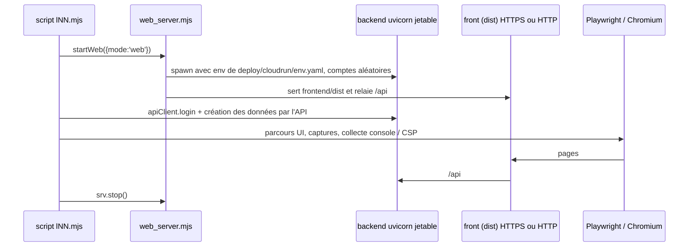

# 18. Tests : pytest, organisation, oracle, recettes Playwright, captures {#tests}

Comment OntoForge est testé : les tests du backend (pytest), l'oracle de la transposition, les tests Node du front, les recettes Playwright par lot qui prouvent un parcours de bout en bout, et les outils de captures de la documentation. Retour au [sommaire](README.md). Méthode générique : skill `recette-playwright-par-lot`.

État vérifié le 23 novembre 2026 : de l'ordre de 1600 tests collectés par `pytest --collect-only` (venv Python 3.13.18 ; le nombre bouge à chaque chapitre ou test paramétré ajouté) ; `node --test` : 19 tests passent.

## 1. Rôle {#role}

Trois niveaux :

1. Unitaire et API (pytest, `backend/tests/`) : fonctions pures, moteur, générateurs, routes via `TestClient`, sécurité, documentation. C'est la porte de la CI.
2. Oracle : un jeu d'ontologies piégées avec la liste des constats attendus ; il protège la sémantique de la transposition.
3. Recettes (Playwright, `tools/recette/`) : un script par lot qui lance un backend jetable et le front construit, déroule un parcours, vérifie ce que les tests unitaires ne voient pas (CSP, cookies, gestes, rendu, multi-comptes) et prend des captures. Elles ne tournent pas dans la CI par défaut.

## 2. Fichiers {#fichiers}

| Chemin | Rôle |
|---|---|
| `backend/tests/conftest.py` | ajoute `backend/` au `sys.path`, coupe le limiteur de débit (`ONTOFORGE_RATE_LIMIT=0`), isole `ONTOFORGE_DATA` dans un dossier temporaire de session (seulement si la variable n'est pas déjà posée : `os.environ.setdefault`), fixture `samples_dir` |
| `backend/tests/fixtures/` | données de tests (`io/`, `shacl/`, `queries/`, `reasoner/`, `l48/`, profils figés `pg_*.json`) |
| `samples/trap/expected-findings.yaml` | **oracle** : constats attendus (règle, sujet, sévérité, option recommandée par cible) et `must_not` |
| `backend/tests/test_mapping_oracle.py` | rejoue l'oracle sur `samples/trap/trap.ttl` pour Curiosity et Neo4j |
| `frontend/tests/safe_markdown.test.mjs` | tests Node du rendu Markdown sûr (`npm test`) |
| `frontend/tests/i18n_parity.test.mjs` | parité de `fr.json` et `en.json` : clés, espaces réservés `{x}`, valeurs non vides (DF-F08) |
| `frontend/tests/http_detail.test.mjs` | lecture de `detail` (chaîne, liste, repli, code) de `lib/httpDetail.ts` |
| `frontend/tests/api_clients.test.mjs` | garde-fous de code : clients API sans `fetch` ni `detail`, pas de message réseau en dur, évènements `ontoforge:*` avec récepteur, pas de getter mort, pages de `ORDER` existantes |
| `backend/tests/test_front_guards.py` | lance ces trois fichiers Node depuis `pytest` (ignoré sans Node 22.18 ou plus) |
| `tools/recette/*.mjs` | recettes Playwright par lot ; `web_server.mjs` : serveur qui reproduit la production |
| `tools/recette/e2e_api.py` | recette complète par l'API (backend jetable + petit serveur SPARQL) |
| `tools/recette/english_scan.mjs` | cherche du français visible dans l'interface anglaise |
| `tools/docs/captures.mjs` | génère les captures du guide (`docs/guide/img/<fr|en>/`) |
| `backend/tests/test_dev_docs.py`, `test_docs_bilingual.py`, `test_help_map.py` | cohérence de la documentation |

## 3. Tests backend {#pytest}

```bash
cd backend && pytest -q                                        # tout (de l'ordre de 1600 tests)
cd backend && pytest -q tests/test_mapping_oracle.py           # un fichier
cd backend && pytest -q -k "oracle and neo4j"                  # une sélection
cd backend && PYTHONPATH=$PWD pytest -q tests/test_dev_docs.py tests/test_docs_bilingual.py   # documentation
```

(`pytest` est lu depuis le venv ; `pyproject.toml` fixe `testpaths = ["tests"]`.)

**Organisation par préfixe de nom** (77 fichiers) :

| Préfixe | Sujet |
|---|---|
| `test_api_*`, `test_settings_*`, `test_assistant_*` | routes et contrat d'API (`test_api_contract.py::test_all_contract_routes_exist`), paramètres, assistant (fournisseur `mock`) |
| `test_io_*`, `test_conformance_*`, `test_reason_*`, `test_shacl_*` | import / export RDF, profils OWL 2, HermiT, SHACL |
| `test_mapping_*`, `test_target_*`, `test_profile_*`, `test_graphql`, `test_report`, `test_translate`, `test_query_*` | moteur, générateurs, profils par cible, traduction de requêtes |
| `test_store`, `test_versions`, `test_local_store*`, `test_files_editor*`, `test_editing_*`, `test_business_map` | projets, versions, triplestore local, éditeur de fichiers, opérations d'édition |
| `test_auth`, `test_collab`, `test_l42_*`, `test_l43_*` | comptes, partage, versions de projet, administration |
| `test_sec_*`, `test_security`, `test_netguard`, `test_l41_*` | sécurité (CSRF, origine, limiteur, SSRF, en-têtes, RDF hostile) |
| `test_l47_*`, `test_l48_*`, `test_l49_*`, `test_l52_*` | tests propres à un lot (justification, import SQL / CSV, bonnes pratiques, non-régression des défauts DF-B01 à DF-B11 et DF-F03) |
| `test_english`, `test_generation_lang` | version anglaise des messages serveur |
| `test_docs_bilingual`, `test_help_map`, `test_dev_docs` | documentation |

**Conventions**

- Tests d'API : `TestClient(create_app())` ou `TestClient(app)` avec `monkeypatch.setenv("ONTOFORGE_DATA", str(tmp_path))` et `ONTOFORGE_LLM_PROVIDER=mock` ; jamais de réseau, jamais de clé (décision D-021). Voir `backend/tests/test_english.py` ou `backend/tests/test_security.py::build` pour construire une application avec des variables précises.
- Les tests de **sécurité** reconstruisent l'application (`create_app`) avec les variables du cas (authentification, public, CORS) ; le limiteur de débit est réactivé explicitement dans `test_sec_ratelimit.py`.
- Les tests qui ont besoin de Node ou de Java sont **ignorés** si l'outil manque (`pytest.mark.skipif`) : un « vert » peut cacher des tests ignorés, lire le résumé de pytest.
- Les gros tests de moteur utilisent des fixtures de module (`scope="module"`) pour n'analyser qu'une fois.
- Pas de données d'entreprise : exemples génériques (`samples/`).

## 4. L'oracle de transposition {#oracle}

`samples/trap/trap.ttl` est une ontologie « piège » qui exerce les règles du catalogue (`docs/RULES.md`). `samples/trap/expected-findings.yaml` liste, par règle et sujet, la sévérité attendue (`auto`, `review`, `lost`) et l'option **recommandée** pour chaque cible ; `must_not` liste les constats interdits. Le contrat est **minimal** : le moteur doit produire au moins ces constats ; d'autres sont tolérés sauf ceux de `must_not`.

`test_mapping_oracle.py` paramètre par cible et par entrée (`test_expected`), vérifie présence, sévérité, option recommandée, que les options existent et qu'une justification est donnée (`rationale`). Ajouter une règle ou changer une recommandation = mettre l'oracle à jour **dans le même lot**, avec décision tracée. L'oracle est lu par le moteur (chapitre 07), les générateurs (chapitre 08) et les profils.

## 5. Tests Node du front {#tests-front}

`cd frontend && npm test` = `node --test tests/*.test.mjs`. Quatre fichiers : le rendu Markdown sûr (liens `javascript:`, images, HTML brut), la parité i18n, la lecture de `detail` et les garde-fous des clients API (les tests de code lisent les sources, sans navigateur). Les fichiers sont en `.ts` importés tels quels par Node 22 : les modules testés n'utilisent que de la syntaxe effaçable et aucun import de l'interface (`httpDetail.ts` est séparé de `http.ts` pour cela). Le rendu Markdown est aussi lancé par `backend/tests/test_sec_front.py::test_sec08_markdown_links_neutralised` si Node et `frontend/node_modules/marked` existent. **Il n'y a pas de test de composants** (ni Testing Library, ni Vitest) : les écrans sont couverts par les recettes. Le contrôle statique est `tsc -b` dans `npm run build`.

## 6. Recettes Playwright {#recettes}

Principes (skill `recette-playwright-par-lot`) :

1. Un script par lot (`tools/recette/l<NN>_sujet.mjs`), autonome : démarre un backend jetable (fournisseur simulé, `ONTOFORGE_DATA` temporaire) et un serveur de front, déroule le parcours, écrit `OK` / `KO` par vérification, sort avec un code non nul au premier échec.
2. Le **front est construit avant** (`cd frontend && npm run build`) ; la recette ne le reconstruit pas.
3. Aucun vrai secret : comptes et mots de passe tirés au hasard à l'exécution, clés factices assemblées à la volée.
4. Ports uniques par script (par défaut 89xx pour le backend, 49xx / 50xx pour le front), surchargeables : `BACKEND_PORT=9150 FRONT_PORT=5150 node tools/recette/mobile_l50.mjs`. Deux scripts avec le même port se parasitent sans erreur claire : relever les ports pris avant d'écrire (`grep -rhoE "[89][0-9]{3}" tools/recette | sort -u`).
5. Attendre un état, jamais une durée (`waitFor`), nettoyer les processus dans `finally`, boucle d'attente du démarrage de 40 s (premier démarrage lent).
6. Console et CSP : collecter les erreurs de console et les `securitypolicyviolation`, les compter comme échec.



**Deux environnements.** `tools/recette/web_server.mjs` reproduit la production : `startWeb({ mode: 'web' })` lance uvicorn qui sert l'API et le front, avec authentification, mode public, cookie `Secure` (`__Host-`), variables lues dans `deploy/cloudrun/env.yaml`, un frontal HTTPS à certificat auto-signé (`openssl`) qui ajoute `X-Forwarded-*` sans que le serveur les croie, et une latence réglable (`WEB_LATENCY_MS`). `mode: 'local'` reproduit `docker compose` (sans authentification, serveur qui imite `nginx.conf`). Le contexte Playwright doit alors avoir `ignoreHTTPSErrors: true`. Une recette « simple » (par exemple `tools/recette/e2e_ui.mjs`) lance `uvicorn` et `vite preview` sans authentification et réachemine `/api` dans le navigateur.

**Client d'API de recette** : `tools/recette/web_server.mjs::apiClient` garde le cookie et le jeton CSRF et envoie `Origin` : c'est le moyen de créer des données par l'API en version authentifiée (même protocole que le navigateur, chapitre 02).

**Rejouer.**

```bash
cd frontend && npm run build
node tools/recette/e2e_ui.mjs                      # non-régression générale (journal/L14/screens)
python tools/recette/e2e_api.py                    # même parcours par l'API (le shebang vise le venv des agents)
BACKEND_PORT=9150 FRONT_PORT=5150 node tools/recette/mobile_l50.mjs
node tools/recette/english_scan.mjs                # français visible en interface anglaise
```

Les scripts cherchent `playwright` par `require` puis dans `/opt/node22/lib/node_modules/playwright` (version 1.63.0 sur la machine des agents). Hors de cette machine : `npm install --no-save playwright@1.63.0` à la racine (la CI épingle la même version, DF-F07) et `npx playwright install chromium`. L'interpréteur Python de `web_server.mjs` est `PYTHON` ou `/home/claude/venv/bin/python`.

**Catalogue** (par thème ; un script par lot) : `e2e_ui` / `e2e_api` (parcours général) ; `l16_assistant`, `l37_aquarium`, `l38_settings_krakie` (Krakie) ; `l19_local_store`, `l22_files`, `l25_document`, `l36_business_map` ; `l27_auth`, `l40_partage`, `l42_admin`, `l43_password` (comptes et collaboration) ; `l28_docs`, `l33_docs_en`, `english_scan` (documentation et anglais) ; `l31_versions`, `l32_hermit`, `l47_justification`, `l48_import`, `l49_bonnes_pratiques` ; `mobile_audit`, `mobile_l44`, `mobile_l45`, `mobile_l50` (téléphone) ; `tour` (visite guidée) ; `l20_game`, `l30_*` (mini-jeu, animations).

**Captures.** Les recettes écrivent leurs captures dans `journal/<lot>/screens/` (environ 500 fichiers suivis par git sous `journal/`) ; celles qui échouent écrivent `journal/L47/screens/ko-*` (ignorées par git). Les captures versionnées réécrites par une recette se committent à part (« recettes : captures régénérées »).

## 7. Captures de la documentation {#captures-doc}

`tools/docs/captures.mjs` (usage : `--lang fr|en|both`, `--only`, `--no-optimize`, `--keep-servers`) démarre un backend jetable et `vite preview`, crée l'exemple `automaint`, prend chaque capture **dans les deux langues** (fenêtre 1440×900, thème clair, mêmes données) avec des pastilles numérotées injectées puis retirées, et écrit `docs/guide/img/<fr|en>/<nom>.png` ; `tools/docs/optimize.py` les réduit (Pillow) ; `tools/docs/scan_fr_in_en.py` repère du français dans les captures anglaises ; `tools/docs/mobile_captures.*` pour le téléphone. Méthode : skill `doc-bilingue-captures`. Les images sont chargées à la demande par le guide embarqué (`frontend/src/lib/docs.ts::resolveGuideImage`) ; `docs/guide/img/sizes.json` donne leurs dimensions.

## 8. Tests de la documentation {#tests-doc}

- `backend/tests/test_docs_bilingual.py` : chaque `docs/guide/<X>.md` a un `<X>.en.md` aux mêmes ancres `{#id}` et au même nombre de titres par niveau.
- `backend/tests/test_help_map.py` : la table d'aide (`backend/ontoforge/assistant/help_map.json`) ne renvoie qu'à des ancres existantes.
- `backend/tests/test_dev_docs.py` (ce manuel) : voir le [sommaire](README.md#conventions) pour la convention. Il vérifie que les chemins et symboles cités existent, que les titres et ancres sont les mêmes en fr et en, que les liens internes sont valides, que les 18 chapitres existent et que rien de sensible n'est cité.

## 9. Décisions {#decisions}

- D-021 : le fournisseur `mock` est le défaut des tests et de la CI ; aucun test ne dépend d'une clé.
- D-L21-03 : validation Neo4j et Curiosity manuelle ; pas de testcontainers ni de compilation C# automatisée.
- D-L14-01 : SHACL piège via projet = 8 violations (oracle inchangé) ; la 9e venait de l'ontologie entière passée comme graphe d'ontologie à pySHACL.
- D-L47-01 : constats sans vrai choix reclassés `auto` (voir `journal/decisions.md`).
- Règle d'équipe : un lot touchant une interface web livre sa recette (skill `recette-playwright-par-lot`).

## 10. Pièges {#pieges}

- Tests ignorés : Node, Java ou `node_modules` absents font ignorer des tests sans les faire échouer.
- `ONTOFORGE_DATA` déjà exporté dans votre shell : `conftest.py` utilise `setdefault`, donc les tests écrivent dans ce dossier au lieu d'un dossier temporaire. Faire `unset ONTOFORGE_DATA` avant `pytest`.
- Le limiteur de débit est coupé par `conftest.py` : un test qui a besoin du 429 doit le réactiver.
- Venv des agents en Python 3.13, CI en 3.12 : un test vert ici peut différer là (`À CONFIRMER`).
- Chemins codés en dur dans les recettes (`/home/claude/venv/bin/python`, `/opt/node22/...`) : seule la CI les contourne par un lien.
- Ports en collision entre agents qui lancent des recettes en parallèle : un autre serveur répond, sans erreur claire.
- Données de recette : toujours un dossier temporaire (`mkdtempSync`), sinon les exemples sont pollués.
- Libellés dans les recettes : lire `frontend/src/i18n/fr.json`, ne pas les recopier ; les `data-testid` sont un contrat (chapitre 15).
- Recette ≠ test unitaire : ne pas y mettre ce qu'un test d'API couvre.
- Pas de test de composants (la parité i18n est gardée depuis L52, DF-F08).

## 11. Comment ajouter… {#comment-ajouter}

### … un test backend {#ajouter-test}

Créer `backend/tests/test_<sujet>.py` ; une fixture avec `monkeypatch.setenv("ONTOFORGE_DATA", str(tmp_path))` et `ONTOFORGE_LLM_PROVIDER=mock` ; passer par `TestClient` pour une route ; vérifier `pytest -q tests/test_<sujet>.py` puis la suite complète (un test qui change l'environnement global casse les autres : utilisez `monkeypatch`).

### … une règle à l'oracle {#ajouter-oracle}

Ajouter l'ontologie piège dans `samples/trap/trap.ttl` (et shapes / données si besoin), l'entrée dans `samples/trap/expected-findings.yaml` (règle, sujet, sévérité, `recommended` par cible), relancer `pytest -q tests/test_mapping_oracle.py` ; si l'oracle change, noter la décision dans `journal/decisions.md`.

### … une recette Playwright {#ajouter-recette}

1. Copier une recette proche (`tools/recette/l50*` pour une version déployée, `e2e_ui.mjs` pour une version simple) en `tools/recette/l<NN>_sujet.mjs`.
2. Choisir deux **ports libres** (relever ceux déjà pris).
3. Créer les données par `apiClient` ou `fetch` vers l'API, pas par l'interface.
4. Une fonction `check('libellé', condition)` par vérification ; capture à chaque étape clé dans `journal/<lot>/screens/` ; collecter console et CSP.
5. Nettoyer les processus dans `finally` ; code de sortie non nul si une vérification échoue.
6. Citer la commande et le nombre de vérifications (« 70/70 ») dans le rapport du lot.

### … un test Node du front {#ajouter-test-node}

Un fichier `frontend/tests/<sujet>.test.mjs` (module ES, `node:test`, sans DOM) ; il ne peut importer que des modules qui ne touchent pas `window` au chargement. Pour un composant, passer par une recette.

### … une capture dans le guide {#ajouter-capture}

Ajouter l'entrée dans `tools/docs/captures-list.mjs` (annotations comprises), lancer `node tools/docs/captures.mjs --only <nom>`, référencer `img/fr/<nom>.png` et `img/en/<nom>.png` dans les deux versions du guide, vérifier `test_docs_bilingual.py`.
