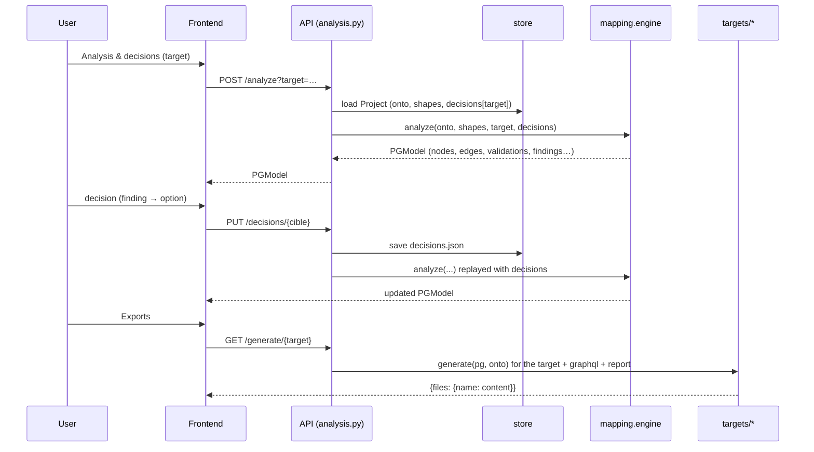
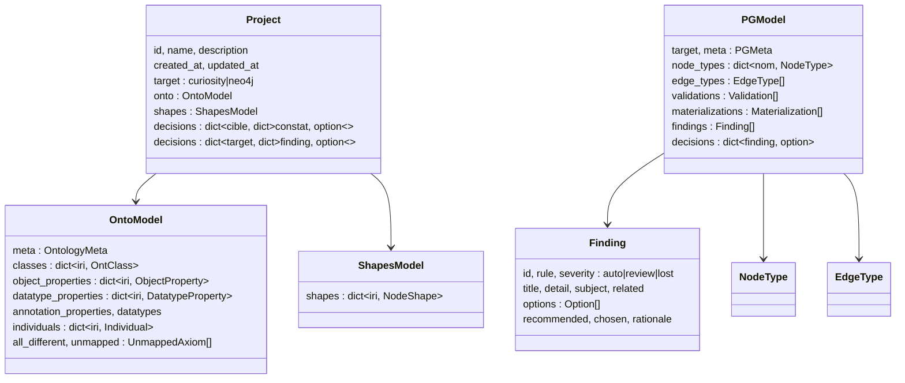

# Architecture of OntoForge {#architecture-d-ontoforge-iteration-2}

Sources checked: `backend/ontoforge/` (modules and signatures), `docs/CONTRACTS.md` §4-7, `backend/ontoforge/core/*.py` (normative pydantic contracts, D-028), `docs/CONTRACTS.md`, `docs/RULES.md`, `frontend/src/`. If they disagree, the code wins.

## 1. Overview {#vue-d-ensemble}

OntoForge is a web application in two containers: a **FastAPI backend** (Python, port 8000, volume `/data`) and a **React + TypeScript frontend** (Vite, served by nginx, which proxies `/api` to the backend; published port `ONTOFORGE_PORT`, 8088 by default in `docker-compose.yml`).

```mermaid
flowchart LR
  subgraph FRONT[Frontend React + TS]
    UI[Shell + kit + i18n + Krakie\nScreens: Dashboard, Graphical editor, Conformance,\nSHACL, Analysis, Target model, Exports, Queries,\nFull-screen assistant, Settings\nProposal store]
  end
  subgraph API[Backend FastAPI, ontoforge.api]
    R1[projects.py] --- R2[analysis.py] --- R3[assistant.py] --- R4[system.py]
    R5[settings.py] --- R6[editing.py] --- R7[queries.py]
  end
  UI -- "JSON /api" --> API
  R1 --> STORE[(projects/store.py\n$ONTOFORGE_DATA/projects/id/)]
  R1 --> IO[io/ : rdf_import, rdf_export, dsl]
  R1 --> CONF[conformance/ : profiles, lint, reasoner]
  R1 --> SH[shacl/ : import, export, validate, owl_to_shacl]
  R2 --> ENG[mapping/engine.py\n+ mapping/rules/* + profiles/*]
  ENG --> PG[(PGModel)]
  PG --> T1[targets/curiosity.py]
  PG --> T2[targets/neo4j.py]
  PG --> T3[targets/graphql.py]
  PG --> T4[targets/report.py]
  R2 --> Q[queries/ : translate, competency]
  R3 --> AS[assistant/ : service, analyzers, convert\n+ providers anthropic | openai_compat | ollama | mock]
  R5 --> SET[settings/ : models, crypto, store\n$ONTOFORGE_DATA/settings.json]
  R6 --> ED[editing/ : ops, history, perimeter, graph, icons]
  R7 --> QB[queries/ : builder, nl, endpoint, saved]
  AS -. provider .-> SET
  QB -. active endpoint .-> SET
```

## 2. Main flow: from ontology to code {#flux-principal-de-l-ontologie-au-code}



1. **Design**: `io/rdf_import.parse_ontology` (Turtle, RDF/XML, JSON-LD, N-Triples, N3, TriG) or `io/dsl.parse_dsl` produces an `OntoModel`. Unstructured constructs are kept in `OntoModel.unmapped`.
2. **Check**: `conformance/profiles.check_conformance` (DL/EL/QL/RL/RDFS profiles, W01–W07) + `conformance/lint.py` (BP01–BP07, W07); optional HermiT reasoner (`reasoner.py`, subprocess, never blocking).
3. **Constrain**: `shacl/` imports, exports, generates (`owl_to_shacl.generate_shapes`) and validates (`validate`, no inference by default, D-034).
4. **Analyze**: `mapping.engine.analyze` detects findings per rule, applies the decisions and builds the `PGModel`.
5. **Generate**: one generator per target, plus GraphQL and the report.

## 3. Backend modules {#modules-backend}

| Module | Role | Main function(s) |
|---|---|---|
| `main.py` | FastAPI app, CORS (`ONTOFORGE_CORS_ORIGINS`), 422 error handler in French | `app` |
| `api/projects.py` | project CRUD, import, DSL, ontology/shapes export, conformance, SHACL | routers `/api/projects…` |
| `api/analysis.py` | analysis, decisions, generation (+ history), zip, translation; `?perimeter=` | `/analyze`, `/decisions`, `/generate`, `/generations`, `/queries` |
| `api/assistant.py` | AI assistant: draft, shapes, explanation, conversation, file upload | `/api/assistant/*` |
| `api/system.py` | health, samples | `/api/health`, `/api/samples` |
| `api/settings.py` | settings, LLM providers, SPARQL endpoints (CONTRACTS §4, §6) | `/api/settings…` |
| `api/editing.py` | editing operations, undo/redo, graph, perimeters, icons (§5) | `/api/projects/{pid}/ops…`, `/graph`, `/perimeters…`, `/api/icons` |
| `api/queries.py` | guided queries, execution, saved queries, natural language (§6) | `/query/*`, `/queries/saved…` |
| `settings/` | `Settings` models, Fernet + HKDF encryption (`crypto.py`), atomic storage (`store.py`), rotation `python -m ontoforge.settings rotate` | `load`, `save`, `rotate` |
| `editing/ops.py` | atomic operations validated against OWL 2 (simple properties, cycles, disjointness...), applied per batch, all or nothing | `apply_ops` |
| `editing/history.py` | undo/redo stack (200) in `ops-history.json`, snapshots of the modified fields only | — |
| `editing/perimeter.py` | restricts the ontology to a perimeter; findings P00–P03 | — |
| `editing/graph.py`, `icons.py` | canvas nodes/edges (sorted, deterministic output); catalog of about 80 Font Awesome icons | — |
| `queries/builder.py` | `GuidedQuery`, `to_sparql`, `Suggester` (relations/targets/filters from the ontology, inheritance, inverses, shapes), `build_all` (reuses `translate`) | — |
| `queries/nl.py` | natural-language question: deterministic pre-analysis + optional LLM + strict validation + fallback | `interpret` |
| `queries/endpoint.py` | read-only execution on the active endpoint (forced LIMIT, cap of 5000, timeout) | `run_select` |
| `queries/saved.py` | saved queries per project (`queries.json`) | — |
| `core/` | pydantic contracts (see §5) | `OntoModel`, `ShapesModel`, `PGModel`, `Project` |
| `io/rdf_import.py` | RDF → `OntoModel` import | `parse_ontology`, `graph_to_model` |
| `io/rdf_export.py` | `OntoModel` → RDF (round trip) | `model_to_graph`, `serialize` |
| `io/dsl.py` | quick input, one line = one axiom | `parse_dsl`, `DSL_HELP` |
| `conformance/` | OWL 2 profiles, best practices, reasoner | `check_conformance` |
| `shacl/` | import/export/generation/validation, translation to PG constraints | `parse_shapes`, `generate_shapes`, `validate`, `shacl_to_pg.shape_constraints` |
| `mapping/engine.py` | orchestrator of the transposition | `analyze(onto, shapes, target, decisions)` |
| `mapping/rules/` | 66 rules + S01/S02/G02 (`catalog.py` = catalog; `classes.py`, `keys.py`, `data.py`, `objects.py`, `reification.py`, `annotations.py`, `individuals.py`, `naming.py`, `shacl.py` = detection and construction) | `REGISTRY[rule]` (metadata + `detect`) |
| `mapping/profiles/` | recommendations and names per target (`curiosity.py`, `neo4j.py`) | profile registry |
| `mapping/decisions.py` | validation and replay of decisions (individual and grouped `rule:*`); a decision whose finding has disappeared is kept without effect | — |
| `targets/curiosity.py` | `Schema.cs`, `Edges.cs`, `RegisterSchema.cs`, `Connector.cs`, README | `generate(pg, onto)` |
| `targets/neo4j.py` | `schema.cypher`, `ingest.cypher`, `validation.cypher`, `model.mmd`, README | `generate(pg, onto)` |
| `targets/graphql.py` | `schema.graphql` (+ README) | `generate(pg, onto)` |
| `targets/report.py` | `rapport-transposition.md` | `generate(pg, onto)` |
| `queries/translate.py` | SPARQL → Cypher / Curiosity / GraphQL | `translate(sparql, pg, onto)` |
| `queries/competency.py` | competency questions | `competency_questions(pg, onto)` |
| `assistant/` | draft from text/CSV/SQL, shapes, explanation; LLM providers | `service.draft`, `propose_shapes`, `explain` |
| `projects/store.py` | file storage, atomic writes | `list_projects`, `get`, `save`, `delete` |
| `samples.py` | samples (`samples/automaint`, `samples/trap`); ignores `*-nondl.*` (D-037) | — |

### Engine pipeline (`mapping/engine.py`) {#pipeline-du-moteur-mapping-engine-py}

1. **Detection**: each rule `detect(ctx) -> list[Finding]` (pure function). The constructs of `OntoModel.unmapped` are re-read as a graph; every blank node that gets explained is *consumed*; what remains becomes G01 (no silent loss).
2. **Decisions**: `decisions[id]` if the option exists for the target; otherwise the recommendation is applied (and G02 flags an invalid option).
3. **Plan**: layout of the classes (own, folded, merged, abstract, alias, computed, union, de-reified, excluded), inverses, property aliases, renamings.
4. **Construction**: node types (discriminators, labels) → properties → keys (IRI property marked `urn:ontoforge:iri`, default key) → relationships → compensations (validations, materializations) → SHACL → final check (unique names, N01).
5. **Invariants**: no relationship to a missing type; **Curiosity**: a single label, no edge property, `reverse` always set, no edge name equal to a type name; **Neo4j**: multiple labels (ancestors), relationship properties. Output is sorted and deterministic.

SHACL shapes enrich the model (`minCount ≥ 1` → required + validation, `maxCount 1` → scalar, `in` → enumeration, `pattern`, `datatype`, `class`, `lessThan`, `closed`...). A conflict with OWL becomes S01; a shape property that is not declared becomes S02.

## 4. Frontend {#frontend}

`frontend/src/` (React + TypeScript, Vite):

| Folder / file | Role |
|---|---|
| `design/tokens.css` | "Abysse" design system: light / dark variables (`data-theme`), IBM Plex Sans / Mono; the old variable names remain as aliases |
| `kit/index.tsx` + `shell/kit.css` | components: Icon, Button, Field, Segmented, Tabs, Panel, SeverityBadge, Card, Toolbar, EmptyState, toasts, Krakie. Screens use only the kit and the variables (no hard-coded color) |
| `shell/` | `Shell.tsx` (per-project sidebar, header with target / perimeter / endpoint / theme, hash routing `#/projet/<id>/<screen>` and `#/parametres`), `registry.tsx` (**screen registry**: `key, labelKey, icon, step, render, editing?, fullBleed?, badge?`), `theme.ts`, `types.ts` (`ScreenProps`) |
| `i18n/{fr,en}.json`, `index.tsx` | fr/en texts (`useT`, `useI18n`); language read from `GET /api/settings`; no hard-coded text |
| `krakie/Krakie.tsx` | mascot: 9 displayed poses (welcome, thinking, reading, magnifier, graph, happy, worried, forge, trophy; the "bolide" pose stays in the sources of `design/krakie/` but is no longer used), `<KrakieStatus>` (forge during processing, trophy for about 2 s at the end) and toasts with a trophy, SVG animated by frames in `public/krakie/anim/` (`manifest.json`), fallback to the 20 px sketch; animation paused off-screen and static with `prefers-reduced-motion` |
| `lib/proposal.ts` | **proposal store** (see §7) |
| `screens/Dashboard.tsx` | dashboard (Krakie's next action, steps, findings per target, generations, perimeters) |
| `screens/editor/` | graphical editor: `Editor.tsx` (`@xyflow/react` canvas, gestures), `Inspector`, `Tree`, `QuickInput`, `IconPicker`, `layout.ts` (dagre) |
| `screens/assistant/` | full-screen assistant (conversation, file drop, proposal mini-graph) |
| `screens/queries/` | `Builder`, `NlBox`, `Results`, `CodePanel`, `Library` |
| `screens/settings/` | LLM / languages / defaults / endpoints tabs; `activeEndpoint.ts` (event `ontoforge:endpoint-changed`) |
| `screens/*.tsx` | iteration 1 screens rewired (Ontology = "List view", Conformance, Shacl, Analysis, Model, Exports); `Shacl` / "Shapes": `ComingSoon` |
| `api.ts`, `settingsApi.ts`, `aapi.ts` | typed API clients |

Libraries: Cytoscape (model diagram, result graph), `@xyflow/react` 12.8.4 and `@dagrejs/dagre` 1.1.5 (editor), CodeMirror (code and quick input), Font Awesome 7.3.1 (solid). The frontend does not recompute semantics: it displays the API responses. **`window` events** between the shell and the screens: `of:perimeter`, `of:perimeters`, `ontoforge:endpoint-changed`, `ontoforge:project`. There is no automated frontend test and no `frontend/scripts/smoke.mjs` (Q-DOC-06): screens were checked by hand (Playwright), with screenshots in `journal/L*/screens/`.

**Wiring a screen**: a component that receives `ScreenProps` (`{p, setP, target, setTarget}`) → an entry in `registry.tsx` → labels in `fr.json` and `en.json` (contract: `journal/L11/rapport.md`).

## 5. Pydantic contracts (`backend/ontoforge/core/`) {#contrats-pydantic-backend-ontoforge-core}

Any change to a contract goes through a decision recorded in `journal/decisions.md`.



### `OntoModel` (`core/onto_model.py`) {#ontomodel-core-ontomodel-py}

Absolute IRIs everywhere (compaction to CURIEs is done by the export and the frontend). Entities: `OntClass` (`sub_class_of`, `restrictions`, `super_expressions`, `equivalent_to`, `disjoint_with`, `disjoint_union_of`, `has_keys`, `one_of`), `ObjectProperty` (`domain`, `range`, `domain_union`, `range_union`, `inverse_of`, `sub_property_of`, `chains`, `characteristics`...), `DatatypeProperty` (`domain`, `range`, `range_expr: DataRange`, `functional`...), `DatatypeDef`, `Individual` (`types`, `facts`, `same_as`, `different_from`). `ClassExpr` covers `named`, `and`, `or`, `not`, `oneOf`, `some`, `only`, `min`, `max`, `exactly`, `value`, `self`. Several `domain` / `range` values on one property form an **intersection**; a union is carried by `domain_union` / `range_union`.

### `ShapesModel` (`core/shapes_model.py`) {#shapesmodel-core-shapesmodel-py}

`NodeShape` (targets `Targets`, constraints `Constraints`, `PropertyShape` with `Path`, `QualifiedShape`); usual SHACL Core constraints (cardinalities, `datatype`, `class`, `node_kind`, `node`, `in`, `has_value`, `pattern`, lengths, bounds, `language_in`, `and`/`or`/`xone`/`not`, raw SHACL-SPARQL). `ShapesModel` holds `shapes`, `property_shapes`, `prefixes`, `warnings`.

### `PGModel` (`core/pg_model.py`) {#pgmodel-core-pgmodel-py}

- `PGType`: `String, Integer, Float, Decimal, Boolean, Date, DateTime, LocalDateTime, Time, Duration`. `Decimal` was added in L13 (test `tests/test_decimal.py`): Curiosity keeps it (`decimal`), Neo4j folds it to `Float` with finding D05.
- `NodeType`: `name`, `labels` (the first is the main one; only one in Curiosity), `source` (OWL classes), `key`, `properties: PGProperty[]`, `abstract`, `discriminator`, `discriminator_values`.
- `PGProperty` : `name`, `type`, `is_list`, `required`, `unique`, `indexed`, `source`, `enum`, `pattern`, `lang`, `note`…
- `EdgeType`: `name`, `from`, `to`, `reverse` (always set in Curiosity), `properties` (always empty in Curiosity), `cardinality {out, in}`, `symmetric`, `derived`.
- `Validation` : `kind`, `node_type`, `edge_type`, `property`, `params`, `description`, `source`, `severity`.
- `Materialization`: `kind`, `chain` (**`EdgeType` names**, never IRIs), `source`, `description`.
- `Finding`: `id` = `<rule>:<subject IRI>[:<suffix>]` (D-035), `options: Option[]` (`id`, `label`, `impact`, `recommended_for`), `recommended`, `chosen`.

Conventions (D-L4-02): the property that carries the original IRI is marked `source = "urn:ontoforge:iri"` (its name depends on the target: `uri` in Neo4j, `Uri` in Curiosity); the generators find it through that marker; a type without a key uses this property as a fallback key; they never emit an empty match pattern.

### Service functions (excerpt from `docs/CONTRACTS.md`) {#fonctions-de-service-extrait-de-docs-contracts-md}

| Module | Signature |
|---|---|
| `io/rdf_import` | `parse_ontology(data, format=None, filename=None) -> (OntoModel, warnings)` |
| `io/rdf_export` | `model_to_graph(m)`, `serialize(m, format="turtle")` |
| `io/dsl` | `parse_dsl(text, base=None) -> (OntoModel, [{line, message}])` |
| `conformance/profiles` | `check_conformance(onto, graph=None) -> ConformanceReport` |
| `shacl/validate` | `validate(data, shapes, onto=None, data_format=None, inference="none") -> ShaclReport` |
| `shacl/owl_to_shacl` | `generate_shapes(onto) -> (ShapesModel, notes)` |
| `mapping/engine` | `analyze(onto, shapes, target, decisions=None) -> PGModel` |
| `targets/*` | `generate(pg, onto=None) -> dict[nom de fichier, contenu]` |
| `queries/translate` | `translate(sparql, pg, onto=None) -> TranslationResult` |

### Extensions of `Project` (iteration 2, backward compatible) {#extensions-de-project-iteration-2-retrocompatibles}

`view {icons, positions, collapsed}`, `perimeters`, `active_perimeter` (UI state: never applied implicitly by the backend), `generations` (50 entries max, history of `GET /generate/{target}`; does not advance `updated_at`). The generators do not depend on `view`. D-L9-02 accepted `NodeType.icon` and an `info` severity for P00–P03, **not implemented in `core/pg_model.py`** so far: P00–P03 are emitted as `auto` (so they inflate the "auto" counter).

## 6. Storage {#stockage}

`$ONTOFORGE_DATA/projects/<id>/` (default `./data`; `/data` in Docker, volume `ontoforge-data`):

| File | Content |
|---|---|
| `project.json` | pydantic `Project`, **source of truth** |
| `decisions.json` | readable copy of the decisions |
| `onto.ttl`, `shapes.ttl` | rewritten at each save (for humans / external tools) |
| `ops-history.json` | undo/redo stack of the editor (200 entries) |
| `queries.json` | saved queries of the project |

Outside the projects, at the root of `$ONTOFORGE_DATA`: `settings.json` (atomic write, permissions 600; secrets in the form `enc:v1:<token>`) and `.secret` (master key generated if `ONTOFORGE_SECRET_KEY` is missing).

Atomic writes (temporary file + `os.replace`). Identifiers: `^[a-z0-9][a-z0-9-]{0,80}$`, built from the name + a random suffix (e.g. `demo-05fbe6`).

## 7. Assistant, settings, proposal {#assistant-parametres-proposition}

**Settings and encryption** (`settings/`). `Settings` = LLM providers (`anthropic | openai_compat | ollama | mock`), `default_provider_id`, languages, defaults (base IRI, prefixes, target, naming), SPARQL endpoints. Fernet encryption, key derived by HKDF-SHA256 from `ONTOFORGE_SECRET_KEY`. Secrets never leave the server: the public view exposes `has_key`, `key_last4` (if the key has at least 12 characters), `key_unreadable`. On first start, `settings.json` is deduced from the environment (`ONTOFORGE_LLM_PROVIDER`, `ANTHROPIC_API_KEY`...); until it exists, the assistant keeps its legacy environment-variable control. The first `GET /api/settings` creates the file: the frontend calls it at startup. Rotation: stop the backend, then `ONTOFORGE_SECRET_KEY_OLD=… ONTOFORGE_SECRET_KEY=… python -m ontoforge.settings rotate`. Connection tests call the URL configured by the administrator with no SSRF filtering (single-user tool, D-L8-01).

**Assistant** (`assistant/service.py`: `status`, `draft`, `propose_shapes`, `explain`, `chat`). The provider comes from `get_provider(provider_id=None)` (default from the settings). `analyzers.py` pre-analyzes CSV / SQL; `convert.py` validates and cleans the LLM's JSON into an `OntoModel`. `chat(project, messages, provider_id, attachments)` returns `{reply, proposal, warnings}`; `proposal` is an `OntoModel`. Without an LLM, `draft` falls back to a deterministic skeleton and `explain` to a built text. Errors: 422, 413 (text or file too long), 503 (provider not configured), 502 (invalid JSON after one retry), 404 (unknown provider). Tests never have network access (D-021).

**Proposal store** (`frontend/src/lib/proposal.ts`). State shared between the assistant and the editor, persisted in `localStorage` (`ontoforge.proposal`). `buildItems(current, proposal, language)` computes items `{id, kind: add|modify, entity_iri, label, ops, type, needs…}`; `acceptItem` sends the `ops` to `POST /ops` (all or nothing) after accepting the items it depends on (`needs`), removes the processed items and refreshes the project (`bindProjectSetter`, event `ontoforge:project`); `rejectItem`, `acceptAll`, `rejectAll`, `clear`, `useProposal()`. The editor highlights items by `entity_iri` or `source`/`target`.

**Editor** (`editing/`). Frontend gestures are **operations** (`add_class`, `rename_entity`, `set_restriction`, `move_node`..., list in CONTRACTS §5) sent to `POST /ops`; the backend validates them all, then applies all of them or none (HTTP 200 with `ok=false` and `errors` per index). `history.py` records the prior state of the modified fields only. `perimeter.py` filters the ontology before analysis / generation.

**Queries** (`queries/`). `GuidedQuery` (root, steps, filters, columns, sort, limit) → `to_sparql` → `build_all` (reuses `translate` for Cypher / Curiosity / GraphQL). `Suggester` proposes relations and targets from the ontology (effective domain/range, inheritance, inverses, unions, `sh:class`). `nl.interpret`: (1) deterministic pre-analysis; (2) if the provider is a real one, `[TASK:nl]` prompt with a compact schema, JSON `GuidedQuery` output; (3) `sanitize` removes any unknown element (dropped terms go to `unmatched`); (4) deterministic fallback (shortest paths, 4 hops max). `endpoint.run_select`: read-only, checked by the SPARQL parser (UPDATE → 403), top-level LIMIT capped at `limit`+1, hard cap of 5000, endpoint timeout (504), network errors → 502 with no secret.

## 8. Tests and quality {#tests-et-qualite}

`cd backend && pytest -q`: 990 green tests at work package L34 (11 November 2026). Generators are checked through determinism, invariants, allowed forms and, for C#, tree-sitter (D-038: no "golden" files). The oracle `samples/trap/expected-findings.yaml` (66 rules, 6 `must_not`) is replayed by `tests/test_mapping_oracle.py`. No test runs Docker, a .NET SDK or a Neo4j database.
