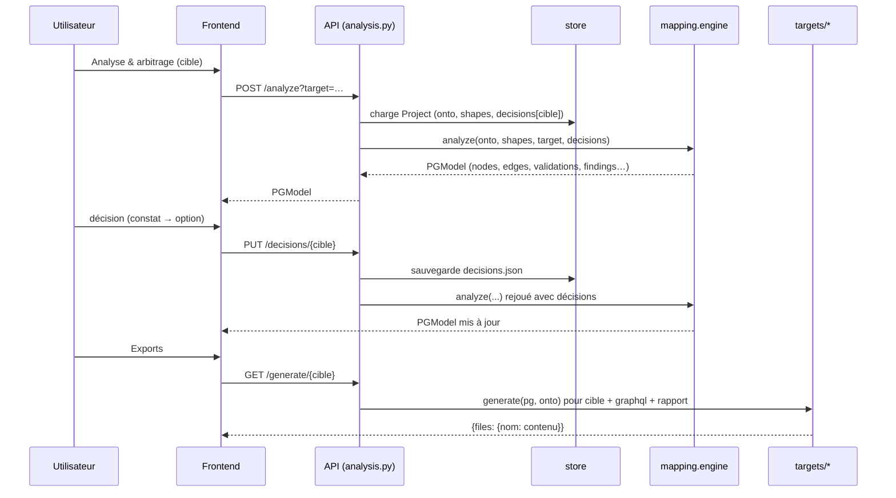
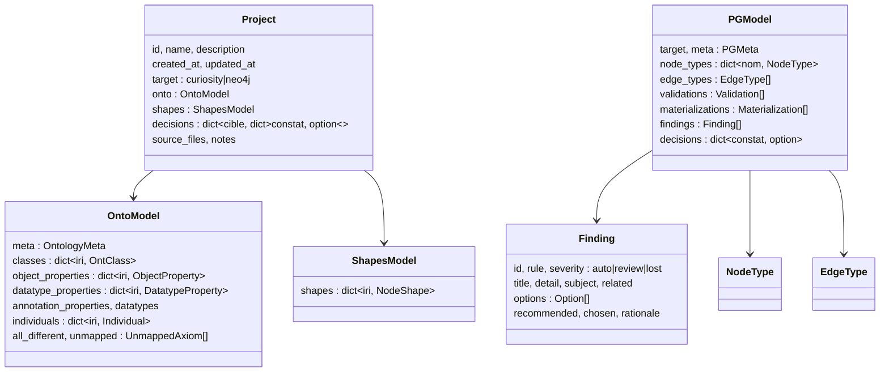

# Architecture d'OntoForge (itération 2)

Sources vérifiées : `backend/ontoforge/` (modules et signatures), `docs/CONTRACTS.md` §4-7, `backend/ontoforge/core/*.py` (contrats pydantic normatifs, D-028), `docs/CONTRACTS.md`, `docs/RULES.md`, `frontend/src/`. En cas d'écart, le code fait foi.

## 1. Vue d'ensemble

OntoForge est une application web en deux conteneurs : un **backend FastAPI** (Python, port 8000, volume `/data`) et un **frontend React + TypeScript** (Vite, servi par nginx qui proxifie `/api` vers le backend ; port publié `ONTOFORGE_PORT`, 8088 par défaut dans `docker-compose.yml`).

```mermaid
flowchart LR
  subgraph FRONT[Frontend React + TS]
    UI[Shell + kit + i18n + Krakie\nÉcrans : Tableau de bord, Éditeur graphique, Conformité,\nSHACL, Analyse, Modèle, Exports, Requêtes guidées,\nAssistant plein écran, Paramètres\nStore de proposition]
  end
  subgraph API[Backend FastAPI — ontoforge.api]
    R1[projects.py] --- R2[analysis.py] --- R3[assistant.py] --- R4[system.py]
    R5[settings.py] --- R6[editing.py] --- R7[queries.py]
  end
  UI -- "JSON /api" --> API
  R1 --> STORE[(projects/store.py\n$ONTOFORGE_DATA/projects/id/)]
  R1 --> IO[io/ : rdf_import, rdf_export, dsl]
  R1 --> CONF[conformance/ : profiles, lint, reasoner]
  R1 --> SH[shacl/ : import, export, validate, owl_to_shacl]
  R2 --> ENG[mapping/engine.py\n+ mapping/rules/* + profiles/*]
  ENG --> PG[(PGModel)]
  PG --> T1[targets/curiosity.py]
  PG --> T2[targets/neo4j.py]
  PG --> T3[targets/graphql.py]
  PG --> T4[targets/report.py]
  R2 --> Q[queries/ : translate, competency]
  R3 --> AS[assistant/ : service, analyzers, convert\n+ providers anthropic | openai_compat | ollama | mock]
  R5 --> SET[settings/ : models, crypto, store\n$ONTOFORGE_DATA/settings.json]
  R6 --> ED[editing/ : ops, history, perimeter, graph, icons]
  R7 --> QB[queries/ : builder, nl, endpoint, saved]
  AS -. fournisseur .-> SET
  QB -. endpoint actif .-> SET
```

## 2. Flux principal : de l'ontologie au code



1. **Concevoir** : `io/rdf_import.parse_ontology` (Turtle, RDF/XML, JSON-LD, N-Triples, N3, TriG) ou `io/dsl.parse_dsl` produit un `OntoModel`. Les constructs non structurés sont conservés dans `OntoModel.unmapped`.
2. **Vérifier** : `conformance/profiles.check_conformance` (profils DL/EL/QL/RL/RDFS, W01–W07) + `conformance/lint.py` (BP01–BP07, W07) ; raisonneur HermiT optionnel (`reasoner.py`, sous-processus, jamais bloquant).
3. **Contraindre** : `shacl/` importe, exporte, génère (`owl_to_shacl.generate_shapes`) et valide (`validate`, sans inférence par défaut — D-034).
4. **Analyser** : `mapping.engine.analyze` détecte les constats par règle, applique les décisions, construit le `PGModel`.
5. **Générer** : un générateur par cible, plus GraphQL et le rapport.

## 3. Modules backend

| Module | Rôle | Fonction(s) principale(s) |
|---|---|---|
| `main.py` | App FastAPI, CORS (`ONTOFORGE_CORS_ORIGINS`), gestionnaire d'erreurs 422 en français | `app` |
| `api/projects.py` | CRUD projets, import, DSL, export ontologie/shapes, conformité, SHACL | routeurs `/api/projects…` |
| `api/analysis.py` | analyse, décisions, génération (+ historique), zip, traduction ; `?perimeter=` | `/analyze`, `/decisions`, `/generate`, `/generations`, `/queries` |
| `api/assistant.py` | assistant IA : brouillon, shapes, explication, conversation, dépôt de fichier | `/api/assistant/*` |
| `api/system.py` | santé, exemples | `/api/health`, `/api/samples` |
| `api/settings.py` | paramètres, fournisseurs LLM, endpoints SPARQL (CONTRACTS §4, §6) | `/api/settings…` |
| `api/editing.py` | opérations d'édition, annuler/rétablir, graphe, périmètres, icônes (§5) | `/api/projects/{pid}/ops…`, `/graph`, `/perimeters…`, `/api/icons` |
| `api/queries.py` | requêtage guidé, exécution, requêtes sauvegardées, langage naturel (§6) | `/query/*`, `/queries/saved…` |
| `settings/` | modèles `Settings`, chiffrement Fernet + HKDF (`crypto.py`), stockage atomique (`store.py`), rotation `python -m ontoforge.settings rotate` | `load`, `save`, `rotate` |
| `editing/ops.py` | opérations atomiques validées OWL 2 (propriétés simples, cycles, disjonctions…) appliquées par lot, tout ou rien | `apply_ops` |
| `editing/history.py` | pile annuler/rétablir (200) dans `ops-history.json`, instantanés des seuls champs modifiés | — |
| `editing/perimeter.py` | restriction de l'ontologie à un périmètre ; constats P00–P03 | — |
| `editing/graph.py`, `icons.py` | nœuds/arêtes du canvas (sortie triée, déterministe) ; catalogue d'environ 80 icônes Font Awesome | — |
| `queries/builder.py` | `GuidedQuery`, `to_sparql`, `Suggester` (relations/cibles/filtres selon ontologie, héritage, inverses, shapes), `build_all` (réutilise `translate`) | — |
| `queries/nl.py` | question en langage naturel : pré-analyse déterministe + LLM facultatif + validation stricte + repli | `interpret` |
| `queries/endpoint.py` | exécution lecture seule sur l'endpoint actif (LIMIT forcé, plafond 5000, délai) | `run_select` |
| `queries/saved.py` | requêtes sauvegardées par projet (`queries.json`) | — |
| `core/` | contrats pydantic (voir §5) | `OntoModel`, `ShapesModel`, `PGModel`, `Project` |
| `io/rdf_import.py` | import RDF → `OntoModel` | `parse_ontology`, `graph_to_model` |
| `io/rdf_export.py` | `OntoModel` → RDF (round-trip) | `model_to_graph`, `serialize` |
| `io/dsl.py` | saisie rapide, une ligne = un axiome | `parse_dsl`, `DSL_HELP` |
| `conformance/` | profils OWL 2, bonnes pratiques, raisonneur | `check_conformance` |
| `shacl/` | import/export/génération/validation, traduction vers contraintes PG | `parse_shapes`, `generate_shapes`, `validate`, `shacl_to_pg.shape_constraints` |
| `mapping/engine.py` | orchestrateur de la transposition | `analyze(onto, shapes, target, decisions)` |
| `mapping/rules/` | 66 règles + S01/S02/G02 (`catalog.py` = catalogue ; `classes.py`, `keys.py`, `data.py`, `objects.py`, `reification.py`, `annotations.py`, `individuals.py`, `naming.py`, `shacl.py` = détection et construction) | `REGISTRY[règle]` (métadonnées + `detect`) |
| `mapping/profiles/` | recommandations et noms par cible (`curiosity.py`, `neo4j.py`) | registre de profils |
| `mapping/decisions.py` | validation et rejeu des décisions (individuelles et groupées `règle:*`) ; une décision dont le constat a disparu est conservée sans effet | — |
| `targets/curiosity.py` | `Schema.cs`, `Edges.cs`, `RegisterSchema.cs`, `Connector.cs`, README | `generate(pg, onto)` |
| `targets/neo4j.py` | `schema.cypher`, `ingest.cypher`, `validation.cypher`, `model.mmd`, README | `generate(pg, onto)` |
| `targets/graphql.py` | `schema.graphql` (+ README) | `generate(pg, onto)` |
| `targets/report.py` | `rapport-transposition.md` | `generate(pg, onto)` |
| `queries/translate.py` | SPARQL → Cypher / Curiosity / GraphQL | `translate(sparql, pg, onto)` |
| `queries/competency.py` | questions de compétence | `competency_questions(pg, onto)` |
| `assistant/` | brouillon depuis texte/CSV/SQL, shapes, explication ; fournisseurs LLM | `service.draft`, `propose_shapes`, `explain` |
| `projects/store.py` | stockage fichier, écritures atomiques | `list_projects`, `get`, `save`, `delete` |
| `samples.py` | exemples (`samples/automaint`, `samples/trap`) ; ignore `*-nondl.*` (D-037) | — |

### Pipeline du moteur (`mapping/engine.py`)

1. **Détection** : chaque règle `detect(ctx) -> list[Finding]` (fonction pure). Les constructs de `OntoModel.unmapped` sont relus en graphe ; chaque nœud blanc expliqué est *consommé* ; les restes deviennent G01 (aucune perte silencieuse).
2. **Décisions** : `decisions[id]` si l'option existe pour la cible ; sinon la recommandation est appliquée (et G02 signale une option invalide).
3. **Plan** : disposition des classes (propre, repliée, fusionnée, abstraite, alias, calculée, union, dé-réifiée, exclue), inverses, alias de propriétés, renommages.
4. **Construction** : types de nœuds (discriminants, labels) → propriétés → clés (propriété IRI marquée `urn:ontoforge:iri`, clé par défaut) → relations → compensations (validations, matérialisations) → SHACL → contrôle final (noms uniques, N01).
5. **Invariants** : aucune relation vers un type inexistant ; **Curiosity** : un seul label, aucune propriété d'arête, `reverse` toujours renseigné, aucun nom d'arête égal à un nom de type ; **Neo4j** : multi-labels (ancêtres), propriétés de relation. Sortie triée et déterministe.

Les shapes SHACL enrichissent le modèle (`minCount ≥ 1` → obligatoire + validation, `maxCount 1` → scalaire, `in` → énumération, `pattern`, `datatype`, `class`, `lessThan`, `closed`…) ; un conflit avec OWL devient S01, une propriété de shape non déclarée S02.

## 4. Frontend

`frontend/src/` (React + TypeScript, Vite) :

| Dossier / fichier | Rôle |
|---|---|
| `design/tokens.css` | design system « Abysse » : variables clair / sombre (`data-theme`), IBM Plex Sans / Mono ; les anciens noms de variables restent des alias |
| `kit/index.tsx` + `shell/kit.css` | composants : Icon, Button, Field, Segmented, Tabs, Panel, SeverityBadge, Card, Toolbar, EmptyState, toasts, Krakie. Les écrans n'utilisent que le kit et les variables (aucune couleur en dur) |
| `shell/` | `Shell.tsx` (barre latérale par projet, en-tête cible / périmètre / endpoint / thème, routage par hash `#/projet/<id>/<écran>` et `#/parametres`), `registry.tsx` (**registre des écrans** : `key, labelKey, icon, step, render, editing?, fullBleed?, badge?`), `theme.ts`, `types.ts` (`ScreenProps`) |
| `i18n/{fr,en}.json`, `index.tsx` | textes fr/en (`useT`, `useI18n`) ; langue lue dans `GET /api/settings` ; aucun texte en dur |
| `krakie/Krakie.tsx` | mascotte : 9 poses affichées (accueil, réfléchit, lit, loupe, graphe, contente, inquiète, forge, trophée ; la pose « bolide » reste dans les sources de `design/krakie/` mais n'est plus utilisée), `<KrakieStatus>` (forge pendant un traitement, trophée environ 2 s à la fin) et toasts avec trophée, SVG animés par frames dans `public/krakie/anim/` (`manifest.json`), repli sur l'ébauche 20 px ; animation en pause hors écran et statique avec `prefers-reduced-motion` |
| `lib/proposal.ts` | **store de proposition** (voir §7) |
| `screens/Dashboard.tsx` | tableau de bord (prochaine action de Krakie, étapes, constats par cible, générations, périmètres) |
| `screens/editor/` | éditeur graphique : `Editor.tsx` (canvas `@xyflow/react`, gestes), `Inspector`, `Tree`, `QuickInput`, `IconPicker`, `layout.ts` (dagre) |
| `screens/assistant/` | assistant plein écran (conversation, dépôt, mini-graphe de proposition) |
| `screens/queries/` | `Builder`, `NlBox`, `Results`, `CodePanel`, `Library` |
| `screens/settings/` | onglets LLM / langues / défauts / endpoints ; `activeEndpoint.ts` (événement `ontoforge:endpoint-changed`) |
| `screens/*.tsx` | écrans de l'itération 1 rebranchés (Ontology = « Vue liste », Conformance, Shacl, Analysis, Model, Exports) ; `Shacl` / « Shapes » : `ComingSoon` |
| `api.ts`, `settingsApi.ts`, `aapi.ts` | clients typés de l'API |

Bibliothèques : Cytoscape (diagramme du modèle, graphe de résultats), `@xyflow/react` 12.8.4 et `@dagrejs/dagre` 1.1.5 (éditeur), CodeMirror (code et saisie rapide), Font Awesome 7.3.1 (solid). Le front ne recalcule pas la sémantique : il affiche les réponses de l'API. **Évènements `window`** entre le shell et les écrans : `of:perimeter`, `of:perimeters`, `ontoforge:endpoint-changed`, `ontoforge:project`. Il n'existe pas de test automatisé du front ni de `frontend/scripts/smoke.mjs` (Q-DOC-06) : la vérification des écrans a été faite manuellement (Playwright), captures dans `journal/L*/screens/`.

**Brancher un écran** : composant recevant `ScreenProps` (`{p, setP, target, setTarget}`) → entrée dans `registry.tsx` → libellés dans `fr.json` et `en.json` (contrat : `journal/L11/rapport.md`).

## 5. Contrats pydantic (`backend/ontoforge/core/`)

Toute modification d'un contrat passe par une décision tracée dans `journal/decisions.md`.



### `OntoModel` (`core/onto_model.py`)

IRIs absolues partout (la compaction en CURIE est faite par l'export et le front). Entités : `OntClass` (`sub_class_of`, `restrictions`, `super_expressions`, `equivalent_to`, `disjoint_with`, `disjoint_union_of`, `has_keys`, `one_of`), `ObjectProperty` (`domain`, `range`, `domain_union`, `range_union`, `inverse_of`, `sub_property_of`, `chains`, `characteristics`…), `DatatypeProperty` (`domain`, `range`, `range_expr: DataRange`, `functional`…), `DatatypeDef`, `Individual` (`types`, `facts`, `same_as`, `different_from`). `ClassExpr` couvre `named`, `and`, `or`, `not`, `oneOf`, `some`, `only`, `min`, `max`, `exactly`, `value`, `self`. Plusieurs `domain` / `range` d'une même propriété sont une **intersection** ; une union est portée par `domain_union` / `range_union`.

### `ShapesModel` (`core/shapes_model.py`)

`NodeShape` (cibles `Targets`, contraintes `Constraints`, `PropertyShape` avec `Path`, `QualifiedShape`) ; contraintes SHACL Core usuelles (cardinalités, `datatype`, `class`, `node_kind`, `node`, `in`, `has_value`, `pattern`, longueurs, bornes, `language_in`, `and`/`or`/`xone`/`not`, SHACL-SPARQL brut). `ShapesModel` porte `shapes`, `property_shapes`, `prefixes`, `warnings`.

### `PGModel` (`core/pg_model.py`)

- `PGType` : `String, Integer, Float, Decimal, Boolean, Date, DateTime, LocalDateTime, Time, Duration`. `Decimal` a été ajouté en L13 (test `tests/test_decimal.py`) : Curiosity le conserve (`decimal`), Neo4j le replie en `Float` avec constat D05.
- `NodeType` : `name`, `labels` (le premier est principal ; un seul en Curiosity), `source` (classes OWL), `key`, `properties: PGProperty[]`, `abstract`, `discriminator`, `discriminator_values`.
- `PGProperty` : `name`, `type`, `is_list`, `required`, `unique`, `indexed`, `source`, `enum`, `pattern`, `lang`, `note`…
- `EdgeType` : `name`, `from`, `to`, `reverse` (toujours renseigné en Curiosity), `properties` (toujours vide en Curiosity), `cardinality {out, in}`, `symmetric`, `derived`.
- `Validation` : `kind`, `node_type`, `edge_type`, `property`, `params`, `description`, `source`, `severity`.
- `Materialization` : `kind`, `chain` (**noms d'`EdgeType`**, jamais des IRIs), `source`, `description`.
- `Finding` : `id` = `<règle>:<IRI sujet>[:<suffixe>]` (D-035), `options: Option[]` (`id`, `label`, `impact`, `recommended_for`), `recommended`, `chosen`.

Conventions (D-L4-02) : la propriété qui porte l'IRI d'origine est marquée `source = "urn:ontoforge:iri"` (son nom dépend de la cible : `uri` en Neo4j, `Uri` en Curiosity) ; les générateurs la retrouvent par ce marqueur ; un type sans clé utilise cette propriété comme clé de repli ; ils n'émettent jamais de motif de correspondance vide.

### Fonctions de service (extrait de `docs/CONTRACTS.md`)

| Module | Signature |
|---|---|
| `io/rdf_import` | `parse_ontology(data, format=None, filename=None) -> (OntoModel, warnings)` |
| `io/rdf_export` | `model_to_graph(m)`, `serialize(m, format="turtle")` |
| `io/dsl` | `parse_dsl(text, base=None) -> (OntoModel, [{line, message}])` |
| `conformance/profiles` | `check_conformance(onto, graph=None) -> ConformanceReport` |
| `shacl/validate` | `validate(data, shapes, onto=None, data_format=None, inference="none") -> ShaclReport` |
| `shacl/owl_to_shacl` | `generate_shapes(onto) -> (ShapesModel, notes)` |
| `mapping/engine` | `analyze(onto, shapes, target, decisions=None) -> PGModel` |
| `targets/*` | `generate(pg, onto=None) -> dict[nom de fichier, contenu]` |
| `queries/translate` | `translate(sparql, pg, onto=None) -> TranslationResult` |

### Extensions de `Project` (itération 2, rétrocompatibles)

`view {icons, positions, collapsed}`, `perimeters`, `active_perimeter` (état d'interface : jamais appliqué implicitement par le backend), `generations` (50 entrées max, historique des `GET /generate/{cible}` ; n'avance pas `updated_at`). Les générateurs ne dépendent pas de `view`. D-L9-02 a accepté `NodeType.icon` et une sévérité `info` pour P00–P03, **non implémentés dans `core/pg_model.py`** à ce jour : P00–P03 sont émis en `auto` (ils gonflent donc le compteur « auto »).

## 6. Stockage

`$ONTOFORGE_DATA/projects/<id>/` (défaut `./data` ; `/data` dans Docker, volume `ontoforge-data`) :

| Fichier | Contenu |
|---|---|
| `project.json` | `Project` pydantic — **source de vérité** |
| `decisions.json` | copie lisible des arbitrages |
| `onto.ttl`, `shapes.ttl` | réécrits à chaque sauvegarde (lecture humaine / outils externes) |
| `ops-history.json` | pile annuler/rétablir de l'éditeur (200 entrées) |
| `queries.json` | requêtes sauvegardées du projet |

Hors projets, à la racine de `$ONTOFORGE_DATA` : `settings.json` (écriture atomique, permissions 600 ; secrets sous la forme `enc:v1:<jeton>`) et `.secret` (clé maître générée si `ONTOFORGE_SECRET_KEY` est absente).

Écritures atomiques (fichier temporaire + `os.replace`). Identifiants : `^[a-z0-9][a-z0-9-]{0,80}$`, construits depuis le nom + suffixe aléatoire (ex. `demo-05fbe6`).

## 7. Assistant, paramètres, proposition

**Paramètres et chiffrement** (`settings/`). `Settings` = fournisseurs LLM (`anthropic | openai_compat | ollama | mock`), `default_provider_id`, langues, défauts (IRI de base, préfixes, cible, nommage), endpoints SPARQL. Chiffrement Fernet, clé dérivée par HKDF-SHA256 de `ONTOFORGE_SECRET_KEY`. Les secrets ne sortent jamais : la vue publique expose `has_key`, `key_last4` (si la clé fait au moins 12 caractères), `key_unreadable`. Au premier démarrage, `settings.json` est déduit de l'environnement (`ONTOFORGE_LLM_PROVIDER`, `ANTHROPIC_API_KEY`…) ; tant qu'il n'existe pas, l'assistant garde le pilotage historique par variables. Le premier `GET /api/settings` crée le fichier : le front l'appelle au démarrage. Rotation : arrêter le backend, `ONTOFORGE_SECRET_KEY_OLD=… ONTOFORGE_SECRET_KEY=… python -m ontoforge.settings rotate`. Les tests de connexion appellent l'URL configurée par l'administrateur sans filtrage SSRF (outil mono-utilisateur, D-L8-01).

**Assistant** (`assistant/service.py` : `status`, `draft`, `propose_shapes`, `explain`, `chat`). Le fournisseur vient de `get_provider(provider_id=None)` (défaut des paramètres). `analyzers.py` pré-analyse CSV / SQL ; `convert.py` valide et nettoie le JSON du LLM en `OntoModel`. `chat(project, messages, provider_id, attachments)` renvoie `{reply, proposal, warnings}` ; `proposal` est un `OntoModel`. Sans LLM, `draft` retombe sur un squelette déterministe et `explain` sur un texte construit. Erreurs : 422, 413 (texte ou fichier trop long), 503 (fournisseur non configuré), 502 (JSON invalide après une relance), 404 (fournisseur inconnu). Les tests n'ont jamais d'accès réseau (D-021).

**Store de proposition** (`frontend/src/lib/proposal.ts`). État partagé entre l'assistant et l'éditeur, persisté dans `localStorage` (`ontoforge.proposal`). `buildItems(courant, proposition, langue)` calcule des éléments `{id, kind: add|modify, entity_iri, label, ops, type, needs…}` ; `acceptItem` envoie les `ops` à `POST /ops` (tout ou rien) après avoir accepté les éléments dont il dépend (`needs`), retire les éléments traités et rafraîchit le projet (`bindProjectSetter`, événement `ontoforge:project`) ; `rejectItem`, `acceptAll`, `rejectAll`, `clear`, `useProposal()`. L'éditeur surligne les éléments par `entity_iri` ou `source`/`target`.

**Éditeur** (`editing/`). Les gestes du front sont des **opérations** (`add_class`, `rename_entity`, `set_restriction`, `move_node`…, liste dans CONTRACTS §5) envoyées à `POST /ops` ; le backend les valide toutes puis les applique ou n'en applique aucune (HTTP 200 avec `ok=false` et `errors` par index). `history.py` enregistre l'état avant des seuls champs modifiés. `perimeter.py` filtre l'ontologie avant analyse / génération.

**Requêtage** (`queries/`). `GuidedQuery` (racine, étapes, filtres, colonnes, tri, limite) → `to_sparql` → `build_all` (réutilise `translate` pour Cypher / Curiosity / GraphQL). `Suggester` propose relations et cibles depuis l'ontologie (domaine/portée effectifs, héritage, inverses, unions, `sh:class`). `nl.interpret` : (1) pré-analyse déterministe ; (2) si le fournisseur est réel, prompt `[TASK:nl]` avec un schéma compact, sortie JSON `GuidedQuery` ; (3) `sanitize` retire tout élément inconnu (termes écartés dans `unmatched`) ; (4) repli déterministe (plus courts chemins, 4 sauts max). `endpoint.run_select` : lecture seule vérifiée par le parseur SPARQL (UPDATE → 403), LIMIT de niveau supérieur plafonné à `limit`+1, plafond dur 5000, délai de l'endpoint (504), erreurs réseau → 502 sans secret.

## 8. Tests et qualité

`cd backend && pytest -q` : 528 tests verts d'après la revue L15 du 4 novembre 2026 (non rejoués au moment de cette mise à jour : `httpx` absent de l'environnement du documentaliste). Les générateurs sont vérifiés par déterminisme, invariants, formes autorisées et, pour le C#, tree-sitter (D-038 : pas de fichiers « golden »). L'oracle `samples/trap/expected-findings.yaml` (66 règles, 6 `must_not`) est rejoué par `tests/test_mapping_oracle.py`. Aucun test n'exécute Docker, un SDK .NET ni une base Neo4j.
