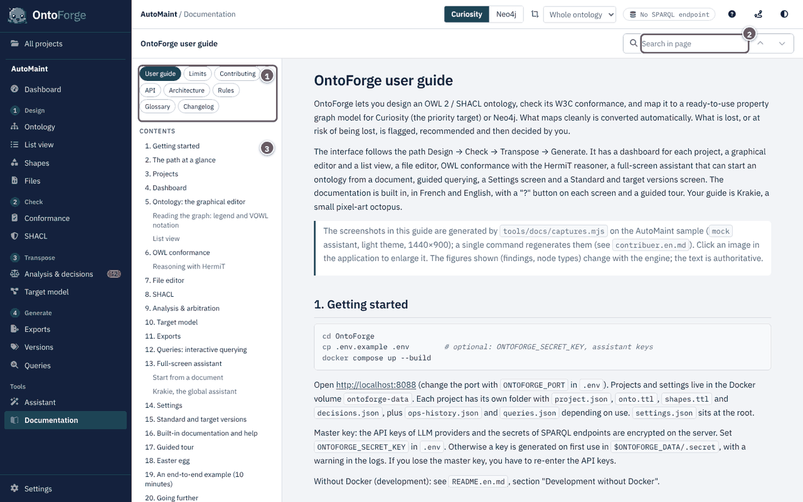

# Contributing: how the agent team works {#contribuer-comment-l-equipe-d-agents-travaille}

OntoForge is built by a team of Claude agents who validate each other's work, under Jerem's direction (he validates only the demos, D-009). This guide describes how the team works, so that a new agent or a human can pick up the work without history. Sources: `docs/TEAM.md` (normative protocol), `docs/PLAN.md`, `docs/PLAN-IT2.md`, `lots/`, `journal/decisions.md`, `skills/ontoforge-delivery/SKILL.md`.

## 1. Roles {#les-roles}

| id | Agent | Sheet | Skill maintained |
|---|---|---|---|
| `chef` | Project lead: work package contracts, MoSCoW backlog, decisions, acceptance; never codes | `.claude/agents/chef-de-projet.md` | `skills/ontoforge-delivery` |
| `lead` | Lead developer: orchestration, mapping engine, front end, AI assistant, storage, API | - | `skills/owl-to-property-graph`, `skills/ontology-rapid-design` |
| `w3c` | W3C expert: RDF import/export, OWL 2 conformance, oracle, semantic reviews | `.claude/agents/expert-w3c.md` | `skills/w3c-ontology-conformance` |
| `shacl` | SHACL expert: import/export, generation, validation, translation to PG constraints | `.claude/agents/expert-shacl.md` | `skills/shacl-modeling` |
| `query` | Query expert: SPARQL and GraphQL translation, competency questions | `.claude/agents/expert-requetage.md` | `skills/graph-query-translation` |
| `curiosity` | Curiosity expert: profile and C# generator | `.claude/agents/expert-curiosity.md` | `skills/curiosity-schema-design` |
| `neo4j` | Neo4j expert: profile and Cypher generator | `.claude/agents/expert-neo4j.md` | `skills/neo4j-schema-design` |
| `doc` | Documentation writer (iteration 2): the whole guide; no work package closes without their pass | `.claude/agents/documentaliste.md` | `skills/technical-documentation` |
| `scout` | Product scout (iteration 2): idea notebook, prioritised; does not code | `.claude/agents/eclaireur-produit.md` | `skills/product-discovery` |

Models: Sonnet by default, Opus for design and semantic reviews, Haiku to run the acceptance tests. At most four agents in parallel (`docs/PLAN-IT2.md`).

## 2. The life cycle of a work package {#le-cycle-d-un-lot}

A work package (`lots/Lx.md`) is the unit of work. Its cycle (`docs/TEAM.md`):

1. Contract (lead): goal, deliverables, files owned per agent, executable acceptance criteria (command + expected result), reviewers.
2. Production (pilot): code, tests, update of their skill. The pilot touches only the files the contract assigns.
3. Self-check: `cd backend && pytest -q` (or the contract's command) is green, and the front-end build is green.
4. Cross review: each reviewer writes `journal/Lx/review-<relecteur>-it<N>.md`:
   ```
   verdict: OK | KO
   bloquants:
     - [fichier:ligne] constat → correction attendue
   non-bloquants:
     - ...
   skill: <remarque à intégrer dans un skill, ou "rien">
   ```
5. Fix: the pilot answers each blocker in `journal/Lx/fix-it<N>.md` (what was done, or why it was refused), reruns the tests and asks for another review (iteration N+1).
6. Escalation: after 3 iterations without an OK, the lead decides (`journal/decisions.md`). A business question goes to `journal/questions-jerem.md`, and the team goes on with the most reasonable assumption, noted down.
7. Closure: green tests + all verdicts OK + skills up to date + `journal/Lx/cloture.md` (lead) + `journal/Lx/doc-ok.md` (documentation writer) since iteration 2.

A real example: the W3C review of L4 (`journal/L4/review-w3c-it1.md`, KO) forced a fix in the translator (missing class = empty pattern + loss). The iteration 2 review (KO) found the same defect for properties, which was fixed afterwards.

## 3. Ground rules {#regles-du-jeu}

- One file = one owner per work package. You do not edit another agent's file: you ask for the change in the review or through the lead. Cross-cutting files with a permanent owner: `backend/pyproject.toml`, `Dockerfile`, `docker-compose.yml`, `main.py`, `tests/conftest.py`, `frontend/**` → lead (D-015).
- Interface contracts are normative: `backend/ontoforge/core/*.py` and `docs/CONTRACTS.md` (D-028) change only through a decision recorded in `journal/decisions.md`. A change request goes in `journal/Lx/demandes-contrat.md`.
- Decisions are numbered and never rewritten: `D-NNN | date | décideur | décision | justification`. A new decision replaces an old one ("remplace D-xxx").
- Nothing invented: an external API you are not sure about (Curiosity.Library, Neo4j, pySHACL...) is marked `À VÉRIFIER` in the code and listed in the work package report.
- No silent loss: whatever is not transposed produces a visible signal (finding, G01, report note).
- An oracle written by another agent: the W3C expert wrote `samples/trap/` + `expected-findings.yaml` in parallel with the engine, and the engine tests replay it.
- No real data in the repository, only generic examples (domain: car maintenance, namespace `am:` = `https://w3id.org/ontoforge/automaint#`).
- Languages: French for documentation and messages, English for code.
- Cutting order if the deadline looms (D-018): HermiT/owlready2 → Curiosity query translation → GraphQL → Neo4j ingestion/validations → LLM providers other than Anthropic → Neo4j DDL. Never cut: import, basic conformance, SHACL validation, Curiosity analysis and generation, arbitration, export.
- Usage limit: at the first refusal (429), restart nothing. The resumption is scheduled for the reset time (`journal/reprise.md`).

## 4. Questions to the experts (documentation writer) {#questions-aux-experts-documentaliste}

When the code does not explain a decision or a limit, the documentation writer never guesses. They write the question in `journal/doc/questions.md` (question, recipient among `w3c`, `shacl`, `query`, `curiosity`, `neo4j`, `lead`, `chef`, context). The lead relays it and notes the answer. Until then, the guide carries the mention `À CONFIRMER`.

## 5. Agents room (live tracking) {#salle-des-agents-suivi-en-direct}

Database of the artifact `https://claude.ai/artifact/UoUzdNu1a6md7T9GN6qmKq`, collection `events`. Each agent publishes with the `ArtifactData` tool (load it through `ToolSearch`: `select:ArtifactData`):

```
action: "set", url: <URL>, collection: "events", doc_id: "e<YYYYMMDDHHMMSS>-<agent>",
data: { ts: "<ISO 8601 UTC>", agent: "<id>", type: "<start|progress|message|review_ok|review_ko|fix|decision|done|blocked|question>",
        status: "<working|reviewing|fixing|waiting|blocked|done|idle>", lot: "Lx", to: "<id destinataire, optionnel>",
        task: "<ce sur quoi je travaille, 1 ligne>", text: "<message lisible par Jerem, 1-3 phrases>" }
```

At a minimum: at start, at each review verdict (with `to` = pilot), at each fix (with `to` = reviewer), and at the end. No more than one event every few minutes. If the tool is unavailable, append the same JSON line to `journal/events.jsonl` (the lead will republish it).

## 6. Skills {#skills}

A skill (`skills/<name>/SKILL.md`, frontmatter `name` / `description`) is a reusable method that its agent maintains at each work package. It keeps what the project has learned, as far as possible outside the OntoForge context. Reviewers report their remarks there (the `skill:` line of the review). Current state: 9 skills (OWL → LPG transposition, SHACL, W3C conformance, Curiosity, Neo4j, queries, rapid ontology design, steering an agent team, product discovery), plus `technical-documentation` (documenting software built by an agent team).

## 7. Working on the code {#travailler-sur-le-code}

```bash
cd backend && python -m venv .venv && . .venv/bin/activate && pip install -e ".[dev]"
ONTOFORGE_LLM_PROVIDER=mock uvicorn ontoforge.main:app --port 8000   # API on :8000, /docs
pytest -q                                                             # 462 tests (3 Nov 2026)
cd ../frontend && npm install && npm run dev                          # http://localhost:5173, proxy /api → :8000
npm run build                                                         # must stay green
```

Test conventions: `backend/tests/test_<module>.py`, fixtures in `samples/`, no network access (`mock` provider). Generators are tested for determinism, invariants and allowed forms, not with golden files (D-038). To add or change a transposition rule, edit `mapping/rules/catalog.py` (single source), then the detection in the matching family module, then the oracle if the expected behaviour changes, then regenerate `docs/RULES.md`. The documentation writer updates [`regles.en.md`](regles.en.md).

## 8. Documentation: the definition of "done" {#documentation-definition-de-termine}

Since iteration 2, a work package is closed only if the documentation reflects it: `journal/<lot>/doc-ok.md`, written by the documentation writer after checking against the code or a test (each statement cites its source). The guide lives in `docs/guide/`: [`utilisateur.en.md`](utilisateur.en.md), [`architecture.en.md`](architecture.en.md), [`api.en.md`](api.en.md), [`regles.en.md`](regles.en.md), [`glossaire.en.md`](glossaire.en.md), [`limites.en.md`](limites.en.md), [`CHANGELOG.en.md`](CHANGELOG.en.md) and this file. `api.en.md` is generated from the FastAPI application (`app.openapi()`) and completed with real examples.

Each heading of a translated file ends with an explicit `{#id}`. A page's `<name>.md` and `<name>.en.md` files use the same ids, because the "?" button, Krakie and `help_map.json` point to `page#id`. Translate the heading text, never the id. `backend/tests/test_help_map.py` fails if the French and English anchors differ. `tools/doc_ids.py` adds the ids to a French file that has none.

**Screenshots.** The guide's images live in `docs/guide/img/fr/` and `docs/guide/img/en/` (one per screen and per language, same names). They are never touched up by hand: `node tools/docs/captures.mjs` regenerates all of them, after `cd frontend && npm run build` (see `journal/L34/rapport-captures.md`). A work package that changes a screen described in the guide reruns the command, looks at a few screenshots in both languages and commits the images with the text. They are embedded in the application: separate files loaded on demand, one click enlarges them.



## 9. Versioning, publishing and CI (`git` agent) {#versionnage-publication-et-ci-agent-git}

Two repositories coexist: the working repository (`/home/claude/OntoForge`, heavy local history, never pushed as is) and the publication clone (`/home/claude/ontoforge-pub`, branch `main` of `https://github.com/XapedemakX/ontoforge`). Only the second receives a `push`, and only when the lead asks (tests green, reviews OK, `doc-ok.md`, humanizer pass; see `docs/TEAM.md`).

### Branches and commits {#branches-et-commits}

- One work package = one branch `lot/Lxx-subject` (for example `lot/L22-editeur-de-fichiers`), merged into `main` after review. Agents touch only their own files (one file = one owner), so commit with a targeted `git add`, never `git add -A` in the working repository.
- Messages in French, with a title line that starts with the work package ("L22 : …"), ending with the `Co-Authored-By` and `Claude-Session` trailers requested by the session.

### Publishing with `tools/git/publish.sh` {#publication-avec-tools-git-publish-sh}

```bash
tools/git/publish.sh "Work package L22: file editor"          # local commit in the clone, no push
tools/git/publish.sh "Work package L22: file editor" --push   # same, then git push origin main
```

The script:

1. exports the committed state of the working repository (`git archive HEAD`, so uncommitted changes do not go out);
2. excludes `ref/`, `journal/L18/video/` and every `*.whl`;
3. looks for secrets in what is about to go out: patterns `sk-ant-`, `AIza`, `AQ.Ab`, `ghp_`, `nvapi-`, `-----BEGIN`, `.env` files (the `.env.example` template is allowed) and a `settings.json` containing `api_key`. It stops without committing if it finds a key that is not a known test example (the `KNOWN_EXAMPLES` list in the script);
4. replaces the clone's content (except `.git`) and commits;
5. pushes only if `--push` is passed.

To undo a trial commit: `git -C /home/claude/ontoforge-pub reset --hard HEAD~1` (in the publication clone only). Optional variables: `ONTOFORGE_SRC`, `ONTOFORGE_PUB`, `PUBLISH_BRANCH`.

### Version tags {#tags-de-version}

One `vX.Y.Z` tag per delivery, set on the publication clone after the push (`git tag -a v0.2.0 -m "Itération 2"` then `git push origin v0.2.0`). Release notes come from [`CHANGELOG.en.md`](CHANGELOG.en.md): add the version's entry before tagging, and keep the version in `backend/pyproject.toml` aligned.

### Continuous integration {#integration-continue}

The workflow `.github/workflows/ci.yml` needs no secret:

| Job | Trigger | Content |
|---|---|---|
| `backend` | push to `main`, pull request | Python 3.12, `pip install -e "backend[dev]"`, `pytest -q` (`mock` provider, no network) |
| `frontend` | same | Node 22, `npm ci`, `npm run build` (`frontend/package-lock.json` is required) |
| `recettes` | manual run (`workflow_dispatch`, "recettes" checkbox) | Playwright and Chromium installed in CI, `tools/recette/e2e_ui.mjs` and `e2e_api.py` |

Actions are pinned by commit SHA (version in a comment), with pip and npm caches enabled. Neo4j and Curiosity are not tested in CI: Jerem validates the generated files by hand (D-L21-03).

### Dependencies {#dependances}

Dependabot (`.github/dependabot.yml`) flags updates, ignores major versions and limits open requests. Nothing is merged without Jerem's agreement, security updates included (D-L21-02).
