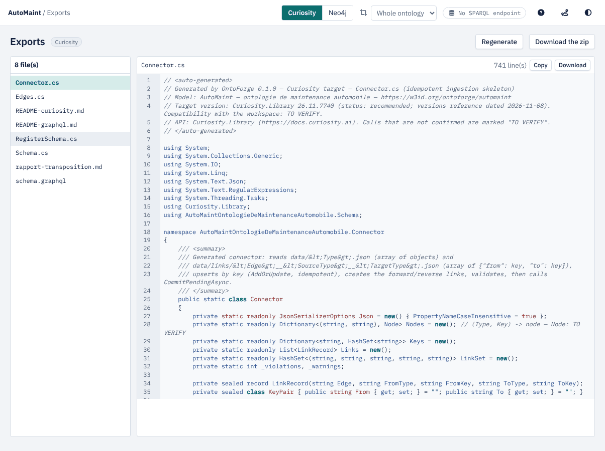
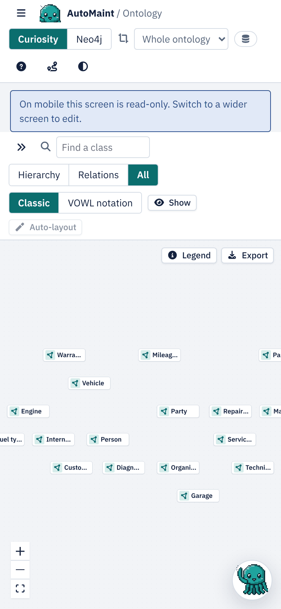

# FAQ: known limits {#faq-des-limites-connues-iteration-2}

Each answer cites its source (work package report, review, decision or code). Anything the code does not settle is an open question in `journal/doc/questions.md` (identifiers `Q-DOC-nn`). State as of work package L34 (11 November 2026). Backend tests rerun on that date: 990 green.

## Generated code: what is verified? {#code-genere-qu-est-ce-qui-est-verifie}

**Does the Curiosity C# code compile?**
Not verified. There is no .NET SDK in the build environment. The C# syntax is checked by tree-sitter (D-038), not by a compiler. Calls to `Curiosity.Library` that are not confirmed carry the `À VÉRIFIER` mark in the code: the return value of `AddOrUpdate`, `Link(a, b, X, X)` for a symmetric edge, `SetAutoCommitCost`, the `Node` type, `T[]` arrays and indexing. The script `tools/dotnet/check-curiosity.ps1` (a temporary net8.0 project plus `dotnet build`) lets you check this yourself. It has not been run (no SDK, no Windows), and the exact name of the NuGet package is still to be confirmed (`journal/L13/rapport.md`). See Q-DOC-01.

**Has the Neo4j Cypher been executed?**
No, not on any real database (question Q-02 in `journal/questions-jerem.md`). The forms are those of Neo4j 5. Points to check: relationship uniqueness in Community (assumed 5.7+), `CALL (row) { … } IN TRANSACTIONS` (variable scope, 5.23+), and the names of n10s and APOC procedures and options (`apoc.refactor.mergeNodes`) (`journal/L4/rapport-neo4j.md`). See Q-DOC-02.

**Why are some Cypher constraints commented out?**
`NODE KEY`, `IS NOT NULL` and property type constraints are Enterprise-only. They are kept apart in `schema.cypher` (Enterprise section, Neo4j 5.11+; Community 5.7+). In Community, uniqueness (`IS UNIQUE`) is offered instead. Version thresholds used in `mapping/profiles/neo4j.py`: property type constraints 5.9+ (lists 5.10+, unions 5.11+), `RELATIONSHIP KEY` 5.7+. None has been tested on an instance.

**Is the GraphQL schema usable as is?**
For Neo4j, it relies on the directives of the Neo4j GraphQL Library (`@relationship(type:, direction:)`, `@node(labels:)` from v4, `direction: NONE` for symmetric relationships). The result is `À VÉRIFIER` for your version (5.x / 6.x). For Curiosity, no native GraphQL is known. The schema serves as a read contract, and resolvers would rely on the Query API (`À VÉRIFIER`). See Q-DOC-03.

**What about the Curiosity queries produced by the translator?**
They are Query API pseudo-C# (`StartAt`, `Where`, `n.UID` accessors...), entirely marked `À VÉRIFIER`, with no verification in a real environment (`journal/L4/rapport-requetes.md`).

## Transposition {#transposition}

**Why so many findings "to decide"?**
On the trap ontology, the engine originally produced about 130 `review` findings (one I01 per individual, one K03 per root type). The noise has been reduced since: D13 `max 1` alone, K03 with an IRI key and C07 guaranteed by construction in Curiosity are now `auto`. Findings are grouped by rule in the interface, and a grouped decision `"<règle>:*"` applies to a whole rule (`journal/L3/rapport-moteur.md`, `docs/RULES.md` `Itération 2`).

**Is the exact decimal supported?**
Yes in Curiosity, no in Neo4j (resolved in L13, D-L13-01, `tests/test_decimal.py`). `PGType` contains `Decimal`. Curiosity keeps `xsd:decimal` as a C# `decimal` with no D05 finding (28-29 significant digits; beyond that it is theoretically lossy, W3C review L13; the note was not added to the profiles). Neo4j has no exact decimal and falls back to `Float` with a D05 finding (option `string_lexical` to stay exact, or integers in cents). One point remains: the C# queries read a Decimal with `GetDouble` (no `GetDecimal` API is confirmed, `À VÉRIFIER`), which loses precision. `docs/RULES.md` (D05) and the `catalog.py` catalogue still describe "decimal → float" (Q-DOC-04).

**Is an inverse relationship name always faithful to the ontology?**
Yes since the L13 fix (resolved). `mapping/reverse_names.py` derives the Curiosity return names (`CoveredBy`, `HasVehicle`, `HasPartTransitive`...). Then `uniquify_reverses(..., reserved=...)` excludes any name equal (case-insensitively) to the local name of an OWL property or of an explicit edge name, and falls back to `<Edge>Of<Source>` (for example `PerformedAtOfRepairOrder`). Tests on automaint and trap cover this (`tests/test_reverse_names.py`). Limit: some names remain unhelpful, for example `HasParty` for the return of `WorksAt` after the fallback (Curiosity review L15, non-blocking). There is no `…Inverse` suffix any more.

**Why did `I01` and `C08` change?**
Resolved in L13: I01 is no longer emitted for a member of `owl:oneOf` (carried by C08), and C08 `reference_nodes` creates the reference nodes itself. I01 is still emitted for the members of a lone `AllDifferent`.

**How is inheritance under an abstract class transposed?**
D-L15-01: under a merged abstract class (C04 `merge_into_leaves`), the ancestor's properties and relations are copied into each concrete leaf. Technician, Garage, Customer and Brand remain distinct types with `DisplayName`. The fallback with a discriminator (`PartyKind`, `VehicleKind`) applies only under a concrete root. `Party` stays a concrete type on automaint. Projects analysed before this fix keep the old model, so rerun the analysis. The query translator keeps the discriminator filter.

**Are defined classes, general axioms and property chains transposed?**
No, they cannot be. They are inference rules with no equivalent in a property graph (rules C06, C09, C11, C13, O08...). Depending on your decision, each becomes a boolean computed at ingestion, a classification or path query, a materialisation, or a simple line in the report (`doc_only`). See [`regles.en.md`](regles.en.md).

**Can the tool make a `lost` finding lossless?**
No. `lost` means no option is lossless for the data. Only compensation (validation, materialisation, query) limits the damage, and the transposition report says which one applies.

**What does the tool do about the open world?**
Transposing an axiom into a constraint is a tightening: OWL infers, the property graph constrains. For example, `owl:hasKey` imposes neither existence nor uniqueness, whereas a Curiosity key must be non-empty and a `NODE KEY` imposes both. `some` does not oblige you to know the value. The report recalls this change of assumption once.

**Are the options marked "minimal" complete?**
With reservations (engine report L3, state before L13): O05 `edge_pair` on the Neo4j side does not add the return edge. O12 `materialize_at_ingest` produces only one materialisation. C08 `reference_nodes` now creates the reference nodes itself (L13). I01 is no longer emitted for the members of an `owl:oneOf`.

**Is `owl:imports` resolved?**
No, the tool is offline. Imported terms are referenced by IRI and flagged (M02, BP05). The *trap* example is DL conformant "subject to closing the PROV-O import".

## OWL and SHACL conformance {#conformite-owl-et-shacl}

**Is conformance to the EL / QL / RL profiles reliable?**
It rests on the datatype and construct lists of the *OWL 2 Profiles*, copied from memory and still to be reread (`journal/L2/rapport-conformite.md`). W06 (RL) is a heuristic (disjunction, complement, `Nothing`) with no propagation through restrictions. The W3C review confirmed the classification of `DisjointUnion` outside EL/QL/RL. See Q-DOC-05.

**And the HermiT reasoner?**
Since L32 it has its own button (Conformance screen) and its route `POST /api/projects/{id}/reason`: consistency, unsatisfiable classes, inferred subclasses and equivalences, reclassified individuals. It runs in a Java subprocess (30 s, 1 GB) provided by `owlready2` (HermiT 1.3.8).

Limits: no justification of an inconsistency (the command line gives none, so OntoForge only proposes candidates), open world, guarantees only for OWL 2 DL. `owl:imports` are not followed (reasoning on the project content only), and no equivalence can be added from the graphical editor.

The images (`backend/Dockerfile`, and `deploy/cloudrun/Dockerfile` by default) include Java. Without Java or `owlready2`, the route answers 501. Tests that launch Java are skipped when Java is missing. Running them in the Docker image has not been verified here (Docker unavailable).

**Does SHACL validation use inference?**
Not by default (D-034). Without inference, the 8 violations of `trap-data.ttl` and the 4 of `automaint-data.ttl` are guaranteed. For a project, only the ontology's TBox is given to pySHACL, not its individuals (D-L14-01). With RDFS, `sh:closed` sees the superproperties. An inference option exists on the service side (`inference="rdfs"`), but the HTTP API does not expose it (no `inference` parameter in `api/analysis.py`).

**Are the generated shapes equivalent to the ontology?**
No: an OWL axiom is not a SHACL constraint. The screen lists "what the generation does not reproduce exactly" (notes of `generate_shapes`).

## Interface {#interface}

**What is read-only in the editor?**
Union domain/range, property chains, complex equivalences, individual facts and other anonymous superclasses. They are kept and transposed but cannot be changed on screen (`journal/L5/rapport-front.md`). An entity's IRI cannot be renamed after creation.

**Is the DSL help up to date?**
It is embedded in the front end: the API does not expose it (no help `GET`). It can therefore differ from `DSL_HELP` if the DSL changes.

**What are the limits of the graphical editor?**
(`journal/L9/rapport-front.md`, `rapport-backend.md`.) Moving a node creates an undo entry. Quick input cannot be undone. A class created while a perimeter is active is not added to it. Data properties and equivalences are not drawn as edges. An object property with several domains/ranges gives one edge per pair (deleting it deletes the whole property). Undo restores the entry's fields even if a `PUT` outside the editor happened in the meantime. Deleting an entity does not clean up the shapes (warning). There is no inter-process lock (single worker). The icon catalogue holds 80 Font Awesome icons (names to confirm against the bundled version, `À VÉRIFIER`). On mobile, read-only. The Shapes screen in the path is a "coming soon" placeholder; shapes are managed in the SHACL screen.

**Are perimeters safe?**
They filter classes, properties (domain and range entirely inside the perimeter), restrictions, keys, individuals and shapes. Each cut produces an information finding P01 to P03. These findings are emitted with the `auto` severity (the `info` level accepted by D-L9-02 is not yet in `core/pg_model.py`) and so inflate the "auto" counter. `OntClass.abstract` does not exist yet: the editor infers "abstract" from a disjoint union or from the `urn:ontoforge:abstract` annotation. A class's icon is not passed to the target model (`NodeType.icon` is planned).

**Are the dashboard, Krakie and the iteration 1 screens finished?**
The Analysis, Model, Exports, Conformance and SHACL screens were rewired into the new shell without a deep redesign (target selector duplicated in Analysis and Model, text buttons without icons: `journal/L11/rapport.md`). The model diagram (L13: readable fonts, fit, wheel, + / − / Fit) was not checked visually in the L13 report. There is no automated front-end test.

**Can I change the language?**
The interface is fr/en (Settings). Ontology labels are displayed in the chosen label language. The FR → EN lexicon for natural language is minimal.

**Why is the page heavy?**
The bundle exceeds 500 kB (CodeMirror + Cytoscape), with no functional impact.

**What does the business map say, and what does it not say?**
Counts are the distinct individuals of a type and of its subclasses, from the local triple store if it is loaded, otherwise from the ontology's individuals; 0 means “no known individual” (open world). Roles (main, hub, lookup…) are inferred from the structure by heuristics: they can be corrected by hand and are not facts of the ontology. The simulated-annealing layout depends on the time it is given: on a dense schema, run “Rearrange” again. Properties with no domain or no range are not drawn (a banner lists them). A domain or range given as a union of classes yields one arrow per combination, to be read as a possibility. On the Curiosity target, inheritance is flattened: hierarchy zones are coarser there.

## AI assistant {#assistant-ia}

**What happens without a key?**
The `mock` provider knows only the car domain for free text and relays a skeleton for CSV/SQL. No proposal is applied without your acceptance.

**Do the Anthropic, OpenAI-compatible and Ollama providers work?**
They were tested only with simulated HTTP responses (`httpx`). The "Test" button in Settings calls the real URL. The real format (OpenAI `response_format`, Ollama `format: json`, default model outside Anthropic) is `À VÉRIFIER` under real conditions (`journal/L6/rapport-assistant.md`).

**What are the input limits?**
Text too long gives `413`, not configured gives `503`, and invalid JSON from the LLM after one retry gives `502`. File upload (`/assistant/upload`) is limited to 2 MB (413) and refuses an empty file (422).

**Has a real provider been tried with chat, proposals and the natural-language question?**
No. The mock returns only a skeleton and the `[TASK:nl]` prompt has not been tried on a real model (no network in tests). Validate it on your provider (`journal/L10/rapport-front.md`, `journal/L15/rapport-backend.md`). Proposed shapes are applied by merging, not element by element. The proposal mini-graph is a simple grid (labels sometimes overlap). The conversation history is kept only in the browser (80 messages).

**Global Krakie: what has not been tried?**
The `[TASK:agent]` prompt has not been tried on a real provider (no network in tests). The JSON is strictly validated, and a non-JSON reply is displayed as text. "Undo" is offered only for the latest change. The fallback without an LLM understands only the phrasings listed in the user guide. When open, the panel covers the right part of the header (`journal/L16/cloture.md`). On the Settings screen (L38), the `[TASK:settings]` prompt has not been tried on a real provider either; the built-in answers cover the three provider types, but a provider's connection test remains the tab's own, and Krakie cannot see the result of a test she did not run.

**What are the limits of the screens redone in L17?**
List view: individual facts, equivalences and complex expressions are read-only. Shapes: pattern, range and list constraints cannot be edited inline. Queries: label autocompletion mixes French and English (`journal/L17/cloture.md`).

## Operations {#exploitation}

**Has `docker compose up --build` been verified?**
Not in the build environment (Docker Hub unreachable, D-012). The Dockerfile and the compose file were reread statically, and the real acceptance test is yours to run. The published port is `ONTOFORGE_PORT` (8088 by default in `docker-compose.yml` and `.env.example`). `CLAUDE.md` and `journal/L7/plan-recette.md` still mention 8080. See Q-DOC-07.

**Is there authentication?**
Not by default. For local use the API is not authenticated, but the port is published on `127.0.0.1` only and CORS is closed (no third-party site can call it from your browser; `ONTOFORGE_CORS_ORIGINS` lists the exceptions). OntoForge is designed for a local workstation. To open it to the network, turn authentication on (see the guide, "Instance security"). An instance opened without authentication is flagged in the logs at startup. LLM provider keys and endpoint secrets are encrypted on the server (`ONTOFORGE_SECRET_KEY`), but that does not replace authentication.

**Who sees which project? Can several people work together?**
With authentication on, every project has an owner and is visible only to its owner and the accounts it is shared with (reader or editor). The limits: accounts come from `ONTOFORGE_AUTH_USERS` or are created by an administrator in the interface (no open sign-up; you share with an existing identifier); there is no automatic merge: two concurrent saves give a conflict (409) and the second must reload; there is no real time (banner and presence by polling every 20 seconds); the version is that of the whole project, not of a field; the version is written in the project's `collab.json`, and only presence lives in the memory of a single instance (`max-instances=1`); if `collab.json` exists but is unreadable, the project is locked read-only, for the administrator only, with a message, and the incident is logged (it is never silently reassigned); in read-only mode the interface disables action buttons and text areas, but it is the server that refuses writes, and an unlisted control only shows "read-only" after the refusal; a reader does not generate (L42): generating writes the project's history (`generations.json`, never `project.json`), so it is reserved for editors and the owner; a reader views the history and exports the ontology and the shapes; sharing answers the same way for an unknown identifier and for the project's owner. An administrator sees every project and has the owner's rights on each; their actions on someone else's project are traced "as administrator" (reads are not traced).

**How are accounts managed? What are the limits?**
Accounts from `ONTOFORGE_AUTH_USERS` (or the file) are "managed by the configuration": the interface changes neither their password, role nor state, and deletes none of them; they only pick their language. Accounts created in the interface are in `accounts.json` of the data folder (mode 600); if the file is unreadable, only configuration accounts work until it is restored. Since the configuration always declares at least one administrator, the "an active administrator remains" rule is a safety net. Sessions are signed stateless cookies: an account that is disabled, deleted or whose password changes loses its sessions at once (the server rereads the account on every request), but a voluntary sign-out is still noted in the instance's memory. A provisional password, generated or typed, must be changed at first sign-in; a generated password is shown only once and exists nowhere afterwards. The administration log keeps the last 1,000 actions. The account's language applies to the interface, to Krakie and to texts generated at display time; ontology labels follow their own setting. There is no password recovery by email and no two-factor authentication: an administrator resets the password.

**Why is a file refused at import, or a request answered 429?**
For safety. An RDF/XML file that declares a `DOCTYPE` or entities, a JSON-LD file whose context is a remote address, or a file with more than 10,000 unrecognised triples (for example a very long RDF list outside OWL axioms) is refused, with a message that says what to fix. Beyond about 1,500 unrecognised triples, their blank nodes are kept without being renumbered, so the text shown in the file editor may vary between two reads. SHACL validation runs in a separate process with no key or secret in its environment (30 s and 2 GB of memory by default, `ONTOFORGE_SHACL_TIMEOUT_S` and `ONTOFORGE_SHACL_MEMORY_MB`), at most 2 at a time (`ONTOFORGE_SHACL_SLOTS`; the next ones get `503` with `Retry-After`), and is interrupted with a message beyond that; a costly `sh:pattern` regular expression is the usual cause. Beyond the per-minute request ceiling, the API answers `429` with `Retry-After`.

**Where is my data?**
In the Docker volume `ontoforge-data` (`/data/projects/<id>/`). No data is sent to an external service, unless you configure an LLM provider (the content submitted to the assistant then goes to that provider).

## Settings, secrets and SPARQL endpoints {#parametres-secrets-et-endpoints-sparql}

**Where are the API keys, and are they protected?**
They are encrypted on the server (Fernet, key derived from `ONTOFORGE_SETTINGS_KEY` or `ONTOFORGE_SECRET_KEY`) and never sent back to the browser. Without a master key, one is generated in a separate file (`ONTOFORGE_SECRET_FILE`, the `ontoforge-keys` volume under Docker, otherwise `$ONTOFORGE_DATA/.secret`). A key or token is sent only to the address it was entered for: changing the address erases the stored secret, which must be entered again. A wrong master key makes the keys `key_unreadable` (to be re-entered). Rotation cancels everything without writing anything if the old key is wrong. Outbound calls (D-L41-01): address checking (`netguard`: private, loopback and cloud-metadata addresses refused, address checked after resolution) is active as soon as authentication is on (`ONTOFORGE_AUTH=password`) or in public mode; without authentication (single-user local use) it is off and local endpoints stay allowed. With authentication, an endpoint or provider on an internal network (Fuseki, Ollama…) must be named in `ONTOFORGE_EGRESS_ALLOW_INTERNAL` (names or addresses separated by commas, `*.example.org` accepted); metadata addresses stay refused even when listed. A non-administrator account sees neither the address nor the port of registered endpoints and providers, and error messages do not quote them. `cryptography` is installed through `pyproject.toml`; the Docker image was not rebuilt to verify it.

**What does Krakie see in Settings, and what can slip past her?**
She receives the non-sensitive configuration, with addresses reduced to host and port. Stored keys, passwords and tokens are never passed to her. Two limits remain: a secret pasted in the conversation is masked only in its usual forms, and the Settings screen (`GET /api/settings`) shows addresses back as typed, including a credential pasted into a URL. Do not put a secret in an address: use the field meant for it.

**Can SPARQL queries be run now?**
Yes, on the active endpoint (resolved in iteration 2, CONTRACTS §6), read-only. Updates are refused, `LIMIT` is forced (ceiling 5000) and the timeout is the endpoint's. Limits:
- "Include subclasses" is global (not per step).
- Selected data properties are `OPTIONAL` (a semantic difference from a competency question, where they were mandatory).
- Complex domains or ranges are approximated in the suggestions.
- The graph preview draws edges only for guided queries.
- There is no counting, aggregate or sorting in natural language.
- The assumed year of relative dates is the current year.
- The FR → EN lexicon is minimal.

The Curiosity translations rely on the Query API, which is absent from the verified C# API: `n.UID`, `Emit`, `AsEnumerable` and `WhereString` remain hypothetical, and multiple columns can only be read in C# (Curiosity review L15).

**Is there data to try things out?**
`samples/automaint/automaint-demo-data.ttl` (~4100 triples: 40 vehicles, 6 garages, 15 technicians, 30 invented customers, 120 repair orders, 160 mileage readings) to load into your endpoint. `tools/demo/generate_demo_data.py` regenerates it identically (fixed seed). It conforms to the shapes without inference. There is no "city" property in the ontology: "Toulouse" is a filter on the garage's display name. Hybrids are typed `am:Vehicle` only. This file is listed as "data" next to `automaint-data.ttl` (4 violations expected), so pick the right one at validation.
