# OntoForge user guide {#guide-utilisateur-ontoforge-iteration-2}

OntoForge lets you design an OWL 2 / SHACL ontology, check its W3C conformance, and map it to a ready-to-use property graph model for Curiosity (the priority target) or Neo4j. What maps cleanly is converted automatically. What is lost, or at risk of being lost, is flagged, recommended and then decided by you.

The interface follows the path Design → Check → Transpose → Generate. It has a dashboard for each project, a graphical editor and a list view, a file editor, OWL conformance with the HermiT reasoner, a full-screen assistant that can start an ontology from a document, guided querying, a Settings screen and a Standard and target versions screen. The documentation is built in, in French and English, with a "?" button on each screen and a guided tour. Your guide is Krakie, a small pixel-art octopus.

> The screenshots in this guide are generated by `tools/docs/captures.mjs` on the AutoMaint sample (`mock` assistant, light theme, 1440×900); a single command regenerates them (see `contribuer.en.md`). Click an image in the application to enlarge it. The figures shown (findings, node types) change with the engine; the text is authoritative.

## 1. Getting started {#demarrer}

```bash
cd OntoForge
cp .env.example .env        # optional: ONTOFORGE_SECRET_KEY, assistant keys
docker compose up --build
```

Open http://localhost:8088 (change the port with `ONTOFORGE_PORT` in `.env`). Projects and settings live in the Docker volume `ontoforge-data`. Each project has its own folder with `project.json`, `onto.ttl`, `shapes.ttl` and `decisions.json`, plus `ops-history.json` and `queries.json` depending on use. `settings.json` sits at the root.

Master key: the API keys of LLM providers and the secrets of SPARQL endpoints are encrypted on the server. Set `ONTOFORGE_SECRET_KEY` in `.env`. Otherwise a key is generated on first use in `$ONTOFORGE_DATA/.secret`, with a warning in the logs. If you lose the master key, you have to re-enter the API keys.

Without Docker (development): see [`README.en.md`](../../README.en.md), section "Development without Docker".

## 2. The path at a glance {#le-parcours-en-un-coup-d-oeil}

The left menu (per project) has four steps, then a "Tools" group. Settings is at the bottom, outside any project.

| Step | Screen | What you do |
|---|---|---|
| - | Dashboard | See where the project stands and follow the next action Krakie suggests. |
| 1 Design | Ontology (graphical editor), List view, Shapes (soon) | Build the ontology on the canvas, in the inspector or with quick input. |
| 2 Check | Conformance, SHACL | OWL 2 profiles and best practices; shapes and data validation. |
| 3 Transpose | Analysis & decisions, Target model | Pick the target, decide, see the property graph. |
| 4 Generate | Exports, Queries | Download the code and the report; query a SPARQL endpoint. |
| Tools | Assistant | Conversation, file upload, proposals to accept. |

The header of every project screen holds the target choice (Curiosity / Neo4j), the active perimeter, the active SPARQL endpoint ("No SPARQL endpoint" otherwise) and the theme switch (system / light / dark). The badge on the "Analysis & decisions" menu entry shows how many findings are still to decide. Below 900 px the menu becomes a drawer. On mobile (< 768 px) the editor is read-only (navigation, selection, decisions) with no editing.

## 3. Projects {#projets}

The home screen (`#/`) lists the projects with a summary: classes, properties, shapes, last change and source files. You rename a project with the pencil icon and delete it after a confirmation.

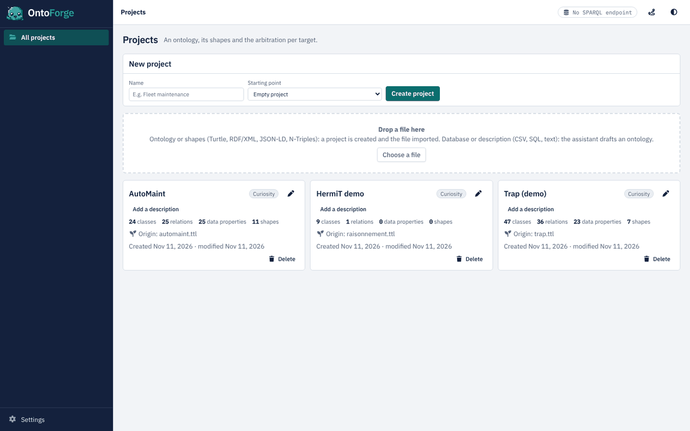

- New project: a name, and either an empty project or an example.
  - automaint: car maintenance (24 classes, SHACL shapes, test data). Use it to learn.
  - trap: the "trap" ontology that exercises the 66 transposition rules. Use it to test.
- Import: drop a file. Ontologies: Turtle, RDF/XML (Protégé export), JSON-LD, N-Triples, N3, TriG. SHACL shapes are recognised by their content. A CSV, SQL, text or Markdown file is passed to the assistant (ontology draft).

.")

## 4. Dashboard {#tableau-de-bord}

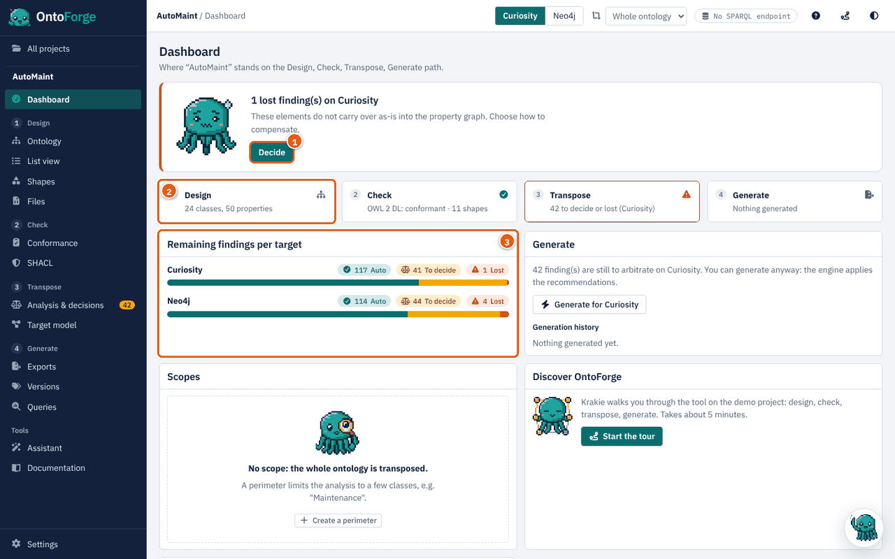

- Krakie card: the next recommended action, based on the project state (empty ontology, OWL 2 DL gaps, no shapes, lost findings, findings to decide, missing or outdated generation, or "all good"). The button takes you to the screen concerned.
- Four steps with their status (for example "24 classes, 50 properties", "OWL 2 DL: conformant · 11 shapes", "48 to decide or lost (Neo4j)").
- Remaining findings per target: auto / to decide / lost bars for Curiosity and Neo4j.
- Latest generations: read from the server (`GET /generations`). A generation is "outdated" if the project has changed since.
- Perimeters and shortcuts.

Krakie reacts to the state of the project: she looks worried while lost findings remain, and happy once everything is decided.

### Sidebar {#bandeau-lateral}

The left menu can collapse into a strip of about 56 px showing icons only, which gives the graph more room. When collapsed, the logo becomes Krakie's head, the four steps become numbered badges 1 to 4 that separate the icon groups, and a line separates the Tools group. Every icon has a tooltip (on hover and on keyboard focus; Esc closes it), and the number of findings to decide stays visible as a small badge on the Analysis & decisions icon.

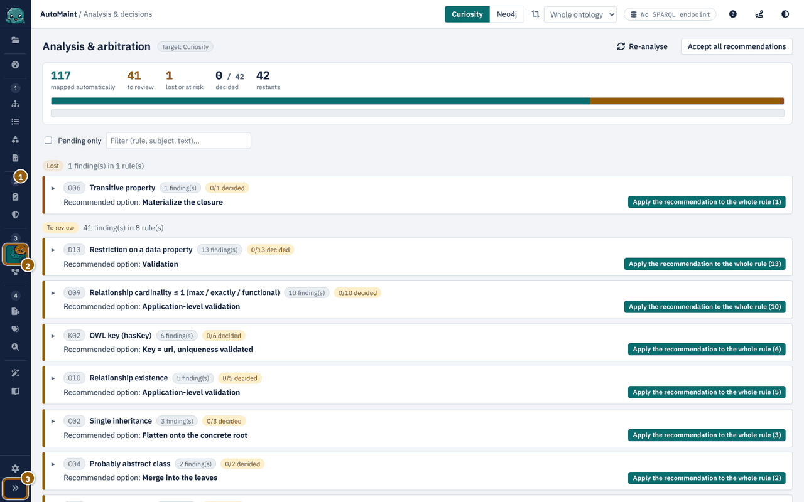

- Collapse or expand: the button at the bottom of the sidebar, or Ctrl+B (Cmd+B on Mac; ignored while the cursor is in an input field).
- The choice is remembered in this browser. Settings, Display tab, offers three options: Automatic (default: collapsed on full-canvas screens, that is the graphical editor, the list view, files and documentation, open elsewhere), Open (never collapsed automatically) and Collapsed (always collapsed).
- The button toggles the current state and remembers it: expanding by hand in the editor amounts to choosing "Open".
- On mobile (below 900 px) nothing changes: the menu stays a drawer.

## 5. Ontology: the graphical editor {#ontologie-l-editeur-graphique}

, 4 the quick input.")

The Ontology screen is a canvas. A collapsible tree sits on the left (classes, object properties, filter), the graph in the centre, the inspector on the right (collapsible, closed until something is selected) and quick input at the bottom. The List view (in the "Design" menu) is the other way to edit; see below.

The graph. Each class is a node (an icon per class, a label in the label language chosen in Settings, *abstract* and *deprecated* badges). Edges: subclass (solid line, hollow arrow), named object property (one arrow per pair of inverses, marked "⇄"), disjointness (red dotted line, ⟂ marker) and equivalence (dash-dot). The Hierarchy / Relations / All filters switch edge groups. Auto-layout reruns the automatic layout (nodes you moved are remembered). You also get zoom, a minimap, search and multi-selection (Ctrl/Cmd-click, Shift-drag). Below a 0.6 zoom, nodes become compact and edge labels disappear (except for the selection).

Gestures.

| Gesture | Effect |
|---|---|
| Double-click on the background | New class (inline entry; the local name is PascalCase, the text you type becomes the label) |
| Drag a node's handle onto another node | Menu: subclass, new object property, disjoint classes |
| Double-click or F2 on a node | Rename (label) |
| Delete | Delete (confirmation in the page) |
| Ctrl+Z / Ctrl+Y (or Shift+Ctrl+Z) | Undo / redo (200 levels) |

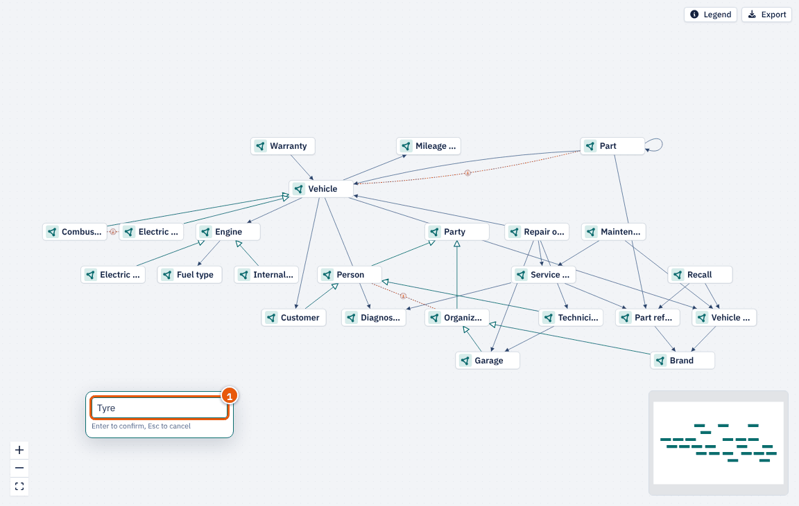

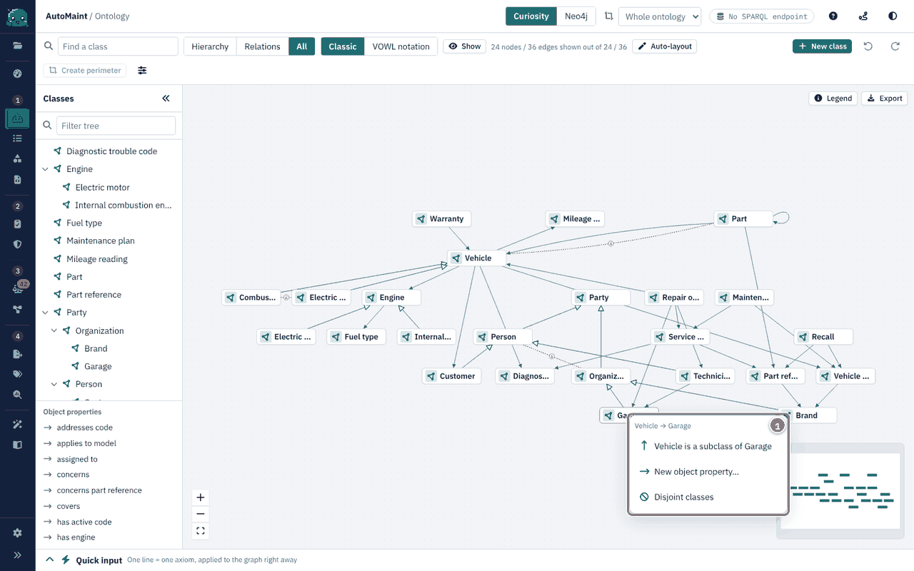

The server validates every gesture against OWL 2. A subclass cycle, a disjointness between a class and its superclass, incompatible characteristics, a cardinality on a non-simple property, an unknown datatype and similar mistakes are refused with a message (toast and banner, offending nodes highlighted in red for 6 s). Nothing is changed (all or nothing).

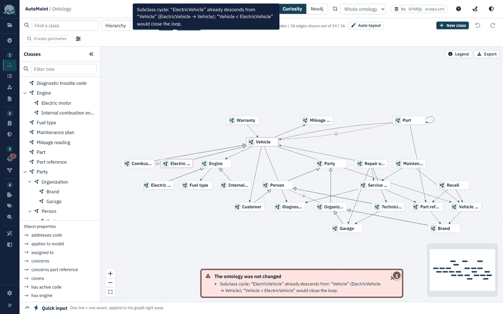

Inspector. For a class: IRI (renamable everywhere: ontology, view, perimeters, shapes, decisions), fr/en labels, comment, parents and children, icon (a catalogue of about 80 icons), data properties (type and cardinality can be added inline), relations, restrictions, keys and disjointness. For an object property: domain, range, inverse and characteristics.

 of a class: labels, parents, data properties, relations, restrictions.")

Quick input. A bottom panel where one line is one axiom (see below). Press Ctrl+Enter to apply; rejected lines stay with their error. The "Add a property to X" shortcut prefills the line. Quick input cannot be undone with Ctrl+Z.

```text
@prefix am: <https://w3id.org/ontoforge/automaint#>
Vehicle "Véhicule"@fr "Vehicle"@en
ElectricVehicle < Vehicle
Vehicle.vin : string [1] key "VIN"
RepairOrder -concerns-> Vehicle [1] inverse hasRepairOrder
FuelType : {Diesel, Petrol, Electric}
```

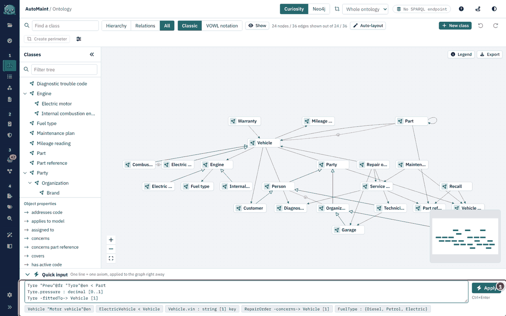

A property cited with several domain classes is read as a union (in plain RDF, several `rdfs:domain` values would mean *intersection*). `[1]`, `[0..1]` and `[1..*]` produce cardinality restrictions (OWA axioms, not constraints).

Perimeters. A perimeter is a subset of the ontology to transpose (a project can have several). Select classes in the graph, then Create perimeter: the graph shrinks and the header selector activates it. Analysis, model and exports then cover the perimeter. The transposition adds information findings P00 (summary), P01 (relation excluded), P02 (inheritance cut) and P03 (axiom cut). Decisions are shared between perimeters. A class created while a perimeter is active is not added to it automatically.

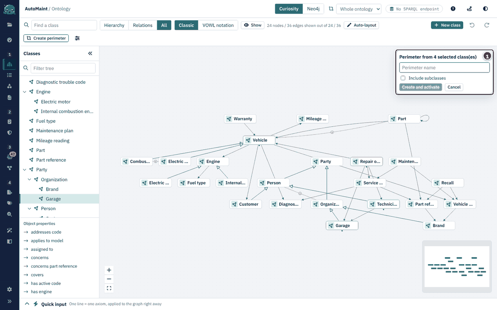

Assistant proposal in the editor. When the assistant has made a proposal, the editor shows it on the graph: added nodes in green (dotted ghosts), changed nodes in orange, with ✓ / ✕ on each element, an "Assistant proposal" panel and Accept all / Reject all.

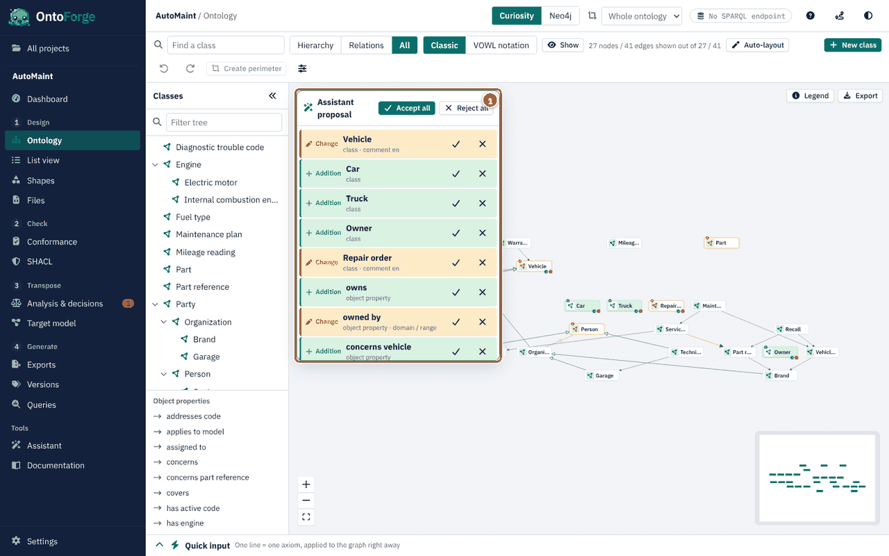

Read-only items in the inspector: union domain/range, property chains, complex equivalences, individual facts and other anonymous superclasses. They are kept and transposed but cannot be edited (see `limites.en.md`). The classic display does not draw data properties; the VOWL notation shows them (see the next section).

### Reading the graph: legend and VOWL notation {#lire-le-graphe-legende-et-notation-vowl}

Three tools help you read a loaded graph: a legend, a second drawing mode and filters.

The legend. The "Legend" button, at the top right of the graph, opens a floating panel. It describes only the elements present in the current view. Each comes with a small drawing that reuses the graph's colours and strokes, and one sentence. On first use the panel is open (collapsed below 900 px) and the view is framed so that it hides no node. The chevron collapses it and the cross closes it. The browser remembers this choice. Selection and error are always explained, because they only appear after a gesture. The panel follows the display mode.

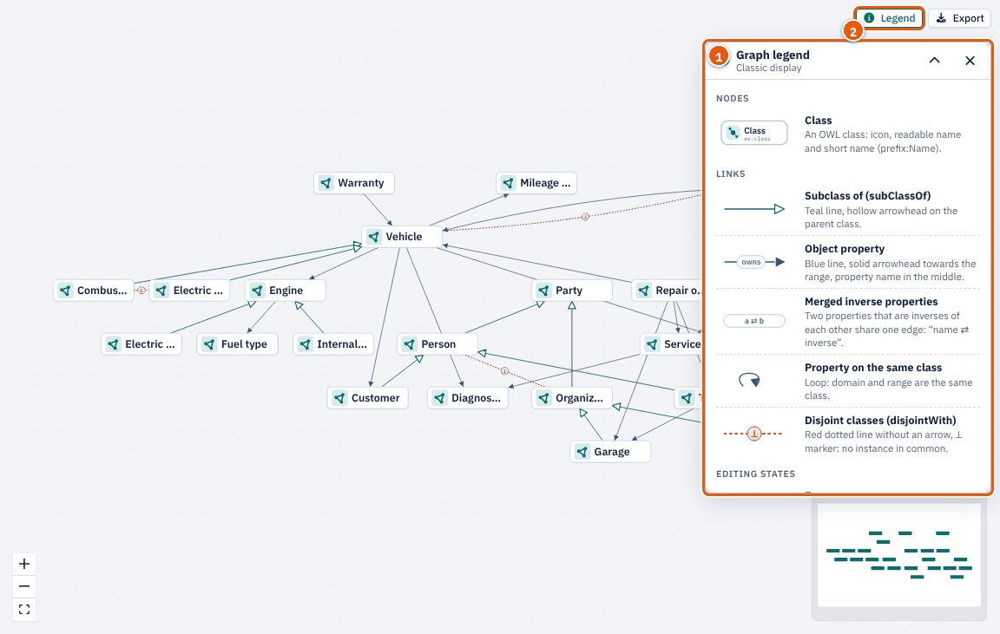

| Encoding (classic display) | Meaning |
|---|---|
| Rounded rectangle, icon, name and short name | A class. You pick the icon in the inspector |
| Dotted border, italic name, "abstract" badge | Abstract class |
| Struck-through grey name, orange badge | Deprecated class |
| Teal line, hollow tip | Subclass of |
| Blue line, filled tip, name in the middle | Object property; "a ⇄ b": two inverse properties merged |
| Loop on a class | Property whose domain and range are the same class |
| Red dotted line without arrow, ⟂ marker | Disjoint classes |
| Teal dash-dot line, ≡ marker | Equivalent classes |
| Green dotted line with "+", ✓ and ✕ badges | Krakie proposal, not applied yet |
| Orange halo and pencil | Existing element that Krakie proposes to change |
| Red halo for a few seconds | Operation refused on this element |
| Teal ring | Selection |
| "+n" badge | n neighbouring classes collapsed by the density slider |

The "VOWL notation" mode. The Classic / VOWL selector in the toolbar draws the same graph with the VOWL 2 notation (*Visual Notation for OWL Ontologies*), taken from its specification. Only the notation is reused, with no WebVOWL code. The choice is remembered. The specification colours (#acf, #36c, #ccc, #fc3, #9c6) are adapted to the light and dark themes.

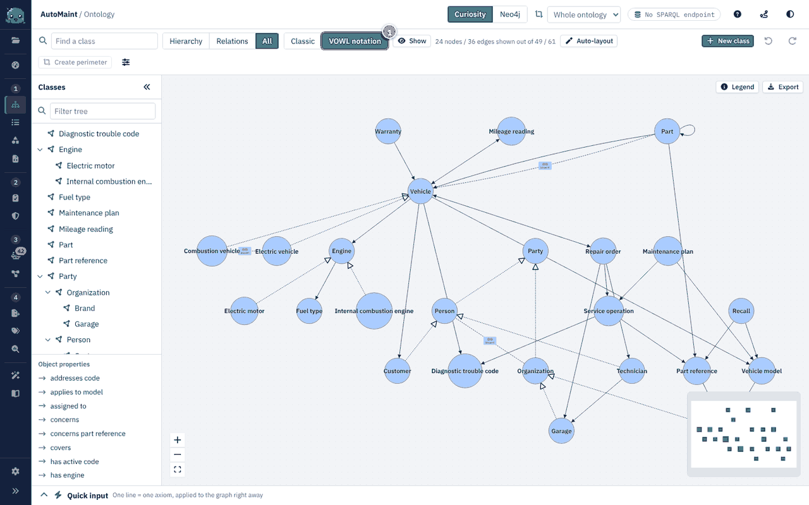

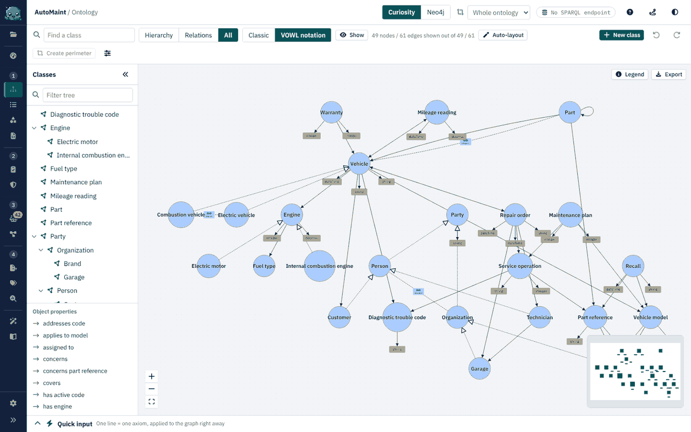

| Encoding (VOWL notation) | Meaning |
|---|---|
| Light blue circle | Class (the diameter follows the length of the name) |
| Dark blue circle, "[external]" | Class outside the ontology's namespace (the ontology IRI followed by `#` or `/`; if no declared class lies there, the majority namespace of the declared classes) |
| Grey circle, "[deprecated]" | Deprecated class (grey wins over dark blue) |
| Double circle, other names in brackets | Equivalent classes, merged into one node |
| Small dotted white circle "Thing" | owl:Thing, duplicated for each object property whose domain or range is missing (or is owl:Thing). A property with neither domain nor range, or a data property without a domain, is not drawn |
| Dotted circle ∪, ∩ or ¬ | Anonymous class: union, intersection, complement, linked to its members by dashed lines |
| Yellow rectangle | Datatype (string, integer…), one per property; `Literal` is dotted. When you have not chosen, they are shown by default only up to 16 classes ("Data properties" checkbox in the "Show" menu) |
| Light green label on an edge | Data property |
| Light blue label in the middle of the edge, black tip | Object property; its characteristics (functional, inverse functional, transitive, symmetric, asymmetric, reflexive, irreflexive) are in brackets under the name |
| Two tips, "a ⇄ b" | Merged inverse properties, when their ends match (otherwise two edges); an inverse with no domain or range of its own is carried by the other's edge |
| Dotted line, white tip, "Subclass of" | Subclass of |
| Dashed line, two separate discs, "[disjoint]" | Disjoint classes |
| Italic and dotted inner ring | Abstract class (an OntoForge addition: VOWL has no equivalent) |

In the overview (zoom below 60%), class names keep at least 11 px on screen and can overflow the circle. Below 30% they are hidden and hovering a circle shows the name. Property labels appear from 55% zoom.

The editing states (proposed, changed, error, selection) are identical in both modes. One deliberate difference from WebVOWL: the selection stays teal, and red is reserved for errors. Selection, inspector, creation by dragging from the handle, renaming and menus work in VOWL as in classic mode, on the classes declared in the ontology. These are read-only: datatypes and their properties (edit them in the class inspector), external classes, anonymous classes and Thing nodes.

The "Show" menu hides or shows data properties (VOWL only), subclasses, relations, disjointness and equivalences, deprecated classes and Krakie proposals. In VOWL, without equivalences, equivalent classes are no longer merged. The Hierarchy / Relations / All buttons set the subclass, relation and disjointness checkboxes in one click. The "Density" slider collapses classes that have at most N subclass or relation links (the "degree of collapsing" of WebVOWL). A "+n" badge marks the collapsed neighbours. Selected or proposed nodes are never collapsed. The counter reads "N nodes / M edges shown out of X / Y", where X and Y are the totals without a filter. Your choices are remembered.

, opened from its button (2): checkboxes and the density slider.")

Export. The "Export" button downloads the graph as displayed, in SVG or PNG. The SVG is self-contained: inline styles, fallback fonts, colours of the current theme, and an optional legend at the bottom of the image. The PNG is rendered from the SVG at double resolution.

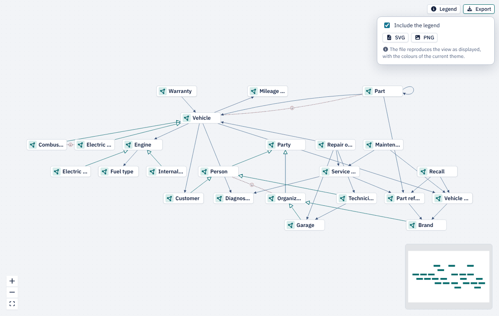

### List view {#vue-liste}

The List view (L17) replaces the old tree + form screen. The left column has a search box, four tabs with counters (classes, object properties, data properties, individuals), the class tree (icon, number of properties and subclasses, classes with several parents) and quick creation of an entry. On the right is the sheet of the selected element:

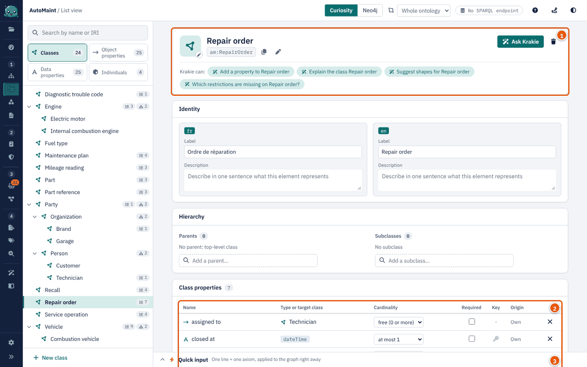

- Class: header (icon, compact IRI that you can copy and rename, badges), fr/en labels side by side, hierarchy, a property table (type or target, readable cardinality, required, key, own or inherited origin, inline addition of a data property or a relation), restrictions in natural language (with an add button), disjointness and equivalences, keys, and usage (domain, range, restrictions, shapes).
- Object property: domain, range, inverse and seven characteristics as explained toggles. Data properties and individuals (types, facts) have their own sheet.
- Writes go through the same validated operations as the graphical editor. Individuals (creation, types) and the "single value" setting of a data property use a direct update of the ontology.
- The Krakie button in the header opens the assistant with the class or property as context. Quick input can be collapsed (closed by default).
- Below 900 px: list or sheet, with a back button.

Read-only: individual facts, equivalences and complex expressions.

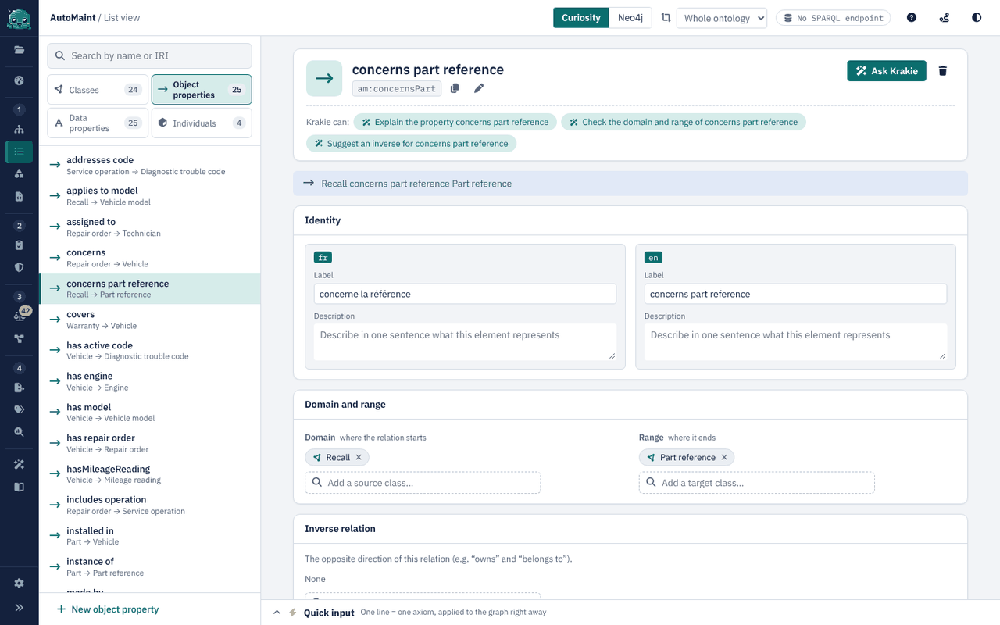

## 6. OWL conformance {#conformite-owl}

On the OWL conformance screen (button "Check again"):

- Profiles: OWL 2 DL, EL, QL, RL (and RDFS). Each is conformant or not, with the reasons for any gap.
- Findings: `error`, `warning`, `info`, with code, message, subject and specification reference (Structural Specification, Mapping to RDF). Codes W01-W07 (OWL 2 DL rules) and BP01-BP07 (best practices: missing labels, hierarchy cycles, naming...). A text filter finds a code or a subject.

Example: the *trap* example is OWL 2 DL conformant "subject to closing the PROV-O import" (the import is not resolved offline, see BP05).

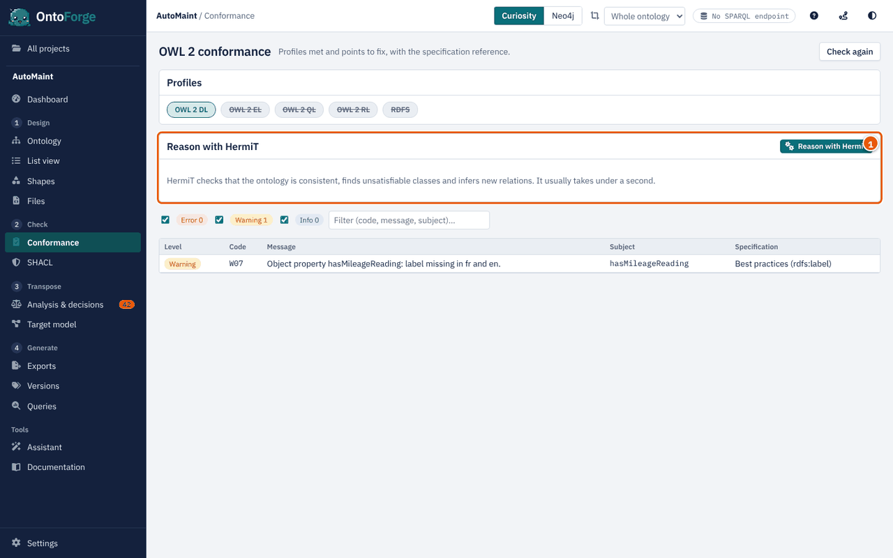

### Reasoning with HermiT {#raisonner-avec-hermit}

The "Reason with HermiT" button (Conformance screen, Check step) runs the OWL 2 DL reasoner HermiT 1.3.8 on the project ontology. The result card shows:

- A Consistent or Inconsistent badge. If the ontology is inconsistent, HermiT gives no justification. OntoForge only offers leads to check: an individual placed in two disjoint classes (including through a property's domain or range), or `sameAs` against `differentFrom`. An inconsistency caused by a cardinality, a functional property or an `owl:hasKey` key has no lead, and the card says so. For a minimal justification, use "Explain inconsistent ontology" in Protégé.
- Unsatisfiable classes, meaning classes equivalent to `owl:Nothing`: they cannot have any instance. A click on one opens the editor, where all unsatisfiable classes are red (same look as a refused operation) until you close the banner.
- Useful inferences: subclasses that are missing from the ontology and deduced from a definition (`equivalentClass`), and equivalent classes. "Add to the model" writes the `subClassOf` relation as an undoable operation (undo the last addition, or Undo in the editor). An equivalence is declared in the file editor, because the graphical editor has no operation for it. A subclass that only follows from an inferred equivalence (C ⊑ B declared, A ≡ B inferred) is not proposed again as C ⊑ A. An inferred class equivalent to `owl:Thing` triggers a warning.
- Reclassified individuals: new types deduced for an individual.

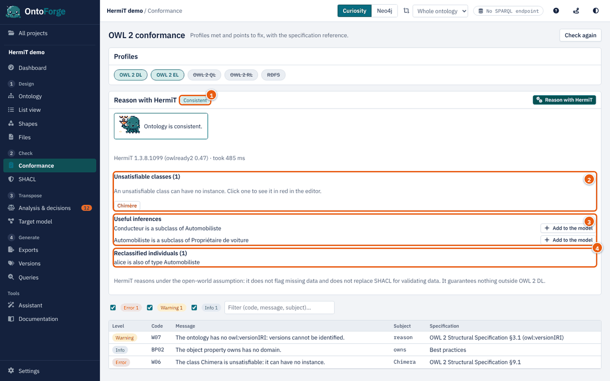

 in red in the editor, with the banner (1).")

The card shows the duration and the HermiT version. The computation runs in a Java subprocess limited to 30 s and 1 GB of memory (variables `ONTOFORGE_HERMIT_TIMEOUT` and `ONTOFORGE_HERMIT_MAX_MB`). Beyond that it is interrupted and no result is kept.

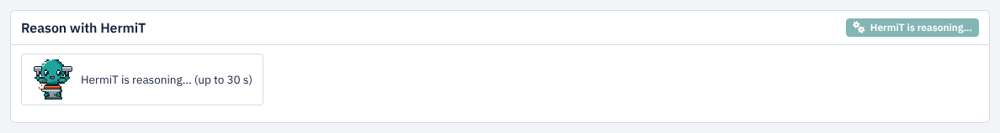

If the ontology goes beyond OWL 2 DL (see the profiles), a warning appears and HermiT still runs. The result is then indicative, because HermiT may ignore axioms it does not understand. Outside OWL 2 DL it may also reject the ontology (for example a transitive property inside a cardinality). The card then shows its error message.

`owl:imports` are not followed. HermiT reasons on the project content only, and a warning lists the imports. Without Java or without `owlready2`, the screen shows the steps to follow (response 501).

What HermiT guarantees. For an OWL 2 DL ontology, consistency, unsatisfiability and the deduced subsumptions are sound and complete under the OWL 2 direct semantics, for the project content (without imported ontologies).

What it does not guarantee.

- It reasons under the open-world assumption: missing information is not an error. A `Voiture` class with a `someValuesFrom` restriction on `aPourMoteur` is not "violated" by a car with no known engine. We simply do not know yet.
- There is no unique name assumption: two individual names do not necessarily denote two different individuals, and a maximum cardinality causes an inconsistency only if the individuals are declared different.
- It does not validate data the way SHACL does. To check that data respects a model (required fields, values, formats), use the SHACL screen.
- It says nothing about what the transposition to a property graph loses. See the Analysis screen.

Krakie offers the same reasoning: `raisonne`, `vérifie la cohérence`, "run the reasoner", "check consistency". She runs HermiT and summarises the result, with a button to open the detailed card.

## 7. File editor {#editeur-de-fichiers}

The Files screen (*Design* step) is an IDE-style editor for changing the project files directly.

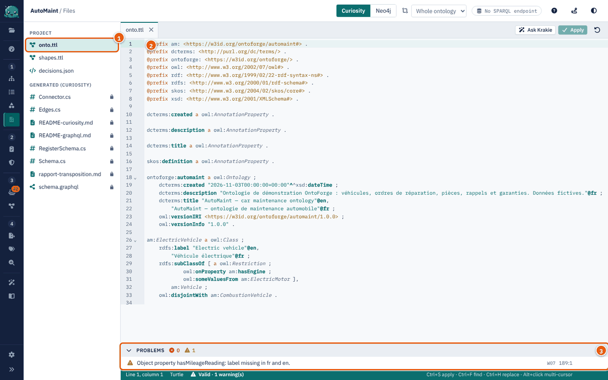

- File tree on the left: `onto.ttl` (ontology in Turtle), `shapes.ttl` (SHACL), `decisions.json` (decisions), then, read-only (padlock), the generated files for the current target (Schema.cs, `*.cypher`, `schema.graphql`, report...). A generated file shows a "modify the ontology or the decisions" banner: you change the source, then regenerate.
  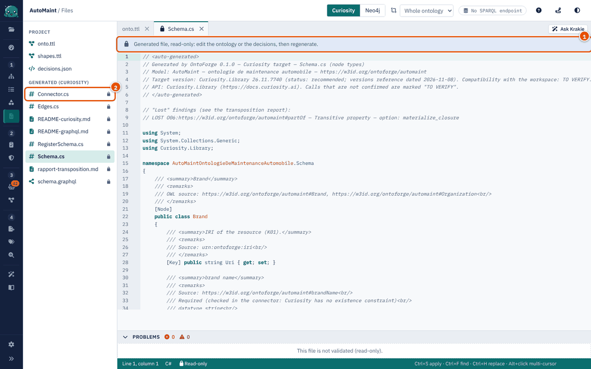
- Tabs in the centre. An orange dot marks a file that is modified but not yet applied. At the bottom, the Problems panel (collapsible); a click on a problem moves the cursor to its line. The status bar shows line, column, format and validation state.
- Editor (CodeMirror 6): highlighting for Turtle, JSON, C#, Cypher and GraphQL; line numbers, code folding, matching brackets, Ctrl+F to search, Ctrl+H to replace, Ctrl+D for the next occurrence, Alt+click for several cursors. The theme follows the application's light or dark theme.
- Live validation (about half a second after the last keystroke): syntax errors are underlined in red with line and column. OWL 2 conformance and best-practice warnings are attached to the subject's line. For shapes, a SHACL meta-validation (shacl-shacl) is added. Only invalid syntax prevents you from applying.
  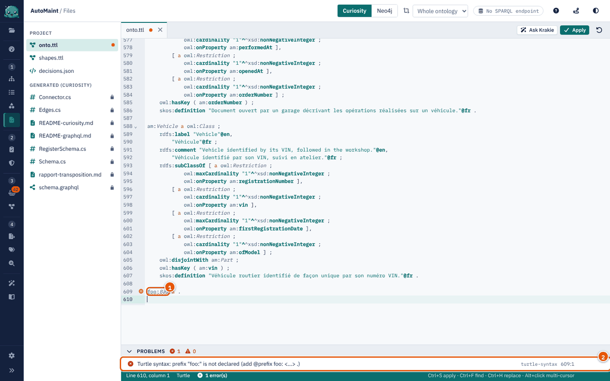
- Autocompletion (Ctrl+Space or as you type): declared prefixes, project classes and properties (by local name or by label), Turtle keywords, OWL, RDFS, XSD and SHACL terms (`sh:path`, `sh:datatype`...).
- Apply (button or Ctrl+S): a side-by-side preview opens with the "+N triples / −M triples" summary computed by the server. You confirm and the project is replaced. The graph, list view and shapes screens reflect the change at once. If the import rewrites part of your text (for example an n-ary disjointness split into pairs), the preview says "N triple(s) of your text rewritten in an equivalent way" with the before / after detail. An apply that changes the model can be undone: "Revert to previous version" button, or undo from the graphical editor (same history). A change to comments or formatting alone is saved without touching the model and cannot be undone.
  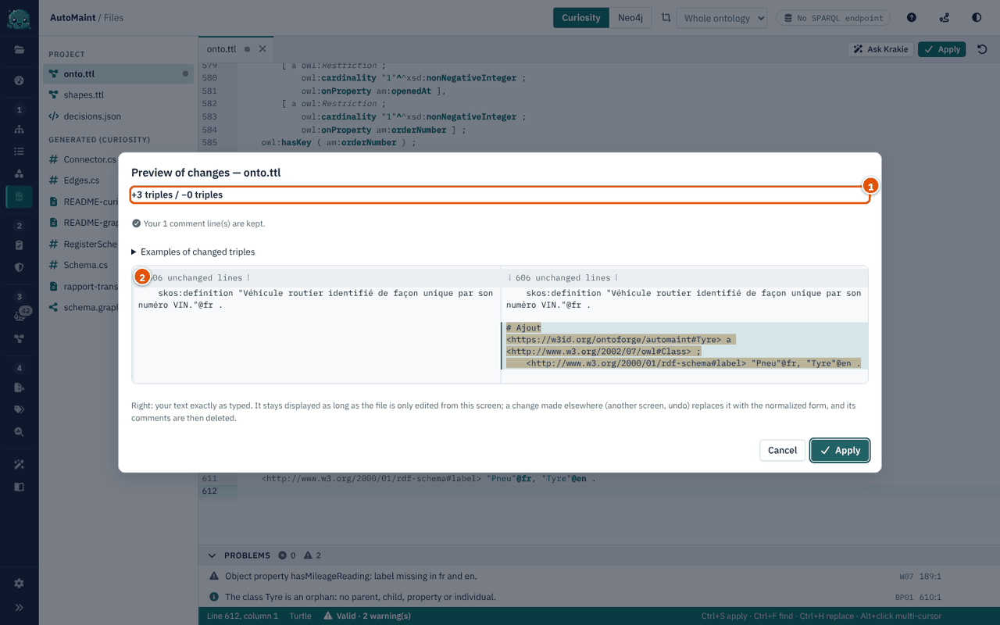
- If the project changed elsewhere while you were editing (another screen, an undo...), the apply is refused with a warning: keep your edit, reload the project version, or overwrite.
- Comments and formatting: if your text gives exactly the same RDF graph as the project, it is kept as is, `#` comments included, and the preview says "your N comment lines are kept". If the import rewrites part of the text, the file is rewritten in normalised form and the preview warns "N comment line(s) will be removed". The kept text stays displayed as long as the project is only changed from this screen. A change made elsewhere (graph, Krakie, undo) replaces it with the normalised form, with a note giving the number of removed comments. If an undo brings back the same graph, your text returns. When the ontology namespace has no prefix, one is added based on its IRI. Numeric literals may be rewritten in canonical form (`"01"^^xsd:integer` becomes `1`).
- Krakie: the "Ask Krakie" button offers "Explain this block" (selection or current line) and "Fix this error" (the error closest to the cursor).
- Mobile: the screen is read-only.

## 8. SHACL {#shacl}

The SHACL screen (L17) has two tabs: shapes and validation.

Shape list. Search, groups by target class (with its icon), number of constraints, validation state (not validated / OK / n violations).

Shape detail. A readable title, compact IRI, "Applies to every ...", closed or open shape, severity. A grid lines up, for each property: label and CURIE, plain-language cardinality, type or class, other constraints as bullets (pattern, range, length, list, nodeKind...), severity and message.

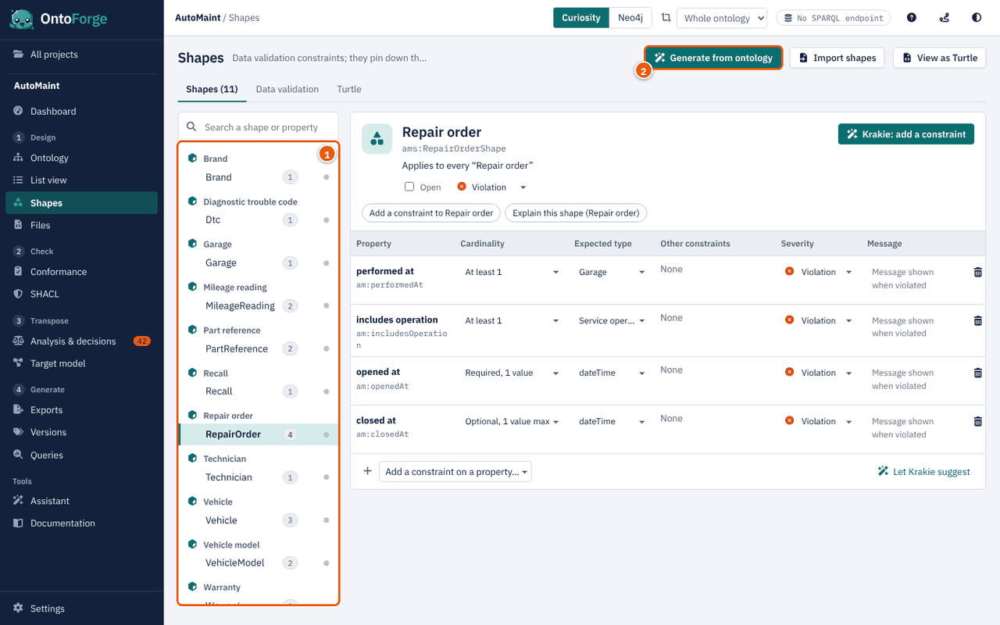

Inline editing. You change the cardinality (presets or free values), the type or class, the severity, the message and the closed flag, and you add or remove a property (those of the class first). An "Unsaved changes" bar saves everything. Messages are edited in the interface language. Pattern, range and list constraints can be read but not yet edited inline.

Generate from ontology. A diff first shows the additions (new shapes, constraints added to existing shapes). Shapes without constraints (types, collections) are dropped and counted. Apply merges them into the draft, then Save. The preview uses `dry_run`, so nothing is saved before (see `api.en.md`). The generation states "what it does not reproduce exactly" (an OWL axiom is not a SHACL constraint).

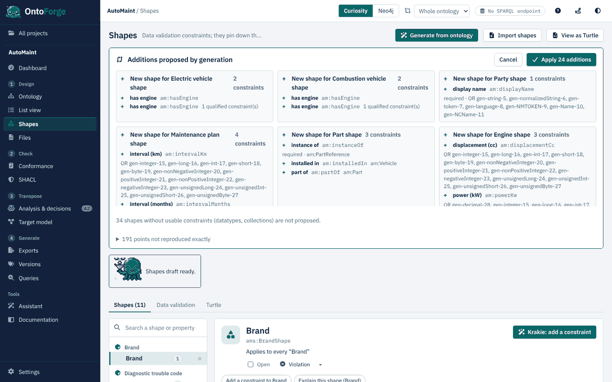

Validate an RDF data file. A dedicated tab: drop or choose a file. The check runs against the project shapes, with no inference by default (decision D-034). Violations are grouped by shape and then by node, with the constraint type in plain words. Open shape selects the shape and highlights the constraint. With `automaint-data.ttl`, you should see 4 violations across 3 shapes.

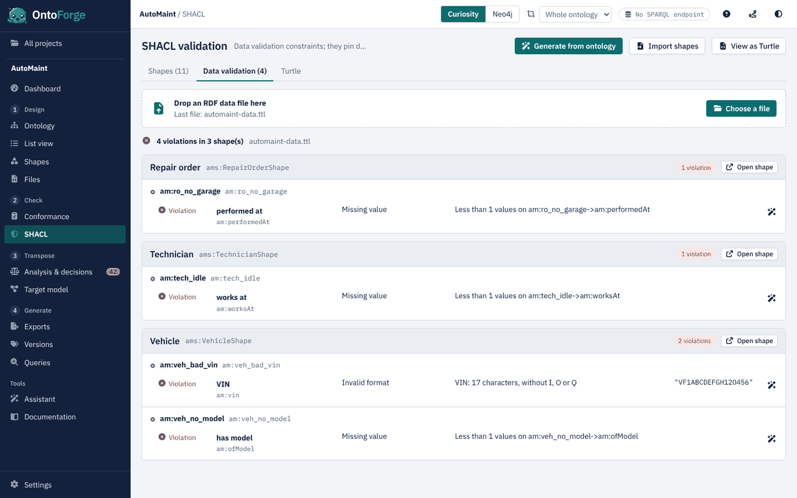

Krakie. A button in the shape header, suggestions ("Add a constraint...", "Explain this shape") and "Why this violation?" on each violation row.

Shapes then enrich the transposition (required property, scalar, enumeration, pattern, validations). An OWL/SHACL conflict becomes an S01 finding.

## 9. Analysis & arbitration {#analyse-arbitrage}

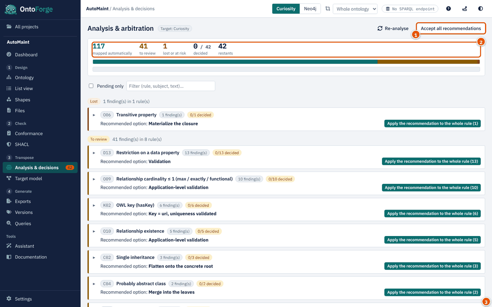

1. Pick the target (Curiosity or Neo4j) at the top. Re-analyse reruns the engine.
2. Summary: "mapped automatically", "to review", "lost or at risk", "decided", "pending", with a green / orange / red bar.
3. Findings are grouped by rule (identifier `C07`, title, number of findings, progress `0/3 decided`, recommended option). The Lost groups come first, then To review. `auto` findings are collapsed. There is a text filter and a "Pending only" checkbox.
   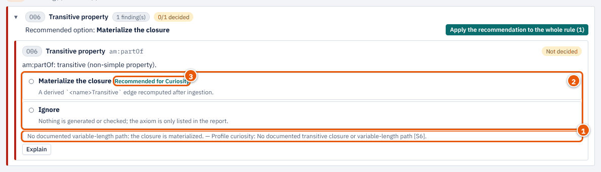
4. Decide:
   - "Apply the recommendation to the whole rule": a single grouped decision (`"<règle>:*"`);
   - expand the rule to decide finding by finding: each finding shows the subject, the justification and the options with their impact;
   - "Accept all recommendations" at the top, then refine.
5. Until you decide, the recommendation is applied. The model and exports are always complete, but the `review` and `lost` points stay flagged in the report.

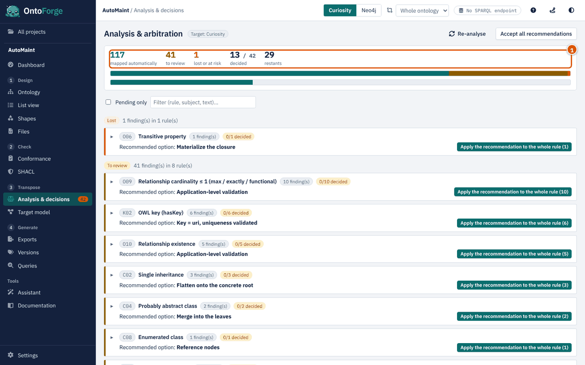

Decisions are saved in the project per target and replayed at each re-analysis, so editing the ontology does not lose the choices already made. Finding identifiers are stable: `<règle>:<IRI du sujet>`. A decision pointing to an option that does not exist for the target is ignored and flagged (G02).

The Neo4j target often offers other recommendations (for example multi-labels for inheritance, `UNIQUE` / `NODE KEY` for keys):

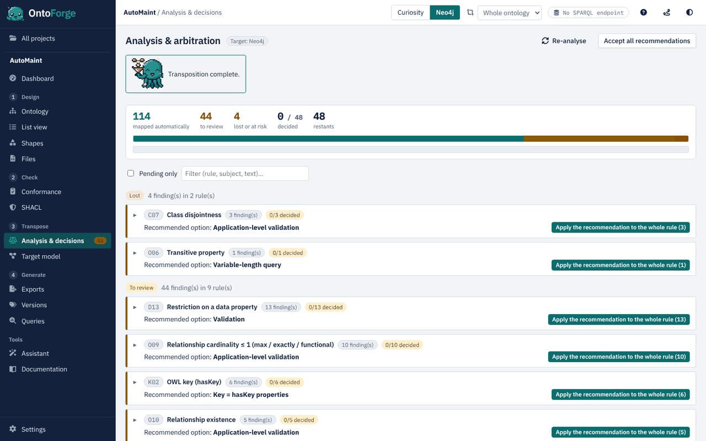

Each rule is explained, with an OWL example and the transposition per target, in [`regles.en.md`](regles.en.md). The Explain button on a finding asks the assistant to write an explanation (deterministic fallback without an LLM).

## 10. Target model {#modele-cible}

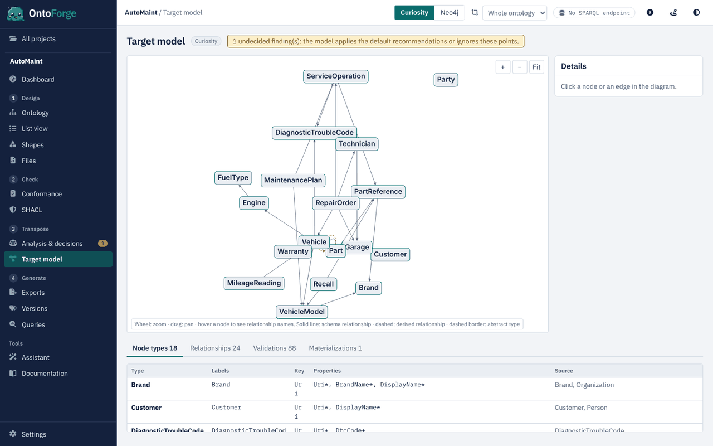

A diagram of the resulting property graph. A solid line is a schema relation, a dotted line is a derived (materialised) relation, and a dashed border is an abstract type. Hover over a node to see the relation names. Under the diagram, four tabs: Node types, Relations, Validations, Materializations. Click a node or an edge to see its details in the right panel: labels, key, discriminator, properties (required, indexed), OWL source, cardinality, inverse and symmetry.

: its properties and OWL source appear on the right.")

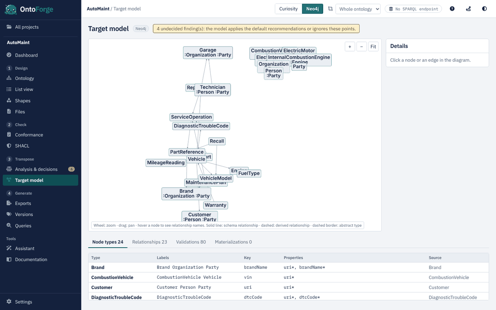

In Neo4j, nodes carry several labels (inheritance is kept). In Curiosity, they carry one.

## 11. Exports {#exports}

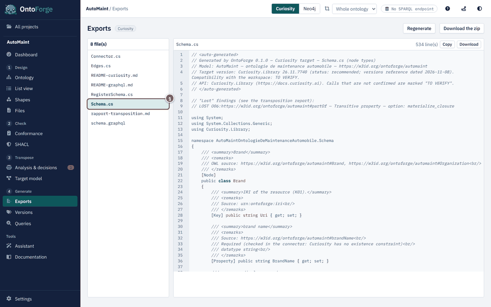

The list of generated files is on the left and the content on the right (Copy, Download). Download the zip to get everything. Regenerate after a change.

| Target | Files |
|---|---|
| Curiosity | `Schema.cs` (`[Node]`/`[Key]`/`[Property]` types), `Edges.cs` (forward/back edge pairs), `RegisterSchema.cs`, `Connector.cs` (idempotent ingestion), `README-curiosity.md` |
| Neo4j | `schema.cypher` (constraints and indexes), `ingest.cypher` (`MERGE`), `validation.cypher` (detection queries), `model.mmd` (Mermaid diagram), `README-neo4j.md` |
| Both | `schema.graphql`, `README-graphql.md`, `rapport-transposition.md` |


Read this before using the generated code:

- The Curiosity C# has not been compiled (there is no .NET SDK in the build environment). Calls marked `À VÉRIFIER` need confirming on your version of `Curiosity.Library`.
- The Cypher has not been run against a real database. Enterprise-only constraints (`NODE KEY`, `IS NOT NULL`, property types) are separated and commented out. In Community, uniqueness (`IS UNIQUE`) is offered instead.
- For each finding, the transposition report lists what was lost, why, and the chosen compensation (application-side validation, query, materialisation).

## 12. Queries: interactive querying {#requetes-requetage-interactif}

The Queries screen builds a query from a guided sentence driven by the ontology and the shapes, runs it on a SPARQL endpoint and translates it for the target.

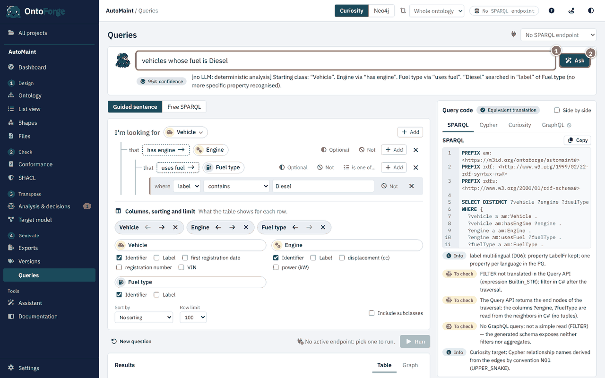

1. Choose the endpoint: the list at the top right (endpoints are declared in Settings). Only one is active at a time. The "+ Temporary endpoint…" option opens an inline form: URL, authentication (none, basic, bearer), secret, default graph. Test checks the connection, then use it as the active one. It is kept only in the browser's memory (no local storage, no server) and disappears on reload. The "Save in settings" checkbox makes it a permanent endpoint. The same safeguards apply (read-only, timeout, secret never sent back).
   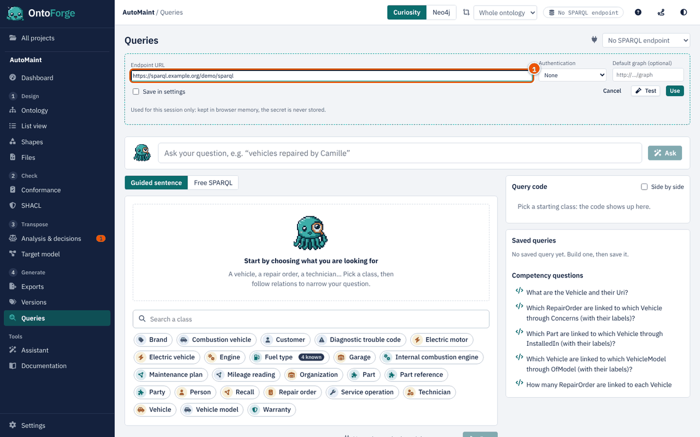
2. Ask a question in natural language ("Ask your question" field, Ask button), for example "vehicles repaired by Camille". The answer fills the guided sentence, which you can edit, with an explanation, a confidence indicator and the unrecognised terms (clickable: they open the relation search). The mode is "llm" if the selected provider is real and configured. Otherwise a deterministic fallback runs (matching against ontology labels). Anything the LLM invents (unknown class, relation or filter) is removed before display.
3. Or build the sentence by hand: "I'm looking for" a class; add a proposed outgoing or incoming relation (never a relation that makes no sense for the class). Each step can be optional or negated ("not"). Filters depend on the type (contains, equals, regex, language, numeric range, date range, list). Several branches can start from the same variable.
4. Columns, sorting and limit: choose and reorder (arrows) the columns (identifier, label, data properties), the sorting, the limit (100 by default) and "Include subclasses" (global; useful if the endpoint does not reason).
5. Run: a table (sort by column, CSV export) or a graph, with the duration and a "truncated" indicator. Read-only: any update query is refused.
   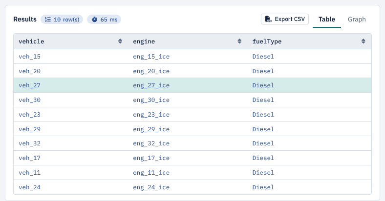
6. Query code (right column): SPARQL / Cypher / Curiosity / GraphQL tabs, a "Side by side" checkbox, `Loss` / `To check` / `Info` notes and Copy.
   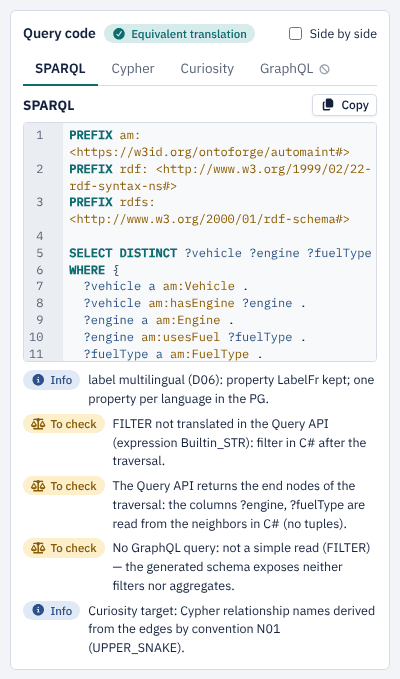
7. Library: saved queries (run, open, rename, delete) and competency questions that you can replay in one click.

Local triplestore (test). Without an external endpoint, the "Local triplestore (test)" option of the selector queries a small RDF store embedded in the project (always available, offline, read-only). It holds the ontology, the project's individuals and the files you load. The panel shows the number of triples per origin and offers: Load the demo data (bundled examples), Load a file… (Turtle, N-Triples, JSON-LD, RDF/XML; 25 MB at most), the Inference checkbox (RDFS, OWL RL or both, so subclasses are found through their superclass; RDFS applies domain, range, subproperties and subclasses, OWL RL applies the rules of the OWL 2 RL profile, deliberately incomplete for the rest of OWL 2, and only facts about individuals are added), Validate (SHACL) the content, and Clear. The content is kept between sessions (data volume). Only SELECT, ASK, CONSTRUCT and DESCRIBE are accepted. The default graph is the union of all graphs without duplicates (a triple present in two files counts once), `FROM` chooses the graphs to query and `GRAPH ?g` tells them apart. On an external endpoint, the default graph is not always that union, so a free query may return a different result there. A query is interrupted after 20 s. After a load or a clear, the store recomputes the union of the graphs (about 4 s for 186,000 triples). A query started at that moment waits for it to finish and never returns a stale result. A load that fails is rolled back entirely. Limits: inference stays reserved for small datasets (30,000 source triples), `owl:hasKey` is not materialised (look for duplicate keys with GROUP BY / HAVING), and `SERVICE` is refused. It is a test tool, not a replacement for a real triplestore.

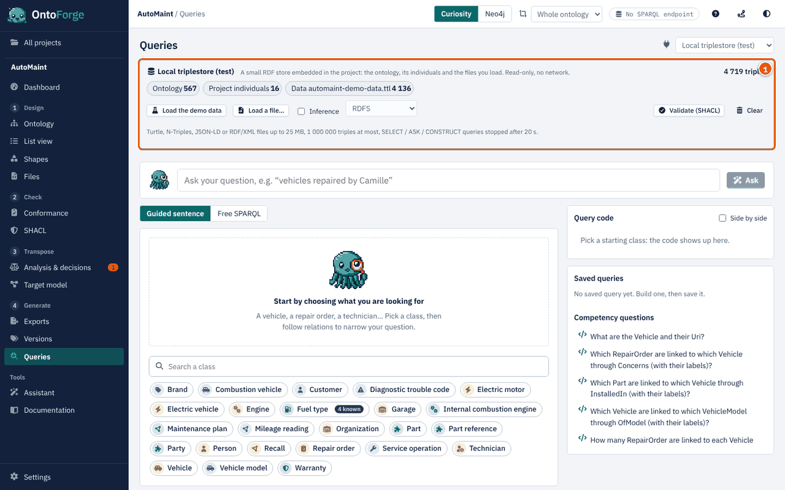

Possible values (without an endpoint). The ontology alone is enough to suggest values (`GET /query/options`): individuals of an enumerated (`owl:oneOf`) or typed class, subclasses included; individuals in the range of an object property; `sh:in` of the shapes, `DataOneOf` or the target model's enumeration for a data property. In the guided sentence:
- a step towards an enumerated or populated class (40 values at most) adds an "is one of" filter with checkboxes (with automaint: `Diesel, Essence, Hydrogène, Électricité`), otherwise an "is one of…" button;
- text filters offer autocompletion (ontology first, then the endpoint if there is one);
- "among" properties also have a checkbox list;
- the root class shows "N known".
With an endpoint, the list is completed with its values. Limit: label autocompletion mixes languages (fr and en).

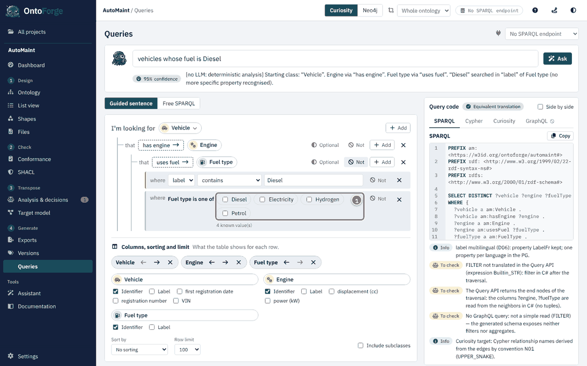

Free SPARQL mode accepts a `SELECT`/`ASK`/`CONSTRUCT`/`DESCRIBE` query, translates it and runs it. On mobile, only the library, the execution of saved queries and the results are available.

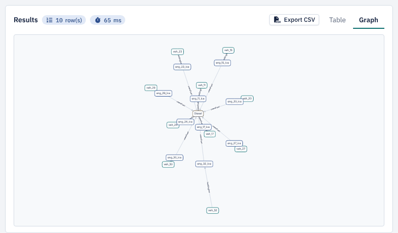

Good to know: the Curiosity translations rely on the Query API, which is not verified, so everything is `À VÉRIFIER`. The Query API returns only the end nodes of a traversal, so multiple columns have to be read in C# afterwards. There is no counting, aggregate or sorting in natural language. "Toulouse" is searched in the display name (the AutoMaint ontology has no city property).

## 13. Full-screen assistant {#assistant-plein-ecran}

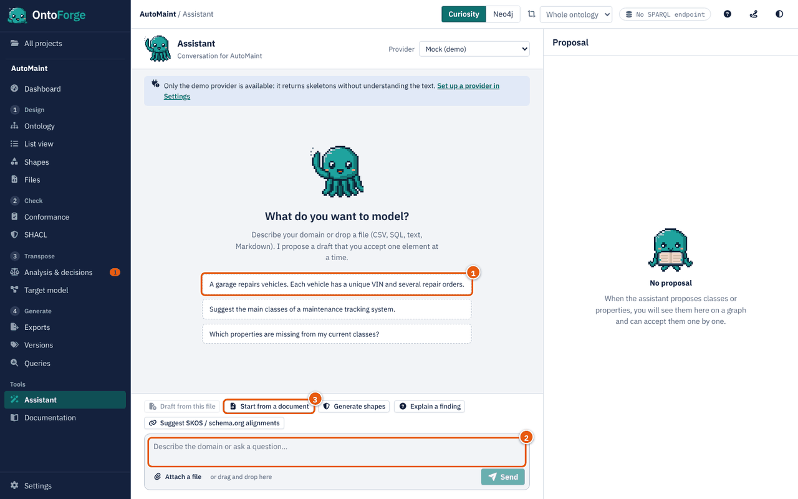

The Assistant (in the "Tools" menu) is a conversation per project (history kept in the browser, 80 messages), with Krakie as the avatar. She thinks while the call runs, is pleased by a proposal and worried by an error.

- Provider: chosen in the conversation (a list taken from Settings; the default is the one from Settings). If only `mock` is configured, a note points to Settings.
- File upload: drag and drop or button; CSV, SQL, text and Markdown formats (2 MB maximum), with a preview (columns, tables, first 20 lines) and the option to remove the file.
- Quick actions: ontology draft from the file; shapes ("Apply" card: merge with existing shapes); explain a finding; SKOS / schema.org alignments.
- Proposal: shown on the right as a mini-graph (green = addition, orange = change, dotted = existing) and as a list. You get ✓ / ✕ per element, Accept all / Reject all and View in editor. Acceptance goes through the same validated operations as the editor (all or nothing) and first accepts the classes an element depends on. Nothing changes in the ontology before you accept (decision D-006). On mobile: Conversation / Proposal tabs.
  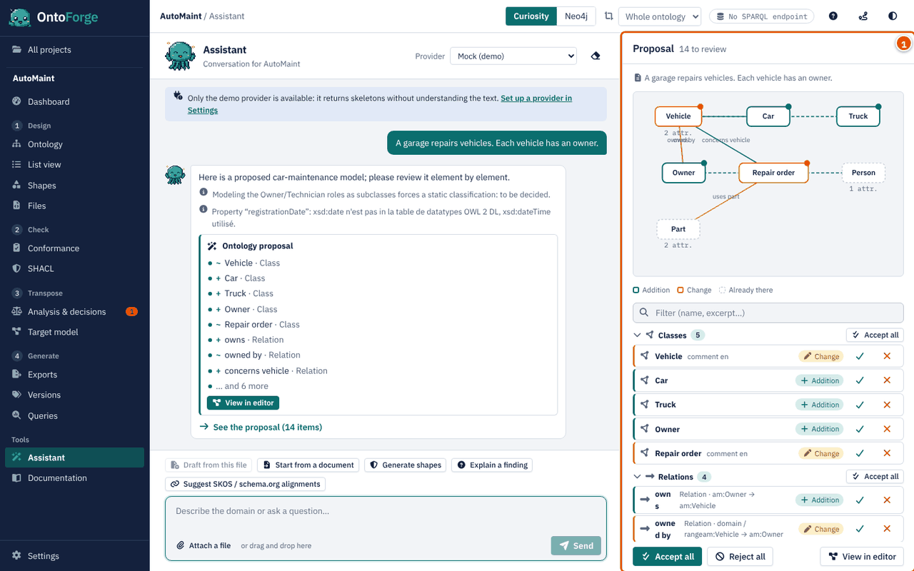

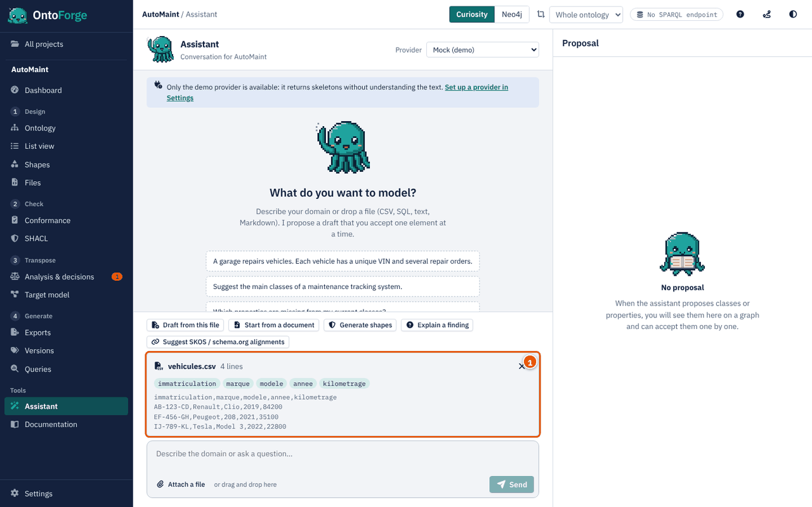

Without a real provider, the `mock` mode returns only a skeleton (car domain for text; deterministic parser for CSV and SQL).

### Start from a document {#amorcer-depuis-un-document}

From a requirements document, a note or an article, the assistant proposes an ontology draft in which every element cites its source excerpt. Nothing is applied until you accept.

1. In the Assistant, click Start from a document (in the Krakie panel: the file icon next to "Send"), or drop a PDF into the conversation. To try it without a file, the "Try the demo requirements document" link loads the sample PDF in one click. Formats: PDF with native text, `.txt`, `.md`. A scanned PDF is refused (no character recognition). The default limits are 10 MB and 60 pages, adjustable through environment variables (see `docs/CONTRACTS.md` §9).
2. The tool reads the document locally and shows the number of pages, characters and planned calls. With a hosted provider (Anthropic, OpenAI-compatible), a privacy warning appears and you must tick the confirmation before sending. With `mock` or Ollama, nothing is sent to a hosted service.
   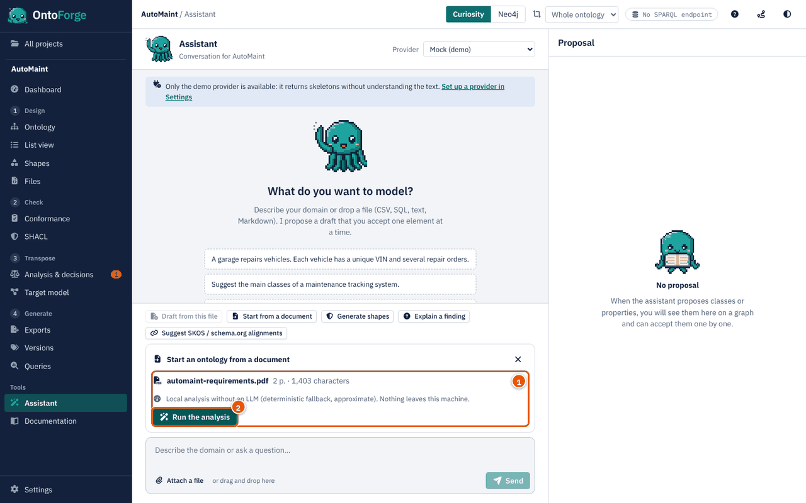
3. Run the analysis. The result starts with 5 to 10 competency questions taken from the document. Each carries a Covered or Not covered badge. A question that is not covered finds no term in the draft, so a class or a property is probably missing.
4. The proposal is grouped into Classes, Relations and Data properties, with a counter per group. All elements carry the "To confirm" hourglass. Click a name to expand its source excerpt (original sentence and page). Accept ✓ or reject ✕ element by element, use Accept all in a group header, or the one at the bottom to take everything. From 8 elements, a filter field searches names, details and excerpts. The W3C lint is summarised above the list: labels missing in the other language (the normal case for a document written in one language) form a collapsible information line with no alert, and a real warning is shown in orange. The graph preview is collapsed under "Graph preview".
5. View in editor: the accepted elements are there, undoable like any other change.

Long documents are split into chunks, then the proposals are merged. The same term (accents, singular or plural) appears only once, and what already exists in the ontology is not proposed again. Elements whose excerpt cannot be found in the document are dropped with a warning.

Without an LLM (`mock` provider, not configured or down), a deterministic fallback spots frequent capitalised terms and phrasings such as `un X est un Y` or `un X a un Y`, in French and English. The draft is then labelled Approximate. It is enough for a demonstration, so check every excerpt. A demo PDF (a car maintenance requirements document, 2 pages) is provided in `samples/automaint/`, with its generation script. The demo link in the import area loads it directly.

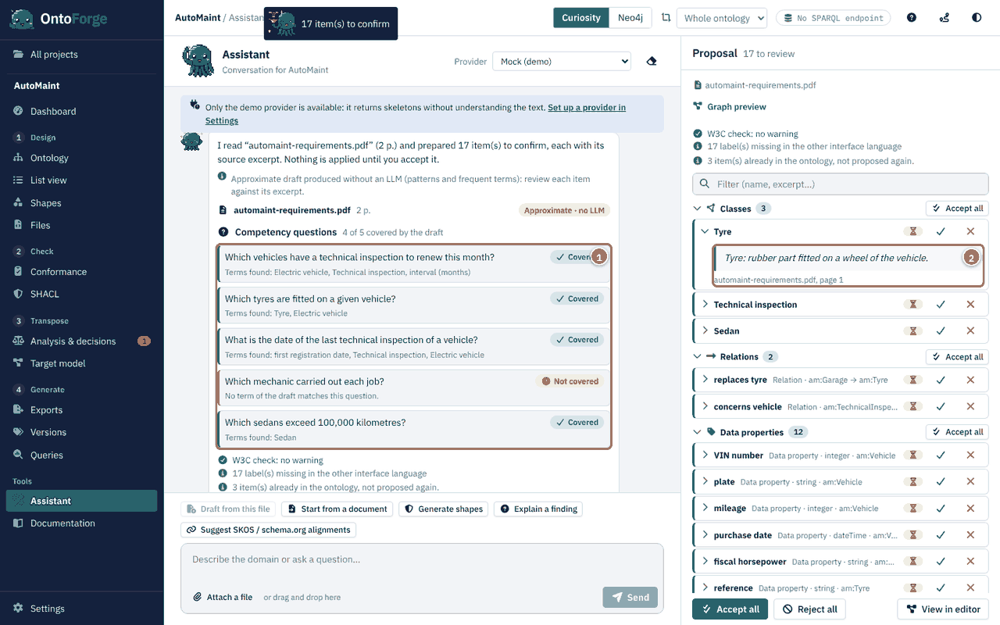

### Krakie, the global assistant {#krakie-l-assistant-global}

Krakie is present on every project screen (L16), in addition to the full-screen view above.

- Open: floating button at the bottom right, or Ctrl+K (Cmd+K on Mac). The side panel resizes with the mouse or with the left/right arrows on the handle. Below 900 px it goes full screen. It stays open when you change screens. Esc in the input area closes it.
- Context: a "Context: [screen] [selection]" line shows what Krakie sees. She receives the screen, the selected element (class with its properties and restrictions, shape, property) and, in Queries, the current query. You can remove the selection or the whole context, then restore it. Suggestion chips specific to the screen fill the input. The Krakie buttons on the sheets (List view, Shapes) open the panel with their element as context.
  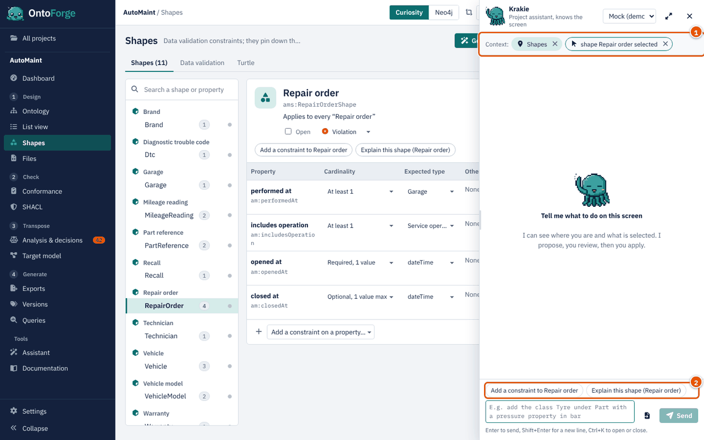
- Action cards: Krakie never changes anything on her own. Her reply contains cards with a preview in plain language. Apply runs the operations (same validated path as the editor). Undo reverts the change, but only while it is the latest one. Depending on the card: View in editor, Open in Queries (the guided query is loaded into the builder), shapes to apply. An invalid operation or an unknown reference is dropped with a warning. Nothing is invented.
  : a preview, and nothing changes until you apply.")
- Conversation: shared with the Assistant screen (same history per project). You choose the provider in the panel.
- Intents understood without an LLM (`mock` provider or not configured), in French:
  - `ajoute la classe X [sous Y] [avec une propriété p [en unité] [de type T]]`;
  - `ajoute la propriété p à X` (`cette classe` = the selection);
  - `rends p obligatoire`;
  - `supprime X`;
  - `contrainte min / max / motif v sur p dans la shape S` (on a numeric or date property, min and max become value bounds);
  - `cherche / trouve / liste / combien …`: a guided query is proposed in Queries;
  - `raisonne`, `vérifie la cohérence`, "run the reasoner": runs HermiT and summarises the result;
  - `ouvre les shapes / requêtes / l'éditeur / le tableau de bord / exports / analyse / conformité / paramètres`;
  - `aide`, `doc`, `comment ça marche ici`: a Help card that opens the guide section for the current screen (see Built-in documentation and help).
  Any other sentence falls back to the old chat (the mock's car proposal).
- With a real provider, the model proposes actions (operations, proposal, shapes, guided query, navigation) validated in the same way. This path has not been tried on a real model (see `limites.en.md`).

## 14. Settings {#parametres}

The global route is `#/parametres` (gear at the bottom of the menu), with four tabs. Each tab saves explicitly ("Saved").

: the key is never shown again, only its last four characters.")

- LLM: a table of providers (name, type, model, URL, key shown as "•••• abcd"). Types: `anthropic`, `openai_compat` (Azure OpenAI, vLLM, LM Studio...), `ollama`, `mock` (always present, cannot be deleted). One default provider, and a Test connection button (latency, model, message; 15 s). The key is encrypted on the server and never sent back to the browser: you can only replace or delete it. To test a new provider, save it first.
- Languages: interface (fr/en, applied immediately), label language (display of the graph and lists), assistant language.
  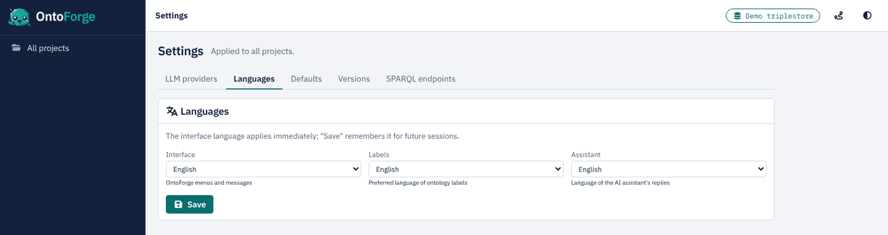
- Defaults: base IRI (used by the assistant for its drafts), prefixes (editable table), default target, naming conventions.
  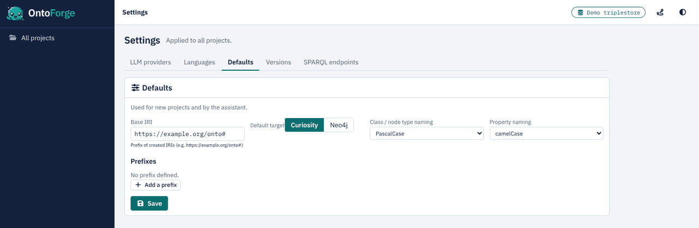
- SPARQL endpoints: several endpoints (name, URL, authentication none / basic / bearer, masked and encrypted secret, default graph, timeout 1-300 s), Test (`ASK {}`), one active at a time, deletion with confirmation.

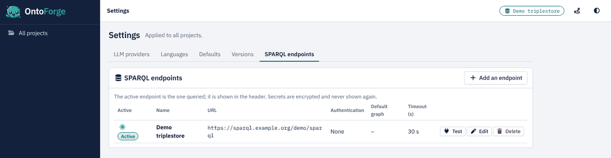

Environment variables (`ONTOFORGE_LLM_PROVIDER`, `ANTHROPIC_API_KEY`...) only initialise `settings.json` on first start.

## 15. Standard and target versions {#versions-des-normes-et-des-cibles}

The Versions screen (Generate step) sets the versions the generators aim for: Neo4j, Cypher, Curiosity.Library, SHACL, SPARQL and RDF. Each version has a status taken from the bundled reference (`standards.json`): recommended, supported, obsolete or end of support. Nothing is read from the Internet.

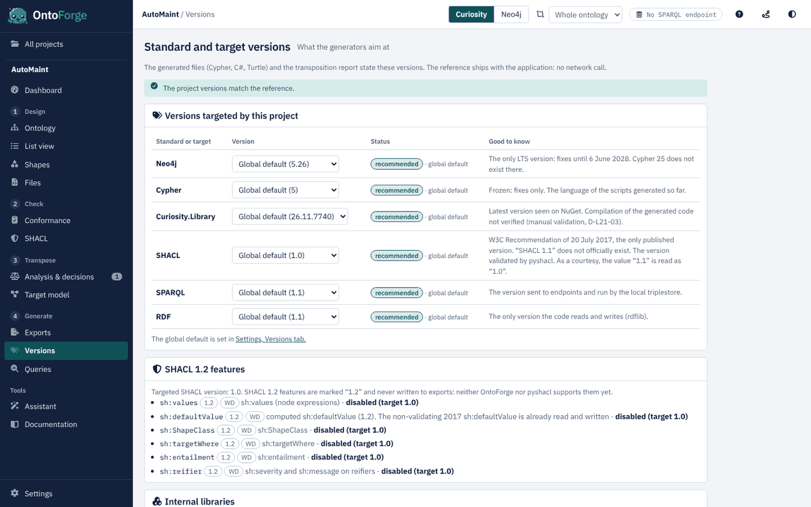

- Global default: Settings, Versions tab. A project that has set nothing follows it, including projects created before this setting existed. The factory values are Neo4j 5.26 (LTS), Cypher 5, Curiosity.Library 26.11.7740, SHACL 1.0, SPARQL 1.1 and RDF 1.1.
- Per project: the selectors on the Versions screen. "Global default" resets a family to the default.
- Effect on the files: for Neo4j, every query in `schema.cypher`, `ingest.cypher` and `validation.cypher` carries the prefix `CYPHER 25` (or `CYPHER 5` on a calendar-versioned database), because this prefix applies only to the query that follows it. Type or relationship constraints missing from an older version are not generated, and the file says so. For Curiosity, the Curiosity.Library version appears in the header of each C# file and in the `dotnet add package` command. The file headers and the transposition report recall the versions used.
- SHACL 1.0: the 2017 W3C Recommendation is the only published version. "SHACL 1.1" does not officially exist. If a "1.1" value arrives (old setting, API), it is read as "1.0".
- SHACL 1.2: its features (`sh:values`, `sh:targetWhere`...) are listed, marked "1.2" and disabled. None is written to the exports.
- What cannot be verified (compatibility of Curiosity.Library with your server, 4.4 syntax, the date of 2026.10.1) is marked `À VÉRIFIER`.

Krakie answers "which versions?" (`quelles versions ?`) and offers an "Open versions" action. "Update the versions" (`mets à jour les versions`) offers to apply the recommended versions, which you confirm with "Apply" (undoable).

When you open a project that has an obsolete or end-of-support version, Krakie announces it once per session in a discreet bubble. "Later" is remembered for that project until the next update of the reference.

## 16. Built-in documentation and help {#documentation-integree-et-aide}

The guide is embedded in the application (L28). You can read it offline and it always matches the installed version, because it is compiled with the front end from `docs/guide/*.md`.

- Open: the Documentation entry in the Tools section of the side menu, or the "?" button in the header of every project screen. The button opens the section that describes the current screen.
- Read: contents on the left (collapsed behind the "Contents" button on mobile), with the list of guide pages above it (user guide, limits, contributing, API, architecture, rules, glossary, changelog). Headings, tables, coloured code blocks and links are rendered. Links to another `.md` file of the guide open the matching page in the screen.
  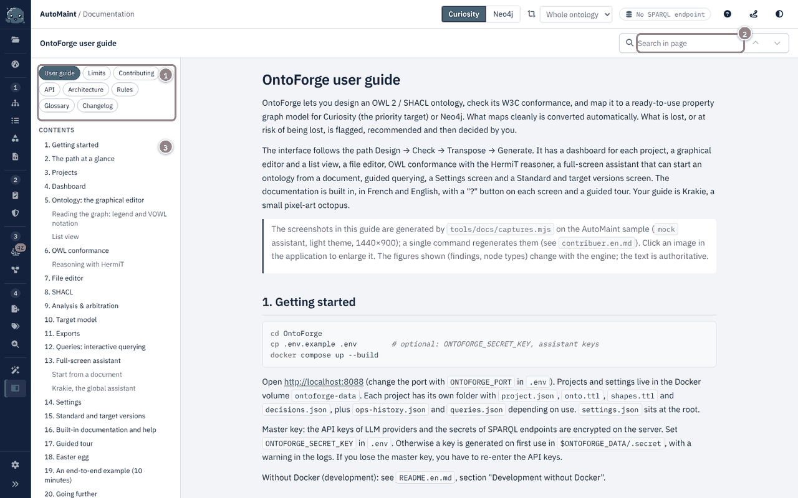
- Search: the search field highlights the matches in the displayed page and shows their count. Enter and Shift+Enter jump to the next or previous one, Esc clears.
- Stable address: `#/projet/<id>/documentation/<page>/<ancre>`. The anchor is written explicitly at the end of each heading of the translated files (`## 8. Analyse & arbitrage {#analyse-arbitrage}`), so it does not change when you renumber or rename a heading. For a heading without `{#id}`, the anchor is the title without accents or section number.
- Language: if an English version of a file exists (`<name>.en.md`), it is shown when the interface is in English. Otherwise the French version is shown with the banner "Documentation available in French only". The user guide, limits, contributing, API and changelog pages exist in English. The French and English files of a page carry the same `{#id}` anchors, so the "?" button and Krakie open the right section in both languages.
- Krakie: the requests `aide`, `comment ça marche ici`, `doc` (in English "help", "how does this work") return a Help card with the title of the section for the current screen, a summary of two or three lines and the "Open help" button.
  
- For maintainers: the mapping from screen to section lives in `backend/ontoforge/assistant/help_map.json`. `backend/tests/test_help_map.py` checks that every anchor exists in the French guide and in its `.en.md` version. A new file in `docs/guide/` shows up in the screen by itself at the next build.

## 17. Guided tour {#visite-guidee}

Krakie can show you around the tool in 20 steps (about 5 minutes). The screen dims, the element being explained gets a teal halo, and a bubble says what it is for. The tour follows the path Design → Check → Transpose → Generate on the automaint demo project.


- Start: the route button ("Guided tour") in the top bar, the "Discover OntoForge" card on the dashboard, or a prompt shown the first time you open a project. With no project open, the tour offers to create the `Démo automaint` demo project.
- Navigate: Previous / Next buttons, or the ← and → keys. Esc or "Skip the tour" closes it, and it will not be offered again (remembered in the browser, key `ontoforge.tour.done`).
- Mobile (under 900 px): the bubble takes the bottom of the screen, full width.
- Direct link: add `?tour=1` to the address, for example `#/projet/<id>/tableau?tour=1`.
- Video recording: `window.ontoforgeTour.start()` (or `start({ demo: true })` to create the demo without asking), `goto(i)`, `next()`, `prev()`, `stop()` and `state()`.

## 18. Easter egg {#easter-egg}

OntoForge hides a small game with Krakie. It has nothing to do with ontology work and touches none of your project data. A discreet hint is hidden in the Settings page: finding it is up to you. The game is played with the keyboard or a finger, pauses by itself when the tab is hidden, respects the "reduce motion" preference and quits with Esc.

## 19. An end-to-end example (10 minutes) {#un-exemple-de-bout-en-bout-10-minutes}

1. Projects → "New project" from automaint; the dashboard opens.
2. Ontology: look at the graph, double-click the background to create a class, Ctrl+Z to undo; create a perimeter from two classes.
3. Conformance: DL conformant, with a few best-practice warnings. SHACL: validate `samples/automaint/automaint-data.ttl`: 4 violations.
4. Analysis: Curiosity target → "Accept all recommendations". Then Target model and Exports: zip and `rapport-transposition.md`.
5. Settings → Endpoints: declare your SPARQL endpoint, after loading `samples/automaint/automaint-demo-data.ttl` into it (40 vehicles, 120 repair orders).
6. Queries: `véhicules réparés par Camille` → adjust the sentence → Run → graph.
7. Assistant: drop a CSV, run the draft, accept two elements, View in editor.

## 20. Going further {#aller-plus-loin}

- Understand a rule: [`regles.en.md`](regles.en.md); vocabulary: [`glossaire.en.md`](glossaire.en.md).
- What the tool does not do (yet): [`limites.en.md`](limites.en.md).
- REST API for automation: [`api.en.md`](api.en.md); modules: [`architecture.en.md`](architecture.en.md).
