# Guide utilisateur — OntoForge (itération 2)

OntoForge permet de **concevoir une ontologie OWL 2 / SHACL**, de **vérifier sa conformité W3C**, puis de la **transposer en modèle property graph** prêt à l'emploi pour **Curiosity** (cible prioritaire) ou **Neo4j**. Ce qui passe tout seul est transposé automatiquement ; ce qui se perd ou risque de se perdre est mis en avant, recommandé, et **arbitré par vous**.

L'interface de l'itération 2 est organisée autour du parcours **Concevoir → Vérifier → Transposer → Générer**, avec un **tableau de bord** par projet, un **éditeur graphique**, un **assistant plein écran**, un écran **Paramètres** et un **requêtage guidé**. Votre guide dans l'interface est **Krakie**, une petite pieuvre en pixel art.

> Captures : `journal/L8/screens/` (Paramètres), `L9/screens/` (éditeur), `L10/screens/` (assistant), `L11/screens/` (tableau de bord), `L15/screens/` (requêtes), prises pendant les lots sur l'exemple AutoMaint (backend `mock`). Les chiffres affichés (constats, types de nœuds) évoluent avec le moteur ; le texte fait foi. Les écrans Analyse, Modèle, Exports, Conformité et SHACL gardent la mise en page de l'itération 1 (captures `journal/L5/screens/`).

## 1. Démarrer

```bash
cd OntoForge
cp .env.example .env        # facultatif : ONTOFORGE_SECRET_KEY, clés de l'assistant
docker compose up --build
```

Ouvrir **http://localhost:8088** (port modifiable avec `ONTOFORGE_PORT` dans `.env`). Les projets et les paramètres sont conservés dans le volume Docker `ontoforge-data` (un dossier par projet : `project.json`, `onto.ttl`, `shapes.ttl`, `decisions.json`, plus `ops-history.json` et `queries.json` selon l'usage ; à la racine : `settings.json`).

**Clé maître** : les clés d'API des fournisseurs LLM et les secrets des endpoints SPARQL sont chiffrés sur le serveur. Renseignez `ONTOFORGE_SECRET_KEY` dans `.env` ; sinon une clé est générée au premier usage dans `$ONTOFORGE_DATA/.secret` (avertissement dans les journaux). Perdre la clé maître oblige à ressaisir les clés d'API.

Sans Docker (développement) : voir `README.md`, section « Développement sans Docker ».

## 2. Le parcours en un coup d'œil

Le menu de gauche (par projet) suit quatre étapes, puis un groupe « Outils » ; **Paramètres** est en bas, hors projet.

| Étape | Écran | Ce que vous faites |
|---|---|---|
| — | **Tableau de bord** | Voir où en est le projet ; suivre la prochaine action proposée par Krakie. |
| 1 Concevoir | **Ontologie** (éditeur graphique), **Vue liste**, **Shapes** (bientôt) | Construire l'ontologie au canvas, à l'inspecteur ou en saisie rapide. |
| 2 Vérifier | **Conformité**, **SHACL** | Profils OWL 2, bonnes pratiques ; shapes et validation de données. |
| 3 Transposer | **Analyse & arbitrage**, **Modèle cible** | Choisir la cible, arbitrer, voir le property graph. |
| 4 Générer | **Exports**, **Requêtes** | Télécharger le code et le rapport ; interroger un endpoint SPARQL. |
| Outils | **Assistant** | Conversation, dépôt de fichiers, proposition à accepter. |

L'en-tête porte, sur chaque écran de projet : le **choix de la cible** (Curiosity / Neo4j), le **périmètre** actif, l'**endpoint SPARQL** actif (« Aucun endpoint SPARQL » sinon) et la bascule de thème (système / clair / sombre). La pastille du menu « Analyse & arbitrage » indique le nombre de constats restant à arbitrer. Sous 900 px de large, le menu devient un tiroir ; sur mobile (< 768 px) l'éditeur est en **consultation** (navigation, sélection, arbitrage) sans édition.

## 3. Projets

Écran d'accueil (`#/`) : liste des projets avec leur résumé (classes, propriétés, shapes, dernière modification, fichiers d'origine). Un projet se renomme (icône crayon) et se supprime avec confirmation.

- **Nouveau projet** : un nom, et au choix un projet vide ou un exemple.
  - **automaint** : maintenance automobile (24 classes, shapes SHACL, données de test) — pour apprendre.
  - **trap** : l'ontologie « piège » qui exerce les 66 règles de transposition — pour tester.
- **Importer** : déposer un fichier. Ontologies : Turtle, RDF/XML (export Protégé), JSON-LD, N-Triples, N3, TriG ; shapes SHACL reconnues à leur contenu. Un fichier **CSV, SQL, texte ou Markdown** déposé est proposé à l'assistant (brouillon d'ontologie).

## 4. Tableau de bord

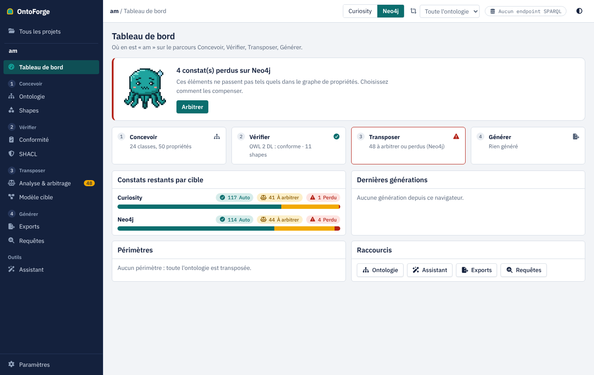

- **Carte de Krakie** : la prochaine action recommandée, selon l'état du projet (ontologie vide, écarts OWL 2 DL, aucune shape, constats perdus, constats à arbitrer, génération absente ou obsolète, ou « tout est bon »). Le bouton mène à l'écran concerné.
- **Quatre étapes** avec leur état (ex. « 24 classes, 50 propriétés », « OWL 2 DL : conforme · 11 shapes », « 48 à arbitrer ou perdus (Neo4j) »).
- **Constats restants par cible** : barres auto / à arbitrer / perdus pour Curiosity et Neo4j.
- **Dernières générations** : lues sur le serveur (`GET /generations`) ; une génération est « obsolète » si le projet a changé depuis.
- **Périmètres** et **raccourcis**.

Exemple de réaction de Krakie : quand il reste des constats perdus, elle prend la pose inquiète ; quand tout est arbitré, la pose contente.

## 5. Ontologie : l'éditeur graphique

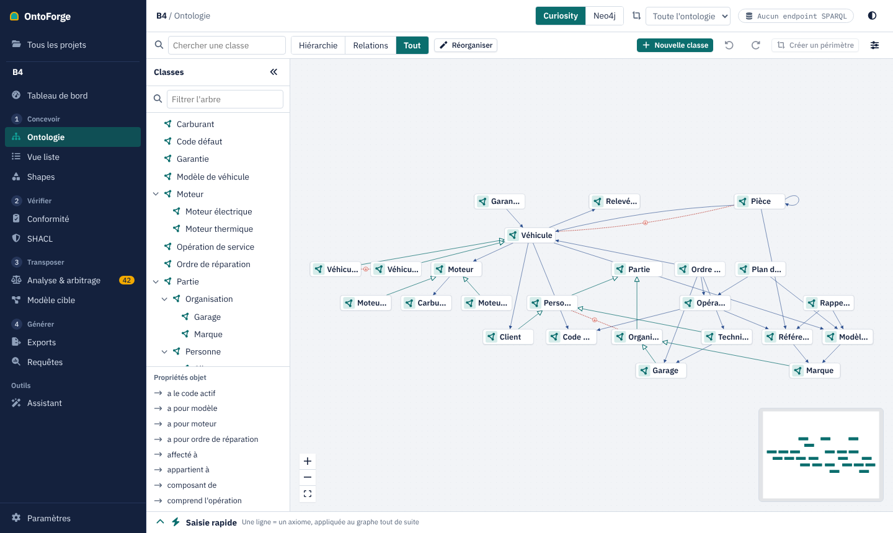

L'écran **Ontologie** est un canvas : arbre repliable à gauche (classes, propriétés objet, filtre), graphe au centre, **inspecteur** à droite (rabattable ; fermé tant que rien n'est sélectionné), **saisie rapide** en bas. L'écran **Vue liste** (menu « Concevoir ») est l'autre façon d'éditer : voir ci-dessous.

**Le graphe.** Chaque classe est un nœud (icône par classe, label dans la langue des labels choisie dans Paramètres, badges *abstrait* / *déprécié*). Arêtes : sous-classe (trait plein, flèche creuse), propriété objet nommée (une seule flèche par paire d'inverses, notée « ⇄ »), disjonction (pointillé rouge, pastille ⟂), équivalence (tirets-points). Filtres **Hiérarchie / Relations / Tout** ; **Réorganiser** relance la disposition automatique (les positions déplacées sont mémorisées) ; zoom, mini-carte, recherche, sélection multiple (Ctrl/Cmd-clic, Maj-glisser). Sous un zoom de 0,6 les nœuds deviennent compacts et les libellés d'arêtes disparaissent (sauf sélection).

**Gestes.**

| Geste | Effet |
|---|---|
| Double-clic sur le fond | Nouvelle classe (saisie en place ; nom local PascalCase, le texte saisi devient le label) |
| Glisser la poignée d'un nœud vers un autre | Menu : sous-classe, nouvelle propriété objet, classes disjointes |
| Double-clic ou F2 sur un nœud | Renommer (label) |
| Suppr | Supprimer (confirmation dans la page) |
| Ctrl+Z / Ctrl+Y (ou Maj+Ctrl+Z) | Annuler / rétablir (200 niveaux) |

Chaque geste est validé côté serveur selon OWL 2 : cycle de sous-classe, disjonction entre une classe et sa super-classe, caractéristiques incompatibles, cardinalité sur une propriété non simple, datatype inconnu… sont **refusés** avec un message (toast + bandeau, nœuds fautifs surlignés en rouge 6 s) et **rien n'est modifié** (tout ou rien).

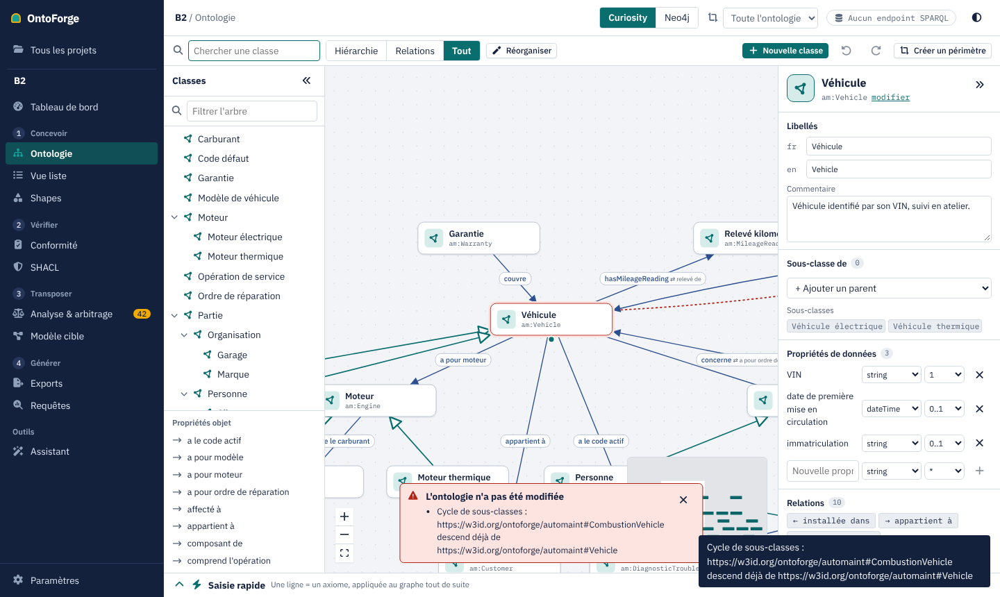

**Inspecteur.** Pour une classe : IRI (renommable partout : ontologie, vue, périmètres, shapes, décisions), labels fr/en, commentaire, parents et enfants, icône (catalogue d'environ 80 icônes), propriétés de données (type et cardinalité ajoutables en ligne), relations, restrictions, clés, disjonctions. Pour une propriété objet : domaine, portée, inverse, caractéristiques.

**Saisie rapide.** Panneau bas, une ligne = un axiome (voir ci-dessous), **Ctrl+Entrée** pour appliquer ; les lignes refusées restent avec leur erreur. Le raccourci « Ajouter une propriété à X » préremplit la ligne. Attention : la saisie rapide n'est **pas annulable** par Ctrl+Z.

```text
@prefix am: <https://w3id.org/ontoforge/automaint#>
Vehicle "Véhicule"@fr "Vehicle"@en
ElectricVehicle < Vehicle
Vehicle.vin : string [1] key "VIN"
RepairOrder -concerns-> Vehicle [1] inverse hasRepairOrder
FuelType : {Diesel, Petrol, Electric}
```

Une même propriété citée avec plusieurs classes en domaine est lue comme une **union** (en RDF pur, plusieurs `rdfs:domain` voudraient dire *intersection*) ; `[1]`, `[0..1]`, `[1..*]` produisent des restrictions de cardinalité (axiomes OWA, pas des contraintes).

**Périmètres.** Un **périmètre** est un sous-ensemble de l'ontologie à transposer (plusieurs par projet). Sélectionnez des classes dans le graphe puis **Créer un périmètre** : le graphe se réduit et le sélecteur de l'en-tête l'active. L'analyse, le modèle et les exports portent alors sur le périmètre ; la transposition ajoute des constats d'information P00 (bilan), P01 (relation exclue), P02 (héritage coupé), P03 (axiome coupé). Les décisions sont partagées entre périmètres. Une classe créée alors qu'un périmètre est actif n'y est pas ajoutée automatiquement.

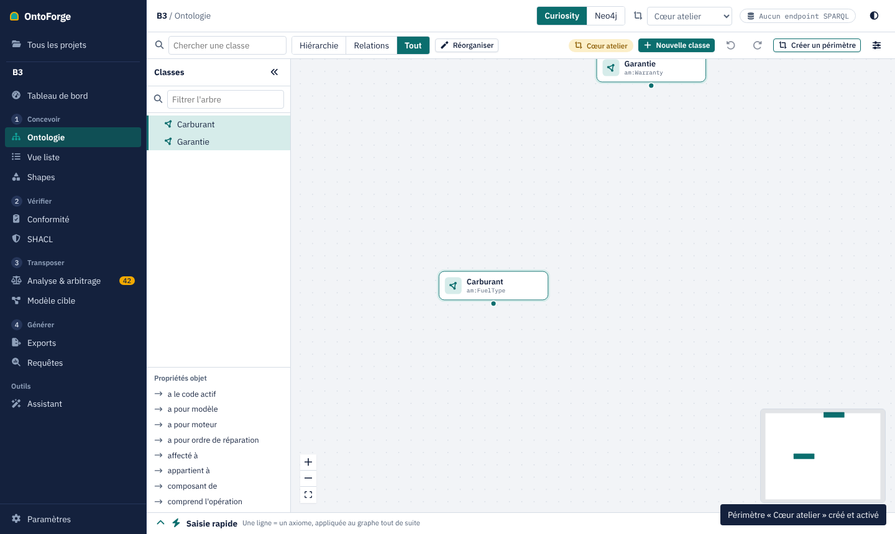

**Proposition de l'assistant dans l'éditeur.** Quand l'assistant a fait une proposition, l'éditeur la montre sur le graphe : nœuds ajoutés en vert (fantômes pointillés), modifiés en orange, avec ✓ / ✕ sur chaque élément, un panneau « Proposition de l'assistant » et **Tout accepter / Tout rejeter**.

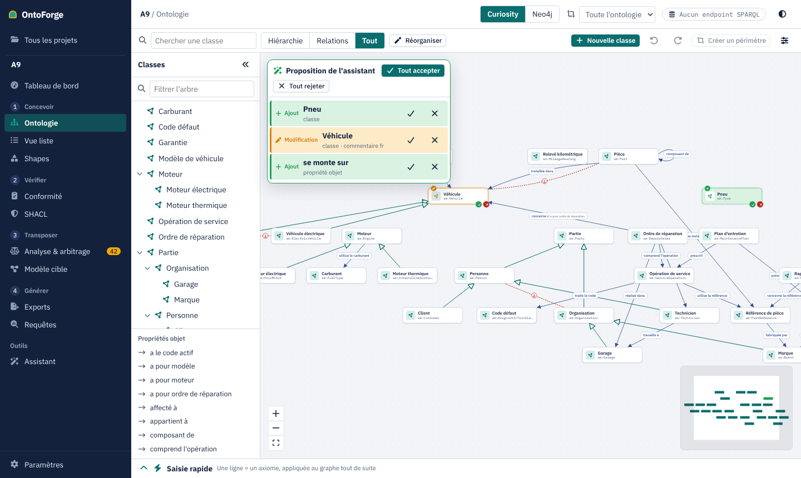

**Éléments en lecture seule** dans l'inspecteur : domaine/portée en union, chaînes de propriétés, équivalences complexes, faits des individus, autres superclasses anonymes. Ils sont conservés et transposés, mais pas modifiables (voir `limites.md`). Les propriétés de données et les équivalences ne sont pas dessinées comme arêtes.

### Vue liste

La **Vue liste** (L17) remplace l'ancien écran arbre + formulaire. Colonne de gauche : recherche, quatre onglets avec compteurs (classes, propriétés objet, propriétés de données, individus), arbre des classes (icône, nombre de propriétés et de sous-classes, classes à plusieurs parents) ; création rapide d'une entrée. À droite, la fiche de l'élément choisi :

- **Classe** : en-tête (icône, IRI compacte copiable et renommable, badges), libellés fr/en côte à côte, hiérarchie, tableau des propriétés (type ou cible, cardinalité lisible, obligatoire, clé, origine propre ou héritée, ajout en ligne d'une donnée ou d'une relation), restrictions en langage naturel (avec ajout), disjonctions et équivalences, clés, utilisation (domaine, portée, restrictions, shapes).
- **Propriété objet** : domaine, portée, inverse, sept caractéristiques en interrupteurs expliqués. **Propriété de données** et **individu** (types, faits) ont leur fiche.
- Les écritures passent par les mêmes opérations validées que l'éditeur graphique. Les individus (création, types) et « une seule valeur » d'une propriété de données passent par une mise à jour directe de l'ontologie.
- Le bouton **Krakie** de l'en-tête ouvre l'assistant avec la classe ou la propriété en contexte. La saisie rapide est repliable (fermée par défaut).
- Sous 900 px : liste ou fiche, avec un bouton retour.

Lecture seule : les faits des individus, les équivalences et expressions complexes.

## 6. Conformité OWL

Écran **Conformité OWL** (bouton « Revérifier ») :

- **Profils** : OWL 2 DL, EL, QL, RL (et RDFS) — chacun est conforme ou non, avec les raisons des écarts.
- **Constats** : `error`, `warning`, `info`, avec code, message, sujet et **référence de spécification** (Structural Specification, Mapping to RDF). Codes W01–W07 (règles OWL 2 DL) et BP01–BP07 (bonnes pratiques : labels manquants, cycles de hiérarchie, nommage…). Un filtre texte permet de retrouver un code ou un sujet.

Exemple : l'exemple *trap* est conforme OWL 2 DL « sous réserve de la fermeture d'import PROV-O » (l'import n'est pas résolu hors ligne, voir BP05).

## 7. SHACL

L'écran **SHACL** (L17) a deux onglets : les shapes et la validation.

**Liste des shapes.** Recherche, groupes par classe cible (avec son icône), nombre de contraintes, état de validation (pas validée / OK / n violations).

**Détail d'une shape.** Titre lisible, IRI compacte, « S'applique à chaque … », shape fermée ou ouverte, sévérité. Une grille aligne, pour chaque propriété : libellé et CURIE, cardinalité en clair, type ou classe, autres contraintes en puces (motif, plage, longueur, liste, nodeKind…), sévérité, message.

**Édition en ligne.** Vous modifiez la cardinalité (préréglages ou valeurs libres), le type ou la classe, la sévérité, le message, le caractère fermé, et vous ajoutez ou supprimez une propriété (celles de la classe d'abord). Une barre « Modifications non enregistrées » enregistre le tout. Les messages sont édités dans la langue de l'interface. Les contraintes motif, plage et liste sont **lisibles mais pas encore éditables** en ligne.

**Générer depuis l'ontologie.** Un **diff** montre d'abord les ajouts (nouvelles shapes, contraintes ajoutées aux shapes existantes) ; les shapes sans contrainte (types, collections) sont écartées et comptées. **Appliquer** les intègre au brouillon, puis **Enregistrer**. L'aperçu utilise `dry_run` : rien n'est enregistré avant (voir `api.md`). La génération indique « ce qu'elle ne reproduit pas à l'identique » (un axiome OWL n'est pas une contrainte SHACL).

**Valider un fichier de données RDF.** Onglet dédié : déposez ou choisissez un fichier. Le contrôle se fait contre les shapes du projet, **sans inférence** par défaut (décision D-034). Les violations sont groupées par shape puis par nœud, avec le type de contrainte en clair ; **Ouvrir la shape** la sélectionne et surligne la contrainte. Avec `automaint-data.ttl`, 4 violations en 3 shapes sont attendues.

**Krakie.** Bouton dans l'en-tête de la shape, suggestions (« Ajoute une contrainte… », « Explique cette shape »), « Pourquoi cette violation ? » sur chaque ligne de violation.

Les shapes enrichissent ensuite la transposition (propriété obligatoire, scalaire, énumération, motif, validations) ; un conflit OWL/SHACL devient un constat S01.

## 8. Analyse & arbitrage

C'est le cœur de l'outil.

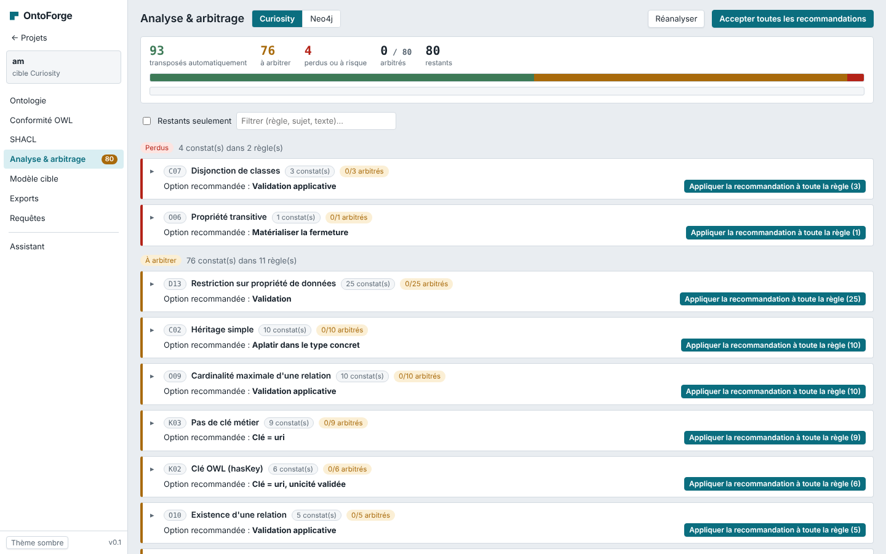

1. **Choisir la cible** (Curiosity ou Neo4j) en haut ; **Réanalyser** relance le moteur.
2. **Synthèse** : « transposés automatiquement », « à arbitrer », « perdus ou à risque », « arbitrés », « restants », avec une barre verte / orange / rouge.
3. **Constats regroupés par règle** (identifiant `C07`, titre, nombre de constats, progression `0/3 arbitrés`, **option recommandée**). Les groupes **Perdus** puis **À arbitrer** sont en tête ; les constats `auto` sont repliés. Filtre texte et case « Restants seulement ».
4. **Décider** :
   - « **Appliquer la recommandation à toute la règle** » : une seule décision groupée (`"<règle>:*"`) ;
   - déplier la règle pour arbitrer **constat par constat** : chaque constat montre le sujet, la justification et les options avec leur impact ;
   - « **Accepter toutes les recommandations** » en haut, puis affiner.
5. Tant que vous n'avez pas décidé, **la recommandation est appliquée** : le modèle et les exports sont toujours complets, mais les points `review` et `lost` restent signalés dans le rapport.

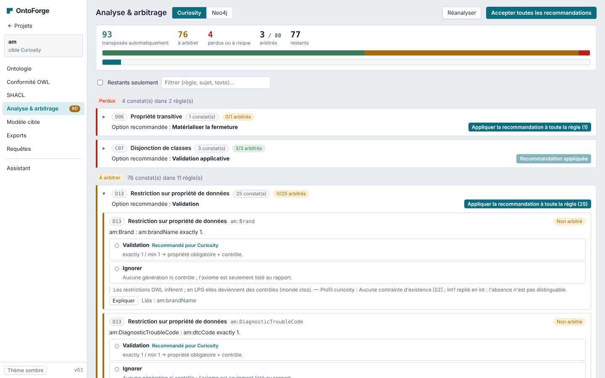

Les décisions sont **enregistrées dans le projet** par cible et rejouées à chaque ré-analyse : modifier l'ontologie ne fait pas perdre les choix déjà faits (les identifiants de constat sont stables : `<règle>:<IRI du sujet>`). Une décision vers une option inexistante pour la cible est ignorée et signalée (G02).

La cible Neo4j propose souvent d'autres recommandations (par exemple multi-labels pour l'héritage, `UNIQUE` / `NODE KEY` pour les clés) :

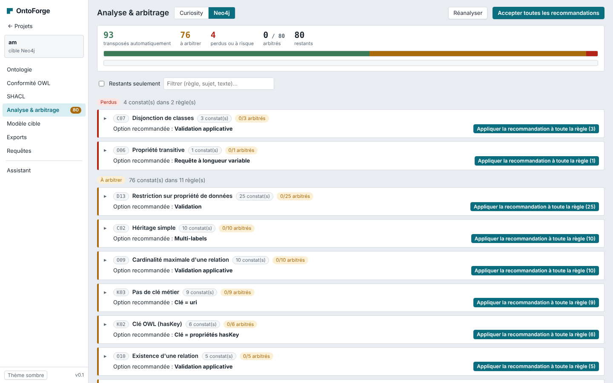

Chaque règle est expliquée, avec exemple OWL et transposition par cible, dans [`regles.md`](regles.md). Le bouton **Expliquer** d'un constat demande à l'assistant de rédiger une explication (repli déterministe sans LLM).

## 9. Modèle cible

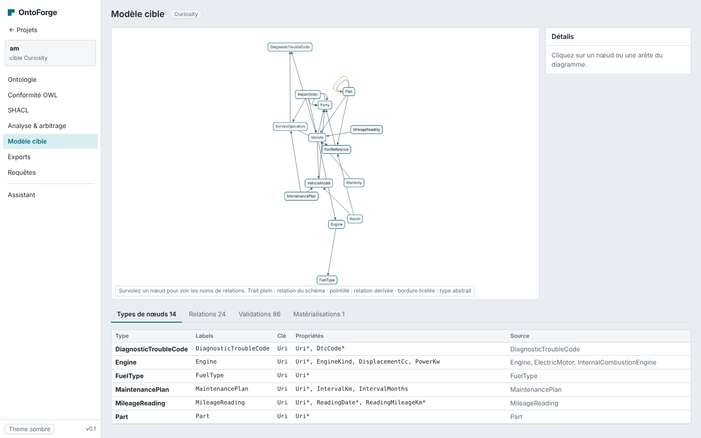

Diagramme du property graph obtenu : **trait plein** = relation du schéma, **pointillé** = relation dérivée (matérialisée), **bordure tiretée** = type abstrait ; survol d'un nœud pour voir les noms de relations. Sous le diagramme, quatre onglets : **Types de nœuds**, **Relations**, **Validations**, **Matérialisations**. Cliquer un nœud ou une arête affiche ses détails dans le panneau de droite : labels, clé, discriminant, propriétés (requis, indexé), source OWL, cardinalité, inverse, symétrie.

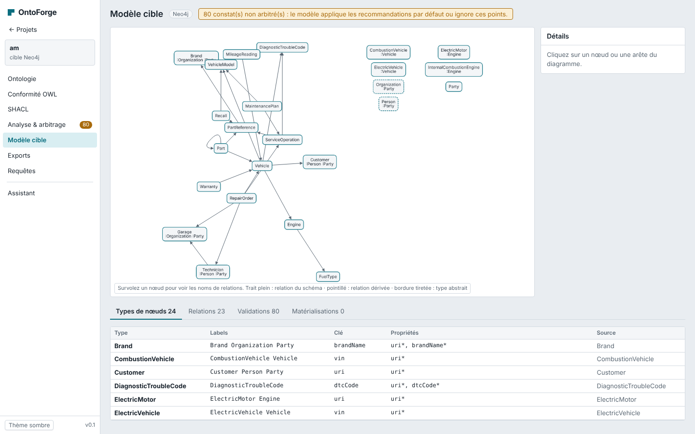

En Neo4j, les nœuds portent plusieurs labels (l'héritage est conservé) ; en Curiosity, un seul.

## 10. Exports

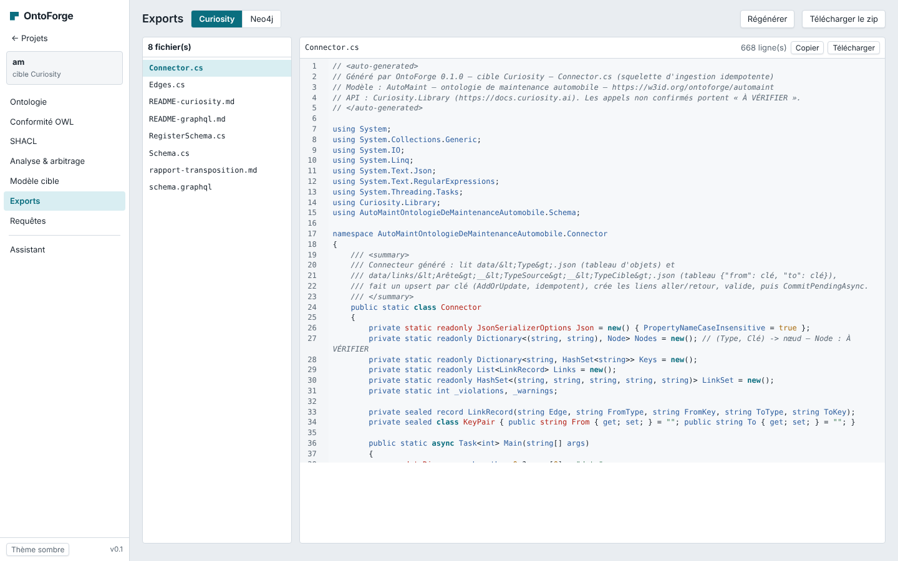

Liste des fichiers générés à gauche, contenu à droite (**Copier**, **Télécharger**) ; **Télécharger le zip** pour tout récupérer ; **Régénérer** après un changement.

| Cible | Fichiers |
|---|---|
| **Curiosity** | `Schema.cs` (types `[Node]`/`[Key]`/`[Property]`), `Edges.cs` (paires d'arêtes aller/retour), `RegisterSchema.cs`, `Connector.cs` (ingestion idempotente), `README-curiosity.md` |
| **Neo4j** | `schema.cypher` (contraintes et index), `ingest.cypher` (`MERGE`), `validation.cypher` (requêtes de détection), `model.mmd` (diagramme Mermaid), `README-neo4j.md` |
| **Les deux** | `schema.graphql`, `README-graphql.md`, **`rapport-transposition.md`** |

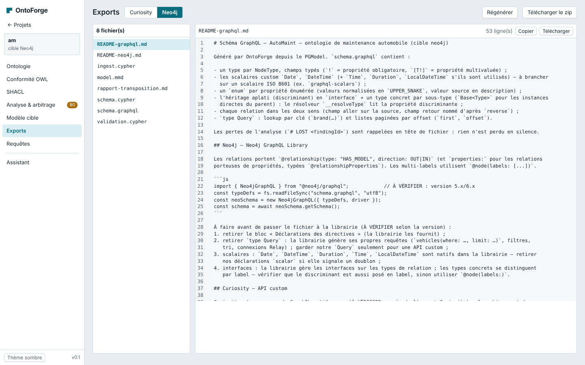

À lire avant d'utiliser le code généré :

- Le **C# Curiosity n'a pas été compilé** (pas de SDK .NET dans l'environnement de construction) : les appels marqués `À VÉRIFIER` sont à confirmer sur votre version de `Curiosity.Library`.
- Le **Cypher n'a pas été exécuté** sur une base réelle. Les contraintes **Enterprise-only** (`NODE KEY`, `IS NOT NULL`, types de propriété) sont séparées et commentées ; en Community, l'unicité (`IS UNIQUE`) est proposée.
- Le **rapport de transposition** liste, par constat, ce qui a été perdu, pourquoi, et la compensation retenue (validation applicative, requête, matérialisation).

## 11. Requêtes : requêtage interactif

L'écran **Requêtes** construit une requête par une **phrase guidée** pilotée par l'ontologie et les shapes, l'exécute sur un **endpoint SPARQL** et traduit la requête pour la cible.

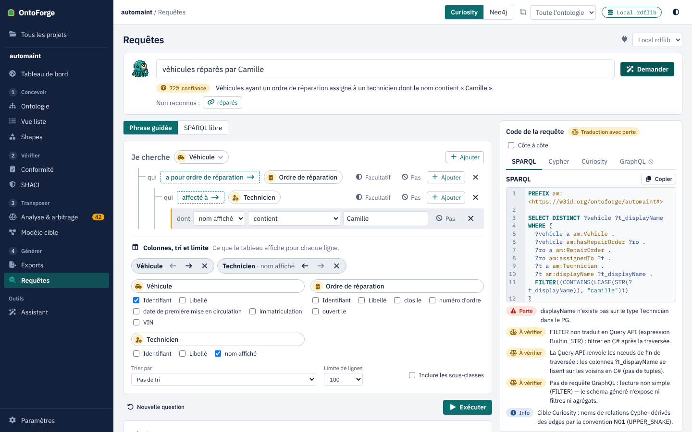

1. **Choisir l'endpoint** : liste en haut à droite (les endpoints se déclarent dans Paramètres) ; un seul est actif à la fois. L'option **+ Endpoint temporaire…** ouvre un formulaire en ligne : URL, authentification (aucune, basic, bearer), secret, graphe par défaut. **Tester** vérifie la connexion, **Utiliser** l'active. Il n'est gardé qu'en mémoire du navigateur (ni stockage local, ni serveur) et disparaît au rechargement ; la case « Enregistrer dans les paramètres » en fait un endpoint permanent. Les mêmes garde-fous s'appliquent (lecture seule, délai, secret jamais renvoyé).
2. **Poser une question en langage naturel** (champ « Pose ta question », bouton **Demander**) : par exemple « véhicules réparés par Camille ». La réponse **remplit la phrase guidée**, que vous pouvez modifier, avec une explication, un indicateur de **confiance** et les **termes non reconnus** (cliquables : ils ouvrent la recherche de relation). Le mode est « llm » si le fournisseur choisi est réel et configuré, sinon un repli **déterministe** (correspondance avec les labels de l'ontologie). Tout ce que le LLM invente (classe, relation, filtre inconnus) est retiré avant affichage.
3. **Ou construire la phrase à la main** : « Je cherche » une classe ; **Ajouter** une relation sortante ou entrante proposée (jamais une relation absurde pour la classe) ; chaque étape peut être **facultative** ou **niée** (« pas ») ; **filtres** selon le type (contient, égal, regex, langue, plage numérique, plage de dates, liste) ; plusieurs branches possibles depuis une même variable.
4. **Colonnes, tri et limite** : choisir et réordonner (flèches) les colonnes (identifiant, libellé, propriétés de données), le tri, la limite (100 par défaut), et « Inclure les sous-classes » (global, utile si l'endpoint ne raisonne pas).
5. **Exécuter** : tableau (tri par colonne, export CSV) ou **graphe**, durée, indication « tronqué ». Lecture seule : toute requête de modification est refusée.
6. **Code de la requête** (colonne de droite) : onglets **SPARQL / Cypher / Curiosity / GraphQL**, case « Côté à côte », notes `Perte` / `À vérifier` / `Info` et **Copier**.
7. **Bibliothèque** : requêtes sauvegardées (exécuter, ouvrir, renommer, supprimer) et **questions de compétence** rejouables en un clic.

**Valeurs possibles (sans endpoint).** L'ontologie suffit à proposer des valeurs (`GET /query/options`) : individus d'une classe énumérée (`owl:oneOf`) ou typée, sous-classes comprises ; individus de la portée d'une propriété objet ; `sh:in` des shapes, `DataOneOf` ou énumération du modèle cible pour une propriété de données. Dans la phrase guidée :
- une étape vers une classe énumérée ou peuplée (40 valeurs au plus) ajoute un filtre **« est l'un de »** à cocher (avec automaint : Diesel, Essence, Hydrogène, Électricité) ; sinon un bouton « est l'un de… » ;
- les filtres texte proposent une **autocomplétion** (ontologie d'abord, puis endpoint s'il y en a un) ;
- les propriétés « parmi » ont aussi une liste à cocher ;
- la classe racine affiche « N connu(s) ».
Avec un endpoint, la liste est complétée par ses valeurs. Limite : l'autocomplétion de libellés mélange les langues (fr et en).

Le mode **SPARQL libre** accepte une requête `SELECT`/`ASK`/`CONSTRUCT`/`DESCRIBE`, la traduit et l'exécute. Sur mobile, seuls la bibliothèque, l'exécution des requêtes sauvegardées et les résultats sont proposés.

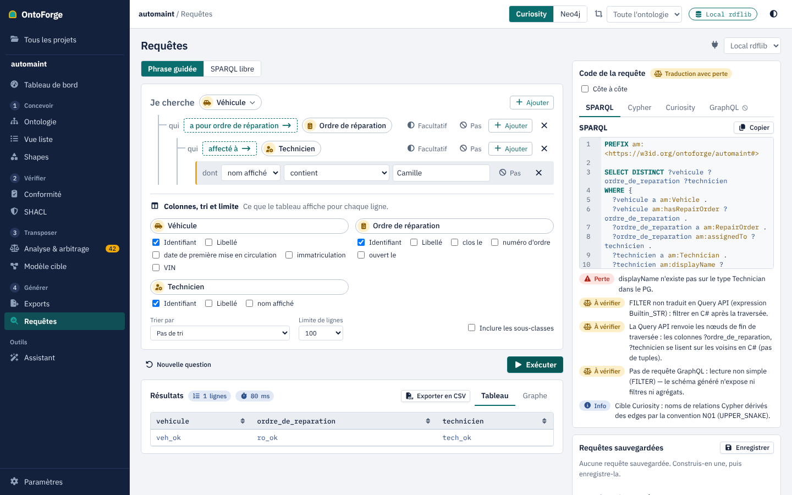

À savoir : les traductions Curiosity relèvent de la Query API, non vérifiée : tout est `À VÉRIFIER` ; la Query API ne renvoie que les nœuds de fin de traversée, donc les colonnes multiples se lisent en C# après coup. Aucun comptage, agrégat ou tri en langage naturel. « Toulouse » est cherché dans le nom affiché (l'ontologie AutoMaint n'a pas de propriété ville).

## 12. Assistant plein écran

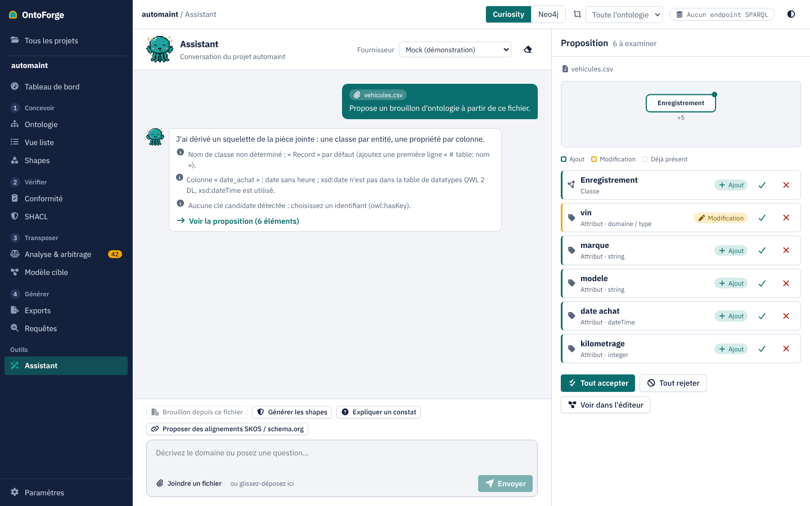

L'**Assistant** (menu « Outils ») est une conversation **par projet** (historique conservé dans le navigateur, 80 messages), avec Krakie en avatar (elle réfléchit pendant l'appel, se réjouit d'une proposition, s'inquiète d'une erreur).

- **Fournisseur** : choisi dans la conversation (liste issue de Paramètres ; le défaut est celui des Paramètres). Si seul `mock` est configuré, une note renvoie vers Paramètres.
- **Dépôt de fichiers** : glisser-déposer ou bouton ; formats **CSV, SQL, texte, Markdown** (2 Mo maximum), avec **aperçu** (colonnes, tables, 20 premières lignes) et retrait possible.
- **Actions rapides** : brouillon d'ontologie depuis le fichier ; shapes (carte « Appliquer » : fusion avec les shapes existantes) ; expliquer un constat ; alignements SKOS / schema.org.
- **Proposition** : affichée à droite en mini-graphe (vert = ajout, orange = modification, pointillé = existant) et en liste ; **✓ / ✕ élément par élément**, Tout accepter / Tout rejeter, **Voir dans l'éditeur**. L'acceptation passe par les mêmes opérations validées que l'éditeur (tout ou rien) et accepte d'abord les classes dont dépend un élément. Rien ne change dans l'ontologie avant votre acceptation (décision D-006). Sur mobile : onglets Conversation / Proposition.

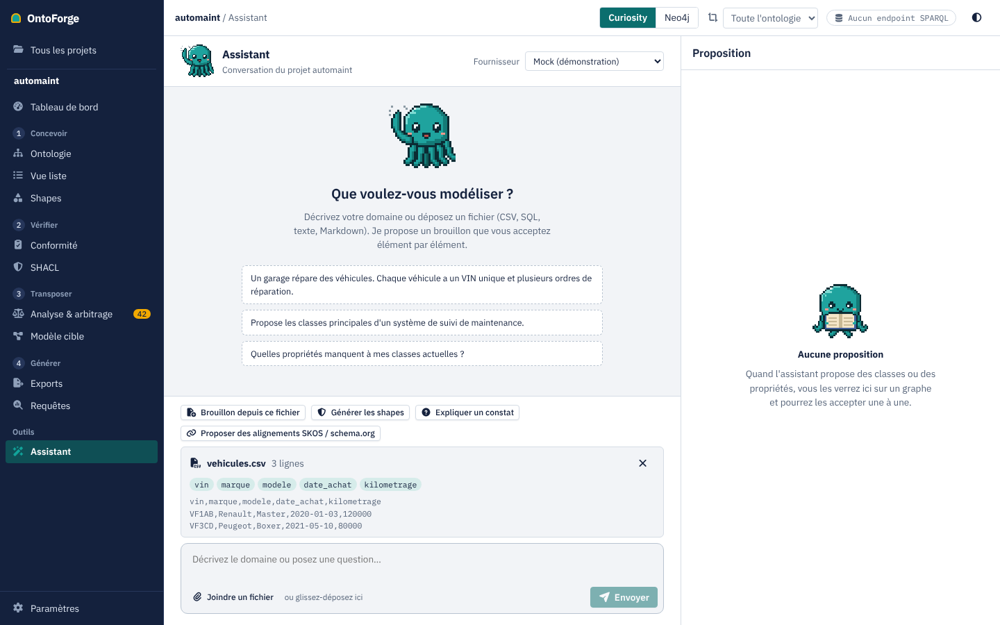

Sans fournisseur réel, le mode `mock` ne renvoie qu'un squelette (domaine automobile pour le texte ; analyseur déterministe pour CSV et SQL).

### Krakie, l'assistant global

Krakie est présente sur tous les écrans du projet (L16), en plus de l'écran plein écran ci-dessus.

- **Ouvrir** : bouton flottant en bas à droite, ou **Ctrl+K** (Cmd+K sur Mac). Le panneau latéral se redimensionne à la souris ou aux flèches gauche/droite sur la poignée ; sous 900 px il passe en plein écran ; il reste ouvert quand vous changez d'écran. Échap dans la zone de saisie le ferme.
- **Contexte** : une ligne « Contexte : [écran] [sélection] » indique ce que Krakie voit. Elle reçoit l'écran, l'élément sélectionné (classe avec ses propriétés et restrictions, shape, propriété) et, dans Requêtes, la requête en cours. Vous pouvez retirer la sélection ou tout le contexte, puis le rétablir. Des puces de suggestions propres à l'écran remplissent la saisie. Les boutons **Krakie** des fiches (Vue liste, Shapes) ouvrent le panneau avec leur élément en contexte.
- **Cartes d'actions** : Krakie ne modifie jamais rien seule. Sa réponse contient des cartes avec un aperçu en français. **Appliquer** exécute les opérations (même chemin validé que l'éditeur) ; **Annuler** défait la modification, mais seulement tant que c'est la dernière. Selon la carte : **Voir dans l'éditeur**, **Ouvrir dans Requêtes** (la requête guidée est chargée dans le constructeur), shapes à appliquer. Une opération invalide ou une référence inconnue est retirée avec un avertissement : rien n'est inventé.
- **Conversation** : partagée avec l'écran Assistant (même historique par projet). Vous choisissez le fournisseur dans le panneau.
- **Intentions comprises sans LLM** (fournisseur `mock` ou non configuré), en français :
  - « ajoute la classe X [sous Y] [avec une propriété p [en unité] [de type T]] » ;
  - « ajoute la propriété p à X » (« cette classe » = la sélection) ;
  - « rends p obligatoire » ;
  - « supprime X » ;
  - « contrainte min / max / motif v sur p dans la shape S » (sur une propriété numérique ou date, min et max deviennent des bornes de valeur) ;
  - « cherche / trouve / liste / combien … » : requête guidée proposée dans Requêtes ;
  - « ouvre les shapes / requêtes / l'éditeur / le tableau de bord / exports / analyse / conformité / paramètres ».
  Toute autre phrase retombe sur l'ancien chat (proposition automobile du mock).
- **Avec un fournisseur réel**, le modèle propose des actions (opérations, proposition, shapes, requête guidée, navigation) validées de la même manière. Ce chemin n'a pas été éprouvé sur un vrai modèle (voir `limites.md`).

## 13. Paramètres

Route globale `#/parametres` (engrenage en bas du menu), quatre onglets ; chaque onglet s'enregistre explicitement (« Enregistré »).

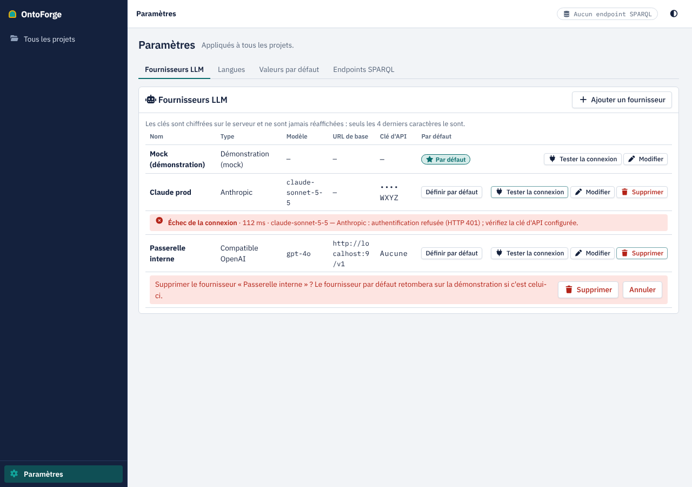

- **LLM** : un tableau de fournisseurs (nom, type, modèle, URL, clé affichée « •••• abcd »). Types : `anthropic`, `openai_compat` (Azure OpenAI, vLLM, LM Studio…), `ollama`, `mock` (toujours présent, non supprimable). Un fournisseur **par défaut**, un bouton **Tester** (latence, modèle, message ; 15 s). La clé est **chiffrée sur le serveur et jamais renvoyée au navigateur** : on ne peut que la remplacer ou la supprimer. Pour tester un nouveau fournisseur, enregistrez-le d'abord.
- **Langues** : interface (fr/en, appliquée immédiatement), langue des labels (affichage du graphe et des listes), langue de l'assistant.
- **Défauts** : IRI de base (utilisée par l'assistant pour ses brouillons), préfixes (table éditable), cible par défaut, conventions de nommage.
- **Endpoints SPARQL** : plusieurs endpoints (nom, URL, authentification aucune / basic / bearer, secret masqué et chiffré, graphe par défaut, délai 1-300 s), **Tester** (`ASK {}`), **un actif à la fois**, suppression confirmée.

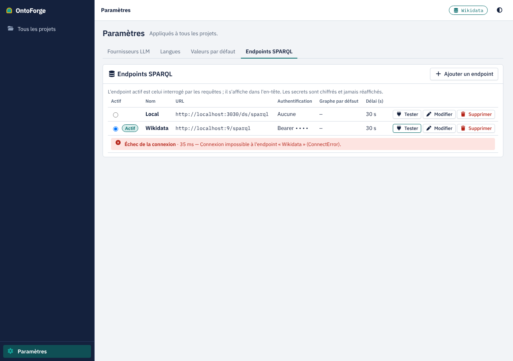

Les variables d'environnement (`ONTOFORGE_LLM_PROVIDER`, `ANTHROPIC_API_KEY`…) ne servent qu'à **initialiser** `settings.json` au premier démarrage.

## Visite guidée

Krakie peut vous faire le tour de l'outil en 18 étapes (environ 5 minutes) : l'écran s'assombrit, l'élément expliqué est entouré d'un halo teal et une bulle dit à quoi il sert. La visite suit le parcours Concevoir → Vérifier → Transposer → Générer sur le projet de démo automaint.

- **Lancer** : bouton route (« Visite guidée ») dans la barre du haut, carte « Découvrir OntoForge » du tableau de bord, ou proposition affichée à la première ouverture d'un projet. Sans projet ouvert, la visite propose de créer le projet de démo « Démo automaint ».
- **Naviguer** : boutons Précédent / Suivant, ou touches ← et →. Échap ou « Passer la visite » ferme la visite ; elle ne se reproposera plus (mémorisé dans le navigateur, clé `ontoforge.tour.done`).
- **Mobile** (moins de 900 px) : la bulle occupe le bas de l'écran, sur toute la largeur.
- **Lien direct** : ajouter `?tour=1` à l'adresse, par exemple `#/projet/<id>/tableau?tour=1`.
- **Enregistrement vidéo** : `window.ontoforgeTour.start()` (ou `start({ demo: true })` pour créer la démo sans demander), `goto(i)`, `next()`, `prev()`, `stop()` et `state()`.

## 14. Un exemple de bout en bout (10 minutes)

1. **Projets** → « Nouveau projet » depuis **automaint** ; le **tableau de bord** s'ouvre.
2. **Ontologie** : repérer le graphe, double-cliquer sur le fond pour créer une classe, Ctrl+Z pour annuler ; créer un **périmètre** depuis deux classes.
3. **Conformité** : conforme DL ; quelques avertissements de bonnes pratiques. **SHACL** : valider `samples/automaint/automaint-data.ttl` : 4 violations.
4. **Analyse** : cible Curiosity → « Accepter toutes les recommandations ». **Modèle cible** puis **Exports** : zip et `rapport-transposition.md`.
5. **Paramètres** → Endpoints : déclarer votre endpoint SPARQL ; y charger au préalable `samples/automaint/automaint-demo-data.ttl` (40 véhicules, 120 ordres de réparation).
6. **Requêtes** : « véhicules réparés par Camille » → ajuster la phrase → Exécuter → graphe.
7. **Assistant** : déposer un CSV, lancer le brouillon, accepter deux éléments, **Voir dans l'éditeur**.

## 15. Aller plus loin

- Comprendre une règle : [`regles.md`](regles.md) ; vocabulaire : [`glossaire.md`](glossaire.md).
- Ce que l'outil ne fait pas (encore) : [`limites.md`](limites.md).
- API REST pour automatiser : [`api.md`](api.md) ; modules : [`architecture.md`](architecture.md).
